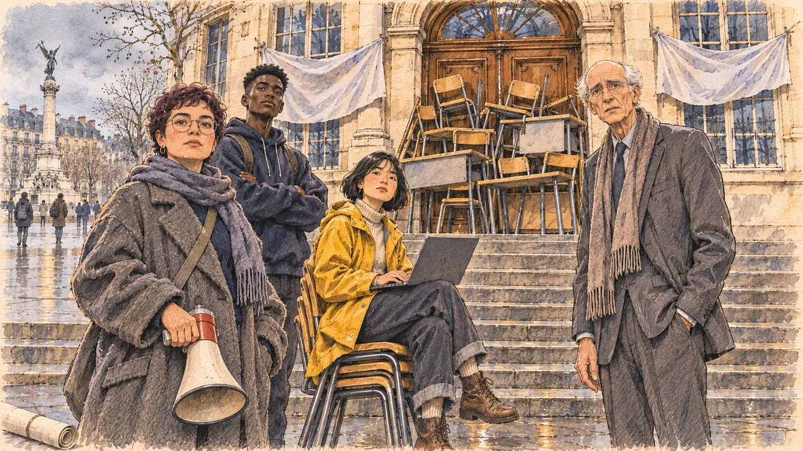

# `campusBlockade` · Université bloquée

**Validée par le PO le 27/11/2026**, au premier essai. Elle sert telle quelle en clair et en sombre.



| Champ | Valeur |
| --- | --- |
| Carte | `campusBlockade`, catégorie `field` (Rencontre), poids 0,2 ; carte ajoutée avec Gaza dans la campagne (Mitchnsun/moi-president#563) |
| Style | Reportage dessiné, trait et texture de `primeTime` |
| Ton | Observateur, matin gris |
| Date | 2026-11-27 |
| Outil | ChatGPT Images |
| Format rendu | 1672 × 941 (16:9) : export en 1290 × 726 px, WebP de qualité 75, 234 Ko, sans recadrage |
| Fichier d'origine | Image de ChatGPT, chez le PO. L'export du dépôt a été fait depuis la copie partagée dans la conversation avec Claude |
| Première édition | La prochaine Release qui suit le merge de Mitchnsun/moi-president#563 |

## Texte de la carte

> **Université bloquée**
>
> Des étudiantes et étudiants bloquent une université pour réclamer la fin des partenariats avec des établissements israéliens. Votre conférence y était prévue ce matin.

Ses réponses : aller débattre avec les étudiants ; demander l'évacuation du bâtiment ; reporter la conférence ; soutenir leur mobilisation.

## Le moment choisi

Bordeaux, un matin gris et mouillé, devant un bâtiment universitaire de pierre blonde dont la porte est barricadée de tables et de chaises empilées, des draps vierges aux fenêtres ; au fond, la colonne d'un monument de la ville. Le candidat du joueur est hors champ, au pied des marches : le programme roulé de sa conférence au premier plan. La porte-parole des étudiants, mégaphone baissé, le regarde ; derrière elle, un étudiant bras croisés et une étudiante assise sur une chaise, son ordinateur sur les genoux ; à droite, le président de l'université attend, inquiet.

## Prompt complet

Dans une nouvelle conversation, avec [`primeTime.webp`](../../illustrations/media/primeTime.webp) comme seule image de référence :

```
Use the attached image as the style reference and copy its drawing: a realistic reportage drawing made on the spot for a newspaper, with quick, nervous pencil lines, often drawn twice, ink hatching in the shadows, transparent watercolour washes that spill a little over the lines, and the warm paper showing through. Take from the reference its line, its washes and its paper, not the finish of the presenter's face, which is the most finished and almost photographic part of it: every face here stays a drawing. Not the same scene and not the same people: never reuse the face or the hair of the woman in the reference.
Like in the reference, the setting can be full when the story needs it, with the things that say where we are and what is happening, but each one is sketched with a few pencil lines and a light wash, never rendered or finished, and the drawing gets looser and paler towards the edges until it fades into the bare paper.
This must look like a drawing made by hand on paper by a press illustrator, halfway between a quick sketch and a realistic picture: never a photograph, a film poster or a digital painting, and never a cartoon, a comic strip, a caricature or a children's book illustration. Continuous lines, never dotted or dashed outlines; the fine mottled grain of the reference is welcome, as long as the pencil lines and the washes stay clearly visible under it, but never a heavy texture, an oil-paint look or a hatching filter laid over a finished picture; no glossy highlights, no smooth gradients, in the sky and on the walls too. Colour can be rich in places, on a piece of clothing, a light or a flag, but it stays transparent and within the palette below. The fade into the paper at the edges stays narrow, without a wide white margin. No blur and no depth-of-field effect: everything, the foreground included, is drawn sharp, like a sketch made on the spot.
People are drawn from life with realistic anatomy and proportions: each face is drawn with the same visible pencil and ink lines, hatching and transparent washes as the clothes and the room, looser and sketchier than the presenter's face in the reference, with realistic features but never photographic (no photographic skin, no smooth shading, no airbrushed or digital-painting look). Expressions stay natural and restrained, even in laughter or tears: no exaggerated grins, no wide-open mouths full of teeth, no rubbery or cartoonish faces.

Editorial illustration, landscape 16:9 (1536 × 864 px), the scene filling the frame, with only a light fade into the paper at the edges. A grey winter morning in 2027 in front of a university building on the place de la Victoire in Bordeaux, France: a classical façade of pale blond stone with tall windows, a few steps up to a large wooden door, and the door blocked by a barricade of stacked tables and chairs. The player's candidate stays off-camera, standing at the foot of the steps, the scene seen from where they stand: in the bottom-left foreground, only a rolled-up printed programme of the lecture held in front of them, unreadable. In the left third, on the steps, the main character, the students' spokesperson, a woman of about twenty-one, white, short and round, short hair dyed a dark plum colour, round glasses, an oversized grey wool coat, holds a megaphone lowered at her side, with no logo, and looks straight at the viewer, open but firm, her face above mid-height. Behind her, at the barricade, a tall young man of about twenty-two of Senegalese origin, very slim, a short high-top haircut, a dark blue hoodie, stands with his arms crossed, looking at the viewer; and a young woman of about twenty of Korean origin, a black bob cut, a yellow raincoat, sits on a stacked chair with a laptop on her knees, glancing up at the viewer. On the right, at the bottom of the steps, the university's president, a man in his sixties, white, tall and thin, a bald head with a white fringe, a grey suit and a scarf, waits, worried, looking at the viewer. A few bedsheet banners hang from the windows with lettering that cannot be read; no flags. Nothing on the banners, the programme, the laptop or the façade is readable.

Style: Reportage drawing made on the spot, like a press illustrator or courtroom sketch artist: pencil and ink with loose watercolour washes, lively unfinished lines, white paper showing through.

Palette: navy #13203F, vellum #F5EFE1, gold #A9802A, brick #B5523B, ochre #D9A441, sage #8FA58A, slate #5E7186, sand #DCC8A4, warm grey #8C8279; use 4 to 6 of them, subtle warm paper grain.

Tone: observant and neutral, grey morning light, soft shadows.

Constraints: realistic proportions, natural expressions, never cartoonish or caricatured faces, drawn like the rest of the illustration and never photographic; people of varied ages, genders, origins and body types (heavy, stocky, round, tall, short, wiry, not only slim), each with a distinct face and haircut (no two people alike), drawn with respect and never as a joke; each person's age, build and look plausible for their job and the scene (working people of working age, students of student age), no stereotype tying an origin or a gender to a role, and no person of colour shown alone in a featured service or deferential role; anatomically correct hands with exactly five fingers, few hands visible, the others in pockets, behind objects or out of frame; no readable text anywhere (the banners, the programme, the laptop and the façade stay unreadable); no captions or speech bubbles; no logos or political party colours; no flags, no keffiyeh, no religious or national symbol; no recognisable real person, no lookalike of a real politician or of a known university president; no violence, nobody aggressive; no photographic rendering, no blur or bokeh, no dotted outlines, no heavy texture or hatching filter over a finished picture (the fine grain of the reference is fine), no oil-paint texture, no wide white margin or frame (a light fade into the paper at the edges is fine).

Format: if 16:9 is not available, make 1536 × 1024 and keep the top 80 px and the bottom 80 px free of anything important (faces, hands, the main action): they will be cropped.
```

## Décisions prises sur cette image

- Le programme roulé du candidat est posé au sol, en bas à gauche, et non tenu : gardé.
- La colonne au fond, à gauche, est celle d'un monument de Bordeaux (un monument réel est permis) ; elle n'est pas sur la place de la Victoire, que le prompt nommait : gardé.

## Essais écartés

Aucun.

## Retouches

Aucune.

## Relecture

Faite par Claude le 27/11/2026 et validée par le PO le même jour.

- [x] Aucun texte lisible : les draps aux fenêtres sont vierges, l'ordinateur est vu de dos, le programme est roulé.
- [x] Aucun drapeau, aucun symbole religieux ou national.
- [x] Aucun sosie d'une personne réelle relevé.
- [x] Le candidat du joueur est hors champ ; seul son programme roulé est au premier plan.
- [x] Mains sans défaut visible (le mégaphone, l'ordinateur, les bras croisés).
- [x] Aucune couleur ni aucun logo de parti. Des personnes variées par l'âge, le corps, l'origine et la coiffure.
- [x] En 16:9 : pas de recadrage.
- [ ] Lisible sur la page de l'événement, en clair et en sombre : à voir dans l'app.
