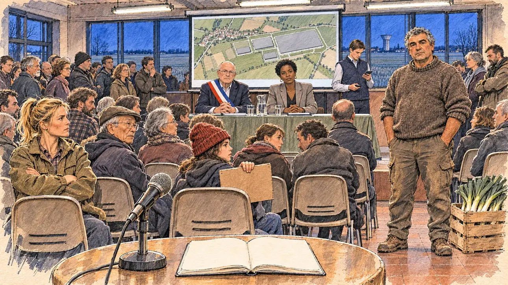

# `campusFarmland` · Un campus de calcul dans les champs

**Retenue par le PO le 18/11/2026**, au quatrième essai. Elle sert telle quelle en clair et en sombre.



| Champ | Valeur |
| --- | --- |
| Carte | `campusFarmland`, catégorie `field` (Rencontre), poids 0,15, toute semaine, un peu plus souvent pour une position écologiste (`leaning`, écologie 0,3) ; exclut `nightGenerators` (Mitchnsun/moi-president, PO, 17/11/2026) |
| Style | Reportage dessiné |
| Ton | Tendu sans éclat, néons d’une salle des fêtes un soir d’hiver |
| Date | 2026-11-18 |
| Outil | ChatGPT Images, à compléter (modèle et effort) |
| Conversation | À compléter |
| Format rendu | 1672 × 941 (16:9) : export en 1290 × 726 px, WebP de qualité 75, 250 Ko, sans recadrage, fait depuis la copie WebP de la conversation (à refaire depuis le PNG d'origine) |
| Fichier d'origine | À compléter (hors du dépôt) |
| Première édition | À compléter |

## Texte de la carte

> **Un campus de calcul dans les champs**
>
> Dans une commune de la plaine, un campus de calcul de plusieurs gigawatts doit recouvrir des dizaines d'hectares de terres cultivées. La salle de la réunion publique est pleine : d'un côté un maraîcher bio et ses voisins, de l'autre des élus qui parlent de centaines d'emplois. Tout le monde attend ce que vous direz.

## Le moment choisi

La salle des fêtes d'un village de la Beauce, un soir de février : chaises empilables toutes prises, du monde debout au fond, et par les fenêtres la plaine de blé d'hiver à perte de vue et un château d'eau. Sur l'écran, le promoteur projette un plan vu du ciel : de grands rectangles gris posés sur les champs, sans un mot. Le candidat reste hors champ : seul son micro sur pied et son carnet ouvert, au premier plan. Le maraîcher bio, debout au premier rang, une cagette de poireaux à ses pieds, le regarde et attend sa réponse ; derrière la table de l'estrade, le maire ceint de son écharpe et un élu du département guettent eux aussi. Des voisins tiennent des pancartes retournées, une agricultrice croise les bras, le représentant du promoteur garde sa télécommande en main. Les précédents sont le campus de Seine-et-Marne et ses 90 hectares, et la pétition de 47 000 signatures : personne n'y ressemble à un élu ou à un promoteur réel.

## Prompt complet

Dans une nouvelle conversation, avec [`primeTime.webp`](../../illustrations/media/primeTime.webp) comme seule image de référence :

```
Use the attached image as the style reference and copy its drawing: a realistic reportage drawing made on the spot for a newspaper, with quick, nervous pencil lines, often drawn twice, ink hatching in the shadows, transparent watercolour washes that spill a little over the lines, and the warm paper showing through. Not the same scene and not the same people: never reuse the face or the hair of the woman in the reference.
Like in the reference, the setting can be full when the story needs it, with the things that say where we are and what is happening, but each one is sketched with a few pencil lines and a light wash, never rendered or finished, and the drawing gets looser and paler towards the edges until it fades into the bare paper.
This must look like a drawing made by hand on paper by a press illustrator, halfway between a quick sketch and a realistic picture: never a photograph, a film poster or a digital painting, and never a cartoon, a comic strip, a caricature or a children's book illustration. Continuous lines, never dotted or dashed outlines; no uniform texture, speckles or hatching filter laid over the picture; no glossy highlights, no smooth gradients, in the sky and on the walls too. Colour can be rich in places, on a piece of clothing, a light or a flag, but it stays transparent and within the palette below. The fade into the paper at the edges stays narrow, without a wide white margin. No blur and no depth-of-field effect: everything, the foreground included, is drawn sharp, like a sketch made on the spot.
People are drawn from life with realistic anatomy and proportions, like in the reference: faces shaped with pencil lines, hatching and light washes, a little more finished than the background but never photographic (no photographic skin, no airbrushed or digital-painting look). Expressions stay natural and restrained, even in laughter or tears: no exaggerated grins, no wide-open mouths full of teeth, no rubbery or cartoonish faces.

Editorial illustration, landscape 16:9 (1536 × 864 px), the scene filling the frame, with only a light fade into the paper at the edges. A packed village hall in the Beauce, the flat cereal plain south-west of Paris, on a winter evening in February 2027: rows of stackable chairs all taken, people standing at the back, cold neon light; through the tall windows, flat fields of winter wheat to the horizon and a concrete water tower. On a projection screen, the developer's aerial plan shows large grey rectangles laid over the fields, with no text at all. The player's candidate stays off-camera: in the foreground, only the candidate's microphone on its stand and an open notebook on a small table. In the right third, standing in the front row, an organic market gardener in his fifties of Portuguese descent, stocky and broad-shouldered, with weathered cheeks, short grey curly hair and a rough wool jumper, a crate of leeks at his feet, looks straight at the viewer and waits for an answer, his face above mid-height. On the platform behind a table covered with a cloth: the mayor, a round white man in his sixties, bald with rimless glasses, in a dark jacket with a tricolour sash, and a councillor of the département, a tall woman in her forties of Senegalese descent with short natural hair and a grey blazer, both turned towards the viewer too. Near the screen, the developer's representative, a lean young man with neatly parted brown hair and a navy quilted gilet, holds a remote and checks his phone. Among the residents: a farmer in her thirties with a blond ponytail and a canvas work jacket, arms crossed; an elderly man of Vietnamese descent with a flat cap; a teenage girl with a red knitted beanie holding a sign turned so it shows only its blank cardboard back. Only the market gardener, the mayor and the councillor look at the viewer; the others watch the platform or each other. Nothing on the screen, the signs, the notebook or the phone is readable.

Style: Reportage drawing made on the spot, like a press illustrator or courtroom sketch artist: pencil and ink with loose watercolour washes, lively unfinished lines, white paper showing through.

Palette: navy #13203F, vellum #F5EFE1, gold #A9802A, brick #B5523B, ochre #D9A441, sage #8FA58A, slate #5E7186, sand #DCC8A4, warm grey #8C8279; use 4 to 6 of them, subtle warm paper grain.

Tone: tense but quiet, the cold neon light of a village hall on a winter evening against the deep blue dusk over the fields in the windows; the grey rectangles of the plan on the screen echo the open fields outside.

Constraints: realistic proportions, natural expressions, never cartoonish or caricatured faces, drawn like the rest of the illustration and never photographic; people of varied ages, genders, origins and body types (heavy, stocky, round, tall, short, wiry, not only slim), each with a distinct face and haircut (no two people alike), drawn with respect and never as a joke; each person's age, build and look plausible for their job and the scene (working people of working age), no stereotype tying an origin or a gender to a role, and no person of colour shown alone in a featured service or deferential role; anatomically correct hands with exactly five fingers, few hands visible, the others in pockets, behind objects or out of frame; no readable text anywhere (the screen, the signs, the notebook, the phone and the cloth stay unreadable, no slogans, no company name, no town name); no captions or speech bubbles; no logos, no tech company logo, no television channel logo, no political party colours, no flags other than the mayor's tricolour sash; no recognisable real person, no lookalike of a real politician, of a real mayor or of a real tech executive; no explicit violence, no one shouting with a wide-open mouth; no photographic rendering, no blur or bokeh, every outline a continuous pencil or ink line with no dotted or dashed outlines, no mottled, crackled or speckled texture over the faces, the clothes, the walls, the fields or the sky, no hatching filter over the picture, no oil-paint texture, no glow or halo, no wide white margin or frame (a light fade into the paper at the edges is fine).

Format: if 16:9 is not available, make 1536 × 1024 and keep the top 80 px and the bottom 80 px free of anything important (faces, hands, the main action): they will be cropped.
```

## Décisions prises sur cette image

Retenue par le PO (18/11/2026) pour son regard : le maraîcher et la conseillère fixent le spectateur, comme le prompt le demande. Son rendu est plus fini que la référence, une peinture presque photographique sous une texture de hachures, celui que le gabarit appelle une dérive ; le PO l'a préférée aux deuxième et troisième essais, au trait juste mais au regard qui passe au-dessus du spectateur. Une table ronde remplace la petite table du premier plan ; les deux hommes en casquette plate, à gauche et à droite, ont des visages différents.

## Essais écartés

- **Essai 1** (18/11/2026), au prompt complet : la composition et le regard justes, le rendu presque photographique sous un filtre de hachures et de craquelures.
- **Essai 2** (18/11/2026), au message de correction ci-dessous : le rendu de la référence, traits d'encre et lavis clairs, la scène redessinée ; le maraîcher regarde au-dessus du spectateur, la conseillère en l'air.
- **Essai 3** (18/11/2026), au second message ci-dessous : presque identique à l'essai 2, les regards inchangés.

### Messages de correction

Après l'essai 1, dans la même conversation :

```
Keep the same scene, the same people, the same places and the same poses, but match the rendering of the reference image much more closely: a quick reportage drawing on warm paper, pencil and ink lines, loose watercolour washes, plenty of white paper showing through, lighter and less saturated overall; no photographic rendering, no hatching filter over a finished digital painting; every face is drawn like the clothes, with an ink outline, a few hatching strokes and flat watercolour washes. Every outline is a continuous pencil or ink line: no dotted or dashed outlines anywhere, and no mottled, crackled or speckled texture laid over the faces, the clothes, the chairs or the fields. Everything else stays the same: nothing readable, exactly five fingers on every visible hand.
```

Après l'essai 2 :

```
Keep exactly the same picture, rendering and people; only change the gaze: the market gardener on the right and the councillor at the table look straight at the viewer, waiting for an answer.
```

L'essai 4, retenu, est une nouvelle génération, à compléter (nouvelle conversation ou même conversation, et le message envoyé).

## Retouches

Aucune.

## Relecture

Faite le 18/11/2026, à confirmer par le PO.

- [x] Aucun texte lisible : le plan ne montre que des parcelles, des maisons et des rectangles gris ; carnet vierge, pancarte retournée, téléphone illisible.
- [x] Aucun sosie d'une personne réelle repéré.
- [x] Le candidat du joueur est hors champ : seuls son micro et son carnet, au premier plan.
- [x] Mains et visages sans défaut visible à 343 px de large : bras croisés de l'agricultrice, mains jointes du maire et de la conseillère, mains dans les poches du maraîcher, mains de la lycéenne sur la pancarte.
- [x] Aucune couleur, aucun logo ni aucun drapeau de parti ; seule l'écharpe tricolore du maire. Des personnes variées par l'âge, le corps, l'origine et la coiffure.
- [x] En 16:9 : pas de recadrage.
- [ ] Lisible sur la page de l'événement, en clair et en sombre : à vérifier dans l'app, une fois la carte publiée.
