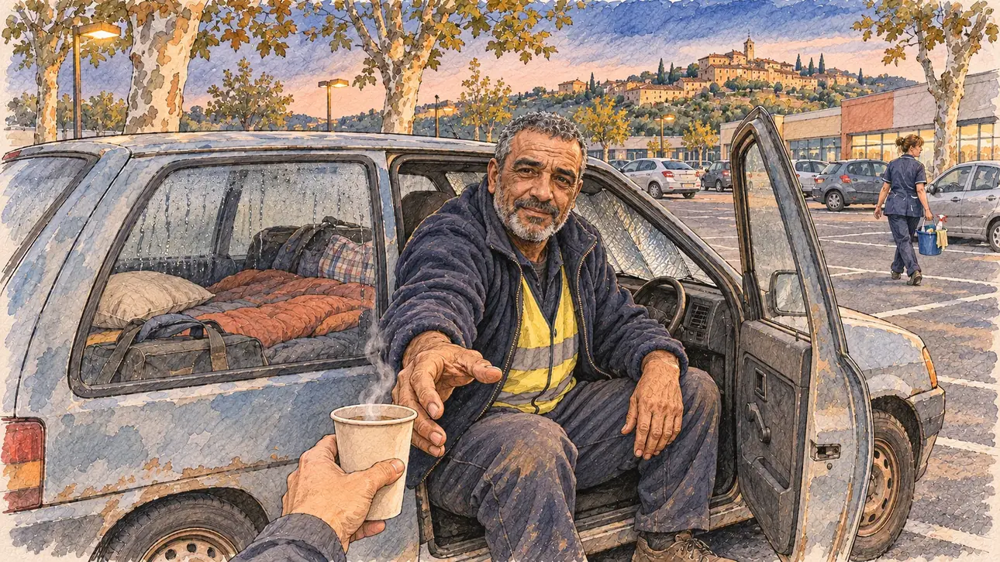

# `carSleeper` · Le bénévole qui dort dans sa voiture

**Retenue par le PO le 19/11/2026** : l'image envoyée dans la session de l'app, sans retouche. Le nombre d'essais et les messages de correction sont à compléter. Elle sert telle quelle en clair et en sombre.



| Champ | Valeur |
| --- | --- |
| Carte | `carSleeper`, catégorie `field` (Rencontre), poids 0,12, toute semaine, sans condition (Mitchnsun/moi-president, PO, 19/11/2026) |
| Style | Reportage dessiné |
| Ton | Observateur et calme, la première lumière de l'aube, ombres bleu nuit sur le parking, lueur abricot sur les collines et le visage |
| Date | 2026-11-19 |
| Outil | ChatGPT Images |
| Conversation | À remplir (le lien ne s'ouvre qu'avec le compte qui l'a créée) |
| Format rendu | 1672 × 941 (16:9) : export en 1290 × 726 px, WebP de qualité 75, 241 Ko, sans recadrage, fait depuis la copie WebP reçue |
| Fichier d'origine | Image de ChatGPT, chez le PO. L'export du dépôt a été fait depuis la copie partagée dans la conversation avec Claude |
| Première édition | `kit-france-2611-0004` |

## Texte de la carte

> **Le bénévole qui dort dans sa voiture**
>
> Un bénévole d'une banque alimentaire raconte en vidéo qu'il travaille à temps plein, et dort depuis quatorze mois dans sa voiture, faute de logement à sa portée. La vidéo dépasse le million de vues. Il ne demande rien à personne : il veut seulement qu'on sache.

## Le moment choisi

Le parking d'une zone commerciale d'une ville moyenne de Provence, à l'aube : platanes, lampadaires qui pâlissent, la vieille ville ocre sur sa colline. Une vieille citadine aux vitres embuées, la banquette rabattue en lit. Le bénévole, d'origine marocaine, la cinquantaine, polaire et gilet de travail, assis de côté sur le siège conducteur, tend la main vers le café que lui tend le candidat, hors champ, et le regarde avec un demi-sourire fatigué et digne. Le précédent est le bénévole de 53 ans qui, au débat du 16/11/2026, a raconté quatorze mois dans sa voiture malgré un emploi : il n'y ressemble pas.

## Prompt complet

Dans une nouvelle conversation, avec [`primeTime.webp`](../../illustrations/media/primeTime.webp) comme seule image de référence :

```
Use the attached image as the style reference and copy its drawing: a realistic reportage drawing made on the spot for a newspaper, with quick, nervous pencil lines, often drawn twice, ink hatching in the shadows, transparent watercolour washes that spill a little over the lines, and the warm paper showing through. Not the same scene and not the same people: never reuse the face or the hair of the woman in the reference.
Like in the reference, the setting can be full when the story needs it, with the things that say where we are and what is happening, but each one is sketched with a few pencil lines and a light wash, never rendered or finished, and the drawing gets looser and paler towards the edges until it fades into the bare paper.
This must look like a drawing made by hand on paper by a press illustrator, halfway between a quick sketch and a realistic picture: never a photograph, a film poster or a digital painting, and never a cartoon, a comic strip, a caricature or a children's book illustration. Continuous lines, never dotted or dashed outlines; no uniform texture, speckles or hatching filter laid over the picture; no glossy highlights, no smooth gradients, in the sky and on the walls too. Colour can be rich in places, on a piece of clothing, a light or a flag, but it stays transparent and within the palette below. The fade into the paper at the edges stays narrow, without a wide white margin. No blur and no depth-of-field effect: everything, the foreground included, is drawn sharp, like a sketch made on the spot.
People are drawn from life with realistic anatomy and proportions, like in the reference: faces shaped with pencil lines, hatching and light washes, a little more finished than the background but never photographic (no photographic skin, no airbrushed or digital-painting look). Expressions stay natural and restrained, even in laughter or tears: no exaggerated grins, no wide-open mouths full of teeth, no rubbery or cartoonish faces.

Editorial illustration, landscape 16:9 (1536 × 864 px), the scene filling the frame, with only a light fade into the paper at the edges. At dawn in 2027, in the car park of a retail park on the edge of a medium-sized town in Provence, in the south of France: a few parked cars under sodium street lamps going pale, plane trees, ochre walls and Roman-tile roofs of the old town on a hill in the distance, the sky turning from navy to a pale apricot. In the middle ground, an old small hatchback with fogged windows, its back seat folded down into a bed with a sleeping bag, a pillow, a bag of clothes and a work bag; a sunshade half-covers the windscreen. The player's candidate stays off-camera: in the foreground, only the candidate's takeaway coffee cup held out at the bottom edge of the frame, steam rising. In the right third, the volunteer, a stocky man in his early fifties of Moroccan descent, with a closely trimmed salt-and-pepper beard, short greying hair, deep lines around the eyes and a navy work fleece over a warehouse worker's high-visibility vest, sits sideways on the driver's seat with the door open, his feet on the tarmac, reaching out for the coffee, and looks at the viewer with a tired, dignified half-smile, his face above mid-height. Nobody else is close; far off, a white woman in her forties in a cleaning company's uniform walks to her own car without looking. Only the volunteer looks at the viewer. Nothing on the car, the vest, the cup, the bags or the shops is readable, and the number plate is blank.

Style: Reportage drawing made on the spot, like a press illustrator or courtroom sketch artist: pencil and ink with loose watercolour washes, lively unfinished lines, white paper showing through.

Palette: navy #13203F, vellum #F5EFE1, gold #A9802A, brick #B5523B, ochre #D9A441, sage #8FA58A, slate #5E7186, sand #DCC8A4, warm grey #8C8279; use 4 to 6 of them, subtle warm paper grain.

Tone: observant and quiet, the first light of dawn, cold navy shadows in the car park and a warm apricot glow on the hills and on the volunteer's face.

Constraints: realistic proportions, natural expressions, never cartoonish or caricatured faces, drawn like the rest of the illustration and never photographic; people of varied ages, genders, origins and body types (heavy, stocky, round, tall, short, wiry, not only slim), each with a distinct face and haircut (no two people alike), drawn with respect and never as a joke, no misery-porn and no pity pose; each person's age, build and look plausible for their job and the scene (working people of working age), no stereotype tying an origin or a gender to a role, and no person of colour shown alone in a featured service or deferential role; anatomically correct hands with exactly five fingers, few hands visible, the others in pockets, behind objects or out of frame; no readable text anywhere (the car, the number plate, the vest, the cup, the bags and the shop signs stay unreadable); no captions or speech bubbles; no logos, no car brand, no shop brand, no political party colours; no recognisable real person, no lookalike of a real politician; no explicit violence; no photographic rendering, no blur or bokeh, no dotted outlines, no texture or hatching filter over the picture, no oil-paint texture, no wide white margin or frame (a light fade into the paper at the edges is fine).

Format: if 16:9 is not available, make 1536 × 1024 and keep the top 80 px and the bottom 80 px free of anything important (faces, hands, the main action): they will be cropped.
```

## Décisions prises sur cette image

Retenue par le PO (19/11/2026).

## Essais écartés

À compléter.

## Retouches

Aucune.

## Relecture

Faite le 19/11/2026 sur l'image reçue, zoomée sur le texte possible et les mains ; retenue par le PO le même jour.

- [x] Aucun texte lisible : voiture, gilet, gobelet, sacs et devantures sans inscription ; pas de plaque visible.
- [x] Le candidat du joueur est hors champ : seule sa main tient le gobelet au premier plan, une main sans bijou dans une manche sombre, sans indice de genre.
- [x] Écart au prompt : la main du candidat est visible (le prompt ne demandait que le gobelet tendu) ; la femme au loin porte un seau et un vaporisateur, comme une agente d'entretien.
- [x] Rendu : un grain craquelé couvre l'image, surtout sur la carrosserie et le pantalon, la dérive que le gabarit signale ; le PO l'a gardée telle quelle.
- [x] Aucun sosie d'une personne réelle repéré.
- [x] Mains sans défaut visible.
- [x] Aucune couleur, aucun logo ni aucun drapeau de parti. Des personnes variées par l'âge, le corps, l'origine et la coiffure.
- [x] En 16:9 : pas de recadrage.
- [ ] Lisible sur la page de l'événement, en clair et en sombre : à vérifier dans l'app, une fois la carte publiée.
