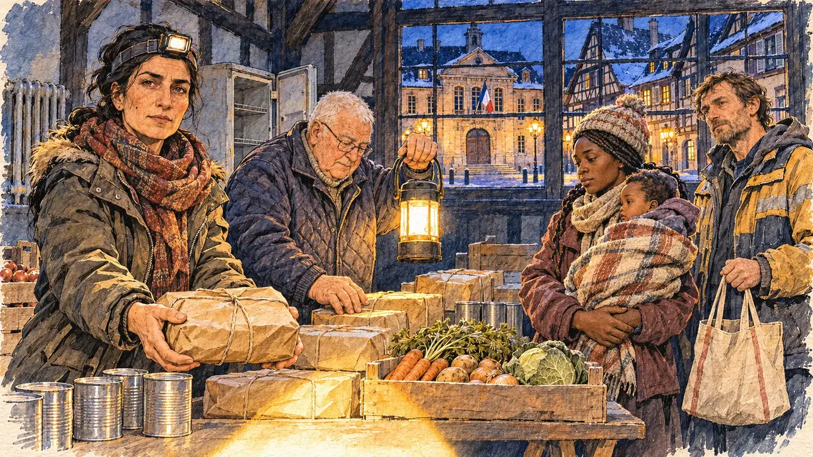

# `charityPowerCut` · L'association privée de courant

**Retenue par le PO le 19/11/2026** : l'image envoyée dans la session de l'app, sans retouche. Le nombre d'essais et les messages de correction sont à compléter. Elle sert telle quelle en clair et en sombre.



| Champ | Valeur |
| --- | --- |
| Carte | `charityPowerCut`, catégorie `field` (Rencontre), poids 0,12, toute semaine, sans condition (Mitchnsun/moi-president, PO, 19/11/2026) |
| Style | Reportage dessiné |
| Ton | Tendu, une pièce sombre éclairée par les seules lampes frontales et lanternes, la rue éclairée au-dehors |
| Date | 2026-11-19 |
| Outil | ChatGPT Images |
| Conversation | À remplir (le lien ne s'ouvre qu'avec le compte qui l'a créée) |
| Format rendu | 1672 × 941 (16:9) : export en 1290 × 726 px, WebP de qualité 75, 262 Ko, sans recadrage, fait depuis la copie WebP reçue |
| Fichier d'origine | Image de ChatGPT, chez le PO. L'export du dépôt a été fait depuis la copie partagée dans la conversation avec Claude |
| Première édition | `kit-france-2611-0004` |

## Texte de la carte

> **L'association privée de courant**
>
> Le maire d'une ville moyenne fait couper l'électricité et le gaz du local d'une association d'aide alimentaire, qu'il accuse de faire de la politique et veut voir partir. Les bénévoles distribuent les colis à la lampe frontale. L'association vous invite à passer.

## Le moment choisi

Une ville moyenne d'Alsace, à la nuit tombée en hiver : le local d'une association d'aide alimentaire au rez-de-chaussée d'une maison à colombages, lumières éteintes. À la lampe frontale et à la lanterne, des bénévoles distribuent des colis sur une table à tréteaux ; radiateur froid, réfrigérateur ouvert et éteint. Par la vitrine, la rue enneigée et la mairie au drapeau tricolore, sans maire visible. La responsable du local, d'origine kurde, lampe frontale sur le front, tend un colis et regarde le candidat. Le précédent est Hayange (2016-2017) : ni la ville, ni le maire, ni l'association n'y sont reconnaissables.

## Prompt complet

Dans une nouvelle conversation, avec [`primeTime.webp`](../../illustrations/media/primeTime.webp) comme seule image de référence :

```
Use the attached image as the style reference and copy its drawing: a realistic reportage drawing made on the spot for a newspaper, with quick, nervous pencil lines, often drawn twice, ink hatching in the shadows, transparent watercolour washes that spill a little over the lines, and the warm paper showing through. Not the same scene and not the same people: never reuse the face or the hair of the woman in the reference.
Like in the reference, the setting can be full when the story needs it, with the things that say where we are and what is happening, but each one is sketched with a few pencil lines and a light wash, never rendered or finished, and the drawing gets looser and paler towards the edges until it fades into the bare paper.
This must look like a drawing made by hand on paper by a press illustrator, halfway between a quick sketch and a realistic picture: never a photograph, a film poster or a digital painting, and never a cartoon, a comic strip, a caricature or a children's book illustration. Continuous lines, never dotted or dashed outlines; no uniform texture, speckles or hatching filter laid over the picture; no glossy highlights, no smooth gradients, in the sky and on the walls too. Colour can be rich in places, on a piece of clothing, a light or a flag, but it stays transparent and within the palette below. The fade into the paper at the edges stays narrow, without a wide white margin. No blur and no depth-of-field effect: everything, the foreground included, is drawn sharp, like a sketch made on the spot.
People are drawn from life with realistic anatomy and proportions, like in the reference: faces shaped with pencil lines, hatching and light washes, a little more finished than the background but never photographic (no photographic skin, no airbrushed or digital-painting look). Expressions stay natural and restrained, even in laughter or tears: no exaggerated grins, no wide-open mouths full of teeth, no rubbery or cartoonish faces.

Editorial illustration, landscape 16:9 (1536 × 864 px), the scene filling the frame, with only a light fade into the paper at the edges. At nightfall in winter 2027, in a medium-sized town of Alsace, in the east of France: the ground-floor premises of a food aid charity in an old half-timbered building with a steep roof, its lights off, the shop window dark. Inside, by the beams of headlamps and a few battery lanterns, volunteers hand out food parcels across a trestle table to a short queue of families in coats; a cold radiator, a switched-off fridge with its door ajar, cardboard boxes of vegetables and tins. Through the window, the lit street outside with its half-timbered façades and a closed town hall with a tricolour flag above its door. The player's candidate stays off-camera: in the foreground, only the beam of the candidate's torch, held at the bottom edge of the frame, lighting the table. In the left third, the head of the local branch, a tall woman in her late thirties of Kurdish descent, with long dark hair tied back under a headlamp, a thick scarf and a parka, holds out a parcel with both hands and looks at the viewer over the table, determined and weary, her face above mid-height. Beside her, a heavy-set white volunteer in his seventies with a white crew cut and a quilted jacket holds up a lantern; in the queue, a young mother of Congolese descent with braids under a woolly hat holds a toddler wrapped in a blanket, and a wiry man in his forties of Polish descent, unshaven, in a builder's jacket, waits with an empty shopping bag. Only the branch head looks at the viewer; the others look at the parcels or at each other. Nothing on the boxes, the tins, the parcels, the window or the town hall is readable.

Style: Reportage drawing made on the spot, like a press illustrator or courtroom sketch artist: pencil and ink with loose watercolour washes, lively unfinished lines, white paper showing through.

Palette: navy #13203F, vellum #F5EFE1, gold #A9802A, brick #B5523B, ochre #D9A441, sage #8FA58A, slate #5E7186, sand #DCC8A4, warm grey #8C8279; use 4 to 6 of them, subtle warm paper grain.

Tone: tense, a dark room lit only by the warm gold beams of the headlamps, the lanterns and the torch, cold navy shadows, the street lamps outside in pale ochre.

Constraints: realistic proportions, natural expressions, never cartoonish or caricatured faces, drawn like the rest of the illustration and never photographic; people of varied ages, genders, origins and body types (heavy, stocky, round, tall, short, wiry, not only slim), each with a distinct face and haircut (no two people alike), drawn with respect and never as a joke, no misery-porn and no pity pose; each person's age, build and look plausible for their job and the scene (working people of working age), no stereotype tying an origin or a gender to a role, and no person of colour shown alone in a featured service or deferential role; anatomically correct hands with exactly five fingers, few hands visible, the others in pockets, behind objects or out of frame; no readable text anywhere (the boxes, the tins, the parcels, the window, the posters and the town hall stay unreadable, no charity name); no captions or speech bubbles; no logos, no charity logo or heart emblem, no political party colours; no mayor shown, no recognisable real person, no lookalike of a real politician; no explicit violence; no photographic rendering, no blur or bokeh, no dotted outlines, no texture or hatching filter over the picture, no oil-paint texture, no glow or halo around the lights, no wide white margin or frame (a light fade into the paper at the edges is fine).

Format: if 16:9 is not available, make 1536 × 1024 and keep the top 80 px and the bottom 80 px free of anything important (faces, hands, the main action): they will be cropped.
```

## Décisions prises sur cette image

Retenue par le PO (19/11/2026).

## Essais écartés

À compléter.

## Retouches

Aucune.

## Relecture

Faite le 19/11/2026 sur l'image reçue, zoomée sur le texte possible et les mains ; retenue par le PO le même jour.

- [x] Aucun texte lisible : colis, conserves, vitrine et mairie sans inscription ; le drapeau tricolore signale la mairie, ce que le gabarit permet.
- [x] Le candidat du joueur est hors champ : seul le faisceau de sa lampe, sur la table au premier plan. Aucun maire n'est montré.
- [x] Écart au prompt : la scène est plus chaude et plus éclairée que demandé (une pièce sombre) ; la responsable, le bénévole à la lanterne, la mère et l'homme au sac sont là comme demandé.
- [x] Rendu : un grain craquelé couvre l'image, la dérive que le gabarit signale ; le PO l'a gardée telle quelle.
- [x] Aucun sosie d'une personne réelle repéré.
- [x] Mains sans défaut visible.
- [x] Aucune couleur, aucun logo ni aucun drapeau de parti. Des personnes variées par l'âge, le corps, l'origine et la coiffure.
- [x] En 16:9 : pas de recadrage.
- [ ] Lisible sur la page de l'événement, en clair et en sombre : à vérifier dans l'app, une fois la carte publiée.
