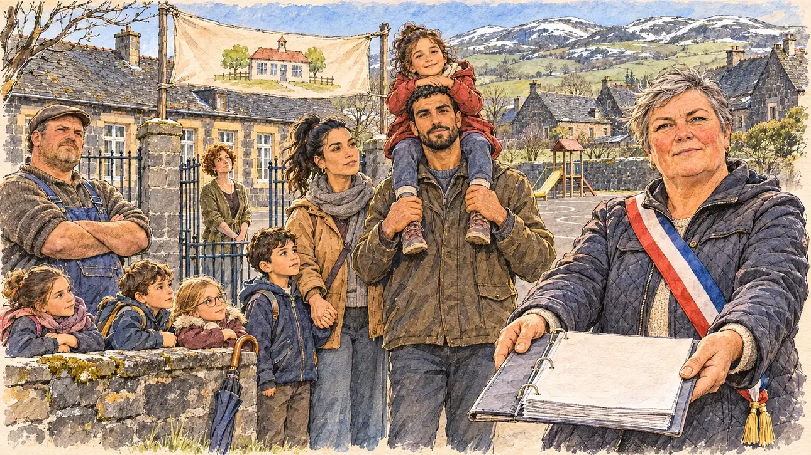

# `classClosures` · Une classe de moins à la rentrée

**Validée par le PO le 20/11/2026**, au premier essai, avec `primeTime.webp` comme référence. Elle sert telle quelle en clair et en sombre.



| Champ | Valeur |
| --- | --- |
| Carte | `classClosures`, catégorie `field` (Rencontre), poids 0,2, à partir de l'officialisation, une carte du programme : tirée si le programme tient des classes moins chargées (`smallerClasses`, `schoolProgrammingLaw`) ; exclut `teachersPay`, une histoire d'école par partie (Mitchnsun/moi-president, PO, 17/11/2026) |
| Style | Reportage dessiné, trait de `primeTime` |
| Ton | Tendu et chaleureux, soleil frais du matin |
| Date | 2026-11-20 (prompt écrit le 2026-11-18) |
| Outil | GPT 6.2 Astra |
| Conversation | À remplir (le lien ne s'ouvre qu'avec le compte qui l'a créée) |
| Format rendu | 1672 × 941 (16:9) : export en 1290 × 726 px, WebP de qualité 75, 272 Ko, sans recadrage |
| Fichier d'origine | Image chez le PO. L'export du dépôt a été fait depuis la copie partagée dans la conversation avec Claude |
| Première édition | `kit-france-2611-0004` |

## Texte de la carte

> **Une classe de moins à la rentrée**
>
> Devant une école de village, des parents et la maire vous attendent avec une pétition : une classe doit fermer à la rentrée, faute d'élèves selon le rectorat. On vous demande si votre promesse de classes moins chargées vaut ici, tout de suite.

## Le moment choisi

Devant l'école d'un village du Cantal, un matin frais de mars : maisons de basalte aux toits de lauze, la petite école à la cour bordée d'un muret, et au fond les monts du Cantal où reste un peu de neige. Le candidat arrive par la route, hors champ : au premier plan, son parapluie fermé posé contre le muret. La maire, écharpe tricolore sur sa doudoune, lui tend le classeur de la pétition et le regarde : votre promesse vaut-elle ici ? Autour : des parents, un père qui porte sa fille sur ses épaules, une mère qui tient son fils par la main, un agriculteur en bleu de travail, quelques enfants avec leurs cartables, et derrière la grille l'institutrice. Une banderole peinte à la main ne montre qu'une petite école dessinée. La carte rappelle la carte scolaire, préparée chaque printemps : personne n'y ressemble à une élue connue.

## Prompt complet

Dans une nouvelle conversation, avec [`primeTime.webp`](../../illustrations/media/primeTime.webp) comme seule image de référence :

```
Use the attached image as the style reference and copy its drawing: a realistic reportage drawing made on the spot for a newspaper, with quick, nervous pencil lines, often drawn twice, ink hatching in the shadows, transparent watercolour washes that spill a little over the lines, and the warm paper showing through. Not the same scene and not the same people: never reuse the face or the hair of the woman in the reference.
Like in the reference, the setting can be full when the story needs it, with the things that say where we are and what is happening, but each one is sketched with a few pencil lines and a light wash, never rendered or finished, and the drawing gets looser and paler towards the edges until it fades into the bare paper.
This must look like a drawing made by hand on paper by a press illustrator, halfway between a quick sketch and a realistic picture: never a photograph, a film poster or a digital painting, and never a cartoon, a comic strip, a caricature or a children's book illustration. Continuous lines, never dotted or dashed outlines; no uniform texture, speckles or hatching filter laid over the picture; no glossy highlights, no smooth gradients, in the sky and on the walls too. Colour can be rich in places, on a piece of clothing, a light or a flag, but it stays transparent and within the palette below. The fade into the paper at the edges stays narrow, without a wide white margin. No blur and no depth-of-field effect: everything, the foreground included, is drawn sharp, like a sketch made on the spot.
People are drawn from life with realistic anatomy and proportions, like in the reference: faces shaped with pencil lines, hatching and light washes, a little more finished than the background but never photographic (no photographic skin, no airbrushed or digital-painting look). Expressions stay natural and restrained, even in laughter or tears: no exaggerated grins, no wide-open mouths full of teeth, no rubbery or cartoonish faces.

Editorial illustration, landscape 16:9 (1536 × 864 px), the scene filling the frame, with only a light fade into the paper at the edges. In front of the school of a village in the Cantal, in the Auvergne mountains, on a fresh morning in March 2027: houses of dark basalt with steep roofs of stone slabs (lauzes), the small village school with its playground behind a low stone wall and an iron gate, and in the distance the rounded Monts du Cantal with patches of late snow. Parents and the mayor wait for the player's candidate with a petition: one of the two classes is to close at the start of the school year. The player's candidate arrives along the road and stays off-camera: in the foreground, only the candidate's closed umbrella leaning against the low stone wall. In the right third, the main character, the mayor, a white woman in her fifties, stocky, with cropped grey hair and wind-reddened cheeks, wearing a tricolour sash over a quilted jacket, holds out the binder of the petition towards the viewer and looks at the viewer with a firm, hopeful look, her face above mid-height. Around her: a father in his thirties of Moroccan descent, tall, with a short black beard, carries his little daughter on his shoulders and looks at the viewer; a young mother in her twenties of Turkish descent, with dark hair in a high ponytail, holds her son's hand; a farmer in his forties, heavy-set and white, with a flat cap and blue work overalls, stands with his arms crossed; a few children with schoolbags lean on the wall; behind the gate, the teacher, a young white woman with short curly red hair, watches from the playground. Over the gate hangs a hand-painted cloth banner showing only a little drawn schoolhouse, with no letters. Only the mayor and the father look at the viewer. Nothing on the petition, the banner, the schoolbags or the school is readable.

Style: Reportage drawing made on the spot, like a press illustrator or courtroom sketch artist: pencil and ink with loose watercolour washes, lively unfinished lines, white paper showing through.

Palette: navy #13203F, vellum #F5EFE1, gold #A9802A, brick #B5523B, ochre #D9A441, sage #8FA58A, slate #5E7186, sand #DCC8A4, warm grey #8C8279; use 4 to 6 of them, subtle warm paper grain.

Tone: tense and warm, the fresh low sun of a mountain morning, the dark basalt and the pale green fields, the tricolour sash and a child's red coat as the bright notes.

Constraints: realistic proportions, natural expressions, never cartoonish or caricatured faces, drawn like the rest of the illustration and never photographic; people of varied ages, genders, origins and body types (heavy, stocky, round, tall, short, wiry, not only slim), each with a distinct face and haircut (no two people alike), drawn with respect and never as a joke; each person's age, build and look plausible for their job and the scene (working people of working age), no stereotype tying an origin or a gender to a role, and no person of colour shown alone in a featured service or deferential role; anatomically correct hands with exactly five fingers, few hands visible, the others in pockets, behind objects or out of frame; no readable text anywhere (the petition, the banner, the schoolbags and the school stay unreadable, no school sign with words); no captions or speech bubbles; no logos, no political party colours; no recognisable real person, no lookalike of a real politician or of a known mayor; no explicit violence; no photographic rendering, no blur or bokeh, every outline a continuous pencil or ink line with no dotted or dashed outlines, no mottled, crackled or speckled texture over the faces, the clothes, the stone walls or the sky, no hatching filter over the picture, no oil-paint texture, no glow or halo, no wide white margin or frame (a light fade into the paper at the edges is fine).

Format: if 16:9 is not available, make 1536 × 1024 and keep the top 80 px and the bottom 80 px free of anything important (faces, hands, the main action): they will be cropped.
```

## Décisions prises sur cette image

Aucune pour le moment.

## Essais écartés

Aucun.

## Retouches

Aucune.

## Relecture

Faite et validée par le PO le 20/11/2026.

- [x] Aucun texte lisible : la pétition, la banderole (une petite école dessinée, sans lettres), les cartables et l'école.
- [x] Aucun sosie d'une personne réelle.
- [x] Le candidat du joueur est hors champ : son parapluie fermé contre le muret.
- [x] Mains, visages et foules sans défaut visible à 343 px de large.
- [x] Aucune couleur ni aucun logo de parti : l'écharpe tricolore de la maire est la seule note tricolore. Des personnes variées par l'âge, le corps, l'origine et la coiffure.
- [x] En 3:2 : sans objet, l'image est en 16:9.
- [x] Lisible sur la page de l'événement, en clair et en sombre.

Ce que la relecture a accepté : des toits d'ardoise plutôt que de lauzes ; le père regarde un peu au-dessus du spectateur ; le dessin plus fini que la référence.
