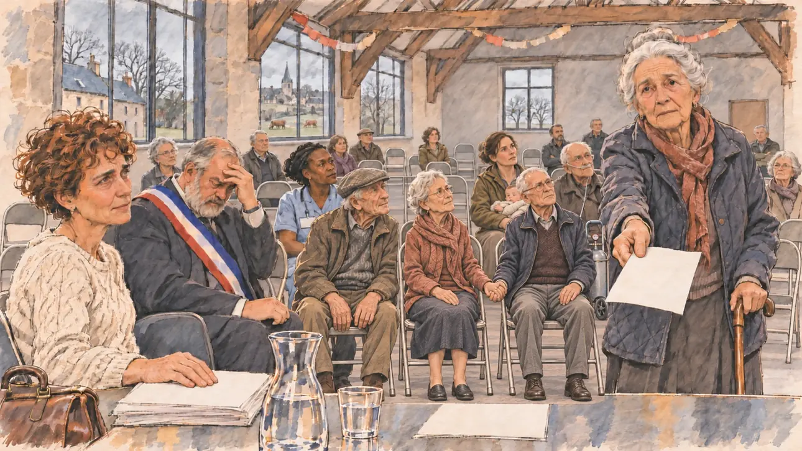

# `creuseSurgery` · La dernière médecin du bourg part

**À générer.** Prompt prêt le 04/11/2026, pas encore d'image validée.



| Champ | Valeur |
| --- | --- |
| Carte | `creuseSurgery`, catégorie `field` (Rencontre), carte ajoutée par la PR #297 de l'app |
| Style | Reportage dessiné, trait de `primeTime` |
| Ton | Grave, inquiet |
| Date | À remplir |
| Outil | ChatGPT Images |
| Conversation | À remplir (le lien ne s'ouvre qu'avec le compte qui l'a créée) |
| Format rendu | À remplir |
| Fichier d'origine | À remplir |
| Première édition | À remplir |

## Texte de la carte

> **La dernière médecin du bourg part**
>
> Dans un bourg de la Creuse, la seule médecin à trente kilomètres à la ronde prend sa retraite à la fin du mois, sans remplaçant. Le maire a réuni quatre-vingts habitants dans la salle des fêtes, la plupart ont plus de soixante-cinq ans, et chacun a une ordonnance à renouveler et une question.

## Le moment choisi

La salle des fêtes en granit d'un bourg de la Creuse, un après-midi gris de février, vue depuis la table où le candidat est assis (hors champ) entre le maire et la médecin qui part : au premier plan, une carafe d'eau et une pile d'ordonnances vierges. Une habitante de plus de quatre-vingts ans s'est levée, sa canne dans une main, son ordonnance dans l'autre, et pose sa question au candidat. Autour : quatre-vingts habitants assis, âgés pour la plupart, une aide à domicile, un couple de retraités, un jeune agriculteur. Au bout de la table, la médecin, émue. Par les fenêtres : les maisons de granit aux toits d'ardoise, le bocage, des vaches limousines et le clocher.

## Prompt complet

Dans une nouvelle conversation, avec [`primeTime.webp`](../../illustrations/media/primeTime.webp) comme seule image de référence.

```
Use the attached image as the style reference and copy its drawing: a realistic reportage drawing made on the spot for a newspaper, with quick, nervous pencil lines, often drawn twice, ink hatching in the shadows, transparent watercolour washes that spill a little over the lines, and the warm paper showing through. Not the same scene and not the same people: never reuse the face or the hair of the woman in the reference.
Like in the reference, the setting can be full when the story needs it, with the things that say where we are and what is happening, but each one is sketched with a few pencil lines and a light wash, never rendered or finished, and the drawing gets looser and paler towards the edges until it fades into the bare paper.
This must look like a drawing made by hand on paper by a press illustrator, halfway between a quick sketch and a realistic picture: never a photograph, a film poster or a digital painting, and never a cartoon, a comic strip, a caricature or a children's book illustration. Continuous lines, never dotted or dashed outlines; no uniform texture, speckles or hatching filter laid over the picture; no glossy highlights, no smooth gradients, in the sky and on the walls too. Colour can be rich in places, on a piece of clothing, a light or a flag, but it stays transparent and within the palette below. The fade into the paper at the edges stays narrow, without a wide white margin. No blur and no depth-of-field effect: everything, the foreground included, is drawn sharp, like a sketch made on the spot.
People are drawn from life with realistic anatomy and proportions, like in the reference: faces shaped with pencil lines, hatching and light washes, a little more finished than the background but never photographic (no photographic skin, no airbrushed or digital-painting look). Expressions stay natural and restrained, even in laughter or tears: no exaggerated grins, no wide-open mouths full of teeth, no rubbery or cartoonish faces.

Editorial illustration, landscape 16:9 (1536 × 864 px), the scene filling the frame, with only a light fade into the paper at the edges. The plain granite village hall of a small market town in the Creuse, in the Limousin, on a grey afternoon in February 2027: the only doctor within thirty kilometres retires at the end of the month with no replacement, and the mayor has gathered eighty residents, most of them over sixty-five, each with a prescription to renew and a question. The scene is seen from the table where the player's candidate sits between the mayor and the doctor, the candidate staying off-camera: in the foreground, only the edge of the table with a carafe of water and a pile of blank prescriptions. In the right third, in the front row, a woman in her eighties with white hair in a neat bun, a quilted jacket and a walking stick in one hand has stood up and holds out her prescription in the other, asking the viewer her question with a worried, determined face, her face above mid-height. Around her, sketched in pencil and light washes: rows of residents on folding chairs, almost all elderly, an old farmer in a flat cap with his hands on his knees, a couple in their seventies holding hands, a home care worker of Ivorian origin in her forties with her badge and a light blue tunic, a young farmer in his thirties with a baby on his lap, a man with an oxygen bottle on wheels. At the end of the table, the retiring doctor, a woman in her late sixties with short grey hair and glasses, her old leather bag at her feet, looking at her patients with tired emotion; the mayor, a stocky man in his sixties with a grey beard and a tricolour sash, rubbing his forehead. Behind them, the hall with its wooden beams and a few paper garlands left from a party, and through the tall windows the granite houses of the town with slate roofs, the hedged fields of the bocage, a few red-brown Limousin cows and the church spire under a low grey sky. Only the old woman looks at the viewer. Nothing on the prescriptions, the badge, the walls or the windows is readable.

Style: Reportage drawing made on the spot, like a press illustrator or courtroom sketch artist: pencil and ink with loose watercolour washes, lively unfinished lines, white paper showing through.

Palette: navy #13203F, vellum #F5EFE1, gold #A9802A, brick #B5523B, ochre #D9A441, sage #8FA58A, slate #5E7186, sand #DCC8A4, warm grey #8C8279; use 4 to 6 of them, subtle warm paper grain.

Tone: grave and worried, the dim grey light of a winter afternoon in the hall, the red-brown of the cows and the blue of the care worker's tunic as the brightest notes.

Constraints: realistic proportions, natural expressions, never cartoonish or caricatured faces, drawn like the rest of the illustration and never photographic; people of varied ages, genders, origins and body types (heavy, stocky, round, tall, short, wiry, not only slim), each with a distinct face and haircut (no two people alike), drawn with respect and never as a joke; anatomically correct hands with exactly five fingers, few hands visible, the others in pockets, behind objects or out of frame; no readable text anywhere (the prescriptions, the badge, the walls and the windows stay unreadable); no captions or speech bubbles; no logos or political party colours; no recognisable real person, no lookalike of a real politician or of a real doctor; no explicit violence; no photographic rendering, no blur or bokeh, no dotted outlines, no texture or hatching filter over the picture, no oil-paint texture, no wide white margin or frame (a light fade into the paper at the edges is fine).

Format: if 16:9 is not available, make 1536 × 1024 and keep the top 80 px and the bottom 80 px free of anything important (faces, hands, the main action): they will be cropped.
```

## Décisions prises sur cette image

Aucune pour l'instant.

## Essais écartés

Aucun pour l'instant.

## Retouches

Aucune.

## Relecture

À faire sur l'image validée.
