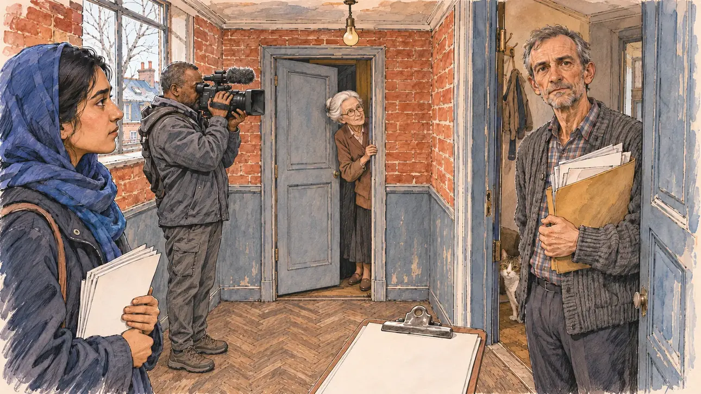

# `doorstepJobseeker` · La porte du premier étage

**Retenue par le PO le 16/11/2026**, au premier essai. Elle sert telle quelle en clair et en sombre.



| Champ | Valeur |
| --- | --- |
| Carte | `doorstepJobseeker`, catégorie `field` (Rencontre), poids 0,12, toute semaine ; une leçon de la campagne (proximité +2 sur l'écoute), une seule des six par partie (Mitchnsun/moi-president, PO, 14/11/2026) |
| Style | Reportage dessiné |
| Ton | Chaleureux et grave, lumière de cage d'escalier |
| Date | 2026-11-16 |
| Outil | ChatGPT Images, à compléter (modèle et effort) |
| Conversation | À compléter |
| Format rendu | 1671 × 941 (16:9) : export en 1290 × 726 px, WebP de qualité 75, 165 Ko, sans recadrage, fait depuis la copie WebP de la conversation (à refaire depuis le PNG d'origine) |
| Fichier d'origine | À compléter (hors du dépôt) |
| Première édition | À compléter |

## Texte de la carte

> **La porte du premier étage**
>
> En porte-à-porte, une personne au chômage depuis deux ans vous retient sur son palier et vous raconte ses refus d'embauche. Une caméra filme la scène depuis l'escalier.

## Le moment choisi

Le palier du premier étage d'un petit immeuble de brique rouge à Amiens, un samedi matin d'hiver : parquet en chevrons, murs de brique et soubassement bleu, une ampoule nue, les toits par la fenêtre. Le candidat est sur le palier, hors champ : seul son porte-bloc de feuilles blanches au premier plan. Sur le seuil, l'homme au chômage serre sa chemise de lettres et le regarde, fatigué mais digne, un chat à ses pieds ; une bénévole attend avec ses tracts ; un cadreur filme ; la voisine d'en face entrouvre sa porte. Le contre-exemple est « je traverse la rue, je vous en trouve » (septembre 2018), une réponse toute faite : personne n'y ressemble à un responsable politique.

## Prompt complet

Dans une nouvelle conversation, avec [`primeTime.webp`](../../illustrations/media/primeTime.webp) comme seule image de référence :

```
Use the attached image as the style reference and copy its drawing: a realistic reportage drawing made on the spot for a newspaper, with quick, nervous pencil lines, often drawn twice, ink hatching in the shadows, transparent watercolour washes that spill a little over the lines, and the warm paper showing through. Not the same scene and not the same people: never reuse the face or the hair of the woman in the reference.
Like in the reference, the setting can be full when the story needs it, with the things that say where we are and what is happening, but each one is sketched with a few pencil lines and a light wash, never rendered or finished, and the drawing gets looser and paler towards the edges until it fades into the bare paper.
This must look like a drawing made by hand on paper by a press illustrator, halfway between a quick sketch and a realistic picture: never a photograph, a film poster or a digital painting, and never a cartoon, a comic strip, a caricature or a children's book illustration. Continuous lines, never dotted or dashed outlines; no uniform texture, speckles or hatching filter laid over the picture; no glossy highlights, no smooth gradients, in the sky and on the walls too. Colour can be rich in places, on a piece of clothing, a light or a flag, but it stays transparent and within the palette below. The fade into the paper at the edges stays narrow, without a wide white margin. No blur and no depth-of-field effect: everything, the foreground included, is drawn sharp, like a sketch made on the spot.
People are drawn from life with realistic anatomy and proportions, like in the reference: faces shaped with pencil lines, hatching and light washes, a little more finished than the background but never photographic (no photographic skin, no airbrushed or digital-painting look). Expressions stay natural and restrained, even in laughter or tears: no exaggerated grins, no wide-open mouths full of teeth, no rubbery or cartoonish faces.

Editorial illustration, landscape 16:9 (1536 × 864 px), the scene filling the frame, with only a light fade into the paper at the edges. The narrow first-floor landing of a small red-brick apartment building in Amiens, in Picardy, northern France, on a winter Saturday morning in 2027, during door-to-door canvassing: worn parquet, a wooden banister, a bare light bulb, painted doors; one flat's door is half open on a modest hallway, a cat peeking out. The player's candidate stands on the landing and stays off-camera: in the foreground, only the candidate's clipboard with blank sheets resting on the banister. In the right third, on the threshold, a man out of work for two years, thin, in his fifties, with grey stubble, a wool cardigan over a checked shirt, holds a cardboard folder full of letters against his chest and looks at the viewer, tired but dignified, as if waiting to be truly heard, his face above mid-height. Near the viewer, a young campaign volunteer of Pakistani descent in a blue headscarf, holding a stack of blank leaflets, waits a little behind. A few steps down the stairs, a stocky camera operator in his forties of Martinican descent, a camera on his shoulder, films the scene. On the opposite landing, a short elderly neighbour with white hair in a bun opens her door a crack and watches. Only the man on the threshold looks at the viewer. Nothing on the doors, the folder, the letters, the leaflets, the clipboard or the camera is readable.

Style: Reportage drawing made on the spot, like a press illustrator or courtroom sketch artist: pencil and ink with loose watercolour washes, lively unfinished lines, white paper showing through.

Palette: navy #13203F, vellum #F5EFE1, gold #A9802A, brick #B5523B, ochre #D9A441, sage #8FA58A, slate #5E7186, sand #DCC8A4, warm grey #8C8279; use 4 to 6 of them, subtle warm paper grain.

Tone: warm and grave, the pale light of the stairwell and the yellow glow of the bulb, the closeness of a landing.

Constraints: realistic proportions, natural expressions, never cartoonish or caricatured faces, drawn like the rest of the illustration and never photographic; people of varied ages, genders, origins and body types (heavy, stocky, round, tall, short, wiry, not only slim), each with a distinct face and haircut (no two people alike), drawn with respect and never as a joke; each person's age, build and look plausible for their job and the scene (working people of working age), no stereotype tying an origin or a gender to a role, and no person of colour shown alone in a featured service or deferential role; the man out of work shown with dignity, never as miserable or pitiful; anatomically correct hands with exactly five fingers, few hands visible, the others in pockets, behind objects or out of frame; no readable text anywhere (the doors, the folder, the letters, the leaflets, the clipboard and the camera stay unreadable, no names on doors, no letterboxes with names); no captions or speech bubbles; no logos, no employment agency logo, no television channel logo, no political party colours, no flags; no recognisable real person, no lookalike of a real politician; no explicit violence; no photographic rendering, no blur or bokeh, every outline a continuous pencil or ink line with no dotted or dashed outlines, no mottled, crackled or speckled texture over the faces, the clothes, the walls or the floor, no hatching filter over the picture, no oil-paint texture, no glow or halo around the bulb, no wide white margin or frame (a light fade into the paper at the edges is fine).

Format: if 16:9 is not available, make 1536 × 1024 and keep the top 80 px and the bottom 80 px free of anything important (faces, hands, the main action): they will be cropped.
```

## Décisions prises sur cette image

Retenue telle quelle par le PO (16/11/2026). Le cadreur filme depuis le palier plutôt que depuis l'escalier, qu'on ne voit pas ; le porte-bloc est posé au premier plan sans rampe.

## Essais écartés

Aucun.

## Retouches

Aucune.

## Relecture

Faite le 16/11/2026, à confirmer par le PO.

- [x] Aucun texte lisible : rien sur les portes, la chemise, les lettres, les tracts, le porte-bloc ni la caméra.
- [x] Aucun sosie d'une personne réelle.
- [x] Le candidat du joueur est hors champ : seul son porte-bloc au premier plan.
- [x] Mains et visages sans défaut visible à 343 px de large : les mains de l'homme autour de sa chemise, celles de la bénévole sur ses tracts, de la voisine sur sa porte, du cadreur sur la caméra.
- [x] Aucune couleur, aucun logo ni aucun drapeau de parti. Des personnes variées par l'âge, le corps, l'origine et la coiffure ; l'homme au chômage montré avec dignité.
- [x] En 16:9 : pas de recadrage.
- [ ] Lisible sur la page de l'événement, en clair et en sombre : à vérifier dans l'app, une fois la carte publiée.
