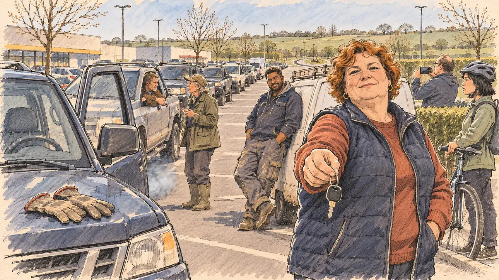

# `engineParade` · La parade des moteurs

**Retenue par le PO le 15/11/2026**, au premier essai. Elle sert telle quelle en clair et en sombre.



| Champ | Valeur |
| --- | --- |
| Carte | `engineParade`, catégorie `field` (Rencontre), poids 0,1, toute semaine ; un geste au bord de l'axe de l'écologie, côté croissance d'abord (Mitchnsun/moi-president, PO, 14/11/2026) |
| Style | Reportage dessiné |
| Ton | Ironique en douceur, soleil de mars |
| Date | 2026-11-15 |
| Outil | ChatGPT Images, à compléter (modèle et effort) |
| Conversation | À compléter |
| Format rendu | 1672 × 941 (16:9) : export en 1290 × 726 px, WebP de qualité 75, 233 Ko, sans recadrage, fait depuis la copie WebP de la conversation (à refaire depuis le PNG d'origine) |
| Fichier d'origine | À compléter (hors du dépôt) |
| Première édition | À compléter |

## Texte de la carte

> **La parade des moteurs**
>
> Des passionnés de 4x4 diesel et de pick-up défilent contre les zones à faibles émissions. Les organisateurs vous proposent la place du conducteur dans le véhicule de tête.

## Le moment choisi

Le parking d'un supermarché à l'entrée de La Roche-sur-Yon, en Vendée, un samedi matin ensoleillé de mars : le bocage au loin, un rond-point, la zone commerciale. Le convoi se forme, 4x4, pick-up et utilitaires d'artisans ; le véhicule de tête a sa portière ouverte et son moteur qui fume un peu. Le candidat reste hors champ : seuls ses gants, sur le capot. L'organisatrice lui tend les clés avec un sourire de défi ; un plombier, adossé à son vieil utilitaire, le regarde aussi ; une agricultrice discute avec un conducteur ; une jeune cycliste regarde le convoi d'un air désapprobateur ; un vidéaste amateur filme. Le précédent est le 80 km/h (juillet 2018), devenu le symbole du mépris des villes pour les campagnes : aucun geste unique d'un candidat n'a été trouvé, la carte l'invente.

## Prompt complet

Dans une nouvelle conversation, avec [`primeTime.webp`](../../illustrations/media/primeTime.webp) comme seule image de référence :

```
Use the attached image as the style reference and copy its drawing: a realistic reportage drawing made on the spot for a newspaper, with quick, nervous pencil lines, often drawn twice, ink hatching in the shadows, transparent watercolour washes that spill a little over the lines, and the warm paper showing through. Not the same scene and not the same people: never reuse the face or the hair of the woman in the reference.
Like in the reference, the setting can be full when the story needs it, with the things that say where we are and what is happening, but each one is sketched with a few pencil lines and a light wash, never rendered or finished, and the drawing gets looser and paler towards the edges until it fades into the bare paper.
This must look like a drawing made by hand on paper by a press illustrator, halfway between a quick sketch and a realistic picture: never a photograph, a film poster or a digital painting, and never a cartoon, a comic strip, a caricature or a children's book illustration. Continuous lines, never dotted or dashed outlines; no uniform texture, speckles or hatching filter laid over the picture; no glossy highlights, no smooth gradients, in the sky and on the walls too. Colour can be rich in places, on a piece of clothing, a light or a flag, but it stays transparent and within the palette below. The fade into the paper at the edges stays narrow, without a wide white margin. No blur and no depth-of-field effect: everything, the foreground included, is drawn sharp, like a sketch made on the spot.
People are drawn from life with realistic anatomy and proportions, like in the reference: faces shaped with pencil lines, hatching and light washes, a little more finished than the background but never photographic (no photographic skin, no airbrushed or digital-painting look). Expressions stay natural and restrained, even in laughter or tears: no exaggerated grins, no wide-open mouths full of teeth, no rubbery or cartoonish faces.

Editorial illustration, landscape 16:9 (1536 × 864 px), the scene filling the frame, with only a light fade into the paper at the edges. The car park of a supermarket at the edge of La Roche-sur-Yon, in the Vendée, in western France, on a sunny Saturday morning in March 2027: hedged farmland and a roundabout in the distance, the low buildings of a retail park. A parade against the low-emission zones is forming: a long line of diesel 4x4s and pick-ups, a few tradespeople's vans; the lead vehicle, a big 4x4 with its engine running and its driver's door open, a little blue diesel smoke rising behind. The player's candidate stands facing the open door and stays off-camera: in the foreground, only the candidate's gloves left on the bonnet of the lead 4x4. In the right third, the organiser, a tall, heavy-set white woman in her fifties with curly hair dyed auburn, in a sleeveless padded gilet over a jumper, holds out the car keys towards the viewer with a challenging smile, her face above mid-height. Around her: a stocky plumber in his thirties of Cape Verdean descent, in work clothes, leaning against his old diesel van, also looks at the viewer; a lean farmer woman in her sixties in boots and a cap chats with another driver. At the edge of the car park, a young cyclist of Laotian descent with a black bob and a helmet watches the convoy with disapproval, holding her bike. A round amateur videographer in his forties films with his phone. Only the organiser and the plumber look at the viewer. Nothing on the vehicles, the vans, the buildings, the phone or the keys is readable.

Style: Reportage drawing made on the spot, like a press illustrator or courtroom sketch artist: pencil and ink with loose watercolour washes, lively unfinished lines, white paper showing through.

Palette: navy #13203F, vellum #F5EFE1, gold #A9802A, brick #B5523B, ochre #D9A441, sage #8FA58A, slate #5E7186, sand #DCC8A4, warm grey #8C8279; use 4 to 6 of them, subtle warm paper grain.

Tone: gently ironic, postures slightly exaggerated but never the faces, the frank March sun on the bodywork and the bluish diesel smoke.

Constraints: realistic proportions, natural expressions, never cartoonish or caricatured faces, drawn like the rest of the illustration and never photographic; people of varied ages, genders, origins and body types (heavy, stocky, round, tall, short, wiry, not only slim), each with a distinct face and haircut (no two people alike), drawn with respect and never as a joke; each person's age, build and look plausible for their job and the scene (working people of working age), no stereotype tying an origin or a gender to a role, and no person of colour shown alone in a featured service or deferential role; anatomically correct hands with exactly five fingers, few hands visible, the others in pockets, behind objects or out of frame; no readable text anywhere (the vehicles, the vans, the buildings, the phone and the keys stay unreadable, no number plates, no shop signs, no stickers with words, no slogans); no captions or speech bubbles; no logos, no car brand logo, no supermarket logo, no political party colours, no flags; no recognisable real person, no lookalike of a real politician; no explicit violence, no one in danger; no photographic rendering, no blur or bokeh, every outline a continuous pencil or ink line with no dotted or dashed outlines, no mottled, crackled or speckled texture over the faces, the clothes, the bodywork or the sky, no hatching filter over the picture, no oil-paint texture, no glow, halo or reflections like chrome adverts, no wide white margin or frame (a light fade into the paper at the edges is fine).

Format: if 16:9 is not available, make 1536 × 1024 and keep the top 80 px and the bottom 80 px free of anything important (faces, hands, the main action): they will be cropped.
```

## Décisions prises sur cette image

Retenue telle quelle par le PO (15/11/2026). La façade du supermarché porte un bandeau jaune, sans lettres ni logo. Le 15/11/2026, le PO a ajouté à la carte une réponse sans jet qui critique la parade, sans changer l'image.

## Essais écartés

Aucun.

## Retouches

Aucune.

## Relecture

Faite le 15/11/2026, à confirmer par le PO.

- [x] Aucun texte lisible : ni plaques, ni enseigne, ni logo de marque sur les calandres.
- [x] Aucun sosie d'une personne réelle.
- [x] Le candidat du joueur est hors champ : seuls ses gants, sur le capot.
- [x] Mains et visages sans défaut visible à 343 px de large : la main qui tend les clés, celles du vidéaste au téléphone et de la cycliste sur son guidon.
- [x] Aucune couleur, aucun logo ni aucun drapeau de parti. Des personnes variées par l'âge, le corps, l'origine et la coiffure.
- [x] En 16:9 : pas de recadrage.
- [ ] Lisible sur la page de l'événement, en clair et en sombre : à vérifier dans l'app, une fois la carte publiée.
