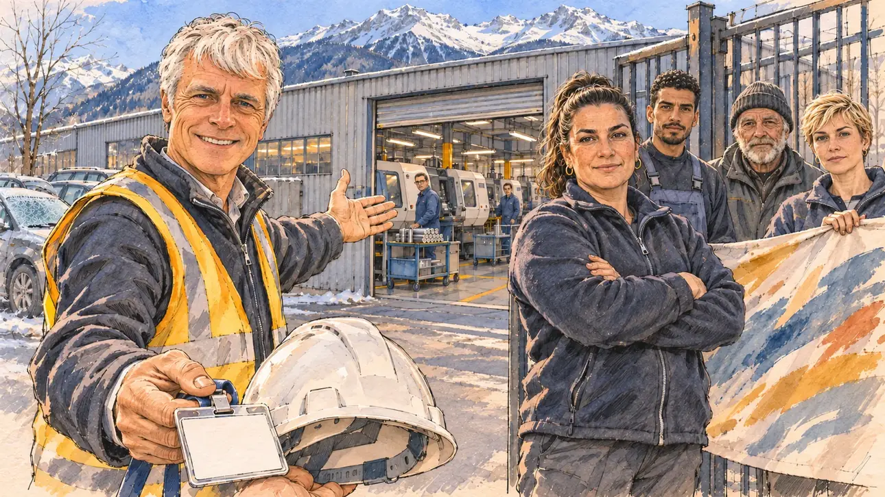

# `factoryInvite` · Une usine vous ouvre ses portes

**Validée par le PO le 05/11/2026**, au premier essai, avec `primeTime.webp` comme référence. Elle sert telle quelle en clair et en sombre.



| Champ | Valeur |
| --- | --- |
| Carte | `factoryInvite`, catégorie `field` (Rencontre), carte ajoutée par la PR #297 de l'app |
| Style | Reportage dessiné, trait de `primeTime` |
| Ton | Tendu, observateur |
| Date | 2026-11-05 |
| Outil | ChatGPT Images |
| Conversation | À remplir (le lien ne s'ouvre qu'avec le compte qui l'a créée) |
| Format rendu | 1672 × 941 (16:9) : export en 1290 × 726 px, WebP de qualité 75, 180 Ko, sans recadrage |
| Fichier d'origine | Image de ChatGPT, chez le PO. L'export du dépôt a été fait depuis la copie partagée dans la conversation avec Claude |
| Première édition | La prochaine Release qui suit le merge de la PR #297 de l'app |

## Texte de la carte

> **Une usine vous ouvre ses portes**
>
> Le directeur d'une usine de pièces automobiles vous invite à visiter ses ateliers. Mais les délégués du personnel, qui vous attendent à la grille, protestent : ils veulent vous parler avant lui.

## Le moment choisi

L'entrée d'une usine de décolletage de la vallée de l'Arve, en Haute-Savoie, qui fabrique des pièces pour l'automobile, un matin froid de février, vue depuis la place du candidat (hors champ), entre les deux camps : au premier plan, un badge visiteur vierge et un casque de chantier qu'on lui a tendus. À gauche, le directeur montre la porte des ateliers. À droite, à la grille, la déléguée du personnel, bras croisés, attend le candidat avec trois collègues et une banderole peinte à la main sans lettres. Derrière : le bâtiment de tôle de l'usine, les tours à commande numérique par la porte ouverte, le parking, et les sommets enneigés des Alpes.

## Prompt complet

Dans une nouvelle conversation, avec deux images jointes, dans cet ordre : [`primeTime.webp`](../../illustrations/media/primeTime.webp) pour le style, puis le portrait dessiné fourni par le PO pour la ressemblance du directeur. Le portrait n'est pas dans ce dépôt.

```
Use the first attached image as the style reference and copy its drawing: a realistic reportage drawing made on the spot for a newspaper, with quick, nervous pencil lines, often drawn twice, ink hatching in the shadows, transparent watercolour washes that spill a little over the lines, and the warm paper showing through. Not the same scene and not the same people: never reuse the face or the hair of the woman in the reference.
Like in the reference, the setting can be full when the story needs it, with the things that say where we are and what is happening, but each one is sketched with a few pencil lines and a light wash, never rendered or finished, and the drawing gets looser and paler towards the edges until it fades into the bare paper.
Use the second attached image, a drawn portrait, only as the likeness reference for the factory director: give him this man's features, his thick short white hair, his blue eyes and his lined face, clean-shaven, at the same age as in the portrait, and draw his face with the same pencil lines and washes as the other people in the scene. Keep the likeness through the drawing, never through photographic detail.
This must look like a drawing made by hand on paper by a press illustrator, halfway between a quick sketch and a realistic picture: never a photograph, a film poster or a digital painting, and never a cartoon, a comic strip, a caricature or a children's book illustration. Continuous lines, never dotted or dashed outlines; no uniform texture, speckles or hatching filter laid over the picture; no glossy highlights, no smooth gradients, in the sky and on the walls too. Colour can be rich in places, on a piece of clothing, a light or a flag, but it stays transparent and within the palette below. The fade into the paper at the edges stays narrow, without a wide white margin. No blur and no depth-of-field effect: everything, the foreground included, is drawn sharp, like a sketch made on the spot.
People are drawn from life with realistic anatomy and proportions, like in the reference: faces shaped with pencil lines, hatching and light washes, a little more finished than the background but never photographic (no photographic skin, no airbrushed or digital-painting look). Expressions stay natural and restrained, even in laughter or tears: no exaggerated grins, no wide-open mouths full of teeth, no rubbery or cartoonish faces.

Editorial illustration, landscape 16:9 (1536 × 864 px), the scene filling the frame, with only a light fade into the paper at the edges. The entrance of a precision bar-turning factory in the Arve valley in Haute-Savoie, which makes small metal parts for car makers, on a cold, clear morning in February 2027. The scene is seen from the place of the player's candidate, who stays off-camera, standing between the two sides: in the foreground, only a blank visitor's badge and a white safety helmet held out towards the viewer at the bottom edge of the picture. In the left third, the factory director, the man from the portrait, in a plain zipped fleece over a shirt and a high-visibility vest with no lettering, gestures with an open hand towards the workshop door, with a polite smile but in a hurry, already half turned towards the door. In the right third, at the metal gate, the staff delegate, a solid woman in her forties of Turkish origin, with a dark ponytail, a work fleece and safety shoes, stands with her arms crossed and looks straight at the viewer with a firm, expectant face, her face above mid-height: they want to speak to the candidate first. Beside her, sketched in pencil and light washes, three colleagues: a tall young man of Moroccan origin in overalls, an older worker with a grey beard and a woolly hat, and a young woman with short blond hair holding one end of a handmade banner painted with broad strokes and no letters. Behind them, the factory: a long low building of grey corrugated metal, through the open roller door the rows of computer-controlled lathes and a few workers in blue overalls glancing out, a car park with frost on the windscreens, and above the valley the steep snowy peaks of the Alps under a pale blue sky. Only the delegate looks at the viewer. Nothing on the badge, the helmet, the vests, the banner or the building is readable, and no logo of a real company appears.

Style: Reportage drawing made on the spot, like a press illustrator or courtroom sketch artist: pencil and ink with loose watercolour washes, lively unfinished lines, white paper showing through.

Palette: navy #13203F, vellum #F5EFE1, gold #A9802A, brick #B5523B, ochre #D9A441, sage #8FA58A, slate #5E7186, sand #DCC8A4, warm grey #8C8279; use 4 to 6 of them, subtle warm paper grain.

Tone: tense and observant, the hard, clear light of a cold mountain morning, the high-visibility vest and the snowy peaks as the brightest notes.

Constraints: realistic proportions, natural expressions, never cartoonish or caricatured faces, drawn like the rest of the illustration and never photographic; people of varied ages, genders, origins and body types (heavy, stocky, round, tall, short, wiry, not only slim), each with a distinct face and haircut (no two people alike), drawn with respect and never as a joke; anatomically correct hands with exactly five fingers, few hands visible, the others in pockets, behind objects or out of frame; no readable text anywhere (the badge, the helmet, the vests, the banner and the building stay unreadable); no captions or speech bubbles; no logos or political party colours; apart from the director, no recognisable real person and no lookalike of a real politician, and no logo of a real company; no explicit violence; no photographic rendering, no blur or bokeh, no dotted outlines, no texture or hatching filter over the picture, no oil-paint texture, no wide white margin or frame (a light fade into the paper at the edges is fine).

Format: if 16:9 is not available, make 1536 × 1024 and keep the top 80 px and the bottom 80 px free of anything important (faces, hands, the main action): they will be cropped.
```

## Décisions prises sur cette image

- **Le directeur reprend les traits d'un portrait dessiné fourni par le PO** (04/11/2026) : les cheveux blancs épais et courts, les yeux bleus, rasé de près, à la place des cheveux grisonnants et des lunettes du premier prompt. Il reste poli mais pressé, comme le PO l'a voulu. L'accord de la personne est confirmé par le PO (06/11/2026). Le portrait n'est pas dans ce dépôt, et la fiche ne nomme personne.

## Essais écartés

Aucun.

## Retouches

Aucune.

## Relecture

Faite et validée par le PO le 05/11/2026.

- [x] Aucun texte lisible : le badge, le casque, les gilets, la banderole et le bâtiment n'ont rien d'écrit, aucun logo d'entreprise.
- [x] Aucun sosie d'une personne réelle autre que la ressemblance voulue du directeur, d'après un portrait dessiné fourni par le PO ; l'accord de la personne est confirmé par le PO (06/11/2026).
- [x] Le candidat du joueur est hors champ.
- [x] Mains, visages et foules sans défaut visible à 343 px de large.
- [x] Aucune couleur ni aucun logo de parti. Des personnes variées par l'âge, le corps, l'origine et la coiffure.
- [x] En 3:2 : sans objet, l'image est en 16:9.
- [x] Lisible sur la page de l'événement, en clair et en sombre.

Ce que la relecture a accepté : le directeur sourit largement et tend lui-même le badge et le casque en regardant le spectateur : il paraît plus accueillant que « poli mais pressé ». Le PO a gardé l'image telle quelle, sans message de correction.
