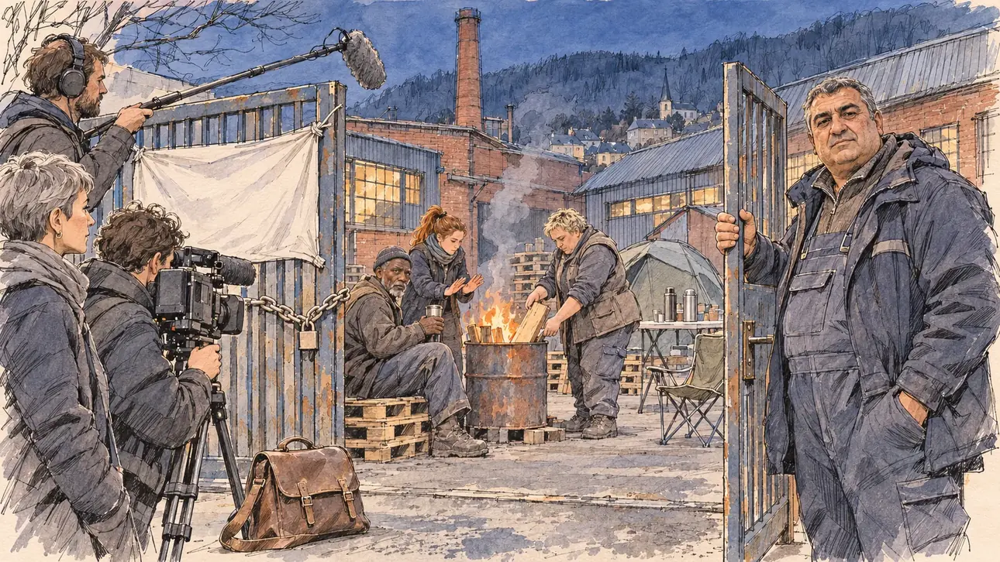

# `factoryOccupied` · L'usine occupée

**Retenue par le PO le 15/11/2026**, au premier essai. Elle sert telle quelle en clair et en sombre.



| Champ | Valeur |
| --- | --- |
| Carte | `factoryOccupied`, catégorie `field` (Rencontre), poids 0,1, toute semaine ; un geste au bord de l'axe de l'économie, côté État (Mitchnsun/moi-president, PO, 14/11/2026) |
| Style | Reportage dessiné |
| Ton | Tendu et chaleureux, crépuscule et brasero |
| Date | 2026-11-15 |
| Outil | ChatGPT Images, modèle GPT 6.2 (effort à compléter) |
| Conversation | À compléter |
| Format rendu | 1672 × 941 (16:9) : export en 1290 × 726 px, WebP de qualité 75, 227 Ko, sans recadrage, fait depuis la copie WebP de la conversation (à refaire depuis le PNG d'origine) |
| Fichier d'origine | À compléter (hors du dépôt) |
| Première édition | À compléter |

## Texte de la carte

> **L'usine occupée**
>
> Les ouvrières et ouvriers d'une fonderie que son propriétaire veut délocaliser occupent le site depuis trois jours. Un feu de palettes brûle à la grille, et les caméras attendent votre arrivée.

## Le moment choisi

La grille d'une fonderie de la vallée de la Meuse, dans les Ardennes, au crépuscule de février : halles de brique et de bardage, une haute cheminée, les toits d'ardoise du village et les collines boisées. La grille fermée d'une chaîne porte une banderole blanche sans lettres ; derrière, un feu de palettes dans un fût, des palettes empilées, une tente, des chaises de camping et des thermos. Le candidat arrive, hors champ : seul son cartable de cuir, posé devant la grille. Le délégué syndical tient la grille entrouverte et regarde le spectateur : vous entrez, ou vous restez dehors ? Autour du feu, trois ouvriers se réchauffent ou le rechargent ; dehors, une équipe de télévision attend. Les précédents sont Florange (2012) et Gandrange (2008) : personne n'y ressemble à un responsable politique ou syndical.

## Prompt complet

Dans une nouvelle conversation, avec [`primeTime.webp`](../../illustrations/media/primeTime.webp) comme seule image de référence :

```
Use the attached image as the style reference and copy its drawing: a realistic reportage drawing made on the spot for a newspaper, with quick, nervous pencil lines, often drawn twice, ink hatching in the shadows, transparent watercolour washes that spill a little over the lines, and the warm paper showing through. Not the same scene and not the same people: never reuse the face or the hair of the woman in the reference.
Like in the reference, the setting can be full when the story needs it, with the things that say where we are and what is happening, but each one is sketched with a few pencil lines and a light wash, never rendered or finished, and the drawing gets looser and paler towards the edges until it fades into the bare paper.
This must look like a drawing made by hand on paper by a press illustrator, halfway between a quick sketch and a realistic picture: never a photograph, a film poster or a digital painting, and never a cartoon, a comic strip, a caricature or a children's book illustration. Continuous lines, never dotted or dashed outlines; no uniform texture, speckles or hatching filter laid over the picture; no glossy highlights, no smooth gradients, in the sky and on the walls too. Colour can be rich in places, on a piece of clothing, a light or a flag, but it stays transparent and within the palette below. The fade into the paper at the edges stays narrow, without a wide white margin. No blur and no depth-of-field effect: everything, the foreground included, is drawn sharp, like a sketch made on the spot.
People are drawn from life with realistic anatomy and proportions, like in the reference: faces shaped with pencil lines, hatching and light washes, a little more finished than the background but never photographic (no photographic skin, no airbrushed or digital-painting look). Expressions stay natural and restrained, even in laughter or tears: no exaggerated grins, no wide-open mouths full of teeth, no rubbery or cartoonish faces.

Editorial illustration, landscape 16:9 (1536 × 864 px), the scene filling the frame, with only a light fade into the paper at the edges. The gate of a foundry in the Meuse valley, in the French Ardennes, at dusk on a cold evening in February 2027: brick and corrugated-steel workshops, a tall chimney, the slate roofs of the village and dark wooded hills behind; the workers have occupied the site for three days, its owner wanting to move production abroad. The steel gate is closed with a chain, a blank white cloth banner with no letters hangs on it; inside, a fire of pallets burns in a metal drum, other pallets are stacked, a few camping chairs, a small tent and folding tables with thermoses. The player's candidate has just arrived and stays off-camera, in front of the gate: in the foreground, only the candidate's leather satchel set down on the ground. In the right third, the union representative, a tall, heavy-set man in his fifties of Turkish descent, with short greying hair and a round face, wearing a work parka over foundry overalls, holds the gate half open and looks at the viewer, a mix of challenge and invitation, as if asking whether the viewer is coming in, his face above mid-height. Around the fire: a young foundry worker in her twenties with red hair pulled back in a ponytail warms her hands; a thin worker in his sixties of Cameroonian descent with a short grey goatee, sitting on a pallet with a thermos cup, also looks at the viewer, wary; a stocky woman worker in her forties of Polish descent with short bleached hair puts another pallet plank on the fire. Outside the gate, behind the viewer's side, a television crew: a camera operator, a short woman with a grey pixie cut, and a sound engineer with a boom. Only the union representative and the older worker look at the viewer. Nothing on the banner, the gate, the overalls, the drum, the buildings or the camera is readable.

Style: Reportage drawing made on the spot, like a press illustrator or courtroom sketch artist: pencil and ink with loose watercolour washes, lively unfinished lines, white paper showing through.

Palette: navy #13203F, vellum #F5EFE1, gold #A9802A, brick #B5523B, ochre #D9A441, sage #8FA58A, slate #5E7186, sand #DCC8A4, warm grey #8C8279; use 4 to 6 of them, subtle warm paper grain.

Tone: tense and warm at once, a cold blue dusk over the workshops and the orange glow of the fire on the faces, the smoke rising against the evening sky.

Constraints: realistic proportions, natural expressions, never cartoonish or caricatured faces, drawn like the rest of the illustration and never photographic; people of varied ages, genders, origins and body types (heavy, stocky, round, tall, short, wiry, not only slim), each with a distinct face and haircut (no two people alike), drawn with respect and never as a joke; each person's age, build and look plausible for their job and the scene (working people of working age), no stereotype tying an origin or a gender to a role, and no person of colour shown alone in a featured service or deferential role; anatomically correct hands with exactly five fingers, few hands visible, the others in pockets, behind objects or out of frame; no readable text anywhere (the banner, the gate, the overalls, the drum, the buildings and the camera stay unreadable, no slogans, no company name, no union name); no captions or speech bubbles; no logos, no trade union logo or colours, no television channel logo, no political party colours, no flags, no red flags; no recognisable real person, no lookalike of a real politician or of a known union leader; no explicit violence, no one in danger, the fire safely contained in its drum; no photographic rendering, no blur or bokeh, every outline a continuous pencil or ink line with no dotted or dashed outlines, no mottled, crackled or speckled texture over the faces, the clothes, the walls or the sky, no hatching filter over the picture, no oil-paint texture, no glow or halo around the fire, no wide white margin or frame (a light fade into the paper at the edges is fine).

Format: if 16:9 is not available, make 1536 × 1024 and keep the top 80 px and the bottom 80 px free of anything important (faces, hands, the main action): they will be cropped.
```

## Décisions prises sur cette image

Retenue telle quelle par le PO (15/11/2026). Elle s'écarte du prompt sur deux points, gardés : l'équipe de télévision est dans le tiers gauche, du côté du spectateur, la caméra tenue par un jeune homme aux cheveux bouclés à côté de la femme aux cheveux gris ; le vieil ouvrier regarde le feu, pas le spectateur, et le délégué est le seul à le regarder.

## Essais écartés

Aucun.

## Retouches

Aucune.

## Relecture

Faite le 15/11/2026, à confirmer par le PO.

- [x] Aucun texte lisible : la banderole est blanche ; rien sur la grille, le fût, les bâtiments ni la caméra.
- [x] Aucun sosie d'une personne réelle.
- [x] Le candidat du joueur est hors champ : seul son cartable, devant la grille.
- [x] Mains et visages sans défaut visible à 343 px de large : la main du délégué sur la grille, les mains tendues vers le feu, celle qui recharge le fût, la perche et la caméra.
- [x] Aucune couleur, aucun logo ni aucun drapeau de parti ou de syndicat. Des personnes variées par l'âge, le corps, l'origine et la coiffure.
- [x] En 16:9 : pas de recadrage.
- [ ] Lisible sur la page de l'événement, en clair et en sombre : à vérifier dans l'app, une fois la carte publiée.
