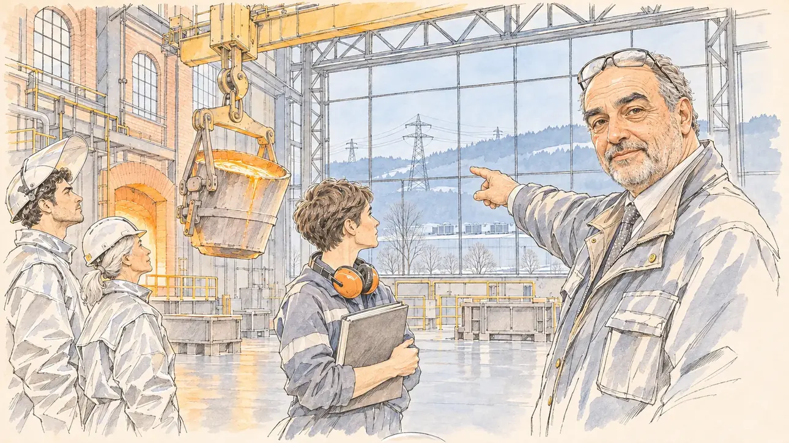

# `factoryWaits` · La fonderie qui attend le réseau

**Validée par le PO le 18/11/2026**, au deuxième essai, après un message de correction. Elle sert telle quelle en clair et en sombre.



| Champ | Valeur |
| --- | --- |
| Carte | `factoryWaits`, catégorie `field` (Rencontre), poids 0,12, toute semaine, sans condition (Mitchnsun/moi-president, PO, 17/11/2026) |
| Style | Reportage dessiné |
| Ton | Observateur, la lueur orangée du four dans une halle grise |
| Date | 2026-11-18 |
| Outil | ChatGPT Images |
| Format rendu | 1672 × 941 (16:9) : export en 1290 × 726 px, WebP de qualité 75, 166 Ko, sans recadrage, fait depuis la copie WebP de la conversation |
| Fichier d'origine | Image de ChatGPT, chez le PO. L'export du dépôt a été fait depuis la copie partagée dans la conversation avec Claude |
| Première édition | `kit-france-2611-0004` |

## Texte de la carte

> **La fonderie qui attend le réseau**
>
> Le directeur d'une fonderie de l'Est vous fait visiter son four : son passage à l'électricité attend un raccordement au réseau depuis des années. Dans la même file, des data centers ont réservé des gigawatts. « Ils n'en consomment même pas le quart », soupire-t-il.

## Le moment choisi

Une fonderie de la vallée du Doubs, en Franche-Comté, un matin de mars : une halle de métal et de brique, le four au gaz qui rougeoie, une poche de métal en fusion portée par un pont roulant, des ouvrières et ouvriers en combinaison argentée. Par une grande baie, au loin sur les collines boisées de sapins, une ligne à haute tension et ses pylônes, et le toit plat d'un data center tout neuf. Le candidat reste hors champ : seul son casque de visiteur blanc, qu'il tient au premier plan. Le directeur, à côté du four, montre d'un geste les pylônes par la baie et regarde le candidat, las : « Ils n'en consomment même pas le quart. » Une ingénieure tient le dossier de raccordement, épais comme un annuaire. Le précédent est la file d'attente de RTE, 18 GW réservés en mai 2026 : personne n'y ressemble à un patron ou à un dirigeant réel.

## Prompt complet

Dans une nouvelle conversation, avec [`primeTime.webp`](../../illustrations/media/primeTime.webp) comme seule image de référence :

```
Use the attached image as the style reference and copy its drawing: a realistic reportage drawing made on the spot for a newspaper, with quick, nervous pencil lines, often drawn twice, ink hatching in the shadows, transparent watercolour washes that spill a little over the lines, and the warm paper showing through. Not the same scene and not the same people: never reuse the face or the hair of the woman in the reference.
Like in the reference, the setting can be full when the story needs it, with the things that say where we are and what is happening, but each one is sketched with a few pencil lines and a light wash, never rendered or finished, and the drawing gets looser and paler towards the edges until it fades into the bare paper.
This must look like a drawing made by hand on paper by a press illustrator, halfway between a quick sketch and a realistic picture: never a photograph, a film poster or a digital painting, and never a cartoon, a comic strip, a caricature or a children's book illustration. Continuous lines, never dotted or dashed outlines; no uniform texture, speckles or hatching filter laid over the picture; no glossy highlights, no smooth gradients, in the sky and on the walls too. Colour can be rich in places, on a piece of clothing, a light or a flag, but it stays transparent and within the palette below. The fade into the paper at the edges stays narrow, without a wide white margin. No blur and no depth-of-field effect: everything, the foreground included, is drawn sharp, like a sketch made on the spot.
People are drawn from life with realistic anatomy and proportions, like in the reference: faces shaped with pencil lines, hatching and light washes, a little more finished than the background but never photographic (no photographic skin, no airbrushed or digital-painting look). Expressions stay natural and restrained, even in laughter or tears: no exaggerated grins, no wide-open mouths full of teeth, no rubbery or cartoonish faces.

Editorial illustration, landscape 16:9 (1536 × 864 px), the scene filling the frame, with only a light fade into the paper at the edges. Inside a foundry in the Doubs valley, in Franche-Comté in eastern France, on a March morning in 2027: a tall hall of steel beams and old brick, the mouth of a gas furnace glowing orange, a ladle of molten metal hanging from an overhead crane, workers in silver heat-protective suits and visors at a safe distance. Through a large window at the back: wooded hills of dark fir trees, a high-voltage power line with its pylons, and in the distance the flat roof of a brand-new data centre. The player's candidate stays off-camera: in the foreground, only the candidate's white visitor's hard hat, held at the bottom edge of the frame. In the right third, the foundry's director, a heavy-set man in his late fifties of Algerian descent, with a short grey beard, thick eyebrows, receding grey hair and safety glasses pushed up on his forehead, in a worn work jacket over a shirt and tie, points through the window at the pylons with one hand and looks at the viewer with a weary half-smile, his face above mid-height. Beside him, a process engineer, a short white woman in her thirties with a dark pixie cut and orange ear defenders around her neck, holds a thick binder against her chest. Further back, a tall young worker of Turkish descent, clean-shaven, with thick black hair and his visor up, and a wiry older worker with a white ponytail under her helmet, watch the ladle. Only the director looks at the viewer; the others go on with their work. Nothing on the binder, the hard hat, the suits or the machines is readable.

Style: Reportage drawing made on the spot, like a press illustrator or courtroom sketch artist: pencil and ink with loose watercolour washes, lively unfinished lines, white paper showing through.

Palette: navy #13203F, vellum #F5EFE1, gold #A9802A, brick #B5523B, ochre #D9A441, sage #8FA58A, slate #5E7186, sand #DCC8A4, warm grey #8C8279; use 4 to 6 of them, subtle warm paper grain.

Tone: observant, the warm orange glow of the furnace against the grey light of the hall, the cold blue-grey of the hills, the pylons and the data centre through the window.

Constraints: realistic proportions, natural expressions, never cartoonish or caricatured faces, drawn like the rest of the illustration and never photographic; people of varied ages, genders, origins and body types (heavy, stocky, round, tall, short, wiry, not only slim), each with a distinct face and haircut (no two people alike), drawn with respect and never as a joke; each person's age, build and look plausible for their job and the scene (working people of working age), no stereotype tying an origin or a gender to a role, and no person of colour shown alone in a featured service or deferential role; anatomically correct hands with exactly five fingers, few hands visible, the others in pockets, behind objects or out of frame; no readable text anywhere (the binder, the hard hat, the suits, the machines and the gauges stay unreadable, no company name, no warning signs with text); no captions or speech bubbles; no logos, no energy company logo, no political party colours, no flags; no recognisable real person, no lookalike of a real politician or of a real industry boss; no explicit violence, no one in danger, no sparks hitting anyone; no photographic rendering, no blur or bokeh, every outline a continuous pencil or ink line with no dotted or dashed outlines, no mottled, crackled or speckled texture over the faces, the clothes, the metal, the bricks or the sky, no hatching filter over the picture, no oil-paint texture, no glow or halo, no wide white margin or frame (a light fade into the paper at the edges is fine).

Format: if 16:9 is not available, make 1536 × 1024 and keep the top 80 px and the bottom 80 px free of anything important (faces, hands, the main action): they will be cropped.
```

## Décisions prises sur cette image

Retenue par le PO (18/11/2026). Le casque de visiteur n'est plus qu'un arc blanc au bas du cadre ; les couleurs sont plus pâles que sur les deux autres cartes de la série, hors la lueur du four.

### Message de correction

Après l'essai 1, dans la même conversation ; il a donné l'image retenue :

```
Keep the same scene, the same people, the same places and the same poses, but match the rendering of the reference image much more closely: a quick reportage drawing on warm paper, pencil and ink lines, loose watercolour washes, plenty of white paper showing through, lighter and less saturated overall; no photographic rendering, no oil-paint texture, no hatching filter over a finished digital painting; every face, hand and piece of clothing is drawn with an ink outline, a few hatching strokes and flat watercolour washes. Every outline is a continuous pencil or ink line: no dotted or dashed outlines anywhere, and no mottled, crackled or speckled texture laid over the faces, the jackets, the silver suits, the metal or the hills. The white hard hat in the foreground is smaller, only its edge at the bottom of the frame, and the director stands a little further from the right edge, his whole head inside the frame. Everything else stays the same: nothing readable, exactly five fingers on every visible hand.
```

## Essais écartés

- **Essai 1** (18/11/2026), au prompt complet : la composition, le regard et le geste justes, mais une peinture épaisse à texture d'huile et de taches, un casque de visiteur qui occupait le bas du cadre et la tête du directeur au bord droit.

## Retouches

Aucune.

## Relecture

Faite le 18/11/2026, validée par le PO le même jour.

- [x] Aucun texte lisible : classeur, combinaisons, machines et casque sans inscription.
- [x] Aucun sosie d'une personne réelle repéré.
- [x] Le candidat du joueur est hors champ : seul le bord de son casque de visiteur, au bas du cadre.
- [x] Mains et visages sans défaut visible à 343 px de large : la main du directeur qui pointe, les mains de l'ingénieure sur le classeur.
- [x] Aucune couleur, aucun logo ni aucun drapeau de parti. Des personnes variées par l'âge, le corps, l'origine et la coiffure.
- [x] En 16:9 : pas de recadrage.
- [ ] Lisible sur la page de l'événement, en clair et en sombre : à vérifier dans l'app, une fois la carte publiée.
