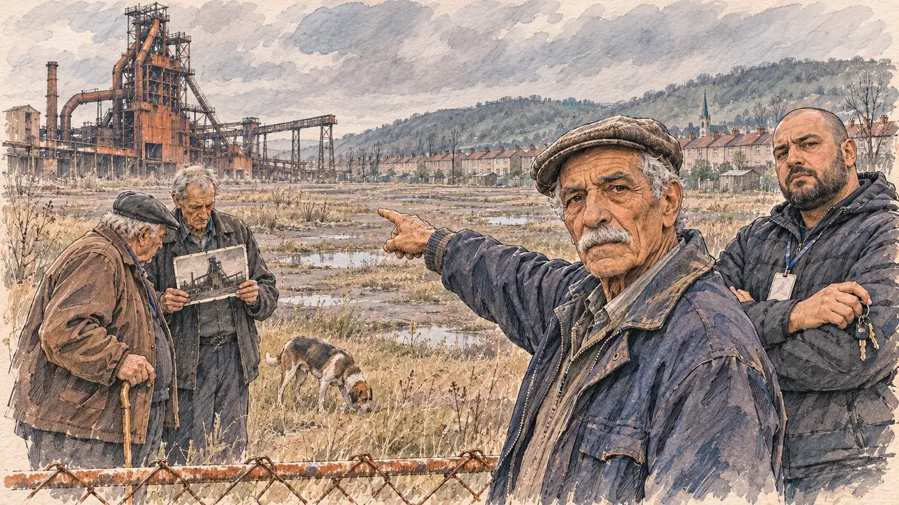

# `fenschValley` · La vallée sans hauts-fourneaux

**À générer.** Prompt prêt le 04/11/2026, pas encore d'image validée.



| Champ | Valeur |
| --- | --- |
| Carte | `fenschValley`, catégorie `field` (Rencontre), carte ajoutée par la PR #297 de l'app |
| Style | Reportage dessiné, trait de `primeTime` |
| Ton | Mélancolique, tendu |
| Date | À remplir |
| Outil | ChatGPT Images |
| Conversation | À remplir (le lien ne s'ouvre qu'avec le compte qui l'a créée) |
| Format rendu | À remplir |
| Fichier d'origine | À remplir |
| Première édition | À remplir |

## Texte de la carte

> **La vallée sans hauts-fourneaux**
>
> Dans la vallée de la Fensch, en Moselle, les hauts-fourneaux sont éteints depuis des années. Un ancien ouvrier vous montre le terrain vague où travaillaient des milliers de personnes ; son fils, derrière lui, travaille maintenant au Luxembourg et vous écoute d'un air sceptique.

## Le moment choisi

Le bord d'un immense terrain vague dans la vallée de la Fensch, en Moselle, un après-midi gris de février, vu depuis la place du candidat (hors champ) : au premier plan, le haut d'une clôture grillagée rouillée. Un ancien ouvrier sidérurgiste montre du bras le terrain où travaillaient des milliers de personnes et regarde le candidat. Son fils, derrière lui, bras croisés, l'écoute d'un air sceptique. Autour : deux anciens de l'amicale, une photo noir et blanc de l'usine qu'on tend, le chien d'un voisin. Derrière : la silhouette rouillée d'un haut-fourneau éteint, les herbes folles, les rangées de maisons ouvrières de la cité, le clocher et le ciel bas de Lorraine.

## Prompt complet

Dans une nouvelle conversation, avec [`primeTime.webp`](../../illustrations/media/primeTime.webp) comme seule image de référence.

```
Use the attached image as the style reference and copy its drawing: a realistic reportage drawing made on the spot for a newspaper, with quick, nervous pencil lines, often drawn twice, ink hatching in the shadows, transparent watercolour washes that spill a little over the lines, and the warm paper showing through. Not the same scene and not the same people: never reuse the face or the hair of the woman in the reference.
Like in the reference, the setting can be full when the story needs it, with the things that say where we are and what is happening, but each one is sketched with a few pencil lines and a light wash, never rendered or finished, and the drawing gets looser and paler towards the edges until it fades into the bare paper.
This must look like a drawing made by hand on paper by a press illustrator, halfway between a quick sketch and a realistic picture: never a photograph, a film poster or a digital painting, and never a cartoon, a comic strip, a caricature or a children's book illustration. Continuous lines, never dotted or dashed outlines; no uniform texture, speckles or hatching filter laid over the picture; no glossy highlights, no smooth gradients, in the sky and on the walls too. Colour can be rich in places, on a piece of clothing, a light or a flag, but it stays transparent and within the palette below. The fade into the paper at the edges stays narrow, without a wide white margin. No blur and no depth-of-field effect: everything, the foreground included, is drawn sharp, like a sketch made on the spot.
People are drawn from life with realistic anatomy and proportions, like in the reference: faces shaped with pencil lines, hatching and light washes, a little more finished than the background but never photographic (no photographic skin, no airbrushed or digital-painting look). Expressions stay natural and restrained, even in laughter or tears: no exaggerated grins, no wide-open mouths full of teeth, no rubbery or cartoonish faces.

Editorial illustration, landscape 16:9 (1536 × 864 px), the scene filling the frame, with only a light fade into the paper at the edges. The edge of a huge wasteland in the Fensch valley in Moselle, Lorraine, on a grey afternoon in February 2027: the blast furnaces have been cold for years, and thousands of people once worked here. The scene is seen from the place of the player's candidate, who stays off-camera: in the foreground, only the top of a rusty chain-link fence. In the right third, a retired steelworker in his seventies of Algerian Kabyle origin, wiry, with a white moustache, a flat cap and an old work jacket, points with his whole arm at the empty land where the steelworks stood, then turns to the viewer with a grave, proud and tired face, his face above mid-height. Behind him, his son, a heavy-set man in his forties with a shaved head, a short dark beard, a padded jacket and a lanyard from his job across the border in Luxembourg, his car keys in his hand, stands with his arms crossed and listens to the viewer with a sceptical, guarded look. Around them, sketched in pencil and light washes: two other retired steelworkers from the veterans' association, a stout man of Italian origin with a walking stick and a tall thin man of Polish origin, one of them holding up an old black-and-white photograph of the works, a neighbour's dog sniffing the grass. Behind them, the Fensch valley: the tall rusty silhouette of a cold blast furnace with its pipes and gantries, wild grass and puddles where the works used to be, long rows of identical workers' houses of the old company town with their small gardens, a church spire, wooded hills, and a low grey Lorraine sky. Only the old steelworker and his son look at the viewer. Nothing on the photograph, the lanyard, the fence or the houses is readable.

Style: Reportage drawing made on the spot, like a press illustrator or courtroom sketch artist: pencil and ink with loose watercolour washes, lively unfinished lines, white paper showing through.

Palette: navy #13203F, vellum #F5EFE1, gold #A9802A, brick #B5523B, ochre #D9A441, sage #8FA58A, slate #5E7186, sand #DCC8A4, warm grey #8C8279; use 4 to 6 of them, subtle warm paper grain.

Tone: melancholic and tense, a low grey winter sky, the rust of the blast furnace as the warmest colour.

Constraints: realistic proportions, natural expressions, never cartoonish or caricatured faces, drawn like the rest of the illustration and never photographic; people of varied ages, genders, origins and body types (heavy, stocky, round, tall, short, wiry, not only slim), each with a distinct face and haircut (no two people alike), drawn with respect and never as a joke; anatomically correct hands with exactly five fingers, few hands visible, the others in pockets, behind objects or out of frame; no readable text anywhere (the photograph, the lanyard, the fence and the houses stay unreadable); no captions or speech bubbles; no logos or political party colours; no recognisable real person, no lookalike of a real politician; no explicit violence; no photographic rendering, no blur or bokeh, no dotted outlines, no texture or hatching filter over the picture, no oil-paint texture, no wide white margin or frame (a light fade into the paper at the edges is fine).

Format: if 16:9 is not available, make 1536 × 1024 and keep the top 80 px and the bottom 80 px free of anything important (faces, hands, the main action): they will be cropped.
```

## Décisions prises sur cette image

Aucune pour l'instant.

## Essais écartés

Aucun pour l'instant.

## Retouches

Aucune.

## Relecture

À faire sur l'image validée.
