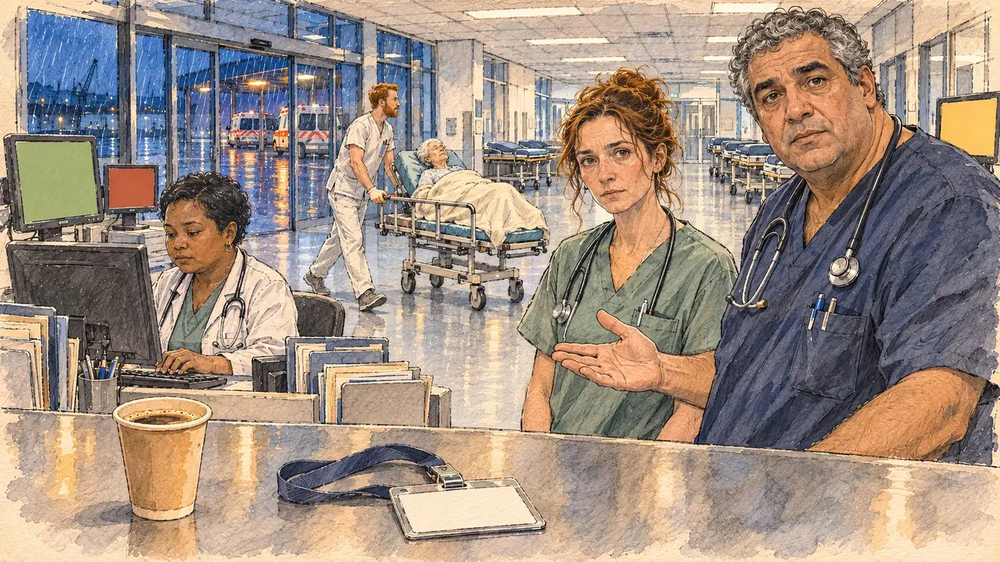

# `foreignDoctors` · Des diplômes étrangers aux urgences

**Validée par le PO le 20/11/2026**, au premier essai, avec `primeTime.webp` comme référence. Elle sert telle quelle en clair et en sombre.



| Champ | Valeur |
| --- | --- |
| Carte | `foreignDoctors`, catégorie `field` (Rencontre), poids 0,2, à partir de l'officialisation, une carte du programme : tirée si le programme tient une mesure d'immigration, dans un sens ou dans l'autre (`nationalPreference`, `migrationQuotas`, `regularisation`, `integrationByWork`, `freedomOfMovement`) (Mitchnsun/moi-president, PO, 17/11/2026) |
| Style | Reportage dessiné, trait de `primeTime` |
| Ton | Observateur, lumière froide d'un service de nuit |
| Date | 2026-11-20 (prompt écrit le 2026-11-18) |
| Outil | À compléter |
| Conversation | À remplir (le lien ne s'ouvre qu'avec le compte qui l'a créée) |
| Format rendu | 1672 × 941 (16:9) : export en 1290 × 726 px, WebP de qualité 75, 212 Ko, sans recadrage |
| Fichier d'origine | Image chez le PO. L'export du dépôt a été fait depuis la copie partagée dans la conversation avec Claude |
| Première édition | À compléter |

## Texte de la carte

> **Des diplômes étrangers aux urgences**
>
> Dans un hôpital de ville moyenne, l'équipe des urgences vous présente ses médecins : une bonne partie a obtenu son diplôme à l'étranger, et certains attendent encore leur pleine autorisation d'exercer. On vous demande ce que deviendra le service avec votre politique d'immigration.

## Le moment choisi

Le service des urgences de l'hôpital de Cherbourg, dans le Cotentin, un soir de mars : le couloir, des brancards, la banque d'accueil, des écrans de suivi, et par une porte vitrée l'arrivée des ambulances sous la pluie. Le candidat est au comptoir, hors champ : au premier plan, son badge de visiteur vierge et un gobelet de café de la machine. Le chef de service présente son équipe et regarde le candidat : que deviendra le service ? À côté de lui, une jeune médecin à l'autorisation encore provisoire, inquiète, regarde aussi le candidat ; une autre médecin écrit à l'ordinateur ; un infirmier pousse un brancard où une vieille dame attend. La carte rappelle les 15,2 % de médecins à diplôme étranger au 1er janvier 2026 : chaque médecin est dessiné en soignant au travail, et personne n'y ressemble à un médecin connu.

## Prompt complet

Dans une nouvelle conversation, avec [`primeTime.webp`](../../illustrations/media/primeTime.webp) comme seule image de référence :

```
Use the attached image as the style reference and copy its drawing: a realistic reportage drawing made on the spot for a newspaper, with quick, nervous pencil lines, often drawn twice, ink hatching in the shadows, transparent watercolour washes that spill a little over the lines, and the warm paper showing through. Not the same scene and not the same people: never reuse the face or the hair of the woman in the reference.
Like in the reference, the setting can be full when the story needs it, with the things that say where we are and what is happening, but each one is sketched with a few pencil lines and a light wash, never rendered or finished, and the drawing gets looser and paler towards the edges until it fades into the bare paper.
This must look like a drawing made by hand on paper by a press illustrator, halfway between a quick sketch and a realistic picture: never a photograph, a film poster or a digital painting, and never a cartoon, a comic strip, a caricature or a children's book illustration. Continuous lines, never dotted or dashed outlines; no uniform texture, speckles or hatching filter laid over the picture; no glossy highlights, no smooth gradients, in the sky and on the walls too. Colour can be rich in places, on a piece of clothing, a light or a flag, but it stays transparent and within the palette below. The fade into the paper at the edges stays narrow, without a wide white margin. No blur and no depth-of-field effect: everything, the foreground included, is drawn sharp, like a sketch made on the spot.
People are drawn from life with realistic anatomy and proportions, like in the reference: faces shaped with pencil lines, hatching and light washes, a little more finished than the background but never photographic (no photographic skin, no airbrushed or digital-painting look). Expressions stay natural and restrained, even in laughter or tears: no exaggerated grins, no wide-open mouths full of teeth, no rubbery or cartoonish faces.

Editorial illustration, landscape 16:9 (1536 × 864 px), the scene filling the frame, with only a light fade into the paper at the edges. The emergency department of the hospital of Cherbourg, in the Cotentin in Normandy, on an evening in March 2027: a corridor with stretchers along the wall, the triage desk, patient-tracking screens showing only coloured blocks, and through a glass door the ambulance bay in the rain. The emergency team introduces its doctors to the player's candidate: many of them hold a foreign diploma, and some still wait for their full licence to practise. The player's candidate stands at the desk and stays off-camera: in the foreground, only the candidate's blank visitor badge and a paper cup of coffee from the machine on the counter. In the right third, the main character, the head of the emergency department, a man in his fifties of Algerian descent, tall and heavy-set, with grey curly hair and a stethoscope around his neck, in navy scrubs, gestures towards his team and looks at the viewer with a direct, worried look, his face above mid-height. Beside him: a young doctor in her early thirties of Romanian descent, wiry and pale, with auburn hair in a messy bun, in green scrubs, also looks at the viewer, a little anxious; at a computer behind the desk, a doctor in her thirties of Malagasy descent, short and round, with short black hair, types without looking up; along the corridor, a nurse in his thirties, white, with a red beard, pushes a stretcher where an elderly white woman lies under a blanket. Only the head of department and the young doctor look at the viewer. Nothing on the screens, the badges, the scrubs, the files or the doors is readable.

Style: Reportage drawing made on the spot, like a press illustrator or courtroom sketch artist: pencil and ink with loose watercolour washes, lively unfinished lines, white paper showing through.

Palette: navy #13203F, vellum #F5EFE1, gold #A9802A, brick #B5523B, ochre #D9A441, sage #8FA58A, slate #5E7186, sand #DCC8A4, warm grey #8C8279; use 4 to 6 of them, subtle warm paper grain.

Tone: observant, the cold white light of a hospital at night against the blue of the rain outside, the green and navy of the scrubs.

Constraints: realistic proportions, natural expressions, never cartoonish or caricatured faces, drawn like the rest of the illustration and never photographic; people of varied ages, genders, origins and body types (heavy, stocky, round, tall, short, wiry, not only slim), each with a distinct face and haircut (no two people alike), drawn with respect and never as a joke; each person's age, build and look plausible for their job and the scene (working people of working age), no stereotype tying an origin or a gender to a role, and no person of colour shown alone in a featured service or deferential role; anatomically correct hands with exactly five fingers, few hands visible, the others in pockets, behind objects or out of frame; no readable text anywhere (the screens, the badges, the scrubs, the files and the doors stay unreadable, no signs with words); no captions or speech bubbles; no logos, no hospital logo, no political party colours; no recognisable real person, no lookalike of a real politician or of a known doctor; no explicit violence, no blood, no wounds shown; no photographic rendering, no blur or bokeh, every outline a continuous pencil or ink line with no dotted or dashed outlines, no mottled, crackled or speckled texture over the faces, the clothes, the walls or the sky, no hatching filter over the picture, no oil-paint texture, no glow or halo, no wide white margin or frame (a light fade into the paper at the edges is fine).

Format: if 16:9 is not available, make 1536 × 1024 and keep the top 80 px and the bottom 80 px free of anything important (faces, hands, the main action): they will be cropped.
```

## Décisions prises sur cette image

Aucune pour le moment.

## Essais écartés

Aucun.

## Retouches

Aucune.

## Relecture

Faite et validée par le PO le 20/11/2026.

- [x] Aucun texte lisible : les écrans ne montrent que des aplats de couleur, le badge est vierge, rien sur les tenues, les dossiers, les portes ni les ambulances.
- [x] Aucun sosie d'une personne réelle.
- [x] Le candidat du joueur est hors champ : son badge et un gobelet de café sur le comptoir.
- [x] Mains, visages et foules sans défaut visible à 343 px de large ; ni sang ni blessure.
- [x] Aucune couleur ni aucun logo de parti. Aucun logo d'hôpital. Des personnes variées par l'âge, le corps, l'origine et la coiffure.
- [x] En 3:2 : sans objet, l'image est en 16:9.
- [x] Lisible sur la page de l'événement, en clair et en sombre.

Ce que la relecture a accepté : un grain marbré sur les visages et les tenues, plus fini que la référence ; la médecin à l'ordinateur en blouse blanche par-dessus sa tenue verte, l'infirmier en tenue blanche.
