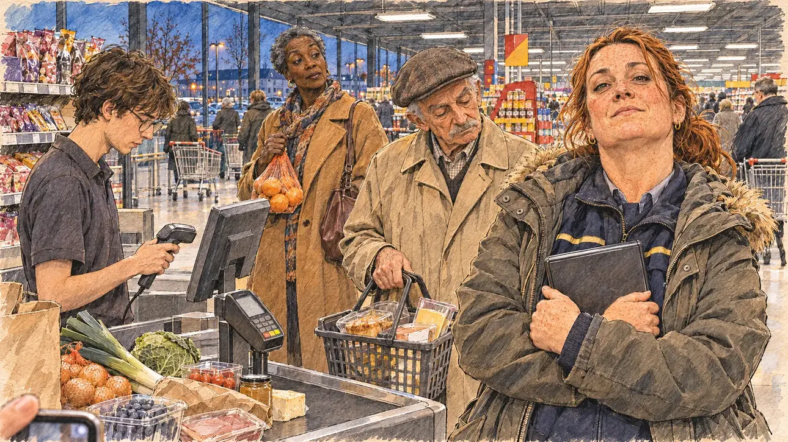

# `gamePrice` · 80 € le jeu, et les fins de mois ?

**Retenue par le PO le 21/11/2026**, au premier essai, sans retouche. Elle sert telle quelle en clair et en sombre.



| Champ | Valeur |
| --- | --- |
| Carte | `gamePrice`, catégorie `field` (Rencontre), poids 0,6 à son pic, sans autre condition, datée du 19/11 au 12/12/2026 et décroissante (`fade` : 1, 0,5, 0,25, 0,1 de la semaine du 15/11 à celle du 6/12) : seules les campagnes longues (#218) l'atteignent (Mitchnsun/moi-president, PO, 20/11/2026) |
| Style | Reportage dessiné |
| Ton | Observateur avec une pointe de tension, la lumière froide et plate de l'hypermarché, plus chaude sur le visage et les cheveux de la mère |
| Date | 2026-11-21 |
| Outil | ChatGPT Images |
| Conversation | À remplir (le lien ne s'ouvre qu'avec le compte qui l'a créée) |
| Format rendu | 1672 × 941 (16:9) : export en 1290 × 726 px, WebP de qualité 75, 246 Ko, sans recadrage, fait depuis la copie WebP reçue (à refaire depuis le PNG d'origine) |
| Fichier d'origine | À compléter (hors du dépôt) |
| Première édition | À compléter |

## Texte de la carte

> **80 € le jeu, et les fins de mois ?**
>
> Devant la caisse d'un hypermarché, un retraité lance à une mère qui achète le jeu de l'année pour son fils : « On se plaint des fins de mois, et on paie 80 € un jeu ? » La vidéo fait le tour des réseaux, la mère répond qu'elle a mis de côté pendant deux mois. On vous demande s'il a raison.

Réponses : « Personne n'a de leçon à donner sur les plaisirs des gens », « Quand les fins de mois sont dures, il faut savoir choisir » (plus facile à droite), « Dénoncer une société qui pousse à acheter ceux qui comptent chaque euro » (plus facile pour un écologiste), « Le problème, ce ne sont pas les jeux, ce sont les salaires », « Aller la voir chez elle, et raconter son mois avec son accord » (le pari risqué).

## Le moment choisi

La caisse d'un hypermarché en fin de journée, l'échange qui est devenu la vidéo. La mère, conductrice de bus d'une quarantaine d'années, serre la boîte du jeu contre elle et regarde le spectateur, gênée et fière ; le retraité derrière elle fixe la boîte ; une jeune femme filme ; le caissier attend sans prendre parti. Le fils n'est pas dans l'image : pas d'enfant avec un jeu déconseillé aux moins de 18 ans.

## Prompt complet

Dans une nouvelle conversation, avec [`primeTime.webp`](../../illustrations/media/primeTime.webp) comme seule image de référence. C'est la première version du prompt, où le candidat fait la queue à la même caisse ; une seconde version, écrite ensuite parce que la carte parle d'une vidéo virale et que le candidat n'y était pas, plaçait le spectateur derrière le téléphone qui filme. Le PO a retenu l'image de la première :

```
Use the attached image as the style reference and copy its drawing: a realistic reportage drawing made on the spot for a newspaper, with quick, nervous pencil lines, often drawn twice, ink hatching in the shadows, transparent watercolour washes that spill a little over the lines, and the warm paper showing through. Not the same scene and not the same people: never reuse the face or the hair of the woman in the reference.
Like in the reference, the setting can be full when the story needs it, with the things that say where we are and what is happening, but each one is sketched with a few pencil lines and a light wash, never rendered or finished, and the drawing gets looser and paler towards the edges until it fades into the bare paper.
This must look like a drawing made by hand on paper by a press illustrator, halfway between a quick sketch and a realistic picture: never a photograph, a film poster or a digital painting, and never a cartoon, a comic strip, a caricature or a children's book illustration. Continuous lines, never dotted or dashed outlines; no uniform texture, speckles or hatching filter laid over the picture; no glossy highlights, no smooth gradients, in the sky and on the walls too. Colour can be rich in places, on a piece of clothing, a light or a flag, but it stays transparent and within the palette below. The fade into the paper at the edges stays narrow, without a wide white margin. No blur and no depth-of-field effect: everything, the foreground included, is drawn sharp, like a sketch made on the spot.
People are drawn from life with realistic anatomy and proportions, like in the reference: faces shaped with pencil lines, hatching and light washes, a little more finished than the background but never photographic (no photographic skin, no airbrushed or digital-painting look). Expressions stay natural and restrained, even in laughter or tears: no exaggerated grins, no wide-open mouths full of teeth, no rubbery or cartoonish faces.

Editorial illustration, landscape 16:9 (1536 × 864 px), the scene filling the frame, with only a light fade into the paper at the edges. At the end of a weekday in November 2027, at a checkout of a large French hypermarket on the edge of a town: a row of checkouts under flat white ceiling lights, a conveyor belt, a card terminal, a rack of sweets by the till, tall aisles of groceries and promotion stands sketched in the background, shoppers with trolleys further off. The player's candidate stays off-camera, queuing at the same checkout: in the foreground, only the candidate's few groceries on the conveyor belt at the bottom edge of the frame (a baguette, a carton of milk, a bag of apples), behind the plastic divider bar. In the right third, the main character, a heavy-set white woman in her early forties with red hair pulled back in a loose ponytail, freckles, tired eyes and small gold hoop earrings, wearing a city bus driver's navy uniform jacket under an open parka, holds a plain dark video game box against her chest with both arms, protectively; she has just answered back and turns to look at the viewer, as if asking the candidate to judge, with a mix of embarrassment and pride, her face above mid-height. Just behind her in the queue, a thin white man in his mid-seventies with a flat cap, a neat grey moustache, a beige raincoat and a basket of reduced-price items on his arm, nods sharply towards the box with a disapproving, tight-lipped look, eyes on the box, not on the viewer. Further left, a young woman of about twenty-five of Chinese descent with a short black bob, a nose ring and a denim jacket, films the scene on her phone held at chest height, looking at her screen. At the till, the cashier, a lanky white man in his early twenties with round glasses and messy brown hair, in the store's plain uniform polo, waits with the scanner in his hand, looking down, staying out of it. Only the mother looks at the viewer. The game box shows no logo, no title and no character from any real game; nothing on the box, the price tags, the receipts, the screens, the signs or the phone is readable.

Style: Reportage drawing made on the spot, like a press illustrator or courtroom sketch artist: pencil and ink with loose watercolour washes, lively unfinished lines, white paper showing through.

Palette: navy #13203F, vellum #F5EFE1, gold #A9802A, brick #B5523B, ochre #D9A441, sage #8FA58A, slate #5E7186, sand #DCC8A4, warm grey #8C8279; use 4 to 6 of them, subtle warm paper grain.

Tone: observant with a touch of tension, the flat cold light of the hypermarket, warmer on the mother's face and hair.

Constraints: realistic proportions, natural expressions, never cartoonish or caricatured faces, drawn like the rest of the illustration and never photographic; people of varied ages, genders, origins and body types (heavy, stocky, round, tall, short, wiry, not only slim), each with a distinct face and haircut (no two people alike), drawn with respect and never as a joke, no misery-porn and no pity pose; each person's age, build and look plausible for their job and the scene (working people of working age), no stereotype tying an origin or a gender to a role, and no person of colour shown alone in a featured service or deferential role; no child in the picture; anatomically correct hands with exactly five fingers, few hands visible, the others in pockets, behind objects or out of frame; no readable text anywhere (the game box, the price tags, the receipts, the card terminal, the screens, the signs and the phone stay unreadable); no captions or speech bubbles; no logos, no store brand, no console brand, no real video game's title, logo, characters or visual identity, no political party colours; no recognisable real person, no lookalike of a real politician; no weapons and no violent imagery; no explicit violence; no photographic rendering, no blur or bokeh, no dotted outlines, no texture or hatching filter over the picture, no oil-paint texture, no wide white margin or frame (a light fade into the paper at the edges is fine).

Format: if 16:9 is not available, make 1536 × 1024 and keep the top 80 px and the bottom 80 px free of anything important (faces, hands, the main action): they will be cropped.
```

## Décisions prises sur cette image

Retenue par le PO (21/11/2026), faite avec la première version du prompt : les courses au premier plan peuvent se lire comme celles du candidat dans la file, alors que la carte le fait réagir à une vidéo ; le PO l'a gardée, la scène se lisant aussi comme le moment filmé.

## Essais écartés

Aucun.

## Retouches

Aucune.

## Relecture

Faite le 21/11/2026 sur l'image reçue, zoomée sur le texte possible et les mains ; retenue par le PO le même jour.

- [x] Aucun texte lisible : boîte de jeu unie, étiquettes jaunes du panier, terminal de paiement, barres chocolatées et rayons sans inscription ni marque.
- [x] Rien du vrai jeu : boîte noire unie.
- [x] Le candidat du joueur est hors champ : seules ses courses sur le tapis (baguette, brique de lait, sachet de pommes).
- [x] Écarts au prompt : le retraité regarde la boîte en coin, la main à son col, plutôt qu'un signe de tête appuyé ; des baies vitrées sur un parking au crépuscule à gauche.
- [x] Rendu : un grain craquelé couvre l'image, comme sur `gameLaunch`, la dérive que le gabarit signale ; le PO l'a gardée telle quelle.
- [x] Aucun sosie d'une personne réelle repéré.
- [x] Mains sans défaut visible.
- [x] Aucune couleur, aucun logo ni aucun drapeau de parti. Des personnes variées par l'âge, le corps, l'origine et la coiffure ; aucun enfant.
- [x] En 16:9 : pas de recadrage.
- [ ] Lisible sur la page de l'événement, en clair et en sombre : à vérifier dans l'app, une fois la carte publiée.
