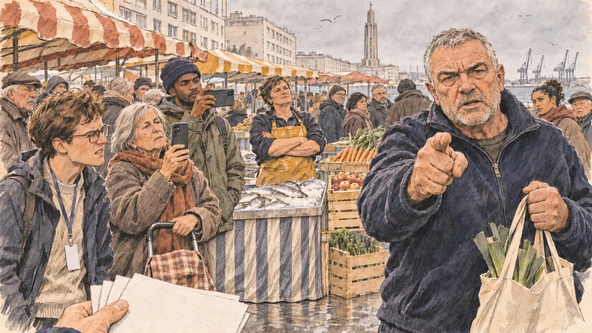

# `heckler` · Un électeur vous interpelle

**À générer.** Prompt prêt le 04/11/2026, pas encore d'image validée.



| Champ | Valeur |
| --- | --- |
| Carte | `heckler`, catégorie `field` (Rencontre), carte ajoutée par la PR #297 de l'app |
| Style | Reportage dessiné, trait de `primeTime` |
| Ton | Tendu |
| Date | À remplir |
| Outil | ChatGPT Images |
| Conversation | À remplir (le lien ne s'ouvre qu'avec le compte qui l'a créée) |
| Format rendu | À remplir |
| Fichier d'origine | À remplir |
| Première édition | À remplir |

## Texte de la carte

> **Un électeur vous interpelle**
>
> À la sortie d'un marché, un homme vous lance devant votre équipe : « Vous, les politiques, vous ne connaissez rien à nos fins de mois ! » Deux téléphones filment.

## Le moment choisi

La sortie d'un marché du Havre, un samedi matin d'hiver, vue depuis la place du candidat (hors champ) : au premier plan, quelques tracts vierges dans la main d'un militant. Un docker à la retraite, son cabas de poireaux à la main, interpelle le candidat du doigt. Deux passants le filment avec leur téléphone, la militante de l'équipe grimace, une marchande regarde la scène. Derrière : les étals du marché sous leurs bâches, les immeubles en béton de la reconstruction, la tour de l'église Saint-Joseph et les grues du port.

## Prompt complet

Dans une nouvelle conversation, avec [`primeTime.webp`](../../illustrations/media/primeTime.webp) comme seule image de référence.

```
Use the attached image as the style reference and copy its drawing: a realistic reportage drawing made on the spot for a newspaper, with quick, nervous pencil lines, often drawn twice, ink hatching in the shadows, transparent watercolour washes that spill a little over the lines, and the warm paper showing through. Not the same scene and not the same people: never reuse the face or the hair of the woman in the reference.
Like in the reference, the setting can be full when the story needs it, with the things that say where we are and what is happening, but each one is sketched with a few pencil lines and a light wash, never rendered or finished, and the drawing gets looser and paler towards the edges until it fades into the bare paper.
This must look like a drawing made by hand on paper by a press illustrator, halfway between a quick sketch and a realistic picture: never a photograph, a film poster or a digital painting, and never a cartoon, a comic strip, a caricature or a children's book illustration. Continuous lines, never dotted or dashed outlines; no uniform texture, speckles or hatching filter laid over the picture; no glossy highlights, no smooth gradients, in the sky and on the walls too. Colour can be rich in places, on a piece of clothing, a light or a flag, but it stays transparent and within the palette below. The fade into the paper at the edges stays narrow, without a wide white margin. No blur and no depth-of-field effect: everything, the foreground included, is drawn sharp, like a sketch made on the spot.
People are drawn from life with realistic anatomy and proportions, like in the reference: faces shaped with pencil lines, hatching and light washes, a little more finished than the background but never photographic (no photographic skin, no airbrushed or digital-painting look). Expressions stay natural and restrained, even in laughter or tears: no exaggerated grins, no wide-open mouths full of teeth, no rubbery or cartoonish faces.

Editorial illustration, landscape 16:9 (1536 × 864 px), the scene filling the frame, with only a light fade into the paper at the edges. The edge of a busy Saturday-morning market in Le Havre, in Normandy, on a grey winter day in early 2027, as the player's candidate leaves after a campaign walkabout with the team. The scene is seen from the candidate's place, who stays off-camera: in the foreground, only a few blank leaflets held by a campaign volunteer at the bottom edge of the picture. In the right third, a retired docker in his early sixties, stocky and broad-chested, with a grey crew cut, grey stubble and a navy fleece, a shopping bag full of leeks in one hand, points a finger at the viewer and speaks hard and fast, angry and tired, his face above mid-height: he is telling the candidate that politicians know nothing about the end of the month. Around him, sketched in pencil and light washes: two passers-by filming the scene with their phones held up, a young man of Cape Verdean origin with a beanie and an older woman with a grey bob and a shopping trolley; a campaign volunteer of the team, a young man with glasses and a lanyard, wincing; a fishmonger in her fifties of Breton stock, in rubber apron and boots, watching with her arms crossed behind her stall of fish on ice; other shoppers slowing down. Behind them, the market stalls under striped canvas awnings, crates of vegetables and apples, and the city of Le Havre rebuilt after the war: the regular pale concrete buildings of the reconstruction with their long rows of windows, the tall slender concrete tower of the church of Saint-Joseph, and the cranes of the port against a grey sea sky with gulls. Only the docker looks at the viewer. Nothing on the leaflets, the phones, the awnings, the stalls or the price tags is readable.

Style: Reportage drawing made on the spot, like a press illustrator or courtroom sketch artist: pencil and ink with loose watercolour washes, lively unfinished lines, white paper showing through.

Palette: navy #13203F, vellum #F5EFE1, gold #A9802A, brick #B5523B, ochre #D9A441, sage #8FA58A, slate #5E7186, sand #DCC8A4, warm grey #8C8279; use 4 to 6 of them, subtle warm paper grain.

Tone: tense, the flat grey light of a winter morning by the sea, the striped awnings and the fresh colours of the vegetables as the only warm notes.

Constraints: realistic proportions, natural expressions, never cartoonish or caricatured faces, drawn like the rest of the illustration and never photographic; people of varied ages, genders, origins and body types (heavy, stocky, round, tall, short, wiry, not only slim), each with a distinct face and haircut (no two people alike), drawn with respect and never as a joke; anatomically correct hands with exactly five fingers, few hands visible, the others in pockets, behind objects or out of frame; no readable text anywhere (the leaflets, the phones, the awnings, the stalls and the price tags stay unreadable); no captions or speech bubbles; no logos or political party colours; no recognisable real person, no lookalike of a real politician; no explicit violence; no photographic rendering, no blur or bokeh, no dotted outlines, no texture or hatching filter over the picture, no oil-paint texture, no wide white margin or frame (a light fade into the paper at the edges is fine).

Format: if 16:9 is not available, make 1536 × 1024 and keep the top 80 px and the bottom 80 px free of anything important (faces, hands, the main action): they will be cropped.
```

## Décisions prises sur cette image

Aucune pour l'instant.

## Essais écartés

Aucun pour l'instant.

## Retouches

Aucune.

## Relecture

À faire sur l'image validée.
