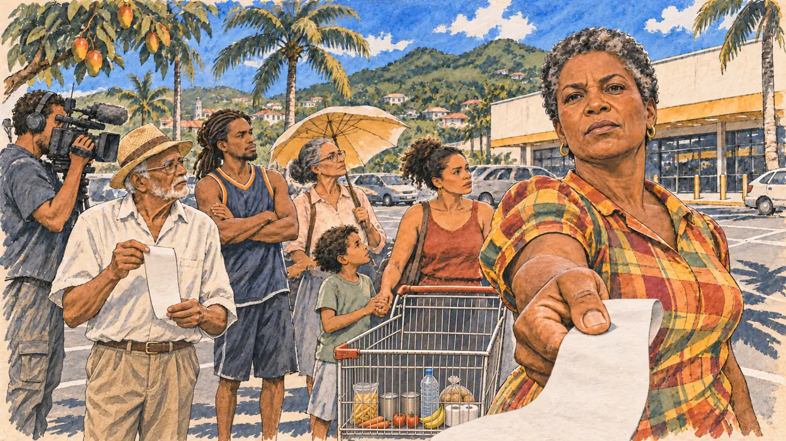

# `martiniqueCost` · La vie chère à Fort-de-France

**À générer.** Prompt prêt le 04/11/2026, pas encore d'image validée.



| Champ | Valeur |
| --- | --- |
| Carte | `martiniqueCost`, catégorie `field` (Rencontre), carte ajoutée par la PR #297 de l'app |
| Style | Reportage dessiné, trait de `primeTime` |
| Ton | Tendu, digne |
| Date | À remplir |
| Outil | ChatGPT Images |
| Conversation | À remplir (le lien ne s'ouvre qu'avec le compte qui l'a créée) |
| Format rendu | À remplir |
| Fichier d'origine | À remplir |
| Première édition | À remplir |

## Texte de la carte

> **La vie chère à Fort-de-France**
>
> Devant un supermarché de Fort-de-France, des habitants vous tendent leurs tickets de caisse : un même panier coûte bien plus cher que dans l'Hexagone. Le mouvement contre la vie chère de l'automne 2024 a fait baisser quelques prix, pas assez, disent-ils, et ils n'attendent pas un discours.

## Le moment choisi

Le parking d'un supermarché de Fort-de-France, en Martinique, un matin de février sous un soleil déjà fort, vu depuis la place du candidat (hors champ) : au premier plan, un long ticket de caisse vierge qu'on lui tend. Une mère de famille d'une cinquantaine d'années le lui met sous les yeux, ferme et digne, sans attendre de discours. Autour : d'autres habitants qui brandissent leurs tickets, un vieux monsieur indo-martiniquais au chapeau de paille, un jeune homme aux dreadlocks, une enseignante à la retraite, des caddies à moitié pleins. Derrière : la façade du supermarché sans enseigne, les palmiers, les mornes verts, les toits de tôle des maisons créoles et le ciel des Antilles.

## Prompt complet

Dans une nouvelle conversation, avec [`primeTime.webp`](../../illustrations/media/primeTime.webp) comme seule image de référence.

```
Use the attached image as the style reference and copy its drawing: a realistic reportage drawing made on the spot for a newspaper, with quick, nervous pencil lines, often drawn twice, ink hatching in the shadows, transparent watercolour washes that spill a little over the lines, and the warm paper showing through. Not the same scene and not the same people: never reuse the face or the hair of the woman in the reference.
Like in the reference, the setting can be full when the story needs it, with the things that say where we are and what is happening, but each one is sketched with a few pencil lines and a light wash, never rendered or finished, and the drawing gets looser and paler towards the edges until it fades into the bare paper.
This must look like a drawing made by hand on paper by a press illustrator, halfway between a quick sketch and a realistic picture: never a photograph, a film poster or a digital painting, and never a cartoon, a comic strip, a caricature or a children's book illustration. Continuous lines, never dotted or dashed outlines; no uniform texture, speckles or hatching filter laid over the picture; no glossy highlights, no smooth gradients, in the sky and on the walls too. Colour can be rich in places, on a piece of clothing, a light or a flag, but it stays transparent and within the palette below. The fade into the paper at the edges stays narrow, without a wide white margin. No blur and no depth-of-field effect: everything, the foreground included, is drawn sharp, like a sketch made on the spot.
People are drawn from life with realistic anatomy and proportions, like in the reference: faces shaped with pencil lines, hatching and light washes, a little more finished than the background but never photographic (no photographic skin, no airbrushed or digital-painting look). Expressions stay natural and restrained, even in laughter or tears: no exaggerated grins, no wide-open mouths full of teeth, no rubbery or cartoonish faces.

Editorial illustration, landscape 16:9 (1536 × 864 px), the scene filling the frame, with only a light fade into the paper at the edges. The car park of a supermarket in Fort-de-France, Martinique, on a bright February morning in 2027 under an already strong sun. Residents are waiting for the player's candidate with their till receipts: the same basket of shopping costs far more than in mainland France; the protest movement against the high cost of living of autumn 2024 brought a few prices down, not enough, they say, and they are not waiting for a speech. The scene is seen from the place of the candidate, who stays off-camera: in the foreground, only the end of a long till receipt, blank, held out towards the viewer. In the right third, a mother in her fifties of African-Caribbean descent, tall and strong, with short natural grey-black hair, small gold earrings and a bright madras-patterned blouse, holds up her long receipt right under the viewer's eyes and looks straight at the viewer, firm, dignified and unsmiling, her face above mid-height. Around her, sketched in pencil and light washes: other residents holding up their own blank receipts, an elderly Indo-Martinican man with a straw hat and a white shirt, a young man with dreadlocks and a basketball vest with his arms crossed, a retired schoolteacher with glasses and a sun umbrella, a young mother of mixed descent with a child holding her hand; shopping trolleys half full of rice, oil and water bottles; a regional television cameraman filming. Behind them, the plain front of the supermarket with no sign or brand, a row of royal palms and mango trees, the steep green hills of the mornes above the town, the corrugated metal roofs of Creole houses, and a deep blue Caribbean sky with white clouds. Only the mother looks at the viewer. Nothing on the receipts, the supermarket, the bottles, the trolleys or the camera is readable, and no logo of a real supermarket or brand appears.

Style: Reportage drawing made on the spot, like a press illustrator or courtroom sketch artist: pencil and ink with loose watercolour washes, lively unfinished lines, white paper showing through.

Palette: navy #13203F, vellum #F5EFE1, gold #A9802A, brick #B5523B, ochre #D9A441, sage #8FA58A, slate #5E7186, sand #DCC8A4, warm grey #8C8279; use 4 to 6 of them, subtle warm paper grain.

Tone: tense and dignified, the hard white light of a tropical morning, deep shadows under the palms, the madras of the blouse and the green of the mornes as the brightest notes.

Constraints: realistic proportions, natural expressions, never cartoonish or caricatured faces, drawn like the rest of the illustration and never photographic; people of varied ages, genders, origins and body types (heavy, stocky, round, tall, short, wiry, not only slim), each with a distinct face and haircut (no two people alike), drawn with respect and never as a joke; anatomically correct hands with exactly five fingers, few hands visible, the others in pockets, behind objects or out of frame; no readable text anywhere (the receipts, the supermarket, the bottles, the trolleys and the camera stay unreadable); no captions or speech bubbles; no logos or political party colours; no recognisable real person, no lookalike of a real politician or of a real activist, and no logo of a real supermarket or brand; no explicit violence; no photographic rendering, no blur or bokeh, no dotted outlines, no texture or hatching filter over the picture, no oil-paint texture, no wide white margin or frame (a light fade into the paper at the edges is fine).

Format: if 16:9 is not available, make 1536 × 1024 and keep the top 80 px and the bottom 80 px free of anything important (faces, hands, the main action): they will be cropped.
```

## Décisions prises sur cette image

Aucune pour l'instant.

## Essais écartés

Aucun pour l'instant.

## Retouches

Aucune.

## Relecture

À faire sur l'image validée.
