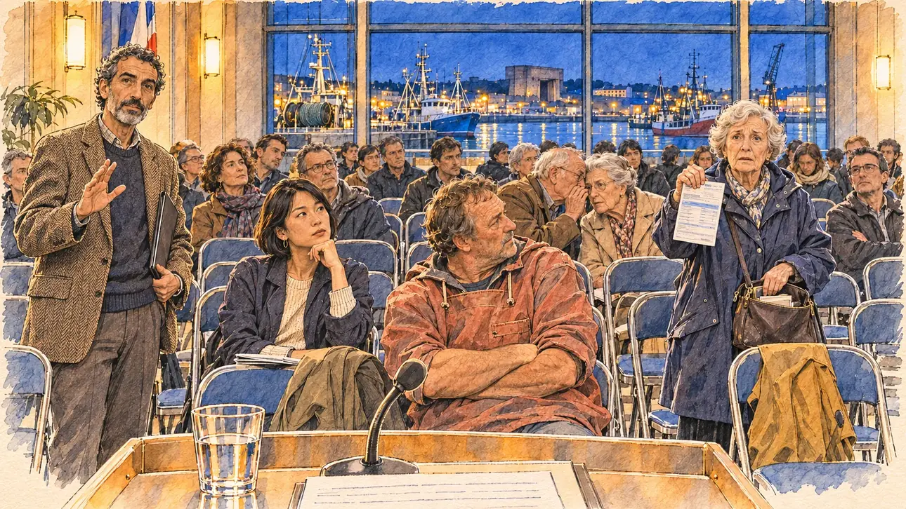

# `mutuelleBill` · L'avis d'échéance de la mutuelle

**Validée par le PO le 20/11/2026**, au premier essai, avec `primeTime.webp` comme référence. Elle sert telle quelle en clair et en sombre.



| Champ | Valeur |
| --- | --- |
| Carte | `mutuelleBill`, catégorie `field` (Rencontre), poids 0,2, à partir de l'officialisation, une carte du programme : tirée si le programme tient la prise en charge complète par l'Assurance maladie (`fullCoverage`) (Mitchnsun/moi-president, PO, 17/11/2026) |
| Style | Reportage dessiné, trait de `primeTime` |
| Ton | Observateur et chaleureux, lumière jaune d'une salle municipale le soir |
| Date | 2026-11-20 (prompt écrit le 2026-11-18) |
| Outil | À compléter |
| Conversation | À remplir (le lien ne s'ouvre qu'avec le compte qui l'a créée) |
| Format rendu | 1672 × 941 (16:9) : export en 1290 × 726 px, WebP de qualité 75, 234 Ko, sans recadrage |
| Fichier d'origine | Image chez le PO. L'export du dépôt a été fait depuis la copie partagée dans la conversation avec Claude |
| Première édition | À compléter |

## Texte de la carte

> **L'avis d'échéance de la mutuelle**
>
> Une retraitée sort de son sac l'avis d'échéance de sa complémentaire santé, encore en hausse cette année, et vous demande si votre prise en charge complète lui épargnera cela, ou si l'on paiera autrement. Dans la salle, le représentant d'une mutuelle rappelle que les remboursements transférés pèsent déjà sur les cotisations.

## Le moment choisi

Une réunion publique dans une salle municipale de Lorient, en Bretagne, un soir de mars : chaises pliantes, un public de quartier, des fenêtres sur le port de pêche et les chalutiers. Le candidat est au pupitre, hors champ : au premier plan, son micro sur pied et un verre d'eau. Une retraitée s'est levée et brandit l'avis d'échéance de sa complémentaire santé, sorti de son sac, en regardant le candidat. Sur le côté, le représentant d'une mutuelle lève la main pour prendre la parole ; dans la salle, une jeune femme écoute, un marin-pêcheur en vareuse, un couple âgé. La carte rappelle les hausses attendues pour 2027 : personne n'y ressemble à un dirigeant de mutuelle connu, et aucun nom de mutuelle n'apparaît.

## Prompt complet

Dans une nouvelle conversation, avec [`primeTime.webp`](../../illustrations/media/primeTime.webp) comme seule image de référence :

```
Use the attached image as the style reference and copy its drawing: a realistic reportage drawing made on the spot for a newspaper, with quick, nervous pencil lines, often drawn twice, ink hatching in the shadows, transparent watercolour washes that spill a little over the lines, and the warm paper showing through. Not the same scene and not the same people: never reuse the face or the hair of the woman in the reference.
Like in the reference, the setting can be full when the story needs it, with the things that say where we are and what is happening, but each one is sketched with a few pencil lines and a light wash, never rendered or finished, and the drawing gets looser and paler towards the edges until it fades into the bare paper.
This must look like a drawing made by hand on paper by a press illustrator, halfway between a quick sketch and a realistic picture: never a photograph, a film poster or a digital painting, and never a cartoon, a comic strip, a caricature or a children's book illustration. Continuous lines, never dotted or dashed outlines; no uniform texture, speckles or hatching filter laid over the picture; no glossy highlights, no smooth gradients, in the sky and on the walls too. Colour can be rich in places, on a piece of clothing, a light or a flag, but it stays transparent and within the palette below. The fade into the paper at the edges stays narrow, without a wide white margin. No blur and no depth-of-field effect: everything, the foreground included, is drawn sharp, like a sketch made on the spot.
People are drawn from life with realistic anatomy and proportions, like in the reference: faces shaped with pencil lines, hatching and light washes, a little more finished than the background but never photographic (no photographic skin, no airbrushed or digital-painting look). Expressions stay natural and restrained, even in laughter or tears: no exaggerated grins, no wide-open mouths full of teeth, no rubbery or cartoonish faces.

Editorial illustration, landscape 16:9 (1536 × 864 px), the scene filling the frame, with only a light fade into the paper at the edges. A public meeting in a municipal hall in Lorient, in Brittany, on an evening in March 2027: rows of folding chairs, a modest neighbourhood audience in coats, a stage with a lectern, and through the windows the fishing harbour with its trawlers under the lights of the quay. The player's candidate stands at the lectern and stays off-camera: in the foreground, only the candidate's microphone on its stand and a glass of water. In the right third, the main character, a retired woman in her late seventies, white, small and round, with white hair in a soft perm and a navy raincoat, has stood up in the third row and holds up the yearly notice of her complementary health insurance, just taken out of her handbag, and looks at the viewer with a direct, anxious look, her face above mid-height. On the left side of the hall, standing by the wall, the representative of a mutual insurer, a man in his fifties of Tunisian descent, tall and lean, with a grey beard, a tweed jacket over a jumper and a folder under his arm, raises a hand to speak and looks at the viewer. In the audience: a young woman of Chinese descent with a short bob listens, her chin on her hand; a heavy-set fisherman in his forties in a faded brick-red smock turns towards the retired woman; an elderly couple whisper to each other. Only the retired woman and the representative look at the viewer. Nothing on the notice, the folder, the walls or the lectern is readable.

Style: Reportage drawing made on the spot, like a press illustrator or courtroom sketch artist: pencil and ink with loose watercolour washes, lively unfinished lines, white paper showing through.

Palette: navy #13203F, vellum #F5EFE1, gold #A9802A, brick #B5523B, ochre #D9A441, sage #8FA58A, slate #5E7186, sand #DCC8A4, warm grey #8C8279; use 4 to 6 of them, subtle warm paper grain.

Tone: observant and warm, the yellow light of a municipal hall in the evening, the blue dusk over the harbour in the windows, the brick-red of the smock as the warm note.

Constraints: realistic proportions, natural expressions, never cartoonish or caricatured faces, drawn like the rest of the illustration and never photographic; people of varied ages, genders, origins and body types (heavy, stocky, round, tall, short, wiry, not only slim), each with a distinct face and haircut (no two people alike), drawn with respect and never as a joke; each person's age, build and look plausible for their job and the scene (working people of working age), no stereotype tying an origin or a gender to a role, and no person of colour shown alone in a featured service or deferential role; anatomically correct hands with exactly five fingers, few hands visible, the others in pockets, behind objects or out of frame; no readable text anywhere (the notice, the folder, the walls and the lectern stay unreadable, no names of insurers, no posters with words); no captions or speech bubbles; no logos, no insurer logo, no political party colours; no recognisable real person, no lookalike of a real politician or of a known insurance executive; no explicit violence; no photographic rendering, no blur or bokeh, every outline a continuous pencil or ink line with no dotted or dashed outlines, no mottled, crackled or speckled texture over the faces, the clothes, the walls or the sky, no hatching filter over the picture, no oil-paint texture, no glow or halo, no wide white margin or frame (a light fade into the paper at the edges is fine).

Format: if 16:9 is not available, make 1536 × 1024 and keep the top 80 px and the bottom 80 px free of anything important (faces, hands, the main action): they will be cropped.
```

## Décisions prises sur cette image

Aucune pour le moment.

## Essais écartés

Aucun.

## Retouches

Aucune.

## Relecture

Faite et validée par le PO le 20/11/2026.

- [x] Aucun texte lisible à la taille du jeu : l'avis (un faux formulaire griffonné), le dossier, les murs et la feuille du pupitre.
- [x] Aucun sosie d'une personne réelle.
- [x] Le candidat du joueur est hors champ : le micro sur le pupitre et un verre d'eau.
- [x] Mains, visages et foules sans défaut visible à 343 px de large, la main levée du représentant comprise.
- [x] Aucune couleur ni aucun logo de parti. Aucun nom ni logo de mutuelle. Des personnes variées par l'âge, le corps, l'origine et la coiffure.
- [x] En 3:2 : sans objet, l'image est en 16:9.
- [x] Lisible sur la page de l'événement, en clair et en sombre.

Ce que la relecture a accepté : l'avis porte un faux formulaire, cases et lignes griffonnées, illisible à la taille du jeu ; un drapeau tricolore dans un coin de la salle municipale ; au loin, la base de sous-marins de Keroman ; une salle plus pleine que le prompt ne le disait.
