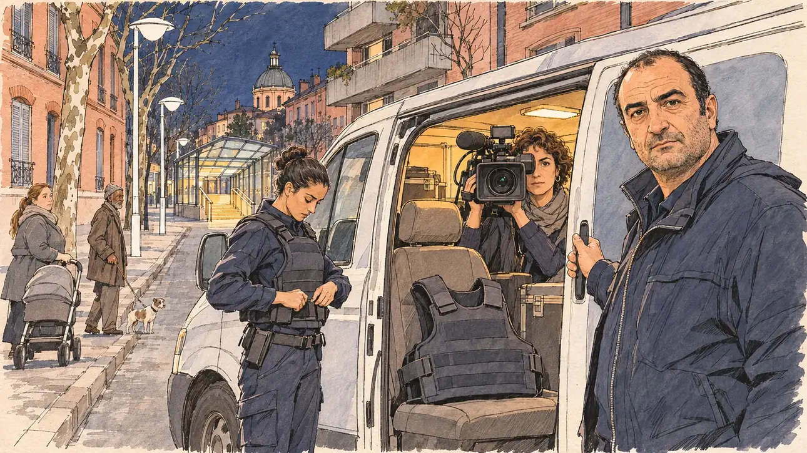

# `nightPatrol` · La patrouille de nuit

**Retenue par le PO le 15/11/2026**, au premier essai. Elle sert telle quelle en clair et en sombre.



| Champ | Valeur |
| --- | --- |
| Carte | `nightPatrol`, catégorie `field` (Rencontre), poids 0,1, toute semaine ; un geste au bord de l'axe de la société, côté autorité (Mitchnsun/moi-president, PO, 14/11/2026) |
| Style | Reportage dessiné |
| Ton | Tendu, nuit froide |
| Date | 2026-11-15 |
| Outil | ChatGPT Images, modèle GPT 6.2, effort Light |
| Conversation | À compléter |
| Format rendu | 1672 × 941 (16:9) : export en 1290 × 726 px, WebP de qualité 75, 198 Ko, sans recadrage, fait depuis la copie WebP de la conversation (à refaire depuis le PNG d'origine) |
| Fichier d'origine | À compléter (hors du dépôt) |
| Première édition | À compléter |

## Texte de la carte

> **La patrouille de nuit**
>
> Après une série d'agressions dans un quartier, un syndicat de police vous invite à une patrouille de nuit, caméras de télévision à bord.

## Le moment choisi

Une rue de Toulouse, une nuit froide de février : immeubles de brique rose et de béton, lampadaires blancs, l'entrée éclairée d'une station de métro sous son auvent de verre, un dôme au fond (le PO voulait une ville à métro, comme la réponse « Rencontrer les habitants à la sortie du métro »). Un fourgon est garé, porte coulissante ouverte. Le candidat reste hors champ : seul le gilet pare-balles posé pour lui sur le siège. Le brigadier délégué syndical tient la porte et le regarde : on y va ? Dans le fourgon, une journaliste le filme déjà ; une jeune gardienne de la paix ajuste son gilet ; en face, une mère à la poussette et un vieil homme et son chien regardent. Les précédents sont le « Kärcher » de La Courneuve (2005) et le discours de Grenoble (2010) : personne n'y ressemble à un responsable politique ou à un policier connu, et personne n'y est montré en suspect.

## Prompt complet

Dans une nouvelle conversation, avec [`primeTime.webp`](../../illustrations/media/primeTime.webp) comme seule image de référence :

```
Use the attached image as the style reference and copy its drawing: a realistic reportage drawing made on the spot for a newspaper, with quick, nervous pencil lines, often drawn twice, ink hatching in the shadows, transparent watercolour washes that spill a little over the lines, and the warm paper showing through. Not the same scene and not the same people: never reuse the face or the hair of the woman in the reference.
Like in the reference, the setting can be full when the story needs it, with the things that say where we are and what is happening, but each one is sketched with a few pencil lines and a light wash, never rendered or finished, and the drawing gets looser and paler towards the edges until it fades into the bare paper.
This must look like a drawing made by hand on paper by a press illustrator, halfway between a quick sketch and a realistic picture: never a photograph, a film poster or a digital painting, and never a cartoon, a comic strip, a caricature or a children's book illustration. Continuous lines, never dotted or dashed outlines; no uniform texture, speckles or hatching filter laid over the picture; no glossy highlights, no smooth gradients, in the sky and on the walls too. Colour can be rich in places, on a piece of clothing, a light or a flag, but it stays transparent and within the palette below. The fade into the paper at the edges stays narrow, without a wide white margin. No blur and no depth-of-field effect: everything, the foreground included, is drawn sharp, like a sketch made on the spot.
People are drawn from life with realistic anatomy and proportions, like in the reference: faces shaped with pencil lines, hatching and light washes, a little more finished than the background but never photographic (no photographic skin, no airbrushed or digital-painting look). Expressions stay natural and restrained, even in laughter or tears: no exaggerated grins, no wide-open mouths full of teeth, no rubbery or cartoonish faces.

Editorial illustration, landscape 16:9 (1536 × 864 px), the scene filling the frame, with only a light fade into the paper at the edges. A street of a residential district of Toulouse, in the south-west of France, on a cold night in February 2027: buildings of pink brick and 1970s concrete with balconies, white street lamps, and at the end of the street the lit entrance of a metro station under its glass canopy. A police van is parked at the kerb, its sliding side door open on the lit interior, its roof light off. The player's candidate stands in front of the van and stays off-camera: in the foreground, only a blank bulletproof vest laid out for the candidate on the van's seat. In the right third, the police union representative, a stocky sergeant in his forties of Armenian descent with receding black hair and a three-day stubble, in a police jacket, holds the sliding door open with one hand and looks at the viewer, as if asking whether the viewer is ready to go, his face above mid-height. Inside the van, a journalist in her thirties of Spanish descent with short curly brown hair, a television camera on her shoulder, is already filming the viewer. Beside the van, a young police officer, a tall, wiry woman of Tunisian descent with her hair in a tight bun, adjusts the straps of her vest. On the opposite pavement, a few residents watch the scene: a round woman in her thirties with a light brown ponytail pushing a pram, and a thin elderly man of Comorian descent in a woollen hat walking his small dog. Only the sergeant and the journalist look at the viewer. Nothing on the van, the vests, the uniforms, the camera or the metro entrance is readable.

Style: Reportage drawing made on the spot, like a press illustrator or courtroom sketch artist: pencil and ink with loose watercolour washes, lively unfinished lines, white paper showing through.

Palette: navy #13203F, vellum #F5EFE1, gold #A9802A, brick #B5523B, ochre #D9A441, sage #8FA58A, slate #5E7186, sand #DCC8A4, warm grey #8C8279; use 4 to 6 of them, subtle warm paper grain.

Tone: tense, a cold winter night, the white light of the street lamps, the warm light inside the van and the lit metro entrance at the end of the street, the pink brick turned dusky in the dark.

Constraints: realistic proportions, natural expressions, never cartoonish or caricatured faces, drawn like the rest of the illustration and never photographic; people of varied ages, genders, origins and body types (heavy, stocky, round, tall, short, wiry, not only slim), each with a distinct face and haircut (no two people alike), drawn with respect and never as a joke; each person's age, build and look plausible for their job and the scene (working people of working age), no stereotype tying an origin or a gender to a role, and no person of colour shown alone in a featured service or deferential role; no one shown as a suspect, no young people of colour shown as a threat; anatomically correct hands with exactly five fingers, few hands visible, the others in pockets, behind objects or out of frame; no readable text anywhere (the van, the vests, the uniforms, the camera and the metro entrance stay unreadable, no POLICE lettering, no metro sign or letter M, no number plates); no captions or speech bubbles; no logos, no police union logo, no transport company logo, no television channel logo, no political party colours, no flags; no recognisable real person, no lookalike of a real politician or of a known police officer; no explicit violence, no weapon drawn, no arrest; no photographic rendering, no blur or bokeh, every outline a continuous pencil or ink line with no dotted or dashed outlines, no mottled, crackled or speckled texture over the faces, the clothes, the brick or the sky, no hatching filter over the picture, no oil-paint texture, no glow, halo or lens flare around the lamps, no wide white margin or frame (a light fade into the paper at the edges is fine).

Format: if 16:9 is not available, make 1536 × 1024 and keep the top 80 px and the bottom 80 px free of anything important (faces, hands, the main action): they will be cropped.
```

## Décisions prises sur cette image

Retenue telle quelle par le PO (15/11/2026), au premier essai du décor toulousain : un premier prompt plaçait la scène au Havre, avec un arrêt de tram, et le PO a voulu une ville à métro avant toute génération. Le fourgon est blanc, sans marquage : les uniformes et le gilet disent la police.

## Essais écartés

Aucun.

## Retouches

Aucune.

## Relecture

Faite le 15/11/2026, à confirmer par le PO.

- [x] Aucun texte lisible : rien sur le fourgon, les gilets, les uniformes, la caméra ni l'entrée du métro.
- [x] Aucun sosie d'une personne réelle ; personne n'est montré en suspect.
- [x] Le candidat du joueur est hors champ : seul le gilet posé pour lui sur le siège.
- [x] Mains et visages sans défaut visible à 343 px de large : la main du brigadier sur la porte, celles de la gardienne sur ses sangles, de la journaliste sur la caméra, de la mère sur la poussette.
- [x] Aucune couleur, aucun logo ni aucun drapeau de parti ou de syndicat. Des personnes variées par l'âge, le corps, l'origine et la coiffure.
- [x] En 16:9 : pas de recadrage.
- [ ] Lisible sur la page de l'événement, en clair et en sombre : à vérifier dans l'app, une fois la carte publiée.
