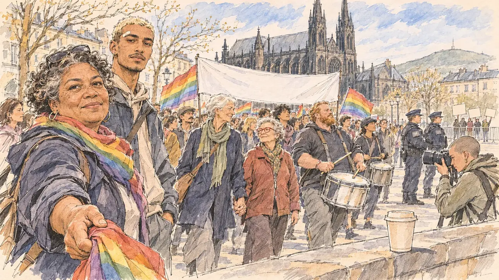

# `prideMarch` · La marche contre l'homophobie

**Retenue par le PO le 15/11/2026**, au premier essai. Elle sert telle quelle en clair et en sombre.



| Champ | Valeur |
| --- | --- |
| Carte | `prideMarch`, catégorie `field` (Rencontre), poids 0,1, toute semaine ; un geste au bord de l'axe de la société, côté ouverture (Mitchnsun/moi-president, PO, 14/11/2026) |
| Style | Reportage dessiné |
| Ton | Chaleureux et un peu tendu, soleil de mars |
| Date | 2026-11-15 |
| Outil | ChatGPT Images, modèle GPT 6.2 (effort à compléter) |
| Conversation | À compléter |
| Format rendu | 1672 × 941 (16:9) : export en 1290 × 726 px, WebP de qualité 75, 235 Ko, sans recadrage, fait depuis la copie WebP de la conversation (à refaire depuis le PNG d'origine) |
| Fichier d'origine | À compléter (hors du dépôt) |
| Première édition | À compléter |

## Texte de la carte

> **La marche contre l'homophobie**
>
> Après une agression homophobe dans le centre-ville, les associations organisent une grande marche et vous invitent à l'ouvrir. Des contre-manifestants se tiennent le long du parcours.

## Le moment choisi

La place de la Victoire à Clermont-Ferrand, un après-midi lumineux de mars, devant la cathédrale et avec le puy de Dôme au fond : le cortège se forme, drapeaux arc-en-ciel, banderole de tête blanche sans lettres, tambours. Derrière un cordon de police, quelques contre-manifestants aux pancartes vierges. Le candidat arrive, hors champ : seul son gobelet de café, sur un muret. L'organisatrice lui tend un drapeau arc-en-ciel roulé : on vous attendait en tête ; derrière elle, le jeune homme agressé, un pansement à l'arcade, le regarde avec dignité. Dans le cortège, deux femmes âgées se tiennent par la main ; un tambour ; une photographe. Les marches des fiertés ont lieu en juin, après la campagne : la carte en fait une marche après une agression. Les précédents sont le mariage de Bègles (2004) et l'Aquarius à Valence (2018) : personne n'y ressemble à un responsable politique ou associatif.

## Prompt complet

Dans une nouvelle conversation, avec [`primeTime.webp`](../../illustrations/media/primeTime.webp) comme seule image de référence :

```
Use the attached image as the style reference and copy its drawing: a realistic reportage drawing made on the spot for a newspaper, with quick, nervous pencil lines, often drawn twice, ink hatching in the shadows, transparent watercolour washes that spill a little over the lines, and the warm paper showing through. Not the same scene and not the same people: never reuse the face or the hair of the woman in the reference.
Like in the reference, the setting can be full when the story needs it, with the things that say where we are and what is happening, but each one is sketched with a few pencil lines and a light wash, never rendered or finished, and the drawing gets looser and paler towards the edges until it fades into the bare paper.
This must look like a drawing made by hand on paper by a press illustrator, halfway between a quick sketch and a realistic picture: never a photograph, a film poster or a digital painting, and never a cartoon, a comic strip, a caricature or a children's book illustration. Continuous lines, never dotted or dashed outlines; no uniform texture, speckles or hatching filter laid over the picture; no glossy highlights, no smooth gradients, in the sky and on the walls too. Colour can be rich in places, on a piece of clothing, a light or a flag, but it stays transparent and within the palette below. The fade into the paper at the edges stays narrow, without a wide white margin. No blur and no depth-of-field effect: everything, the foreground included, is drawn sharp, like a sketch made on the spot.
People are drawn from life with realistic anatomy and proportions, like in the reference: faces shaped with pencil lines, hatching and light washes, a little more finished than the background but never photographic (no photographic skin, no airbrushed or digital-painting look). Expressions stay natural and restrained, even in laughter or tears: no exaggerated grins, no wide-open mouths full of teeth, no rubbery or cartoonish faces.

Editorial illustration, landscape 16:9 (1536 × 864 px), the scene filling the frame, with only a light fade into the paper at the edges. The Place de la Victoire in Clermont-Ferrand, in the Auvergne, on a bright afternoon in March 2027, before the cathedral of black volcanic stone with its dark spires; a march against homophobia gathers after an assault in the city centre: rainbow flags, a white head banner with no letters, a few drums. At the side, behind a short line of police officers, a handful of counter-protesters hold blank placards, kept at a distance. The player's candidate has just arrived and stays off-camera: in the foreground, only the candidate's paper cup of coffee set down on a low stone wall. In the left third, the organiser, a short, round woman in her fifties of Réunionese descent with curly salt-and-pepper hair and a rainbow scarf, holds out a rolled rainbow flag towards the viewer with a frank smile, as if saying the head of the march is waiting, her face above mid-height. Behind her, among his friends, the young man who was assaulted, in his twenties, of Algerian descent, tall, with short bleached hair and a small plaster above one eyebrow, looks at the viewer with quiet dignity. In the march: two women in their seventies holding hands, one tall with short white hair, the other small with red glasses; a drummer, a heavy-set man in his forties with a ginger beard. Along the route, two police officers in front of the counter-protesters, and a press photographer, a slim young woman with a shaved head. Only the organiser and the young man look at the viewer. Nothing on the banner, the placards, the flags, the uniforms or the cup is readable.

Style: Reportage drawing made on the spot, like a press illustrator or courtroom sketch artist: pencil and ink with loose watercolour washes, lively unfinished lines, white paper showing through.

Palette: navy #13203F, vellum #F5EFE1, gold #A9802A, brick #B5523B, ochre #D9A441, sage #8FA58A, slate #5E7186, sand #DCC8A4, warm grey #8C8279; use 4 to 6 of them, subtle warm paper grain.

Tone: warm and a little tense, the March sun on the black volcanic stone, the rainbow flags as the bright, transparent colours of the picture, kept within washes.

Constraints: realistic proportions, natural expressions, never cartoonish or caricatured faces, drawn like the rest of the illustration and never photographic; people of varied ages, genders, origins and body types (heavy, stocky, round, tall, short, wiry, not only slim), each with a distinct face and haircut (no two people alike), drawn with respect and never as a joke; each person's age, build and look plausible for their job and the scene (working people of working age), no stereotype tying an origin or a gender to a role, and no person of colour shown alone in a featured service or deferential role; anatomically correct hands with exactly five fingers, few hands visible, the others in pockets, behind objects or out of frame; no readable text anywhere (the banner, the placards, the flags, the uniforms and the cup stay unreadable, no slogans, no hateful signs or symbols); no captions or speech bubbles; no logos, no association logo, no television channel logo, no political party colours, no flags other than the rainbow flags; no recognisable real person, no lookalike of a real politician or activist; no explicit violence, no visible injury beyond the small plaster, no confrontation; no photographic rendering, no blur or bokeh, every outline a continuous pencil or ink line with no dotted or dashed outlines, no mottled, crackled or speckled texture over the faces, the clothes, the stone or the sky, no hatching filter over the picture, no oil-paint texture, no glow or halo, no wide white margin or frame (a light fade into the paper at the edges is fine).

Format: if 16:9 is not available, make 1536 × 1024 and keep the top 80 px and the bottom 80 px free of anything important (faces, hands, the main action): they will be cropped.
```

## Décisions prises sur cette image

Retenue telle quelle par le PO (15/11/2026). La cathédrale est grise plutôt que noire ; le puy de Dôme et son antenne se voient au fond, un monument que le gabarit permet. Le 15/11/2026, le PO a ajouté à la carte une cinquième réponse, ignorer la marche, qui ne change rien à l'image.

## Essais écartés

Aucun.

## Retouches

Aucune.

## Relecture

Faite le 15/11/2026, à confirmer par le PO.

- [x] Aucun texte lisible : la banderole et les pancartes sont blanches ; rien sur le gobelet ni les uniformes.
- [x] Aucun sosie d'une personne réelle.
- [x] Le candidat du joueur est hors champ : seul son gobelet, sur le muret.
- [x] Mains et visages sans défaut visible à 343 px de large : la main qui tend le drapeau, les mains jointes des deux femmes, les baguettes du tambour, l'appareil de la photographe.
- [x] Aucune couleur, aucun logo ni aucun drapeau de parti ou d'association ; seuls les drapeaux arc-en-ciel. Des personnes variées par l'âge, le corps, l'origine et la coiffure.
- [x] En 16:9 : pas de recadrage.
- [ ] Lisible sur la page de l'événement, en clair et en sombre : à vérifier dans l'app, une fois la carte publiée.
