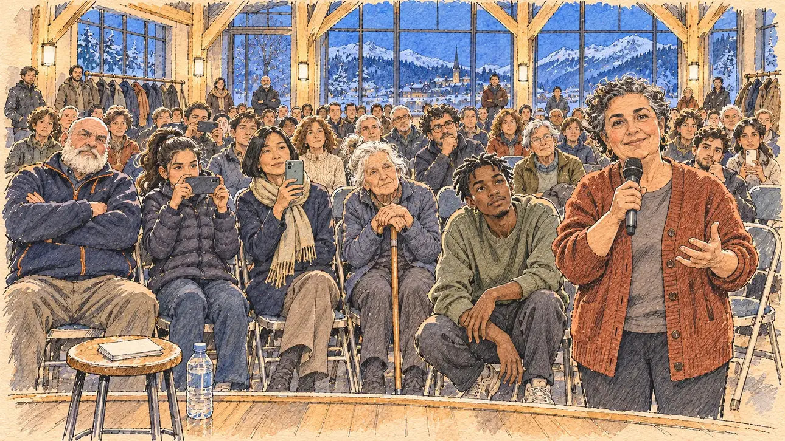

# `remindMeeting` · Une question dans la salle

**Validée par le PO le 27/11/2026**, au premier essai, malgré la texture notée plus bas. Elle sert telle quelle en clair et en sombre.



| Champ | Valeur |
| --- | --- |
| Carte | `remindMeeting`, catégorie `field` (Rencontre), carte ajoutée par la PR #561 de l'app (Mitchnsun/moi-president#499) |
| Style | Reportage dessiné ; une texture tissée couvre les vêtements, gardée par le PO |
| Ton | Attentif, une salle qui attend la réponse |
| Date | 2026-11-27 |
| Outil | ChatGPT Images, modèle GPT 6.2 Astra, effort Light |
| Conversation | À remplir (le lien ne s'ouvre qu'avec le compte qui l'a créée) |
| Format rendu | 1672 × 941 (16:9) : export en 1290 × 726 px depuis l'image partagée dans la conversation avec Claude, WebP de qualité 75, 272 Ko, sans recadrage |
| Fichier d'origine | Image de ChatGPT, chez le PO. L'export du dépôt est fait depuis la copie partagée dans la conversation avec Claude |
| Première édition | La prochaine Release qui suit le merge de la PR #561 de l'app |

## Texte de la carte

> **Une question dans la salle**
>
> Fin de meeting. Au premier rang, une militante prend le micro : « Rappelez-nous votre mesure, celle de votre programme, sans détour. » La salle attend, téléphones levés.

Les réponses sont trois mesures d'un même thème, tirées pour chaque partie : celle du programme et deux qu'il ne tient pas. L'image ne montre donc ni le thème ni la réponse.

## Le moment choisi

La fin d'un meeting dans la salle polyvalente d'une petite ville de Savoie, en février 2027 : une charpente de bois clair, de hautes fenêtres sur les montagnes enneigées au crépuscule, des rangées de chaises pliantes pleines. Le candidat est hors champ, sur la petite scène, la salle vue de sa place : au premier plan, seulement le bord de la scène avec une bouteille d'eau et quelques fiches posées sur un tabouret haut. Au premier rang, une militante, debout, tient le micro sans fil qu'un bénévole vient de lui passer et attend la réponse. Autour d'elle, la salle se tait, des téléphones levés pour filmer. La Savoie n'a servi qu'une fois dans la série.

## Prompt complet

Dans une nouvelle conversation, avec [`primeTime.webp`](../../illustrations/media/primeTime.webp) comme seule image de référence :

```
Use the attached image as the style reference and copy its drawing: a realistic reportage drawing made on the spot for a newspaper, with quick, nervous pencil lines, often drawn twice, ink hatching in the shadows, transparent watercolour washes that spill a little over the lines, and the warm paper showing through. Take from the reference its line, its washes and its paper, not the finish of the presenter's face, which is the most finished and almost photographic part of it: every face here stays a drawing. Not the same scene and not the same people: never reuse the face or the hair of the woman in the reference.
Like in the reference, the setting can be full when the story needs it, with the things that say where we are and what is happening, but each one is sketched with a few pencil lines and a light wash, never rendered or finished, and the drawing gets looser and paler towards the edges until it fades into the bare paper.
This must look like a drawing made by hand on paper by a press illustrator, halfway between a quick sketch and a realistic picture: never a photograph, a film poster or a digital painting, and never a cartoon, a comic strip, a caricature or a children's book illustration. Continuous lines, never dotted or dashed outlines; the paper grain is the paper itself, never a mottled texture, speckles or hatching filter laid over the picture; no glossy highlights, no smooth gradients, in the sky and on the walls too. Colour can be rich in places, on a piece of clothing, a light or a flag, but it stays transparent and within the palette below. The fade into the paper at the edges stays narrow, without a wide white margin. No blur and no depth-of-field effect: everything, the foreground included, is drawn sharp, like a sketch made on the spot.
People are drawn from life with realistic anatomy and proportions: each face is drawn with the same visible pencil and ink lines, hatching and transparent washes as the clothes and the room, looser and sketchier than the presenter's face in the reference, with realistic features but never photographic (no photographic skin, no smooth shading, no airbrushed or digital-painting look). Expressions stay natural and restrained, even in laughter or tears: no exaggerated grins, no wide-open mouths full of teeth, no rubbery or cartoonish faces.

Editorial illustration, landscape 16:9 (1536 × 864 px), the scene filling the frame, with only a light fade into the paper at the edges. The end of a campaign meeting, on a February evening in 2027, in the community hall of a small town in Savoy, in the French Alps: a high ceiling of pale wooden beams, tall windows on the snowy mountains in the blue dusk, rows of folding chairs all taken, a few people standing at the back by the coat racks. The speech is over and the hall is silent, waiting for an answer. The player's candidate stays off-camera, the hall seen from their place on the low stage: in the foreground, only the front edge of the stage and a tall stool with a bottle of water and a few index cards on it, nothing readable on the cards. In the right third, in the front row, the main character, a campaign supporter in her late forties of Algerian origin, short and round, with short curly hair streaked with grey and small gold earrings, in a brick-red wool cardigan over a grey top, stands up holding a wireless microphone close to her chin and looks straight at the viewer, friendly but firm, waiting for a precise answer, her face above mid-height. Beside her, a young volunteer of the team, a tall wiry man of Senegalese origin with short twists and a plain sage-green sweatshirt, crouches in the aisle, having just handed her the microphone, and looks up at the viewer. Around them, sketched in pencil and light washes, most of the audience looks at the viewer, each busy with their own gesture: a heavy-set man in his sixties with a bald head, a white beard and a ski-resort fleece, his arms crossed; a teenage girl with a long dark ponytail and a puffer jacket holding up her phone to film; a slim woman in her thirties of Vietnamese origin with a short straight bob and a scarf, holding up her phone too; an older woman with white hair in a loose bun leaning forward on her cane; a few others with phones held up in the rows behind. Only a couple of people at the back look elsewhere. No banners, no flags of a party, no party colours, no posters on the walls. Nothing on the cards, the phones, the bottle, the sweatshirt or the walls is readable.

Style: Reportage drawing made on the spot, like a press illustrator or courtroom sketch artist: pencil and ink with loose watercolour washes, lively unfinished lines, white paper showing through.

Palette: navy #13203F, vellum #F5EFE1, gold #A9802A, brick #B5523B, ochre #D9A441, sage #8FA58A, slate #5E7186, sand #DCC8A4, warm grey #8C8279; use 4 to 6 of them, subtle warm paper grain.

Tone: expectant and attentive, the warm light of the hall against the blue dusk in the windows, a held silence.

Constraints: realistic proportions, natural expressions, never cartoonish or caricatured faces, drawn like the rest of the illustration and never photographic; people of varied ages, genders, origins and body types (heavy, stocky, round, tall, short, wiry, not only slim), each with a distinct face and haircut (no two people alike), drawn with respect and never as a joke; each person's age, build and look plausible for their job and the scene (working people of working age), no stereotype tying an origin or a gender to a role, and no person of colour shown alone in a featured service or deferential role; anatomically correct hands with exactly five fingers, few hands visible, the others in pockets, behind objects or out of frame; no readable text anywhere (the cards, the phones, the bottle and the walls stay unreadable); no captions or speech bubbles; no logos or political party colours; no recognisable real person, no lookalike of a real politician; no explicit violence; no photographic rendering, no blur or bokeh, no dotted outlines, no texture or hatching filter over the picture, no oil-paint texture, no wide white margin or frame (a light fade into the paper at the edges is fine).

Format: if 16:9 is not available, make 1536 × 1024 and keep the top 80 px and the bottom 80 px free of anything important (faces, hands, the main action): they will be cropped.
```

## Décisions prises sur cette image

- Le PO a gardé le premier essai (27/11/2026) sans message de correction, alors qu'une texture tissée est posée sur toute l'image, surtout sur les doudounes, le gilet et les pantalons. Le gabarit l'interdit ; le message de correction proposé n'a pas été envoyé.
- La bouteille d'eau est posée sur le bord de la scène, pas sur le tabouret ; les fiches sont sur le tabouret.
- Dans les rangs du fond, plusieurs visages aux cheveux châtains bouclés se ressemblent, et une église de village se dessine dans la fenêtre, petite : gardés.

## Essais écartés

Aucun.

## Retouches

Aucune.

## Relecture

Faite et validée par le PO le 27/11/2026.

- [x] Aucun texte lisible : fiches, téléphones, bouteille, murs.
- [x] Aucun sosie d'une personne réelle.
- [x] Le candidat du joueur est hors champ.
- [x] Mains, visages et foules sans défaut visible à 343 px de large : la main ouverte de la militante, celles de la dame sur sa canne et du bénévole ont cinq doigts.
- [x] Aucune couleur ni aucun logo de parti. Des personnes variées par l'âge, le corps, l'origine et la coiffure, sauf au fond (plus haut).
- [x] En 3:2 : sans objet, l'image est en 16:9.
- [x] Lisible sur la page de l'événement, en clair et en sombre.
