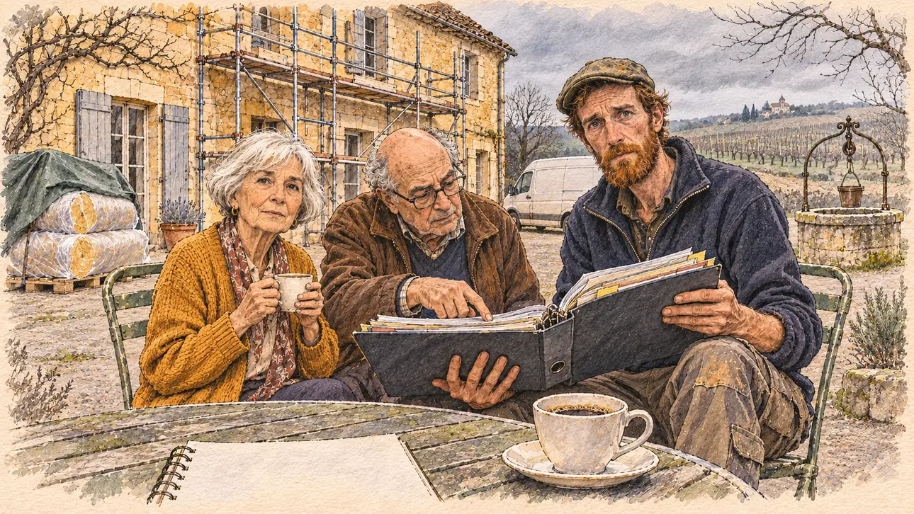

# `renovationFreeze` · Les chantiers d'isolation en attente

**Validée par le PO le 20/11/2026**, au premier essai, avec `primeTime.webp` comme référence. Elle sert telle quelle en clair et en sombre.



| Champ | Valeur |
| --- | --- |
| Carte | `renovationFreeze`, catégorie `field` (Rencontre), poids 0,2, à partir de l'officialisation, une carte du programme : tirée si le programme tient un plan d'isolation ou une planification écologique (`insulation`, `ecologicalPlanning`) (Mitchnsun/moi-president, PO, 17/11/2026) |
| Style | Reportage dessiné, trait de `primeTime` |
| Ton | Observateur et un peu las, matin gris |
| Date | 2026-11-20 (prompt écrit le 2026-11-18) |
| Outil | GPT 6.2 Astra |
| Conversation | À remplir (le lien ne s'ouvre qu'avec le compte qui l'a créée) |
| Format rendu | 1672 × 941 (16:9) : export en 1290 × 726 px, WebP de qualité 75, 253 Ko, sans recadrage |
| Fichier d'origine | Image chez le PO. L'export du dépôt a été fait depuis la copie partagée dans la conversation avec Claude |
| Première édition | À compléter |

## Texte de la carte

> **Les chantiers d'isolation en attente**
>
> Un artisan de la rénovation et un couple de retraités vous montrent un dossier d'aide en attente depuis des mois : les travaux sont commandés, l'argent n'est pas versé. L'artisan dit qu'il devra se séparer de salariés si les règles changent encore.

## Le moment choisi

La cour d'une maison de pierre blonde du Périgord, près de Bergerac, en Dordogne, un matin gris de mars : un échafaudage arrêté contre la façade, des rouleaux d'isolant emballés sous une bâche, la camionnette blanche de l'artisan sans inscription, et au fond les vignes. Le candidat est à la table de jardin, hors champ : au premier plan, son carnet et la tasse de café qu'on lui a servie. L'artisan ouvre l'épais dossier d'aide en attente et regarde le candidat : les travaux sont commandés, l'argent ne vient pas. À côté de lui, le couple de retraités : elle regarde le candidat, sa tasse à la main ; il montre le dossier du doigt. La carte rappelle les aides de l'Anah suspendues début 2026 : personne n'y ressemble à une personne réelle.

## Prompt complet

Dans une nouvelle conversation, avec [`primeTime.webp`](../../illustrations/media/primeTime.webp) comme seule image de référence :

```
Use the attached image as the style reference and copy its drawing: a realistic reportage drawing made on the spot for a newspaper, with quick, nervous pencil lines, often drawn twice, ink hatching in the shadows, transparent watercolour washes that spill a little over the lines, and the warm paper showing through. Not the same scene and not the same people: never reuse the face or the hair of the woman in the reference.
Like in the reference, the setting can be full when the story needs it, with the things that say where we are and what is happening, but each one is sketched with a few pencil lines and a light wash, never rendered or finished, and the drawing gets looser and paler towards the edges until it fades into the bare paper.
This must look like a drawing made by hand on paper by a press illustrator, halfway between a quick sketch and a realistic picture: never a photograph, a film poster or a digital painting, and never a cartoon, a comic strip, a caricature or a children's book illustration. Continuous lines, never dotted or dashed outlines; no uniform texture, speckles or hatching filter laid over the picture; no glossy highlights, no smooth gradients, in the sky and on the walls too. Colour can be rich in places, on a piece of clothing, a light or a flag, but it stays transparent and within the palette below. The fade into the paper at the edges stays narrow, without a wide white margin. No blur and no depth-of-field effect: everything, the foreground included, is drawn sharp, like a sketch made on the spot.
People are drawn from life with realistic anatomy and proportions, like in the reference: faces shaped with pencil lines, hatching and light washes, a little more finished than the background but never photographic (no photographic skin, no airbrushed or digital-painting look). Expressions stay natural and restrained, even in laughter or tears: no exaggerated grins, no wide-open mouths full of teeth, no rubbery or cartoonish faces.

Editorial illustration, landscape 16:9 (1536 × 864 px), the scene filling the frame, with only a light fade into the paper at the edges. The yard of a house of pale golden stone in the Périgord, near Bergerac in the Dordogne, in south-western France, on a grey morning in March 2027: a scaffolding left standing against the façade where the work has stopped, rolls of insulation wrapped in plastic stacked under a tarpaulin, the artisan's plain white van with nothing written on it, a stone well, and in the background bare vineyards on the hills. A renovation artisan and a retired couple show the player's candidate a grant file that has been waiting for months. The player's candidate sits at the garden table and stays off-camera: in the foreground, only the candidate's notebook and a cup of coffee that has been offered. In the right third, the main character, the artisan, a man in his forties of Polish descent, tall and wiry, with a red beard and a cap, in work trousers and a fleece jacket, holds open a thick file of forms and looks at the viewer with a tired, worried look, his face above mid-height. Beside him, the retired couple: a white woman in her seventies, small, with white hair in a short bob and a knitted cardigan, holds a cup and looks at the viewer; her husband, in his late seventies, of Spanish descent, round, bald with a fringe of grey hair and glasses, points at the file without looking at the viewer. Only the artisan and the woman look at the viewer. Nothing on the file, the van, the rolls of insulation, the tarpaulin or the notebook is readable.

Style: Reportage drawing made on the spot, like a press illustrator or courtroom sketch artist: pencil and ink with loose watercolour washes, lively unfinished lines, white paper showing through.

Palette: navy #13203F, vellum #F5EFE1, gold #A9802A, brick #B5523B, ochre #D9A441, sage #8FA58A, slate #5E7186, sand #DCC8A4, warm grey #8C8279; use 4 to 6 of them, subtle warm paper grain.

Tone: observant and a little weary, the flat grey light of a March morning, the golden stone and the ochre of the cardigan as the warm notes.

Constraints: realistic proportions, natural expressions, never cartoonish or caricatured faces, drawn like the rest of the illustration and never photographic; people of varied ages, genders, origins and body types (heavy, stocky, round, tall, short, wiry, not only slim), each with a distinct face and haircut (no two people alike), drawn with respect and never as a joke; each person's age, build and look plausible for their job and the scene (working people of working age), no stereotype tying an origin or a gender to a role, and no person of colour shown alone in a featured service or deferential role; anatomically correct hands with exactly five fingers, few hands visible, the others in pockets, behind objects or out of frame; no readable text anywhere (the file, the van, the rolls of insulation, the tarpaulin and the notebook stay unreadable, no company name on the van); no captions or speech bubbles; no logos, no company logo, no political party colours; no recognisable real person, no lookalike of a real politician; no explicit violence; no photographic rendering, no blur or bokeh, every outline a continuous pencil or ink line with no dotted or dashed outlines, no mottled, crackled or speckled texture over the faces, the clothes, the stone or the sky, no hatching filter over the picture, no oil-paint texture, no glow or halo, no wide white margin or frame (a light fade into the paper at the edges is fine).

Format: if 16:9 is not available, make 1536 × 1024 and keep the top 80 px and the bottom 80 px free of anything important (faces, hands, the main action): they will be cropped.
```

## Décisions prises sur cette image

Aucune pour le moment.

## Essais écartés

Aucun.

## Retouches

Aucune.

## Relecture

Faite et validée par le PO le 20/11/2026.

- [x] Aucun texte lisible : le dossier, la camionnette (sans nom d'entreprise), les rouleaux d'isolant, la bâche et le carnet.
- [x] Aucun sosie d'une personne réelle.
- [x] Le candidat du joueur est hors champ : son carnet et la tasse de café sur la table du jardin.
- [x] Mains, visages et foules sans défaut visible à 343 px de large, la main du retraité qui montre le dossier comprise.
- [x] Aucune couleur ni aucun logo de parti. Aucun logo d'entreprise. Des personnes variées par l'âge, le corps, l'origine et la coiffure.
- [x] En 3:2 : sans objet, l'image est en 16:9.
- [x] Lisible sur la page de l'événement, en clair et en sombre.

Ce que la relecture a accepté : un grain craquelé, en mosaïque, sur toute l'image, que le prompt interdisait, plus marqué que sur les cartes précédentes ; le dessin plus fini que la référence.
