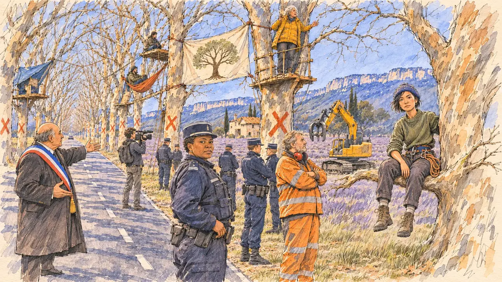

# `roadTrees` · Perchés dans les platanes

**Retenue par le PO le 15/11/2026**, au premier essai. Elle sert telle quelle en clair et en sombre.



| Champ | Valeur |
| --- | --- |
| Carte | `roadTrees`, catégorie `field` (Rencontre), poids 0,15, toute semaine ; exclut `tramTrees` (Mitchnsun/moi-president, PO, 14/11/2026) |
| Style | Reportage dessiné |
| Ton | Tendu mais calme, soleil d'hiver bas |
| Date | 2026-11-15 |
| Outil | ChatGPT Images, modèle GPT 6.2, effort Light |
| Format rendu | 1671 × 941 (16:9) : export en 1290 × 726 px, WebP de qualité 75, 267 Ko, sans recadrage, fait depuis la copie WebP de la conversation |
| Fichier d'origine | Image de ChatGPT, chez le PO. L'export du dépôt a été fait depuis la copie partagée dans la conversation avec Claude |
| Première édition | `kit-france-2611-0004` |

## Texte de la carte

> **Perchés dans les platanes**
>
> Le long d'une nationale, des platanes centenaires doivent tomber pour la deux-fois-deux voies que réclament les élus du coin. Des militantes et militants écologistes se sont perchés dans les branches, les gendarmes encerclent le campement, et votre convoi passe juste devant.

## Le moment choisi

Une nationale bordée de platanes dans la Drôme provençale, un matin froid et lumineux de février : les troncs pâles et tachetés, les branches nues en voûte, des croix rouges peintes sur les troncs à abattre ; un mas aux tuiles rondes, les champs de lavande et la falaise du Vercors au fond. Des militants se sont perchés dans les arbres, avec plateformes, hamac, bâche et une banderole qui ne porte qu'un arbre. Le candidat descend de sa voiture, hors champ. Une militante perchée sur une branche basse le regarde, calme et décidée ; plus haut, une femme aux cheveux gris bouclés appelle les autres ; une capitaine de gendarmerie mène le cordon et jette un regard vers le spectateur ; un bûcheron attend, bras croisés, près d'une pelle équipée d'une pince ; le maire, écharpe tricolore, montre la route ; un caméraman filme. Les précédents sont les « écureuils » de l'A69, dans les platanes de Soual (2023) : personne n'y ressemble à un militant connu.

## Prompt complet

Dans une nouvelle conversation, avec [`primeTime.webp`](../../illustrations/media/primeTime.webp) comme seule image de référence :

```
Use the attached image as the style reference and copy its drawing: a realistic reportage drawing made on the spot for a newspaper, with quick, nervous pencil lines, often drawn twice, ink hatching in the shadows, transparent watercolour washes that spill a little over the lines, and the warm paper showing through. Not the same scene and not the same people: never reuse the face or the hair of the woman in the reference.
Like in the reference, the setting can be full when the story needs it, with the things that say where we are and what is happening, but each one is sketched with a few pencil lines and a light wash, never rendered or finished, and the drawing gets looser and paler towards the edges until it fades into the bare paper.
This must look like a drawing made by hand on paper by a press illustrator, halfway between a quick sketch and a realistic picture: never a photograph, a film poster or a digital painting, and never a cartoon, a comic strip, a caricature or a children's book illustration. Continuous lines, never dotted or dashed outlines; no uniform texture, speckles or hatching filter laid over the picture; no glossy highlights, no smooth gradients, in the sky and on the walls too. Colour can be rich in places, on a piece of clothing, a light or a flag, but it stays transparent and within the palette below. The fade into the paper at the edges stays narrow, without a wide white margin. No blur and no depth-of-field effect: everything, the foreground included, is drawn sharp, like a sketch made on the spot.
People are drawn from life with realistic anatomy and proportions, like in the reference: faces shaped with pencil lines, hatching and light washes, a little more finished than the background but never photographic (no photographic skin, no airbrushed or digital-painting look). Expressions stay natural and restrained, even in laughter or tears: no exaggerated grins, no wide-open mouths full of teeth, no rubbery or cartoonish faces.

Editorial illustration, landscape 16:9 (1536 × 864 px), the scene filling the frame, with only a light fade into the paper at the edges. A straight national road in the Drôme provençale, in southern France, on a cold, bright morning in February 2027, lined on both sides with tall century-old plane trees whose pale mottled trunks and bare winter branches form an arch over the road; a few trunks already marked with a painted red cross; beyond, lavender fields cut back for winter, a stone farmhouse with a curved-tile roof and the blue line of the Vercors cliffs on the horizon. Ecologist activists have climbed into the plane trees to stop their felling for a dual carriageway: in the branches, platforms of planks and ropes, a hammock, a tarpaulin, and a long blank cloth banner stretched between two trees, painted only with a simple drawing of a tree, with no letters. The player's candidate stays off-camera, getting out of a car stopped on the roadside: in the foreground, only the edge of the candidate's open car door and a closed campaign notebook lying on the seat. In the right third, perched on a low branch in a climbing harness, a young activist woman in her twenties of Vietnamese descent, wiry, with a short asymmetric black bob under a woollen beanie, a thick sage-green wool jumper and coiled climbing ropes, leans down towards the viewer, one arm around the trunk, and looks at the viewer with a calm, determined look, her face above mid-height. Around her: higher in another tree, on a plank platform, a round woman in her fifties with grey curly hair in a padded jacket calls out to the other climbers, not looking at the viewer; at the foot of the trees, a line of gendarmes in navy uniforms surrounds the camp, led by a gendarmerie captain, a stocky woman in her forties of Senegalese descent with close-cropped hair under her kepi, who glances at the viewer; beside a parked tree-felling machine, a forestry worker, a heavy-set white man in his fifties with grey stubble, in orange high-visibility work clothes and ear protectors around his neck, waits with his arms crossed; across the road, the local mayor, a round man in his sixties of Portuguese descent, bald, wearing a tricolour sash over his overcoat, points down the road with exasperation; further away, a camera operator, a tall young man with curly hair, films the trees. Only the activist on the low branch and the gendarmerie captain look at the viewer. Nothing on the banner, the tarpaulin, the uniforms, the machine, the car, the notebook or the camera is readable.

Style: Reportage drawing made on the spot, like a press illustrator or courtroom sketch artist: pencil and ink with loose watercolour washes, lively unfinished lines, white paper showing through.

Palette: navy #13203F, vellum #F5EFE1, gold #A9802A, brick #B5523B, ochre #D9A441, sage #8FA58A, slate #5E7186, sand #DCC8A4, warm grey #8C8279; use 4 to 6 of them, subtle warm paper grain.

Tone: tense but calm, a low winter sun, the long shadows of the bare branches across the road, the pale trunks against a clear sky, the sage and ochre of the activists' clothes as the warm notes of the picture.

Constraints: realistic proportions, natural expressions, never cartoonish or caricatured faces, drawn like the rest of the illustration and never photographic; people of varied ages, genders, origins and body types (heavy, stocky, round, tall, short, wiry, not only slim), each with a distinct face and haircut (no two people alike), drawn with respect and never as a joke; each person's age, build and look plausible for their job and the scene (working people of working age), no stereotype tying an origin or a gender to a role, and no person of colour shown alone in a featured service or deferential role; anatomically correct hands with exactly five fingers, few hands visible, the others in pockets, behind objects or out of frame; no readable text anywhere (the banner, the tarpaulin, the uniforms, the machine, the car, the notebook and the camera stay unreadable, no slogans, no road signs with words); no captions or speech bubbles; no logos, no television channel logo, no political party colours, no green party banners, no flags other than the mayor's tricolour sash; no recognisable real person, no lookalike of a real politician or of a known tree activist; no explicit violence, no one in danger, no one falling; no photographic rendering, no blur or bokeh, every outline a continuous pencil or ink line with no dotted or dashed outlines, no mottled, crackled or speckled texture over the faces, the clothes, the trunks or the sky, no hatching filter over the picture, no oil-paint texture, no glow or halo, no wide white margin or frame (a light fade into the paper at the edges is fine).

Format: if 16:9 is not available, make 1536 × 1024 and keep the top 80 px and the bottom 80 px free of anything important (faces, hands, the main action): they will be cropped.
```

## Décisions prises sur cette image

Retenue telle quelle par le PO (15/11/2026). Elle s'écarte du prompt sur trois points, gardés :

- la portière et le carnet du candidat ne sont pas au premier plan : la scène est vue depuis le bas-côté, et le candidat reste hors champ ;
- la lavande est en fleur, alors que le prompt la voulait taillée pour l'hiver ;
- l'engin est une pelle jaune équipée d'une pince de forestier.

## Essais écartés

Aucun.

## Retouches

Aucune.

## Relecture

Faite le 15/11/2026, à confirmer par le PO.

- [x] Aucun texte lisible : la banderole ne porte qu'un arbre ; les écussons des gendarmes et la caméra restent illisibles.
- [x] Aucun sosie d'une personne réelle.
- [x] Le candidat du joueur est hors champ.
- [x] Mains et visages sans défaut visible à 343 px de large : les deux mains du maire, celle de la capitaine sur son ceinturon, les bras croisés du bûcheron.
- [x] Aucune couleur, aucun logo ni aucun drapeau de parti ; seule l'écharpe tricolore du maire. Des personnes variées par l'âge, le corps, l'origine et la coiffure.
- [x] En 16:9 : pas de recadrage.
- [ ] Lisible sur la page de l'événement, en clair et en sombre : à vérifier dans l'app, une fois la carte publiée.
