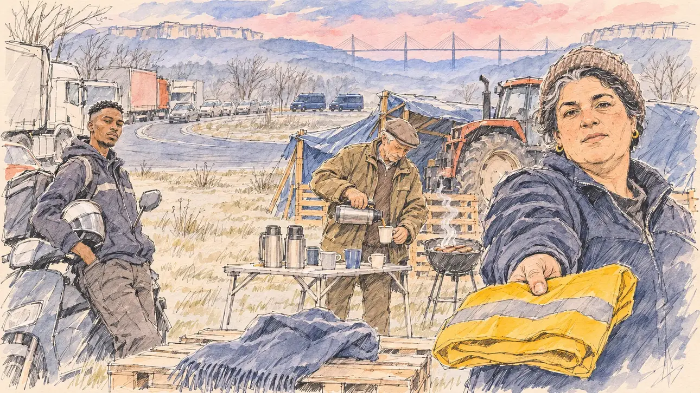

# `roundabout` · Le rond-point

**Retenue par le PO le 15/11/2026**, au premier essai. Elle sert telle quelle en clair et en sombre.



| Champ | Valeur |
| --- | --- |
| Carte | `roundabout`, catégorie `field` (Rencontre), poids 0,1, toute semaine ; un geste au bord de l'axe du système, côté antisystème (Mitchnsun/moi-president, PO, 14/11/2026) |
| Style | Reportage dessiné |
| Ton | Froid et tendu mais humain, aube d'hiver |
| Date | 2026-11-15 |
| Outil | ChatGPT Images, modèle GPT 6.2, effort Light |
| Conversation | À compléter |
| Format rendu | 1672 × 941 (16:9) : export en 1290 × 726 px, WebP de qualité 75, 222 Ko, sans recadrage, fait depuis la copie WebP de la conversation (à refaire depuis le PNG d'origine) |
| Fichier d'origine | À compléter (hors du dépôt) |
| Première édition | À compléter |

## Texte de la carte

> **Le rond-point**
>
> Des automobilistes en colère bloquent le rond-point d'une sous-préfecture depuis une semaine, et la préfecture veut les évacuer. Ils vous invitent à les rejoindre, gilet compris.

## Le moment choisi

Un rond-point à l'entrée de Millau, dans l'Aveyron, à l'aube d'un matin de février : givre, brume, les causses et le viaduc au loin, une file de camions et de voitures à l'arrêt, deux fourgons de gendarmerie qui attendent. Sur le rond-point, une cabane de palettes et de bâches, un barbecue, des thermos, un tracteur. Le candidat reste hors champ : seule son écharpe, posée sur une palette. La porte-parole, une routière, lui tend un gilet jaune plié : vous l'enfilez ? Un agriculteur sert le café ; un livreur, appuyé contre son scooter, le regarde aussi. Le précédent est le gilet jaune du Puy-en-Velay (novembre 2018), démenti ensuite : personne n'y ressemble à un responsable politique ou à une figure connue du mouvement.

## Prompt complet

Dans une nouvelle conversation, avec [`primeTime.webp`](../../illustrations/media/primeTime.webp) comme seule image de référence :

```
Use the attached image as the style reference and copy its drawing: a realistic reportage drawing made on the spot for a newspaper, with quick, nervous pencil lines, often drawn twice, ink hatching in the shadows, transparent watercolour washes that spill a little over the lines, and the warm paper showing through. Not the same scene and not the same people: never reuse the face or the hair of the woman in the reference.
Like in the reference, the setting can be full when the story needs it, with the things that say where we are and what is happening, but each one is sketched with a few pencil lines and a light wash, never rendered or finished, and the drawing gets looser and paler towards the edges until it fades into the bare paper.
This must look like a drawing made by hand on paper by a press illustrator, halfway between a quick sketch and a realistic picture: never a photograph, a film poster or a digital painting, and never a cartoon, a comic strip, a caricature or a children's book illustration. Continuous lines, never dotted or dashed outlines; no uniform texture, speckles or hatching filter laid over the picture; no glossy highlights, no smooth gradients, in the sky and on the walls too. Colour can be rich in places, on a piece of clothing, a light or a flag, but it stays transparent and within the palette below. The fade into the paper at the edges stays narrow, without a wide white margin. No blur and no depth-of-field effect: everything, the foreground included, is drawn sharp, like a sketch made on the spot.
People are drawn from life with realistic anatomy and proportions, like in the reference: faces shaped with pencil lines, hatching and light washes, a little more finished than the background but never photographic (no photographic skin, no airbrushed or digital-painting look). Expressions stay natural and restrained, even in laughter or tears: no exaggerated grins, no wide-open mouths full of teeth, no rubbery or cartoonish faces.

Editorial illustration, landscape 16:9 (1536 × 864 px), the scene filling the frame, with only a light fade into the paper at the edges. A roundabout at the edge of Millau, in the Aveyron, in the south of France, at dawn on a frosty morning in February 2027: frost on the grass, mist rising from the Tarn valley, the limestone plateaus and, far away, the long cable-stayed viaduct over the valley. Angry drivers have blocked the roundabout for a week: a hut of pallets and tarpaulins, a makeshift barbecue, thermoses on a folding table, and a line of stopped cars and lorries; in the distance, two gendarmerie vans wait, the prefecture wanting the roundabout cleared. The player's candidate stands facing the roundabout and stays off-camera: in the foreground, only the candidate's scarf left on a pallet. In the right third, the roundabout's spokesperson, a heavy-set lorry driver in her forties of Italian descent with short dark hair with grey roots, in a fleece and a woollen hat, holds out a folded yellow high-visibility vest towards the viewer, as if asking whether the viewer will put it on, her face above mid-height. Around her: a tall, lean farmer in his sixties in a flat cap, his tractor parked behind, pours coffee from a thermos; a young delivery rider of Guinean descent, slim, his helmet on his arm, leaning against his scooter, also looks at the viewer; in a stopped car with its window down, a nurse in her thirties of Martinican descent, in a scrub top under her coat, watches the scene. Only the spokesperson and the delivery rider look at the viewer. Nothing on the hut, the tarpaulins, the vests, the vehicles or the vans is readable.

Style: Reportage drawing made on the spot, like a press illustrator or courtroom sketch artist: pencil and ink with loose watercolour washes, lively unfinished lines, white paper showing through.

Palette: navy #13203F, vellum #F5EFE1, gold #A9802A, brick #B5523B, ochre #D9A441, sage #8FA58A, slate #5E7186, sand #DCC8A4, warm grey #8C8279; use 4 to 6 of them, subtle warm paper grain.

Tone: cold and tense but human, the blue and pink light of dawn, the mist in the valley, the yellow vest as the strong, ochre-yellow note of the picture.

Constraints: realistic proportions, natural expressions, never cartoonish or caricatured faces, drawn like the rest of the illustration and never photographic; people of varied ages, genders, origins and body types (heavy, stocky, round, tall, short, wiry, not only slim), each with a distinct face and haircut (no two people alike), drawn with respect and never as a joke; each person's age, build and look plausible for their job and the scene (working people of working age), no stereotype tying an origin or a gender to a role, and no person of colour shown alone in a featured service or deferential role; anatomically correct hands with exactly five fingers, few hands visible, the others in pockets, behind objects or out of frame; no readable text anywhere (the hut, the tarpaulins, the vests, the vehicles and the vans stay unreadable, no slogans written on the vests or on cardboard, no number plates, no road signs with words); no captions or speech bubbles; no logos, no delivery company logo, no television channel logo, no political party colours, no flags; no recognisable real person, no lookalike of a real politician or of a known protest figure; no explicit violence, no confrontation with the gendarmes, no fire beyond the small barbecue; no photographic rendering, no blur or bokeh, every outline a continuous pencil or ink line with no dotted or dashed outlines, no mottled, crackled or speckled texture over the faces, the clothes, the grass or the sky, no hatching filter over the picture, no oil-paint texture, no glow or halo, no wide white margin or frame (a light fade into the paper at the edges is fine).

Format: if 16:9 is not available, make 1536 × 1024 and keep the top 80 px and the bottom 80 px free of anything important (faces, hands, the main action): they will be cropped.
```

## Décisions prises sur cette image

Retenue telle quelle par le PO (15/11/2026). L'infirmière dans sa voiture n'est pas venue : la scène garde trois personnages, et le viaduc de Millau au fond, un monument que le gabarit permet. Le 15/11/2026, le PO a ajouté à la carte une réponse qui dénonce le blocage, sans changer l'image.

## Essais écartés

Aucun.

## Retouches

Aucune.

## Relecture

Faite le 15/11/2026, à confirmer par le PO.

- [x] Aucun texte lisible : rien sur la cabane, les bâches, le gilet, les véhicules ni les fourgons.
- [x] Aucun sosie d'une personne réelle.
- [x] Le candidat du joueur est hors champ : seule son écharpe, sur la palette.
- [x] Mains et visages sans défaut visible à 343 px de large : la main qui tend le gilet (le pouce dessus, les doigts dessous), celles de l'agriculteur au thermos, celle du livreur sur son casque.
- [x] Aucune couleur, aucun logo ni aucun drapeau de parti. Des personnes variées par l'âge, le corps, l'origine et la coiffure.
- [x] En 16:9 : pas de recadrage.
- [ ] Lisible sur la page de l'événement, en clair et en sombre : à vérifier dans l'app, une fois la carte publiée.
