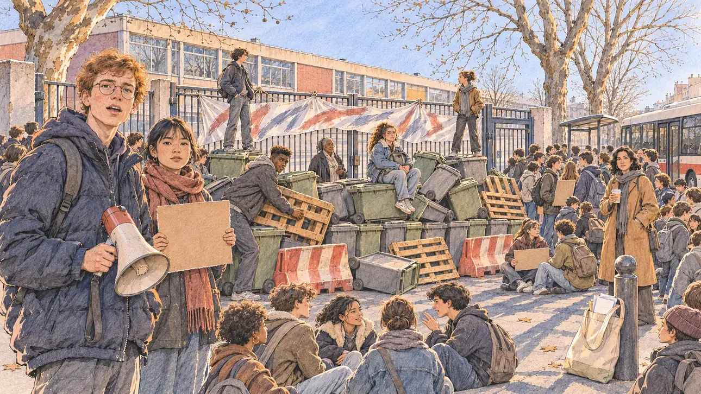

# `schoolBlockade` · Un lycée bloqué

**Validée par le PO le 07/11/2026**, à l'essai 2, après un prompt revu dans la même conversation. Elle sert telle quelle en clair et en sombre.



| Champ | Valeur |
| --- | --- |
| Carte | `schoolBlockade`, catégorie `field` (Rencontre) |
| Style | Reportage dessiné |
| Ton | Observateur et vivant |
| Date | 2026-11-07 |
| Outil | ChatGPT Images, à compléter (modèle et effort) |
| Conversation | À compléter |
| Format rendu | 1672 × 941 (16:9) : export en 1290 × 726 px, WebP de qualité 75, 234 Ko, sans recadrage, fait depuis la copie WebP de la conversation (à refaire depuis le PNG d'origine) |
| Fichier d'origine | À compléter (hors du dépôt) |
| Première édition | À compléter |

## Texte de la carte

> **Un lycée bloqué**
>
> Devant un lycée de banlieue, des poubelles barrent l'entrée : les lycéens bloquent pour leurs conditions d'étude, classes surchargées, professeurs non remplacés. Ils vous reconnaissent : « Venez nous parler ! »

## Le moment choisi

Un lycée des années 1970 de la banlieue est de Lyon, un matin d'hiver froid et clair. L'entrée est bloquée par une barricade de poubelles empilées, de palettes et de barrières de chantier, une banderole peinte sur la grille fermée, la cour vide derrière. Une soixantaine de lycéens se rassemblent devant, assis sur les poubelles ou par terre, pancartes en main. Le candidat arrive par le trottoir, hors champ : son sac de tracts est posé contre une borne. Un délégué roux à lunettes baisse son mégaphone pour l'interpeller ; la proviseure, seule derrière la grille, regarde ses élèves ; une professeure observe de loin, un café à la main. La région parisienne, d'où est parti le vrai mouvement, a été évitée pour qu'il ne se reconnaisse pas.

## Prompt complet

Dans une nouvelle conversation, avec [`primeTime.webp`](../../illustrations/media/primeTime.webp) comme seule image de référence. C'est le premier prompt écrit avec la règle « Le rôle va avec le métier et le contexte, sans cliché » du [gabarit](../gabarit.md) :

```
Use the attached image as the style reference and copy its drawing: a realistic reportage drawing made on the spot for a newspaper, with quick, nervous pencil lines, often drawn twice, ink hatching in the shadows, transparent watercolour washes that spill a little over the lines, and the warm paper showing through. Not the same scene and not the same people: never reuse the face or the hair of the woman in the reference.
Like in the reference, the setting can be full when the story needs it, with the things that say where we are and what is happening, but each one is sketched with a few pencil lines and a light wash, never rendered or finished, and the drawing gets looser and paler towards the edges until it fades into the bare paper.
This must look like a drawing made by hand on paper by a press illustrator, halfway between a quick sketch and a realistic picture: never a photograph, a film poster or a digital painting, and never a cartoon, a comic strip, a caricature or a children's book illustration. Continuous lines, never dotted or dashed outlines; no uniform texture, speckles or hatching filter laid over the picture; no glossy highlights, no smooth gradients, in the sky and on the walls too. Colour can be rich in places, on a piece of clothing, a light or a flag, but it stays transparent and within the palette below. The fade into the paper at the edges stays narrow, without a wide white margin. No blur and no depth-of-field effect: everything, the foreground included, is drawn sharp, like a sketch made on the spot.
People are drawn from life with realistic anatomy and proportions, like in the reference: faces shaped with pencil lines, hatching and light washes, a little more finished than the background but never photographic (no photographic skin, no airbrushed or digital-painting look). Expressions stay natural and restrained, even in laughter or tears: no exaggerated grins, no wide-open mouths full of teeth, no rubbery or cartoonish faces.

Editorial illustration, landscape 16:9 (1536 × 864 px), the scene filling the frame, with only a light fade into the paper at the edges. The front gate of a 1970s lycée in the eastern suburbs of Lyon, early on a cold, clear winter morning in 2027: a long prefabricated concrete building with faded coloured panels, a bicycle shed, bare plane trees, a bus stop across the street. A dozen green and grey wheelie bins, pushed together, block the closed metal gate: the pupils are blockading over their study conditions, peacefully, nothing burning. The player's candidate arrives along the pavement and stays off-camera: in the foreground, only the candidate's canvas bag of leaflets resting against a bollard, the leaflets unreadable. In the left third, a seventeen-year-old pupil spokesperson of European descent, lanky, with short red hair, freckles and round glasses, in a dark puffer jacket, lowers a megaphone and calls out to the viewer with an open, earnest face, mouth only slightly open, looking at the viewer, his face above mid-height. Around him: a sixteen-year-old girl of Vietnamese descent, small and slim, with a short fringe and a long scarf, holds up a blank cardboard placard and looks at the viewer; a tall, broad-shouldered eighteen-year-old of Malian descent, with a high-top haircut and a hoodie, wedges a bin into place and glances over; a round fifteen-year-old girl of Portuguese descent, with curly brown hair in a ponytail and a denim jacket over a jumper, sits on a bin with her backpack on her knees, watching. Behind the gate, inside the courtyard, the head teacher, a woman in her fifties of Caribbean descent, tall and solidly built, with short grey locs and reading glasses on a cord, in a long dark coat, holds her phone and looks at the pupils, worried but calm. On the pavement to the right, a history teacher in her forties of Algerian descent, slim, with shoulder-length wavy black hair and a camel coat, holds a paper cup of coffee and watches the scene from a distance. Other pupils further back, sketched lightly. Nothing on the placards, the building, the bus stop or the bag is readable.

Style: Reportage drawing made on the spot, like a press illustrator or courtroom sketch artist: pencil and ink with loose watercolour washes, lively unfinished lines, white paper showing through.

Palette: navy #13203F, vellum #F5EFE1, gold #A9802A, brick #B5523B, ochre #D9A441, sage #8FA58A, slate #5E7186, sand #DCC8A4, warm grey #8C8279; use 4 to 6 of them, subtle warm paper grain.

Tone: observant and lively, crisp early-morning winter light, long blue shadows, the low sun warming the faces.

Constraints: realistic proportions, natural expressions, never cartoonish or caricatured faces, drawn like the rest of the illustration and never photographic; people of varied ages, genders, origins and body types (heavy, stocky, round, tall, short, wiry, not only slim), each with a distinct face and haircut (no two people alike), drawn with respect and never as a joke; each person's age, build and look plausible for their role and the scene (the pupils are teenagers of fifteen to eighteen, the staff of working age), no stereotype tying an origin or a gender to a role, and no person of colour shown alone in a featured service or deferential role; the pupils are drawn with care, as the minors they are: no violence, no fire, no damage, no police; no religious signs; anatomically correct hands with exactly five fingers, few hands visible, the others in pockets, behind objects or out of frame; no readable text anywhere (placards, building, bus stop, bag and leaflets stay unreadable); no captions or speech bubbles; no logos, no trade-union or political party colours; no recognisable real person, no lookalike of a real politician; no photographic rendering, no blur or bokeh, no dotted outlines, no texture or hatching filter over the picture, no oil-paint texture, no wide white margin or frame (a light fade into the paper at the edges is fine).

Format: if 16:9 is not available, make 1536 × 1024 and keep the top 80 px and the bottom 80 px free of anything important (faces, hands, the main action): they will be cropped.
```

### Message de correction

Le prompt revu, envoyé en entier dans la même conversation, sans rejoindre d'image (l'étape 2 du gabarit), après l'essai 1 où le blocus ne se voyait pas. Il a donné l'essai 2, validé :

```
Same people, same faces, haircuts and clothes, same drawing and same light as your previous image, but the lycée must now look clearly and unmistakably blockaded: rebuild the scene as described below.

Use the attached image as the style reference and copy its drawing: a realistic reportage drawing made on the spot for a newspaper, with quick, nervous pencil lines, often drawn twice, ink hatching in the shadows, transparent watercolour washes that spill a little over the lines, and the warm paper showing through. Not the same scene and not the same people: never reuse the face or the hair of the woman in the reference.
Like in the reference, the setting can be full when the story needs it, with the things that say where we are and what is happening, but each one is sketched with a few pencil lines and a light wash, never rendered or finished, and the drawing gets looser and paler towards the edges until it fades into the bare paper.
This must look like a drawing made by hand on paper by a press illustrator, halfway between a quick sketch and a realistic picture: never a photograph, a film poster or a digital painting, and never a cartoon, a comic strip, a caricature or a children's book illustration. Continuous lines, never dotted or dashed outlines; no uniform texture, speckles or hatching filter laid over the picture; no glossy highlights, no smooth gradients, in the sky and on the walls too. Colour can be rich in places, on a piece of clothing, a light or a flag, but it stays transparent and within the palette below. The fade into the paper at the edges stays narrow, without a wide white margin. No blur and no depth-of-field effect: everything, the foreground included, is drawn sharp, like a sketch made on the spot.
People are drawn from life with realistic anatomy and proportions, like in the reference: faces shaped with pencil lines, hatching and light washes, a little more finished than the background but never photographic (no photographic skin, no airbrushed or digital-painting look). Expressions stay natural and restrained, even in laughter or tears: no exaggerated grins, no wide-open mouths full of teeth, no rubbery or cartoonish faces.

Editorial illustration, landscape 16:9 (1536 × 864 px), the scene filling the frame, with only a light fade into the paper at the edges. A lycée under blockade in the eastern suburbs of Lyon, early on a cold, clear winter morning in 2027: a long 1970s prefabricated concrete building with faded coloured panels, bare plane trees. In the centre of the image, the main entrance is completely blocked: in front of the closed metal gate and its pedestrian door, a tall, messy barricade of about thirty green and grey wheelie bins, piled two high, some tipped on their sides, wedged with wooden pallets and two red-and-white plastic road barriers, leaves no way in; a long white bed sheet painted with large, unreadable letters hangs across the gate. Behind the gate, the school courtyard is empty and silent: no pupil inside, no class today. Outside, on the pavement and spilling onto the street, some sixty pupils are gathered around the barricade in groups: some sit on the bins, two stand on top of the pile, others hold up blank cardboard placards or talk with their backpacks on; a city bus waits at the stop, its doors closed. Nothing is burning, nothing is broken. The player's candidate arrives along the pavement and stays off-camera: in the foreground, only the candidate's canvas bag of leaflets resting against a bollard, the leaflets unreadable. In the left third, in front of the barricade, a seventeen-year-old pupil spokesperson of European descent, lanky, with short red hair, freckles and round glasses, in a dark puffer jacket, lowers a megaphone and calls out to the viewer with an open, earnest face, mouth only slightly open, looking at the viewer, his face above mid-height. Around him: a sixteen-year-old girl of Vietnamese descent, small and slim, with a short fringe and a long red scarf, holds up a blank cardboard placard and looks at the viewer; a tall, broad-shouldered eighteen-year-old of Malian descent, with a high-top haircut and a hoodie under a grey jacket, wedges a pallet into the barricade and glances over; a round fifteen-year-old girl of Portuguese descent, with curly brown hair in a ponytail and a denim jacket, sits on top of a bin with her backpack on her knees, watching. Alone behind the blocked gate, in the empty courtyard, the head teacher, a woman in her fifties of Caribbean descent, tall and solidly built, with short grey locs and reading glasses on a cord, in a long dark coat, holds her phone and looks at the pupils over the barricade, worried but calm. On the pavement to the right, a history teacher in her forties of Algerian descent, slim, with shoulder-length wavy black hair and a camel coat, holds a paper cup of coffee and watches the scene from a distance. Nothing on the sheet, the placards, the building, the bus or the bag is readable.

Style: Reportage drawing made on the spot, like a press illustrator or courtroom sketch artist: pencil and ink with loose watercolour washes, lively unfinished lines, white paper showing through.

Palette: navy #13203F, vellum #F5EFE1, gold #A9802A, brick #B5523B, ochre #D9A441, sage #8FA58A, slate #5E7186, sand #DCC8A4, warm grey #8C8279; use 4 to 6 of them, subtle warm paper grain.

Tone: observant and lively, crisp early-morning winter light, long blue shadows, the low sun warming the faces.

Constraints: realistic proportions, natural expressions, never cartoonish or caricatured faces, drawn like the rest of the illustration and never photographic; people of varied ages, genders, origins and body types (heavy, stocky, round, tall, short, wiry, not only slim), each with a distinct face and haircut (no two people alike), drawn with respect and never as a joke; each person's age, build and look plausible for their role and the scene (the pupils are teenagers of fifteen to eighteen, the staff of working age), no stereotype tying an origin or a gender to a role, and no person of colour shown alone in a featured service or deferential role; the pupils are drawn with care, as the minors they are: no violence, no fire, no damage, no police; no religious signs; anatomically correct hands with exactly five fingers, few hands visible, the others in pockets, behind objects or out of frame; no readable text anywhere (the sheet, the placards, the building, the bus and the bag stay unreadable); no captions or speech bubbles; no logos, no trade-union or political party colours; no recognisable real person, no lookalike of a real politician; no photographic rendering, no blur or bokeh, no dotted outlines, no texture or hatching filter over the picture, no oil-paint texture, no wide white margin or frame (a light fade into the paper at the edges is fine).

Format: if 16:9 is not available, make 1536 × 1024 and keep the top 80 px and the bottom 80 px free of anything important (faces, hands, the main action): they will be cropped.
```

## Décisions prises sur cette image

- Le blocus doit se voir au premier regard : une barricade qui ferme l'entrée, la cour vide derrière, les lycéens rassemblés devant (PO, 07/11/2026, après l'essai 1).
- Des lycéens d'origines variées, blancs et non blancs, pour ne pas faire de la banlieue un cliché ; la proviseure, d'origine antillaise, tient le rôle d'autorité. Aucun signe religieux, aucune violence, aucun feu : les lycéens sont des mineurs.

## Essais écartés

- **Essai 1, 07/11/2026** : le premier prompt. Les poubelles étaient rangées le long de la grille comme un jour de collecte, l'entrée restait libre et des élèves passaient dans la cour : le lycée n'avait pas l'air bloqué (PO).

## Retouches

Aucune.

## Relecture

Faite et validée par le PO le 07/11/2026.

- [x] Aucun texte lisible : la banderole est faite de traits de peinture, les pancartes sont en carton nu, rien ne se lit sur le bâtiment, l'arrêt ni le bus.
- [x] Aucun sosie d'une personne réelle.
- [x] Le candidat du joueur est hors champ : seul son sac de tracts, contre la borne.
- [x] Mains, visages et foules sans défaut visible à 343 px de large.
- [x] Aucune couleur ni aucun logo de parti. Des personnes variées par l'âge, le corps, l'origine et la coiffure, sans rôle assigné par l'origine.
- [x] En 16:9 : pas de recadrage.
- [ ] Lisible sur la page de l'événement, en clair et en sombre : à vérifier dans l'app, une fois la carte publiée.
