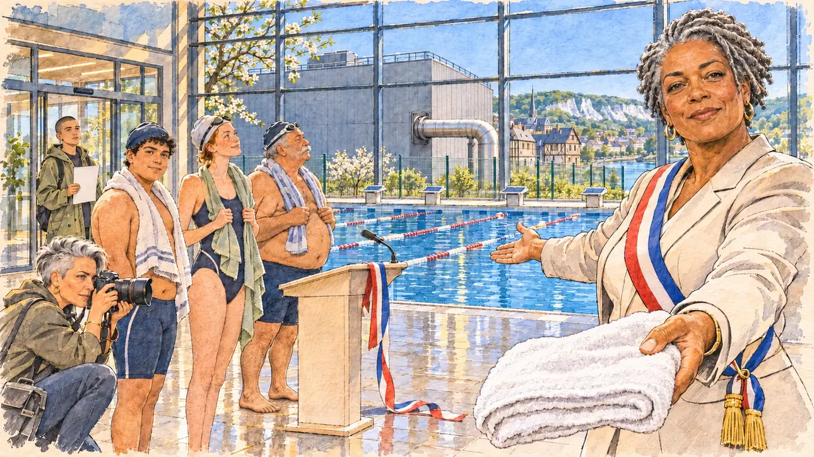

# `serverPool` · La piscine chauffée aux serveurs

**Validée par le PO le 18/11/2026**, au premier essai. Elle sert telle quelle en clair et en sombre.



| Champ | Valeur |
| --- | --- |
| Carte | `serverPool`, catégorie `field` (Rencontre), poids 0,1, toute semaine, un peu plus souvent pour une position écologiste (`leaning`, écologie 0,2) (Mitchnsun/moi-president, PO, 17/11/2026) |
| Style | Reportage dessiné |
| Ton | Chaleureux, avec une pointe d’ironie, lumière d’un bassin au soleil |
| Date | 2026-11-18 |
| Outil | ChatGPT Images |
| Conversation | À remplir (le lien ne s'ouvre qu'avec le compte qui l'a créée) |
| Format rendu | 1672 × 941 (16:9) : export en 1290 × 726 px, WebP de qualité 75, 192 Ko, sans recadrage, fait depuis la copie WebP de la conversation |
| Fichier d'origine | Image de ChatGPT, chez le PO. L'export du dépôt a été fait depuis la copie partagée dans la conversation avec Claude |
| Première édition | `kit-france-2611-0004` |

## Texte de la carte

> **La piscine chauffée aux serveurs**
>
> Une maire inaugure la piscine municipale, chauffée par la chaleur d'un data center voisin, la seule de la région. Elle vous invite à plonger. À la sortie, un militant vous glisse que cette chaleur n'est qu'une petite part de ce que le site consomme.

## Le moment choisi

Une piscine municipale neuve dans une ville de la vallée de la Seine, en Normandie, un matin ensoleillé d'avril : bassin bleu, grande baie vitrée, et de l'autre côté de la baie, collé au bâtiment, le cube gris du data center voisin et le gros tuyau calorifugé qui amène sa chaleur au bassin. Le ruban est coupé, les nageuses et nageurs du club attendent sur le bord en bonnet de bain. Le candidat reste hors champ : seule une serviette pliée, que la maire lui tend, au premier plan. La maire, écharpe tricolore sur son tailleur, lui montre l'eau d'un geste et le regarde en souriant : à vous ! À la sortie, derrière la vitre du hall, le militant attend avec un tract. Le précédent est le centre aquatique de Saint-Denis et la baignade de la maire de Paris dans la Seine, en 2024 : personne n'y ressemble à une élue réelle.

## Prompt complet

Dans une nouvelle conversation, avec [`primeTime.webp`](../../illustrations/media/primeTime.webp) comme seule image de référence :

```
Use the attached image as the style reference and copy its drawing: a realistic reportage drawing made on the spot for a newspaper, with quick, nervous pencil lines, often drawn twice, ink hatching in the shadows, transparent watercolour washes that spill a little over the lines, and the warm paper showing through. Not the same scene and not the same people: never reuse the face or the hair of the woman in the reference.
Like in the reference, the setting can be full when the story needs it, with the things that say where we are and what is happening, but each one is sketched with a few pencil lines and a light wash, never rendered or finished, and the drawing gets looser and paler towards the edges until it fades into the bare paper.
This must look like a drawing made by hand on paper by a press illustrator, halfway between a quick sketch and a realistic picture: never a photograph, a film poster or a digital painting, and never a cartoon, a comic strip, a caricature or a children's book illustration. Continuous lines, never dotted or dashed outlines; no uniform texture, speckles or hatching filter laid over the picture; no glossy highlights, no smooth gradients, in the sky and on the walls too. Colour can be rich in places, on a piece of clothing, a light or a flag, but it stays transparent and within the palette below. The fade into the paper at the edges stays narrow, without a wide white margin. No blur and no depth-of-field effect: everything, the foreground included, is drawn sharp, like a sketch made on the spot.
People are drawn from life with realistic anatomy and proportions, like in the reference: faces shaped with pencil lines, hatching and light washes, a little more finished than the background but never photographic (no photographic skin, no airbrushed or digital-painting look). Expressions stay natural and restrained, even in laughter or tears: no exaggerated grins, no wide-open mouths full of teeth, no rubbery or cartoonish faces.

Editorial illustration, landscape 16:9 (1536 × 864 px), the scene filling the frame, with only a light fade into the paper at the edges. A brand-new municipal swimming pool in a town of the Seine valley in Normandy, on a sunny April morning in 2027: a blue pool with lane ropes, wet tiles, a large glass wall flooded with light; on the other side of the glass, right against the building, the grey windowless cube of the neighbouring data centre and a thick insulated pipe that runs from it to the pool hall; beyond, half-timbered houses and the chalk cliffs of the valley, only sketched. A cut inauguration ribbon hangs by a lectern. The player's candidate stays off-camera: in the foreground, only a folded white towel held out towards the viewer. In the right third, the mayor, a woman in her fifties of Martinican descent, tall and curvy, with short grey locs and gold earrings, in a light suit with a tricolour sash, holds out the towel and points at the water with her other hand, smiling at the viewer as if saying “your turn”, her face above mid-height. On the edge of the pool, the swimmers of the local club wait in swimming caps and towels: a stocky teenage boy of Moroccan descent, a tall thin white girl with freckles, a round older man with a grey moustache and goggles on his forehead. A photographer from the local paper, a short woman in her forties with a silver undercut, crouches with her camera. Behind the glass of the entrance hall, a young activist with a shaved head and a sage-green raincoat waits with a sheet of paper in his hand. Only the mayor and the boy look at the viewer; the others look at the water or at the mayor. Nothing on the lectern, the ribbon, the paper, the pipe or the building is readable.

Style: Reportage drawing made on the spot, like a press illustrator or courtroom sketch artist: pencil and ink with loose watercolour washes, lively unfinished lines, white paper showing through.

Palette: navy #13203F, vellum #F5EFE1, gold #A9802A, brick #B5523B, ochre #D9A441, sage #8FA58A, slate #5E7186, sand #DCC8A4, warm grey #8C8279; use 4 to 6 of them, subtle warm paper grain.

Tone: warm and gently ironic, soft spring sunlight and blue reflections of the water, the grey cube of the data centre quietly present behind the glass, like a guest nobody mentions.

Constraints: realistic proportions, natural expressions, never cartoonish or caricatured faces, drawn like the rest of the illustration and never photographic; people of varied ages, genders, origins and body types (heavy, stocky, round, tall, short, wiry, not only slim), each with a distinct face and haircut (no two people alike), drawn with respect and never as a joke; each person's age, build and look plausible for their job and the scene (working people of working age), no stereotype tying an origin or a gender to a role, and no person of colour shown alone in a featured service or deferential role; anatomically correct hands with exactly five fingers, few hands visible, the others in pockets, behind objects or out of frame; no readable text anywhere (the lectern, the ribbon, the activist's paper, the pipe, the building and the caps stay unreadable, no town name, no slogans); no captions or speech bubbles; no logos, no tech company logo, no political party colours, no flags other than the mayor's tricolour sash; no recognisable real person, no lookalike of a real politician, of a real mayor or of a known activist; no nudity beyond ordinary swimwear, no one in danger in the water; no photographic rendering, no blur or bokeh, every outline a continuous pencil or ink line with no dotted or dashed outlines, no mottled, crackled or speckled texture over the faces, the clothes, the tiles, the water or the sky, no hatching filter over the picture, no oil-paint texture, no glow or halo, no wide white margin or frame (a light fade into the paper at the edges is fine).

Format: if 16:9 is not available, make 1536 × 1024 and keep the top 80 px and the bottom 80 px free of anything important (faces, hands, the main action): they will be cropped.
```

## Décisions prises sur cette image

Retenue telle quelle par le PO (18/11/2026). Le militant attend dans le hall de la piscine, près des portes vitrées, plutôt que derrière la vitre de l'entrée ; le nageur âgé, rond et torse nu, est dessiné sans moquerie. Des plots à dessus bleu bordent le bassin, et un clocher se devine parmi les colombages.

## Essais écartés

Aucun.

## Retouches

Aucune.

## Relecture

Faite le 18/11/2026, validée par le PO le même jour.

- [x] Aucun texte lisible : pupitre, ruban, feuille du militant, tuyau et bâtiment sans inscription.
- [x] Aucun sosie d'une personne réelle repéré.
- [x] Le candidat du joueur est hors champ : seule la serviette qu'on lui tend, au premier plan.
- [x] Mains et visages sans défaut visible à 343 px de large : les deux mains de la maire, celles des nageurs sur leurs serviettes, de la photographe et du militant.
- [x] Aucune couleur, aucun logo ni aucun drapeau de parti ; seule l'écharpe tricolore de la maire, et le ruban tricolore de l'inauguration. Des personnes variées par l'âge, le corps, l'origine et la coiffure.
- [x] En 16:9 : pas de recadrage.
- [ ] Lisible sur la page de l'événement, en clair et en sombre : à vérifier dans l'app, une fois la carte publiée.
