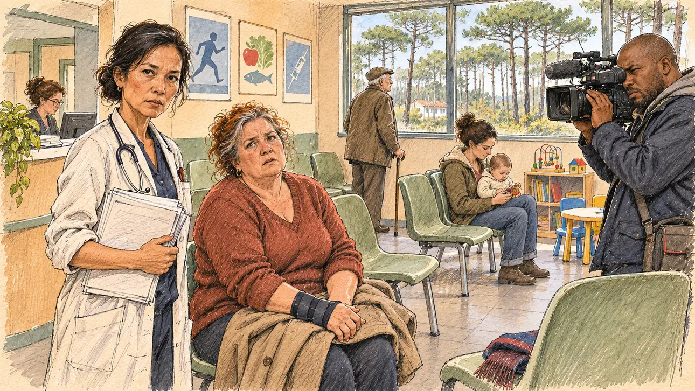

# `sickLeaveCap` · Une salle d'attente, un arrêt maladie

**Validée par le PO le 20/11/2026**, au premier essai, avec `primeTime.webp` comme référence. Elle sert telle quelle en clair et en sombre.



| Champ | Valeur |
| --- | --- |
| Carte | `sickLeaveCap`, catégorie `field` (Rencontre), poids 0,2, à partir de l'officialisation, une carte du programme : tirée si le programme tient le contrôle des arrêts maladie (`sickLeaveControl`) (Mitchnsun/moi-president, PO, 17/11/2026) |
| Style | Reportage dessiné, trait de `primeTime` |
| Ton | Observateur, lumière douce du matin |
| Date | 2026-11-20 (prompt écrit le 2026-11-18) |
| Outil | GPT 6.2 Astra |
| Format rendu | 1672 × 941 (16:9) : export en 1290 × 726 px, WebP de qualité 75, 234 Ko, sans recadrage |
| Fichier d'origine | Image chez le PO. L'export du dépôt a été fait depuis la copie partagée dans la conversation avec Claude |
| Première édition | `kit-france-2611-0004` |

## Texte de la carte

> **Une salle d'attente, un arrêt maladie**
>
> Dans la salle d'attente d'un cabinet médical, une médecin et une patiente en arrêt vous interpellent : l'une dit passer ses journées à justifier ses prescriptions, l'autre craint d'être soupçonnée de tricher. Un journaliste filme, et demande si votre contrôle vise les abus ou les malades.

## Le moment choisi

La salle d'attente d'une maison de santé à Mont-de-Marsan, dans les Landes, un matin de mars : chaises en plastique, un coin jeux pour les enfants, des affiches de prévention illisibles, et par la baie vitrée les pins et un ciel pâle. Le candidat est debout près de l'accueil, hors champ : au premier plan, son écharpe pliée sur une chaise. La médecin, sortie de son cabinet avec une pile de formulaires, et la patiente en arrêt, assise, son manteau sur les genoux, le regardent toutes les deux. Un journaliste filme, la caméra sur l'épaule ; d'autres patients attendent, un vieil homme à la canne, une jeune mère et son bébé. La carte rappelle le décret du 12 juin 2026 qui plafonne la durée des arrêts : personne n'y ressemble à une médecin connue.

## Prompt complet

Dans une nouvelle conversation, avec [`primeTime.webp`](../../illustrations/media/primeTime.webp) comme seule image de référence :

```
Use the attached image as the style reference and copy its drawing: a realistic reportage drawing made on the spot for a newspaper, with quick, nervous pencil lines, often drawn twice, ink hatching in the shadows, transparent watercolour washes that spill a little over the lines, and the warm paper showing through. Not the same scene and not the same people: never reuse the face or the hair of the woman in the reference.
Like in the reference, the setting can be full when the story needs it, with the things that say where we are and what is happening, but each one is sketched with a few pencil lines and a light wash, never rendered or finished, and the drawing gets looser and paler towards the edges until it fades into the bare paper.
This must look like a drawing made by hand on paper by a press illustrator, halfway between a quick sketch and a realistic picture: never a photograph, a film poster or a digital painting, and never a cartoon, a comic strip, a caricature or a children's book illustration. Continuous lines, never dotted or dashed outlines; no uniform texture, speckles or hatching filter laid over the picture; no glossy highlights, no smooth gradients, in the sky and on the walls too. Colour can be rich in places, on a piece of clothing, a light or a flag, but it stays transparent and within the palette below. The fade into the paper at the edges stays narrow, without a wide white margin. No blur and no depth-of-field effect: everything, the foreground included, is drawn sharp, like a sketch made on the spot.
People are drawn from life with realistic anatomy and proportions, like in the reference: faces shaped with pencil lines, hatching and light washes, a little more finished than the background but never photographic (no photographic skin, no airbrushed or digital-painting look). Expressions stay natural and restrained, even in laughter or tears: no exaggerated grins, no wide-open mouths full of teeth, no rubbery or cartoonish faces.

Editorial illustration, landscape 16:9 (1536 × 864 px), the scene filling the frame, with only a light fade into the paper at the edges. The waiting room of a maison de santé, a group medical practice, in Mont-de-Marsan, in the Landes in south-western France, on a morning in March 2027: rows of plastic chairs, a corner with toys for children, a reception desk, prevention posters on the walls, and through the wide window the tall pines and a pale sky. A doctor and a patient on sick leave challenge the player's candidate about the control of sick leave. The player's candidate stands near the reception desk and stays off-camera: in the foreground, only the candidate's folded scarf on a plastic chair. In the left third, the main character, the doctor, a woman in her forties of Cambodian descent, short and slim, with black hair in a low bun, in a white coat with rolled-up sleeves and a stethoscope, holds a stack of forms and looks at the viewer with a tired, sharp look, her face above mid-height. Seated beside her, the patient on sick leave, a white woman in her fifties, heavy-set, with auburn hair going grey, a wrist brace on one arm and her coat on her knees, looks up at the viewer, worried. On the right, a television journalist in his thirties of Ivorian descent, stocky, with a shaved head, films with a camera on his shoulder. Other patients wait: an elderly man with a cane looks out of the window; a young mother with a baby on her lap. Only the doctor and the patient look at the viewer. Nothing on the forms, the posters, the desk, the camera or the coats is readable.

Style: Reportage drawing made on the spot, like a press illustrator or courtroom sketch artist: pencil and ink with loose watercolour washes, lively unfinished lines, white paper showing through.

Palette: navy #13203F, vellum #F5EFE1, gold #A9802A, brick #B5523B, ochre #D9A441, sage #8FA58A, slate #5E7186, sand #DCC8A4, warm grey #8C8279; use 4 to 6 of them, subtle warm paper grain.

Tone: observant, the soft light of a March morning through the window, the pale green of the pines and the warm sand of the walls.

Constraints: realistic proportions, natural expressions, never cartoonish or caricatured faces, drawn like the rest of the illustration and never photographic; people of varied ages, genders, origins and body types (heavy, stocky, round, tall, short, wiry, not only slim), each with a distinct face and haircut (no two people alike), drawn with respect and never as a joke; each person's age, build and look plausible for their job and the scene (working people of working age), no stereotype tying an origin or a gender to a role, and no person of colour shown alone in a featured service or deferential role; anatomically correct hands with exactly five fingers, few hands visible, the others in pockets, behind objects or out of frame; no readable text anywhere (the forms, the posters, the desk, the camera and the coats stay unreadable, no medical sign with words); no captions or speech bubbles; no logos, no television channel logo, no health insurance logo, no political party colours; no recognisable real person, no lookalike of a real politician or of a known doctor; no explicit violence; no photographic rendering, no blur or bokeh, every outline a continuous pencil or ink line with no dotted or dashed outlines, no mottled, crackled or speckled texture over the faces, the clothes, the walls or the sky, no hatching filter over the picture, no oil-paint texture, no glow or halo, no wide white margin or frame (a light fade into the paper at the edges is fine).

Format: if 16:9 is not available, make 1536 × 1024 and keep the top 80 px and the bottom 80 px free of anything important (faces, hands, the main action): they will be cropped.
```

## Décisions prises sur cette image

Aucune pour le moment.

## Essais écartés

Aucun.

## Retouches

Aucune.

## Relecture

Faite et validée par le PO le 20/11/2026.

- [x] Aucun texte lisible : les formulaires, les affiches (des pictogrammes seulement), l'accueil, la caméra et les manteaux.
- [x] Aucun sosie d'une personne réelle.
- [x] Le candidat du joueur est hors champ : son écharpe pliée sur une chaise au premier plan.
- [x] Mains, visages et foules sans défaut visible à 343 px de large ; l'attelle au poignet est correcte.
- [x] Aucune couleur ni aucun logo de parti. Aucun logo de chaîne ni de l'Assurance maladie. Des personnes variées par l'âge, le corps, l'origine et la coiffure.
- [x] En 3:2 : sans objet, l'image est en 16:9.
- [x] Lisible sur la page de l'événement, en clair et en sombre.

Ce que la relecture a accepté : une secrétaire à l'accueil, en plus des personnes du prompt ; les affiches de prévention en simples pictogrammes.
