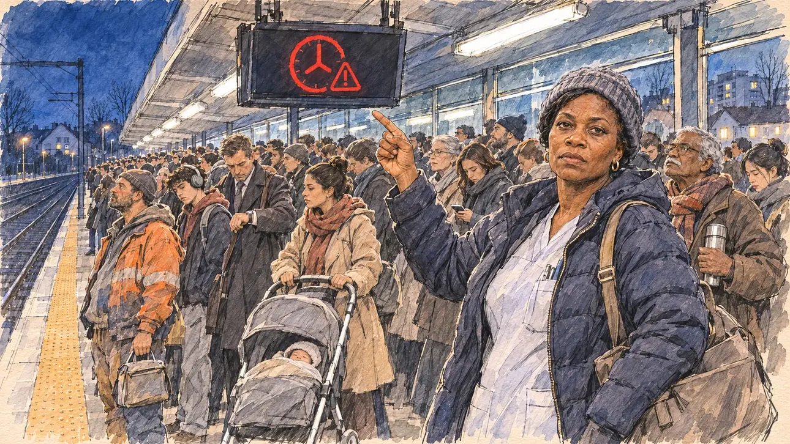

# `suburbLine` · Le RER du matin

**À générer.** Prompt prêt le 04/11/2026, pas encore d'image validée.



| Champ | Valeur |
| --- | --- |
| Carte | `suburbLine`, catégorie `field` (Rencontre), carte ajoutée par la PR #297 de l'app |
| Style | Reportage dessiné, trait de `primeTime` |
| Ton | Las, tendu |
| Date | À remplir |
| Outil | ChatGPT Images |
| Conversation | À remplir (le lien ne s'ouvre qu'avec le compte qui l'a créée) |
| Format rendu | À remplir |
| Fichier d'origine | À remplir |
| Première édition | À remplir |

## Texte de la carte

> **Le RER du matin**
>
> À six heures, sur le quai d'une gare de Seine-et-Marne, des centaines d'habitants attendent un RER annoncé en retard pour la troisième fois de la semaine. Beaucoup vivent à plus d'une heure de leur travail et disent qu'ils n'ont pas les moyens de se loger plus près.

## Le moment choisi

Le quai d'une gare de RER de Seine-et-Marne, à six heures du matin en février, sous les néons, vu depuis la place du candidat sur le quai (hors champ) : au premier plan, le bord du quai et sa bande podotactile. Une aide-soignante en route pour Paris, son sac de travail à l'épaule, montre au candidat le panneau d'affichage qui annonce encore un retard. Autour : la foule serrée des voyageurs qui attendent, un maçon en tenue de chantier, un lycéen, un homme en costume qui regarde l'heure, une mère avec une poussette. Derrière : l'écran du quai qui n'affiche que des pictogrammes de retard, l'abri vitré, les pavillons et les immeubles de la ville nouvelle dans le noir, et la voie vide qui file vers Paris.

## Prompt complet

Dans une nouvelle conversation, avec [`primeTime.webp`](../../illustrations/media/primeTime.webp) comme seule image de référence.

```
Use the attached image as the style reference and copy its drawing: a realistic reportage drawing made on the spot for a newspaper, with quick, nervous pencil lines, often drawn twice, ink hatching in the shadows, transparent watercolour washes that spill a little over the lines, and the warm paper showing through. Not the same scene and not the same people: never reuse the face or the hair of the woman in the reference.
Like in the reference, the setting can be full when the story needs it, with the things that say where we are and what is happening, but each one is sketched with a few pencil lines and a light wash, never rendered or finished, and the drawing gets looser and paler towards the edges until it fades into the bare paper.
This must look like a drawing made by hand on paper by a press illustrator, halfway between a quick sketch and a realistic picture: never a photograph, a film poster or a digital painting, and never a cartoon, a comic strip, a caricature or a children's book illustration. Continuous lines, never dotted or dashed outlines; no uniform texture, speckles or hatching filter laid over the picture; no glossy highlights, no smooth gradients, in the sky and on the walls too. Colour can be rich in places, on a piece of clothing, a light or a flag, but it stays transparent and within the palette below. The fade into the paper at the edges stays narrow, without a wide white margin. No blur and no depth-of-field effect: everything, the foreground included, is drawn sharp, like a sketch made on the spot.
People are drawn from life with realistic anatomy and proportions, like in the reference: faces shaped with pencil lines, hatching and light washes, a little more finished than the background but never photographic (no photographic skin, no airbrushed or digital-painting look). Expressions stay natural and restrained, even in laughter or tears: no exaggerated grins, no wide-open mouths full of teeth, no rubbery or cartoonish faces.

Editorial illustration, landscape 16:9 (1536 × 864 px), the scene filling the frame, with only a light fade into the paper at the edges. The platform of a suburban RER station in Seine-et-Marne, east of Paris, at six in the morning on a cold February day in 2027, under the white neon lights: hundreds of residents are waiting for a train announced late for the third time this week; many live more than an hour from their work and say they cannot afford to live any closer. The scene is seen from the place of the player's candidate on the platform, who stays off-camera: in the foreground, only the edge of the platform with its yellow tactile strip. In the right third, a care assistant in her forties of Haitian origin, on her way to a hospital in Paris, with short relaxed hair under a wool hat, a puffer jacket over her work tunic and a heavy work bag on her shoulder, points up at the departure board and looks at the viewer with a tired, exasperated face, her face above mid-height. Around her, sketched in pencil and light washes: the dense crowd of commuters waiting shoulder to shoulder, a bricklayer of Portuguese origin in his work clothes with a lunch bag, a sleepy teenager with headphones and a backpack, a man in a suit and a long coat checking his watch, a young mother of North African origin with a pushchair, an older man of Sri Lankan origin with a thermos, many looking at their phones. Behind them, the departure screen above the platform showing only a red delay pictogram and no words, the glass shelter, the empty tracks running into the dark towards Paris, and beyond the station the detached houses and apartment blocks of the new town in the night, with a few lit windows and street lamps. Only the care assistant looks at the viewer. Nothing on the departure board, the screens, the signs, the phones, the bags or the shelter is readable, and no logo of a real transport company appears.

Style: Reportage drawing made on the spot, like a press illustrator or courtroom sketch artist: pencil and ink with loose watercolour washes, lively unfinished lines, white paper showing through.

Palette: navy #13203F, vellum #F5EFE1, gold #A9802A, brick #B5523B, ochre #D9A441, sage #8FA58A, slate #5E7186, sand #DCC8A4, warm grey #8C8279; use 4 to 6 of them, subtle warm paper grain.

Tone: weary and tense, the cold white neon light of the platform against the deep blue night, the red of the delay pictogram as the only bright note.

Constraints: realistic proportions, natural expressions, never cartoonish or caricatured faces, drawn like the rest of the illustration and never photographic; people of varied ages, genders, origins and body types (heavy, stocky, round, tall, short, wiry, not only slim), each with a distinct face and haircut (no two people alike), drawn with respect and never as a joke; anatomically correct hands with exactly five fingers, few hands visible, the others in pockets, behind objects or out of frame; no readable text anywhere (the departure board, the screens, the signs, the phones, the bags and the shelter stay unreadable); no captions or speech bubbles; no logos or political party colours; no recognisable real person, no lookalike of a real politician, and no logo of a real transport company; no explicit violence; no photographic rendering, no blur or bokeh, no dotted outlines, no texture or hatching filter over the picture, no oil-paint texture, no wide white margin or frame (a light fade into the paper at the edges is fine).

Format: if 16:9 is not available, make 1536 × 1024 and keep the top 80 px and the bottom 80 px free of anything important (faces, hands, the main action): they will be cropped.
```

## Décisions prises sur cette image

Aucune pour l'instant.

## Essais écartés

Aucun pour l'instant.

## Retouches

Aucune.

## Relecture

À faire sur l'image validée.
