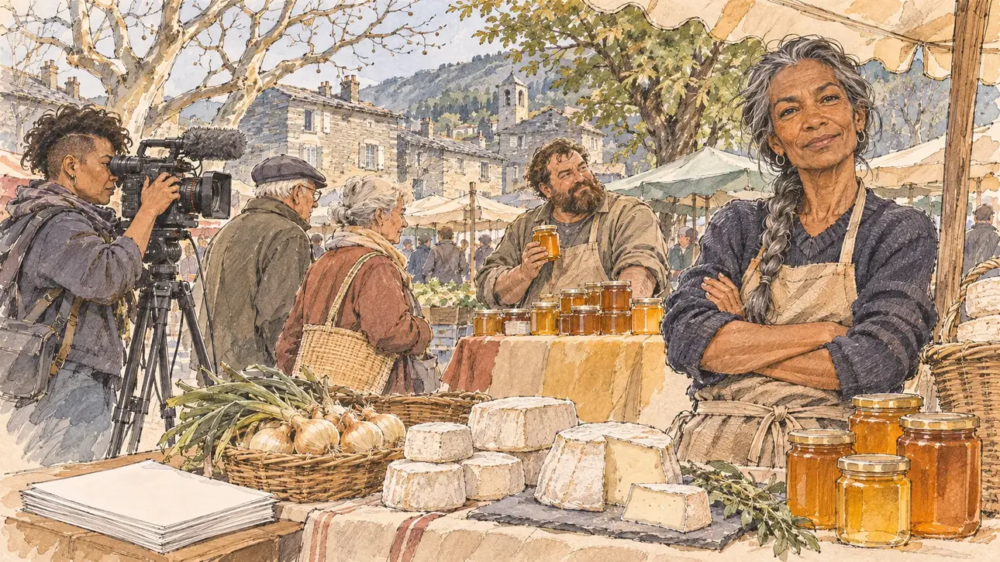

# `teachMe` · Apprenez-moi

**Retenue par le PO le 16/11/2026**, au premier essai. Elle sert telle quelle en clair et en sombre.



| Champ | Valeur |
| --- | --- |
| Carte | `teachMe`, catégorie `field` (Rencontre), poids 0,15, toute semaine ; une leçon gagnée sur une faiblesse (proximité +3, jet inversé), une seule de la série par partie (Mitchnsun/moi-president, PO, 16/11/2026) |
| Style | Reportage dessiné |
| Ton | Gentiment ironique, matin frais |
| Date | 2026-11-16 |
| Outil | ChatGPT Images, modèle GPT 6.2, effort Light |
| Format rendu | 1672 × 941 (16:9) : export en 1290 × 726 px, WebP de qualité 75, 246 Ko, sans recadrage, fait depuis la copie WebP de la conversation |
| Fichier d'origine | Image de ChatGPT, chez le PO. L'export du dépôt a été fait depuis la copie partagée dans la conversation avec Claude |
| Première édition | `kit-france-2611-0004` |

## Texte de la carte

> **Apprenez-moi**
>
> Sur le marché d'un bourg, vous vous sentez raide, les gens vous évitent, et un commerçant vous lance : « Vous n'êtes pas du coin, vous. » La tournée est filmée.

## Le moment choisi

Le marché du samedi d'un bourg des Cévennes, un matin frais de mars : maisons de schiste, platanes, collines boisées, étals sous des auvents de toile, fromages de chèvre, miel, oignons doux. Le candidat est devant l'étal, hors champ : seule sa pile de tracts blancs, sur le coin. La fromagère, bras croisés, le regarde d'un air amusé : vous n'êtes pas du coin, vous ; un couple âgé se détourne poliment ; l'apiculteur voisin observe, un pot à la main ; une caméraman filme. Aucun précédent fiable n'a été trouvé pour un candidat qui aurait dit sa gêne sur un marché : la carte repose sur la règle du jeu.

## Prompt complet

Dans une nouvelle conversation, avec [`primeTime.webp`](../../illustrations/media/primeTime.webp) comme seule image de référence :

```
Use the attached image as the style reference and copy its drawing: a realistic reportage drawing made on the spot for a newspaper, with quick, nervous pencil lines, often drawn twice, ink hatching in the shadows, transparent watercolour washes that spill a little over the lines, and the warm paper showing through. Not the same scene and not the same people: never reuse the face or the hair of the woman in the reference.
Like in the reference, the setting can be full when the story needs it, with the things that say where we are and what is happening, but each one is sketched with a few pencil lines and a light wash, never rendered or finished, and the drawing gets looser and paler towards the edges until it fades into the bare paper.
This must look like a drawing made by hand on paper by a press illustrator, halfway between a quick sketch and a realistic picture: never a photograph, a film poster or a digital painting, and never a cartoon, a comic strip, a caricature or a children's book illustration. Continuous lines, never dotted or dashed outlines; no uniform texture, speckles or hatching filter laid over the picture; no glossy highlights, no smooth gradients, in the sky and on the walls too. Colour can be rich in places, on a piece of clothing, a light or a flag, but it stays transparent and within the palette below. The fade into the paper at the edges stays narrow, without a wide white margin. No blur and no depth-of-field effect: everything, the foreground included, is drawn sharp, like a sketch made on the spot.
People are drawn from life with realistic anatomy and proportions, like in the reference: faces shaped with pencil lines, hatching and light washes, a little more finished than the background but never photographic (no photographic skin, no airbrushed or digital-painting look). Expressions stay natural and restrained, even in laughter or tears: no exaggerated grins, no wide-open mouths full of teeth, no rubbery or cartoonish faces.

Editorial illustration, landscape 16:9 (1536 × 864 px), the scene filling the frame, with only a light fade into the paper at the edges. The Saturday market of a small town in the Cévennes, in southern France, on a cool morning in March 2027: houses of grey schist, chestnut trees and still-bare plane trees, stalls under small canvas awnings with goat cheeses, honey and sweet onions. The player's candidate stands before a stall and stays off-camera: in the foreground, only the candidate's stack of blank leaflets on the corner of the stall. In the right third, behind her cheese stall, the stallholder, a lean woman in her fifties of Malagasy descent with a long grey braid and a canvas apron, arms crossed, looks at the viewer with an amused, slightly teasing look, as if saying the viewer is not from around here, her face above mid-height. Around her: an elderly couple with shopping baskets politely turns away; a heavy-set beekeeper in his forties with a thick brown beard watches from the next stall, a jar of honey in his hand. A little apart, a stocky camerawoman with an undercut films the scene. Only the stallholder looks at the viewer. Nothing on the stalls, the awnings, the jars, the leaflets or the camera is readable.

Style: Reportage drawing made on the spot, like a press illustrator or courtroom sketch artist: pencil and ink with loose watercolour washes, lively unfinished lines, white paper showing through.

Palette: navy #13203F, vellum #F5EFE1, gold #A9802A, brick #B5523B, ochre #D9A441, sage #8FA58A, slate #5E7186, sand #DCC8A4, warm grey #8C8279; use 4 to 6 of them, subtle warm paper grain.

Tone: gently ironic, postures slightly exaggerated but never the faces, the cool morning light on the schist, the colours of the stalls as the warm notes of the picture.

Constraints: realistic proportions, natural expressions, never cartoonish or caricatured faces, drawn like the rest of the illustration and never photographic; people of varied ages, genders, origins and body types (heavy, stocky, round, tall, short, wiry, not only slim), each with a distinct face and haircut (no two people alike), drawn with respect and never as a joke; each person's age, build and look plausible for their job and the scene (working people of working age), no stereotype tying an origin or a gender to a role, and no person of colour shown alone in a featured service or deferential role; anatomically correct hands with exactly five fingers, few hands visible, the others in pockets, behind objects or out of frame; no readable text anywhere (the stalls, the awnings, the jars, the leaflets and the camera stay unreadable, no price tags with figures, no shop signs); no captions or speech bubbles; no logos, no television channel logo, no political party colours, no flags; no recognisable real person, no lookalike of a real politician; no explicit violence; no photographic rendering, no blur or bokeh, every outline a continuous pencil or ink line with no dotted or dashed outlines, no mottled, crackled or speckled texture over the faces, the clothes, the stone or the sky, no hatching filter over the picture, no oil-paint texture, no glow or halo, no wide white margin or frame (a light fade into the paper at the edges is fine).

Format: if 16:9 is not available, make 1536 × 1024 and keep the top 80 px and the bottom 80 px free of anything important (faces, hands, the main action): they will be cropped.
```

## Décisions prises sur cette image

Retenue telle quelle par le PO (16/11/2026). Des pots de miel sont aussi sur l'étal de la fromagère, et la caméra est sur un trépied.

## Essais écartés

Aucun.

## Retouches

Aucune.

## Relecture

Faite le 16/11/2026, à confirmer par le PO.

- [x] Aucun texte lisible : ni étiquettes sur les pots, ni prix, ni enseignes ; les tracts sont blancs.
- [x] Aucun sosie d'une personne réelle.
- [x] Le candidat du joueur est hors champ : seule sa pile de tracts, sur l'étal.
- [x] Mains et visages sans défaut visible à 343 px de large : les bras croisés de la fromagère, la main de l'apiculteur sur son pot, celles de la caméraman.
- [x] Aucune couleur, aucun logo ni aucun drapeau de parti. Des personnes variées par l'âge, le corps, l'origine et la coiffure.
- [x] En 16:9 : pas de recadrage.
- [ ] Lisible sur la page de l'événement, en clair et en sombre : à vérifier dans l'app, une fois la carte publiée.
