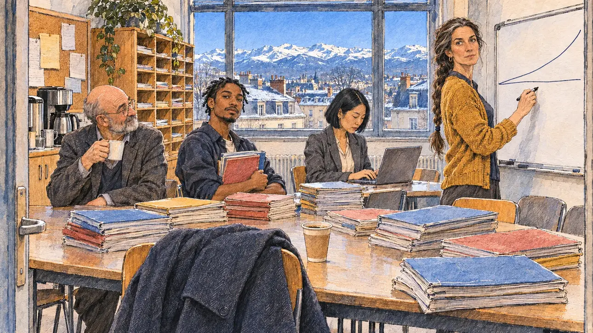

# `teachersPay` · Combien pour les professeurs ?

**Validée par le PO le 20/11/2026**, au premier essai, avec `primeTime.webp` comme référence. Elle sert telle quelle en clair et en sombre.



| Champ | Valeur |
| --- | --- |
| Carte | `teachersPay`, catégorie `field` (Rencontre), poids 0,25, à partir de l'officialisation, une carte du programme : tirée si le programme tient la revalorisation des enseignants (`teacherPay`) ; exclut `teachersUnion`, `schoolBlockade` et `classClosures`, une histoire d'école par partie (Mitchnsun/moi-president, PO, 17/11/2026) |
| Style | Reportage dessiné, trait de `primeTime` |
| Ton | Observateur et tendu, lumière claire du matin |
| Date | 2026-11-20 (prompt écrit le 2026-11-18) |
| Outil | À compléter |
| Conversation | À remplir (le lien ne s'ouvre qu'avec le compte qui l'a créée) |
| Format rendu | 1672 × 941 (16:9) : export en 1290 × 726 px, WebP de qualité 75, 232 Ko, sans recadrage |
| Fichier d'origine | Image chez le PO. L'export du dépôt a été fait depuis la copie partagée dans la conversation avec Claude |
| Première édition | À compléter |

## Texte de la carte

> **Combien pour les professeurs ?**
>
> Dans une salle des professeurs, on vous attend avec un tableau : depuis des années, le point d'indice monte moins vite que les prix. Votre programme promet de mieux payer les enseignantes et les enseignants ; une professeure en milieu de carrière vous demande combien, ici et maintenant, et si les postes passeront après.

## Le moment choisi

La salle des professeurs d'un collège de Tarbes, dans les Hautes-Pyrénées, un matin clair de mars : casiers, machine à café, longue table couverte de copies, et par la fenêtre les sommets enneigés des Pyrénées. Le candidat est entré, hors champ : au premier plan, son manteau posé sur le dossier d'une chaise et un gobelet de café qu'on lui a servi. Sur le tableau blanc, un graphique tracé au feutre : deux courbes qui s'écartent, sans aucun chiffre ni mot. Une professeure en milieu de carrière, feutre en main, le regarde : combien, ici et maintenant ? Autour : un jeune professeur qui le regarde aussi, ses copies sous le bras, un collègue proche de la retraite, sa tasse à la main, une professeure à son ordinateur. La carte rappelle la journée d'action du 10/11/2026 sur le point d'indice : personne n'y ressemble à une syndicaliste connue.

## Prompt complet

Dans une nouvelle conversation, avec [`primeTime.webp`](../../illustrations/media/primeTime.webp) comme seule image de référence :

```
Use the attached image as the style reference and copy its drawing: a realistic reportage drawing made on the spot for a newspaper, with quick, nervous pencil lines, often drawn twice, ink hatching in the shadows, transparent watercolour washes that spill a little over the lines, and the warm paper showing through. Not the same scene and not the same people: never reuse the face or the hair of the woman in the reference.
Like in the reference, the setting can be full when the story needs it, with the things that say where we are and what is happening, but each one is sketched with a few pencil lines and a light wash, never rendered or finished, and the drawing gets looser and paler towards the edges until it fades into the bare paper.
This must look like a drawing made by hand on paper by a press illustrator, halfway between a quick sketch and a realistic picture: never a photograph, a film poster or a digital painting, and never a cartoon, a comic strip, a caricature or a children's book illustration. Continuous lines, never dotted or dashed outlines; no uniform texture, speckles or hatching filter laid over the picture; no glossy highlights, no smooth gradients, in the sky and on the walls too. Colour can be rich in places, on a piece of clothing, a light or a flag, but it stays transparent and within the palette below. The fade into the paper at the edges stays narrow, without a wide white margin. No blur and no depth-of-field effect: everything, the foreground included, is drawn sharp, like a sketch made on the spot.
People are drawn from life with realistic anatomy and proportions, like in the reference: faces shaped with pencil lines, hatching and light washes, a little more finished than the background but never photographic (no photographic skin, no airbrushed or digital-painting look). Expressions stay natural and restrained, even in laughter or tears: no exaggerated grins, no wide-open mouths full of teeth, no rubbery or cartoonish faces.

Editorial illustration, landscape 16:9 (1536 × 864 px), the scene filling the frame, with only a light fade into the paper at the edges. The staff room of a collège in Tarbes, in the Hautes-Pyrénées in south-western France, on a clear morning in March 2027: rows of wooden pigeonholes, a coffee machine, a long table covered with piles of exercise books, a corkboard, and through the wide window the snowy peaks of the Pyrenees above the town's roofs. The teachers waited for the player's candidate with a chart: on the whiteboard, drawn in marker, only two curves that move apart, one climbing and one nearly flat, with no figures, no axes labelled and no words. The player's candidate stays off-camera, just inside the door: in the foreground, only the candidate's coat over the back of a chair and a paper cup of coffee someone has poured. In the right third, the main character, a teacher in her mid-forties, white, tall, with a long brown braid streaked with grey, in a mustard cardigan, stands at the whiteboard with the marker still in her hand and looks at the viewer with a frank, expectant look, as if asking how much, here and now, her face above mid-height. Around her: a young teacher in his late twenties of Guadeloupean descent, slim, with short twists, holding a stack of exercise books, also looks at the viewer; an older teacher in his early sixties, round and bald, with a beard, holds a mug and nods; at the end of the table, a teacher in her thirties of Korean descent, with a straight black bob, types on her laptop without looking up. Only the teacher at the whiteboard and the young teacher look at the viewer. Nothing on the whiteboard, the pigeonholes, the corkboard, the exercise books or the laptop is readable.

Style: Reportage drawing made on the spot, like a press illustrator or courtroom sketch artist: pencil and ink with loose watercolour washes, lively unfinished lines, white paper showing through.

Palette: navy #13203F, vellum #F5EFE1, gold #A9802A, brick #B5523B, ochre #D9A441, sage #8FA58A, slate #5E7186, sand #DCC8A4, warm grey #8C8279; use 4 to 6 of them, subtle warm paper grain.

Tone: observant and a little tense, the clear light of a mountain morning through the window, the mustard of the cardigan as the warm note.

Constraints: realistic proportions, natural expressions, never cartoonish or caricatured faces, drawn like the rest of the illustration and never photographic; people of varied ages, genders, origins and body types (heavy, stocky, round, tall, short, wiry, not only slim), each with a distinct face and haircut (no two people alike), drawn with respect and never as a joke; each person's age, build and look plausible for their job and the scene (working people of working age), no stereotype tying an origin or a gender to a role, and no person of colour shown alone in a featured service or deferential role; anatomically correct hands with exactly five fingers, few hands visible, the others in pockets, behind objects or out of frame; no readable text anywhere (the whiteboard, the pigeonholes, the corkboard, the exercise books and the laptop stay unreadable, the chart has only two lines, no numbers); no captions or speech bubbles; no logos, no trade union logo, no political party colours; no recognisable real person, no lookalike of a real politician or of a known trade unionist; no explicit violence; no photographic rendering, no blur or bokeh, every outline a continuous pencil or ink line with no dotted or dashed outlines, no mottled, crackled or speckled texture over the faces, the clothes, the walls or the sky, no hatching filter over the picture, no oil-paint texture, no glow or halo, no wide white margin or frame (a light fade into the paper at the edges is fine).

Format: if 16:9 is not available, make 1536 × 1024 and keep the top 80 px and the bottom 80 px free of anything important (faces, hands, the main action): they will be cropped.
```

## Décisions prises sur cette image

Aucune pour le moment.

## Essais écartés

Aucun.

## Retouches

Aucune.

## Relecture

Faite et validée par le PO le 20/11/2026.

- [x] Aucun texte lisible : le tableau blanc ne porte que deux courbes, les notes du panneau, les casiers, les copies et l'ordinateur sont vierges.
- [x] Aucun sosie d'une personne réelle.
- [x] Le candidat du joueur est hors champ : son manteau sur une chaise et un gobelet de café au premier plan.
- [x] Mains, visages et foules sans défaut visible à 343 px de large.
- [x] Aucune couleur ni aucun logo de parti. Aucun logo de syndicat. Des personnes variées par l'âge, le corps, l'origine et la coiffure.
- [x] En 3:2 : sans objet, l'image est en 16:9.
- [x] Lisible sur la page de l'événement, en clair et en sombre.

Ce que la relecture a accepté : le professeur proche de la retraite porte des lunettes et regarde sa collègue au tableau plutôt que de hocher la tête ; le dessin plus fini que la référence, avec peu de fondu dans le papier aux bords.
