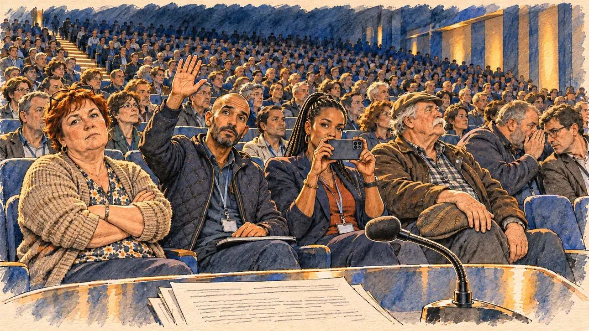

# `tobacconistsCongress` · Le congrès des buralistes

**Validée par le PO le 24/11/2026**, dans le trait de `primeTime`, sur le prompt sans la banderole au losange des tabacs, que le PO a retirée (voir « Décisions »). Elle sert telle quelle en clair et en sombre.



| Champ | Valeur |
| --- | --- |
| Carte | `tobacconistsCongress`, catégorie `field` (Rencontre) ; carte ajoutée par la PR #510 de l'app |
| Style | Reportage dessiné, trait de `primeTime` |
| Ton | Observateur, un peu tendu |
| Date | 2026-11-24 |
| Outil | ChatGPT Images |
| Conversation | À remplir (le lien ne s'ouvre qu'avec le compte qui l'a créée) |
| Format rendu | 1672 × 941 (16:9) : export en 1290 × 726 px depuis l'image partagée dans la conversation avec Claude, WebP de qualité 75, 206 Ko, sans recadrage |
| Fichier d'origine | Image de ChatGPT, chez le PO. L'export du dépôt a été fait depuis la copie partagée dans la conversation avec Claude |
| Première édition | La prochaine Release qui suit le merge de la PR #510 de l'app |

## Texte de la carte

> **Le congrès des buralistes**
>
> Le congrès des buralistes vous invite à la tribune. Dans la salle, des patrons de bureaux de tabac de bourgs et de quartiers attendent une promesse : la fin des hausses de taxes, qu'ils accusent de nourrir la contrebande.

Les réponses : venir écouter, sans rien promettre (sans jet) ; promettre de geler les taxes sur le tabac (charisme 11, plus facile à droite) ; présenter un plan pour faire des bureaux de tabac des commerces de services (expertise 11) ; leur dire en face que le prix du tabac sauve des vies, avec un plan de reconversion (charisme 14, le pari).

## Le moment choisi

La salle vue depuis la tribune, au moment où le candidat, hors champ, arrive au pupitre : au premier plan, le bord du pupitre, ses feuilles et un micro. Au premier rang, une buraliste de bourg, bras croisés, sceptique ; à côté, un buraliste de quartier qui lève la main ; une jeune buraliste qui filme au téléphone, un homme âgé à moustache blanche, deux congressistes qui se parlent à l'oreille. Ni cigarette, ni paquet, ni marque : le métier se lit au lieu et au texte de la carte. Le congrès réel des buralistes de novembre 2026 et leur semaine de manifestations de septembre sont dans `docs/NEWS_SOURCES.md` de l'app.

## Prompt complet

Dans une nouvelle conversation, avec [`primeTime.webp`](../../illustrations/media/primeTime.webp) comme seule image de référence. Le prompt proposé ajoutait une banderole au-dessus de la scène, montrant seulement le losange rouge de l'enseigne des tabacs, vierge ; le PO l'a retirée avant de générer, et le prompt ci-dessous est celui envoyé.

```
Use the attached image as the style reference and copy its drawing: a realistic reportage drawing made on the spot for a newspaper, with quick, nervous pencil lines, often drawn twice, ink hatching in the shadows, transparent watercolour washes that spill a little over the lines, and the warm paper showing through. Not the same scene and not the same people: never reuse the face or the hair of the woman in the reference.
Like in the reference, the setting can be full when the story needs it, with the things that say where we are and what is happening, but each one is sketched with a few pencil lines and a light wash, never rendered or finished, and the drawing gets looser and paler towards the edges until it fades into the bare paper.
This must look like a drawing made by hand on paper by a press illustrator, halfway between a quick sketch and a realistic picture: never a photograph, a film poster or a digital painting, and never a cartoon, a comic strip, a caricature or a children's book illustration. Continuous lines, never dotted or dashed outlines; no uniform texture, speckles or hatching filter laid over the picture; no glossy highlights, no smooth gradients, in the sky and on the walls too. Colour can be rich in places, on a piece of clothing, a light or a flag, but it stays transparent and within the palette below. The fade into the paper at the edges stays narrow, without a wide white margin. No blur and no depth-of-field effect: everything, the foreground included, is drawn sharp, like a sketch made on the spot.
People are drawn from life with realistic anatomy and proportions, like in the reference: faces shaped with pencil lines, hatching and light washes, a little more finished than the background but never photographic (no photographic skin, no airbrushed or digital-painting look). Expressions stay natural and restrained, even in laughter or tears: no exaggerated grins, no wide-open mouths full of teeth, no rubbery or cartoonish faces.

Editorial illustration, landscape 16:9 (1536 × 864 px), the scene filling the frame, with only a light fade into the paper at the edges. The congress of the French tobacconists, in the main hall of a convention centre in Lyon, on a morning in 2027: rows of padded seats rising slightly towards the back, a few hundred shop owners in their everyday clothes, spotlights on the front rows, the back of the hall in shadow. The tobacconists want an end to the tax rises on tobacco, which they blame for smuggling, and they wait to hear what the candidate will promise. The scene is seen from the stage: the player's candidate stands at the lectern and stays off-camera; in the foreground, only the edge of the wooden lectern with a few loose sheets of the candidate's speech and a small microphone on a gooseneck. In the left third of the front row, the main character, a tobacconist from a small town in her late fifties, white, round and sturdy, with short dyed auburn hair and reading glasses pushed up on her head, in a cardigan over a blouse, sits with her arms crossed and looks at the viewer with a sceptical, waiting look, her face above mid-height. Next to her, a tobacconist from a city neighbourhood in his forties of Moroccan descent, wiry, with a shaved head and a short black beard, in a quilted jacket, raises one hand to ask a question, looking at the viewer. Around them, other tobacconists, each different: a tall, heavy man in his sixties with a white moustache and a flat cap held on his knee; a young woman in her thirties of Martinican descent with long braids tied back, who has taken over her parents' shop, filming the stage with her phone; a stocky man in his fifties with grey stubble whispering to his neighbour. Only the woman in the cardigan, the man raising his hand and the young woman filming look at the viewer. Nothing on the sheets, the badges or the phone is readable.

Style: Reportage drawing made on the spot, like a press illustrator or courtroom sketch artist: pencil and ink with loose watercolour washes, lively unfinished lines, white paper showing through.

Palette: navy #13203F, vellum #F5EFE1, gold #A9802A, brick #B5523B, ochre #D9A441, sage #8FA58A, slate #5E7186, sand #DCC8A4, warm grey #8C8279; use 4 to 6 of them, subtle warm paper grain.

Tone: observant and a little tense, warm spotlight on the front rows, the back of the hall in a soft shadow.

Constraints: realistic proportions, natural expressions, never cartoonish or caricatured faces, drawn like the rest of the illustration and never photographic; people of varied ages, genders, origins and body types (heavy, stocky, round, tall, short, wiry, not only slim), each with a distinct face and haircut (no two people alike), drawn with respect and never as a joke; each person's age, build and look plausible for their job and the scene (working people of working age), no stereotype tying an origin or a gender to a role, and no person of colour shown alone in a featured service or deferential role; anatomically correct hands with exactly five fingers, few hands visible, the others in pockets, behind objects or out of frame; no readable text anywhere (the sheets, the badges and the phone stay unreadable); no captions or speech bubbles; no logos, no political party colours; no cigarettes, no cigarette packs, no smoke and no tobacco brand; no recognisable real person, no lookalike of a real politician or of a known trade union leader; no explicit violence; no photographic rendering, no blur or bokeh, every outline a continuous pencil or ink line with no dotted or dashed outlines, no mottled, crackled or speckled texture over the faces, the clothes, the seats or the walls, no hatching filter over the picture, no oil-paint texture, no glow or halo, no wide white margin or frame (a light fade into the paper at the edges is fine).

Format: if 16:9 is not available, make 1536 × 1024 and keep the top 80 px and the bottom 80 px free of anything important (faces, hands, the main action): they will be cropped.
```

## Décisions prises sur cette image

- La banderole au losange des tabacs est retirée du prompt par le PO : sans mot, on ne comprenait pas que c'était l'enseigne des buralistes.
- L'homme à la moustache blanche porte une casquette sur la tête et en tient une seconde sur le genou (le prompt n'en demandait qu'une, sur le genou). Gardé tel quel.
- Comme `ghostAmendment`, le rendu est plus fini et plus texturé que `primeTime` (hachures sur les vêtements et les sièges) ; le PO garde l'image telle quelle.

## Essais écartés

Aucun.

## Retouches

Aucune.

## Relecture

Faite par Claude et validée par le PO le 24/11/2026.

- [x] Aucun texte lisible : les feuilles du discours ne portent que des lignes grises, les badges sont blancs, le téléphone n'a rien d'écrit.
- [x] Aucun sosie d'une personne réelle.
- [x] Le candidat du joueur est hors champ (le pupitre au premier plan).
- [x] Mains et visages sans défaut visible à 343 px de large ; la main levée et les mains sur le téléphone ont cinq doigts. La foule du fond, esquissée, répète un peu les visages.
- [x] Aucune couleur ni aucun logo de parti, aucune cigarette ni fumée ni marque de tabac. Des personnes variées par l'âge, le corps, l'origine et la coiffure.
- [x] En 3:2 : sans objet, l'image est en 16:9.
- [x] Lisible sur la page de l'événement, en clair et en sombre.
