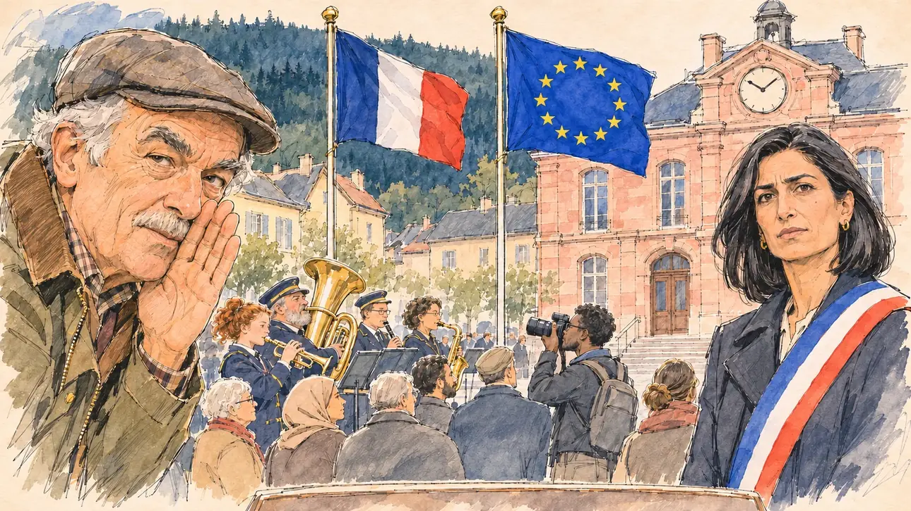

# `townHallFlag` · Le drapeau de la mairie

**Retenue par le PO le 17/11/2026**, au deuxième essai. Elle sert telle quelle en clair et en sombre.



| Champ | Valeur |
| --- | --- |
| Carte | `townHallFlag`, catégorie `field` (Rencontre), poids 0,1, toute semaine ; un geste au bord de l'axe de l'Europe, côté souveraineté (Mitchnsun/moi-president, PO, 14/11/2026) |
| Style | Reportage dessiné |
| Ton | Légèrement ironique et tendu, matin clair de mars |
| Date | 2026-11-17 |
| Outil | ChatGPT Images, à compléter (modèle et effort) |
| Conversation | À compléter |
| Format rendu | 1672 × 941 (16:9) : export en 1290 × 726 px, WebP de qualité 75, 189 Ko, sans recadrage, fait depuis la copie WebP de la conversation (à refaire depuis le PNG d'origine) |
| Fichier d'origine | À compléter (hors du dépôt) |
| Première édition | À compléter |

## Texte de la carte

> **Le drapeau de la mairie**
>
> Une petite ville vous reçoit devant son hôtel de ville, où flottent le drapeau tricolore et le drapeau européen. Un élu local vous souffle que « personne n'a voté pour le second ».

## Le moment choisi

La place de l'hôtel de ville d'une petite ville des Vosges, un matin clair de mars : façade de grès rose, horloge, perron, les sapins sur les collines ; devant, les deux mâts, le tricolore et le drapeau européen ; une fanfare municipale joue, des habitants assistent à la cérémonie. Le candidat est au pupitre, hors champ : seul le bord du pupitre au premier plan. L'adjoint, casquette et veste de chasse, se penche vers lui, la main près de la bouche : personne n'a voté pour celui-là. La maire, écharpe tricolore, attend près des mâts ; une adolescente à la trompette, un tubiste, un photographe de la presse locale. Les précédents sont les maires qui ont retiré le drapeau européen de leur mairie (2014, et au moins quatre en mars 2026) et les eurodéputés du Brexit Party dos à l'hymne (juillet 2019) : personne n'y ressemble à un élu réel.

## Prompt complet

Dans une nouvelle conversation, avec [`primeTime.webp`](../../illustrations/media/primeTime.webp) comme seule image de référence :

```
Use the attached image as the style reference and copy its drawing: a realistic reportage drawing made on the spot for a newspaper, with quick, nervous pencil lines, often drawn twice, ink hatching in the shadows, transparent watercolour washes that spill a little over the lines, and the warm paper showing through. Not the same scene and not the same people: never reuse the face or the hair of the woman in the reference.
Like in the reference, the setting can be full when the story needs it, with the things that say where we are and what is happening, but each one is sketched with a few pencil lines and a light wash, never rendered or finished, and the drawing gets looser and paler towards the edges until it fades into the bare paper.
This must look like a drawing made by hand on paper by a press illustrator, halfway between a quick sketch and a realistic picture: never a photograph, a film poster or a digital painting, and never a cartoon, a comic strip, a caricature or a children's book illustration. Continuous lines, never dotted or dashed outlines; no uniform texture, speckles or hatching filter laid over the picture; no glossy highlights, no smooth gradients, in the sky and on the walls too. Colour can be rich in places, on a piece of clothing, a light or a flag, but it stays transparent and within the palette below. The fade into the paper at the edges stays narrow, without a wide white margin. No blur and no depth-of-field effect: everything, the foreground included, is drawn sharp, like a sketch made on the spot.
People are drawn from life with realistic anatomy and proportions, like in the reference: faces shaped with pencil lines, hatching and light washes, a little more finished than the background but never photographic (no photographic skin, no airbrushed or digital-painting look). Expressions stay natural and restrained, even in laughter or tears: no exaggerated grins, no wide-open mouths full of teeth, no rubbery or cartoonish faces.

Editorial illustration, landscape 16:9 (1536 × 864 px), the scene filling the frame, with only a light fade into the paper at the edges. The square in front of the town hall of a small town in the Vosges, in eastern France, on a cool, clear morning in March 2027: a town hall of pink sandstone with front steps and a clock with no readable numerals, fir-covered hills behind; in front, two flagpoles standing a little apart, with nobody standing in front of them, one with the French tricolour and one with the European flag, both flying open in a light breeze; the European flag shows its full circle of exactly twelve gold five-pointed stars on the blue, all twelve clearly visible and evenly spaced, none hidden by a fold, a pole or a person. A small municipal brass band plays and a few residents attend the ceremony. The player's candidate stands at a lectern set up before the steps and stays off-camera: in the foreground, only the edge of the lectern and its microphone. In the left third, a local official, the deputy mayor, a short, wiry white man in his sixties with bushy grey eyebrows, in a flat cap and a hunting jacket, leans towards the viewer with one hand near his mouth and a knowing look, as if whispering that nobody voted for the second flag, his face above mid-height. By the flagpoles but beside them, never in front of the flags, the mayor, a tall woman in her forties of Kurdish descent with shoulder-length black hair and a tricolour sash, looks at the viewer, worried about what the viewer will do. In the brass band: a red-haired teenage girl with a trumpet and a heavy-set tuba player in his fifties with a grey beard. A local press photographer, a slim man in his thirties of Senegalese descent, aims at the flagpoles. Only the deputy mayor and the mayor look at the viewer. Nothing on the facade, the clock, the lectern, the instruments or the camera is readable.

Style: Reportage drawing made on the spot, like a press illustrator or courtroom sketch artist: pencil and ink with loose watercolour washes, lively unfinished lines, white paper showing through.

Palette: navy #13203F, vellum #F5EFE1, gold #A9802A, brick #B5523B, ochre #D9A441, sage #8FA58A, slate #5E7186, sand #DCC8A4, warm grey #8C8279; use 4 to 6 of them, subtle warm paper grain.

Tone: slightly ironic and tense, the frank March light on the pink sandstone, the two flags as the strong notes of the picture, the dark firs behind.

Constraints: realistic proportions, natural expressions, never cartoonish or caricatured faces, drawn like the rest of the illustration and never photographic; people of varied ages, genders, origins and body types (heavy, stocky, round, tall, short, wiry, not only slim), each with a distinct face and haircut (no two people alike), drawn with respect and never as a joke; each person's age, build and look plausible for their job and the scene (working people of working age), no stereotype tying an origin or a gender to a role, and no person of colour shown alone in a featured service or deferential role; anatomically correct hands with exactly five fingers, few hands visible, the others in pockets, behind objects or out of frame; the European flag with exactly twelve gold stars in a full circle, all visible; no readable text anywhere (the facade, the clock, the lectern, the instruments and the camera stay unreadable, no "Mairie" or "Hôtel de ville" lettering, no motto on the facade); no captions or speech bubbles; no logos, no television channel logo, no political party colours, no flags other than the French tricolour and the European flag on their poles and the mayor's sash; no recognisable real person, no lookalike of a real politician or of a real mayor; no explicit violence; no photographic rendering, no blur or bokeh, every outline a continuous pencil or ink line with no dotted or dashed outlines, no mottled, crackled or speckled texture over the faces, the clothes, the stone or the sky, no hatching filter over the picture, no oil-paint texture, no glow or halo, no wide white margin or frame (a light fade into the paper at the edges is fine).

Format: if 16:9 is not available, make 1536 × 1024 and keep the top 80 px and the bottom 80 px free of anything important (faces, hands, the main action): they will be cropped.
```

## Décisions prises sur cette image

Retenue par le PO le 17/11/2026, au deuxième essai, régénérée dans une nouvelle conversation avec le prompt revu : les deux mâts en retrait, personne devant les drapeaux, et le drapeau européen avec ses douze étoiles en cercle complet, toutes visibles. Le pupitre est vu de dos, sans micro ; la maire regarde le spectateur, l'adjoint aussi.

## Essais écartés

- 15/11/2026 : la première image, retenue d'abord, montrait le drapeau européen plissé par le vent avec onze étoiles seulement ; le PO l'a fait régénérer (17/11/2026).

## Retouches

Aucune.

## Relecture

Faite le 17/11/2026, à confirmer par le PO.

- [x] Aucun texte lisible : ni façade, ni horloge (aiguilles sans chiffres), ni pupitre, ni partitions. Le drapeau européen a ses douze étoiles, comptées en zoomant.
- [x] Aucun sosie d'une personne réelle.
- [x] Le candidat du joueur est hors champ : seul le bord de son pupitre.
- [x] Mains et visages sans défaut visible à 343 px de large : la main de l'adjoint près de la bouche, celles des musiciens sur leurs instruments, celles du photographe.
- [x] Aucune couleur, aucun logo ni aucun drapeau de parti ; le tricolore, le drapeau européen et l'écharpe de la maire seulement. Des personnes variées par l'âge, le corps, l'origine et la coiffure.
- [x] En 16:9 : pas de recadrage.
- [ ] Lisible sur la page de l'événement, en clair et en sombre : à vérifier dans l'app, une fois la carte publiée.
