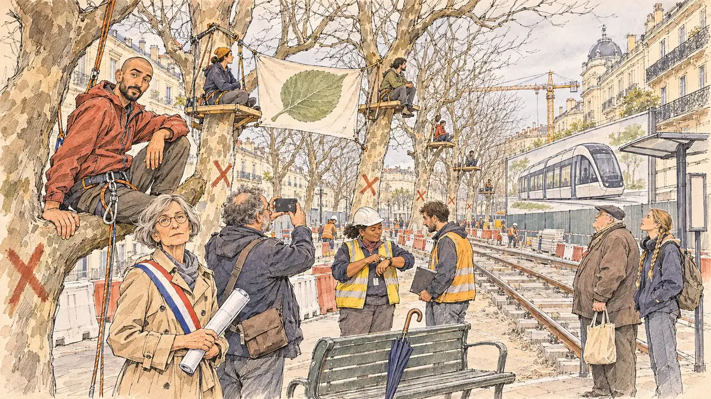

# `tramTrees` · Les tilleuls du tramway

**Retenue par le PO le 15/11/2026**, au premier essai. Elle sert telle quelle en clair et en sombre.



| Champ | Valeur |
| --- | --- |
| Carte | `tramTrees`, catégorie `field` (Rencontre), poids 0,15, toute semaine ; exclut `roadTrees` (Mitchnsun/moi-president, PO, 14/11/2026) |
| Style | Reportage dessiné |
| Ton | Ironique en douceur, matin gris |
| Date | 2026-11-15 |
| Outil | ChatGPT Images, modèle GPT 6.2, effort Light |
| Conversation | À compléter |
| Format rendu | 1672 × 941 (16:9) : export en 1290 × 726 px, WebP de qualité 75, 284 Ko, sans recadrage, fait depuis la copie WebP de la conversation |
| Fichier d'origine | Image de ChatGPT, chez le PO. L'export du dépôt a été fait depuis la copie partagée dans la conversation avec Claude |
| Première édition | À compléter |

## Texte de la carte

> **Les tilleuls du tramway**
>
> Une métropole abat quarante tilleuls pour sa nouvelle ligne de tramway, que la mairie écologiste défend comme le projet du siècle. Des militantes et militants écologistes se sont perchés dans les arbres contre leurs propres élus : les caméras attendent votre avis.

## Le moment choisi

Un boulevard de Montpellier, un matin gris de mars : immeubles de pierre blonde aux balcons de fer forgé, le chantier du tramway (rails à moitié posés, barrières, grue), et la rangée de vieux arbres marqués d'une croix qui barre le tracé. Contre la palissade, le panneau du projet ne montre qu'un tram dessiné ; en face, les perchés et leur banderole à la feuille de tilleul : la contradiction est au milieu de l'image. Le candidat reste hors champ : seul son parapluie fermé, contre un banc. Un militant perché sur une branche basse le regarde, sourcil levé : de quel côté êtes-vous ? À ses pieds, l'adjointe aux transports, écharpe tricolore et plan roulé, cherche un allié du regard. La cheffe de chantier montre sa montre à un collègue, des usagers attendent à l'arrêt provisoire, un journaliste filme au téléphone. Le précédent est Lützerath (2023), un projet défendu par un ministre écologiste : personne n'y ressemble à un élu de Montpellier.

## Prompt complet

Dans une nouvelle conversation, avec [`primeTime.webp`](../../illustrations/media/primeTime.webp) comme seule image de référence :

```
Use the attached image as the style reference and copy its drawing: a realistic reportage drawing made on the spot for a newspaper, with quick, nervous pencil lines, often drawn twice, ink hatching in the shadows, transparent watercolour washes that spill a little over the lines, and the warm paper showing through. Not the same scene and not the same people: never reuse the face or the hair of the woman in the reference.
Like in the reference, the setting can be full when the story needs it, with the things that say where we are and what is happening, but each one is sketched with a few pencil lines and a light wash, never rendered or finished, and the drawing gets looser and paler towards the edges until it fades into the bare paper.
This must look like a drawing made by hand on paper by a press illustrator, halfway between a quick sketch and a realistic picture: never a photograph, a film poster or a digital painting, and never a cartoon, a comic strip, a caricature or a children's book illustration. Continuous lines, never dotted or dashed outlines; no uniform texture, speckles or hatching filter laid over the picture; no glossy highlights, no smooth gradients, in the sky and on the walls too. Colour can be rich in places, on a piece of clothing, a light or a flag, but it stays transparent and within the palette below. The fade into the paper at the edges stays narrow, without a wide white margin. No blur and no depth-of-field effect: everything, the foreground included, is drawn sharp, like a sketch made on the spot.
People are drawn from life with realistic anatomy and proportions, like in the reference: faces shaped with pencil lines, hatching and light washes, a little more finished than the background but never photographic (no photographic skin, no airbrushed or digital-painting look). Expressions stay natural and restrained, even in laughter or tears: no exaggerated grins, no wide-open mouths full of teeth, no rubbery or cartoonish faces.

Editorial illustration, landscape 16:9 (1536 × 864 px), the scene filling the frame, with only a light fade into the paper at the edges. A wide boulevard in Montpellier, in the south of France, on a soft grey morning in March 2027, lined with buildings of pale blond limestone with wrought-iron balconies; on the roadway, the building site of a new tramway line: rails half laid in the dug-up street, white and red site barriers, a crane in the distance; a row of old lime trees with still-bare branches stands across the route, a painted cross on each trunk; against a site hoarding, the project's billboard shows only a large drawing of a modern tram, with no text. Ecologist activists have climbed into the lime trees to stop their felling: plank platforms, ropes, and a blank cloth banner between two trees painted only with a big lime leaf, with no letters. The player's candidate stays off-camera: in the foreground, only the candidate's closed umbrella leaning against a public bench. In the left third, sitting on a low branch in a climbing harness, an activist man in his thirties of Moroccan descent, tall and wiry, with a shaved head and a short black beard, in a brick-red windbreaker, leans towards the viewer with one eyebrow raised, as if asking whose side the viewer is on, his face above mid-height. At the foot of his tree: the city's deputy mayor for transport, a slim white woman in her sixties with a grey bob and round glasses, in a beige trench coat with a tricolour sash, holding a rolled-up plan, looks at the viewer as if looking for an ally. In front of the rails: the site manager, a stocky woman in her forties of Guadeloupean descent, in a white helmet and a high-visibility vest, taps her watch while talking to a co-worker. At a temporary bus stop, a few commuters watch the scene: a heavy-set elderly man with a shopping bag and a young student with long blond braids and headphones around her neck. A round journalist in his fifties with a salt-and-pepper beard films with his phone. Only the activist on the branch and the deputy mayor look at the viewer. Nothing on the billboard, the banner, the barriers, the plan, the vests or the phone is readable.

Style: Reportage drawing made on the spot, like a press illustrator or courtroom sketch artist: pencil and ink with loose watercolour washes, lively unfinished lines, white paper showing through.

Palette: navy #13203F, vellum #F5EFE1, gold #A9802A, brick #B5523B, ochre #D9A441, sage #8FA58A, slate #5E7186, sand #DCC8A4, warm grey #8C8279; use 4 to 6 of them, subtle warm paper grain.

Tone: gently ironic, postures slightly exaggerated but never the faces, a soft grey morning light; the contradiction at the centre of the picture, the drawn tram on the billboard on one side and the activists in the trees on the other.

Constraints: realistic proportions, natural expressions, never cartoonish or caricatured faces, drawn like the rest of the illustration and never photographic; people of varied ages, genders, origins and body types (heavy, stocky, round, tall, short, wiry, not only slim), each with a distinct face and haircut (no two people alike), drawn with respect and never as a joke; each person's age, build and look plausible for their job and the scene (working people of working age), no stereotype tying an origin or a gender to a role, and no person of colour shown alone in a featured service or deferential role; anatomically correct hands with exactly five fingers, few hands visible, the others in pockets, behind objects or out of frame; no readable text anywhere (the billboard, the banner, the barriers, the plan, the vests and the phone stay unreadable, no slogans, no street names, no tram line number); no captions or speech bubbles; no logos, no transport company logo, no television channel logo, no political party colours, no green party banners, no flags other than the deputy mayor's tricolour sash; no recognisable real person, no lookalike of a real politician, of a real mayor of Montpellier or of a known tree activist; no explicit violence, no one in danger, no one falling; no photographic rendering, no blur or bokeh, every outline a continuous pencil or ink line with no dotted or dashed outlines, no mottled, crackled or speckled texture over the faces, the clothes, the trunks, the stone or the sky, no hatching filter over the picture, no oil-paint texture, no glow or halo, no wide white margin or frame (a light fade into the paper at the edges is fine).

Format: if 16:9 is not available, make 1536 × 1024 and keep the top 80 px and the bottom 80 px free of anything important (faces, hands, the main action): they will be cropped.
```

## Décisions prises sur cette image

Retenue telle quelle par le PO (15/11/2026). Les arbres ont l'écorce tachetée des platanes plutôt que celle des tilleuls : à la taille de la carte, on ne les distingue pas, et la feuille de la banderole dit le tilleul.

## Essais écartés

Aucun.

## Retouches

Aucune.

## Relecture

Faite le 15/11/2026, à confirmer par le PO.

- [x] Aucun texte lisible : le panneau ne montre qu'un tram, la banderole qu'une feuille ; badges, téléphone et palissade illisibles.
- [x] Aucun sosie d'une personne réelle.
- [x] Le candidat du joueur est hors champ : seul son parapluie, contre le banc.
- [x] Mains et visages sans défaut visible à 343 px de large : les mains du militant, de l'adjointe autour du plan, du journaliste au téléphone, de la cheffe de chantier sur sa montre.
- [x] Aucune couleur, aucun logo ni aucun drapeau de parti ; seule l'écharpe tricolore de l'adjointe. Des personnes variées par l'âge, le corps, l'origine et la coiffure.
- [x] En 16:9 : pas de recadrage.
- [ ] Lisible sur la page de l'événement, en clair et en sombre : à vérifier dans l'app, une fois la carte publiée.
