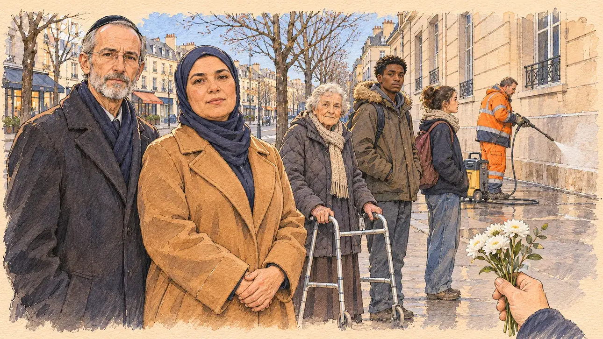

# `twinTags` · Une synagogue et une mosquée taguées

**Validée par le PO le 27/11/2026**, au premier essai. Elle sert telle quelle en clair et en sombre.



| Champ | Valeur |
| --- | --- |
| Carte | `twinTags`, catégorie `field` (Rencontre), poids 0,15 ; carte ajoutée avec Gaza dans la campagne (Mitchnsun/moi-president#563) |
| Style | Reportage dessiné, trait et texture de `primeTime` |
| Ton | Grave et chaleureux, matin d'hiver |
| Date | 2026-11-27 |
| Outil | ChatGPT Images |
| Format rendu | 1672 × 941 (16:9) : export en 1290 × 726 px, WebP de qualité 75, 203 Ko, sans recadrage |
| Fichier d'origine | Image de ChatGPT, chez le PO. L'export du dépôt a été fait depuis la copie partagée dans la conversation avec Claude |
| Première édition | La prochaine Release qui suit le merge de Mitchnsun/moi-president#563 |

## Texte de la carte

> **Une synagogue et une mosquée taguées**
>
> La même semaine, dans la même ville, une synagogue puis une mosquée sont couvertes d'inscriptions haineuses. Les fidèles des deux lieux attendent un geste des responsables politiques.

Ses réponses : vous rendre dans les deux lieux le même jour ; condamner les deux actes dans un même communiqué ; ne condamner que l'un des deux actes ; laisser les autorités locales réagir.

## Le moment choisi

Une rue ordinaire d'une ville moyenne, un matin d'hiver clair. Côte à côte, un rabbin et la présidente de l'association de la mosquée regardent le spectateur, graves et dignes ; autour d'eux, des voisins et des fidèles de tous âges. Au fond, un agent municipal nettoie un mur au nettoyeur haute pression : les inscriptions ne se voient plus. Le parti pris est l'union, jamais la haine : aucune inscription, aucun symbole. Le candidat du joueur est hors champ : sa main tient un petit bouquet de fleurs blanches au premier plan.

## Prompt complet

Dans une nouvelle conversation, avec [`primeTime.webp`](../../illustrations/media/primeTime.webp) comme seule image de référence :

```
Use the attached image as the style reference and copy its drawing: a realistic reportage drawing made on the spot for a newspaper, with quick, nervous pencil lines, often drawn twice, ink hatching in the shadows, transparent watercolour washes that spill a little over the lines, and the warm paper showing through. Take from the reference its line, its washes and its paper, not the finish of the presenter's face, which is the most finished and almost photographic part of it: every face here stays a drawing. Not the same scene and not the same people: never reuse the face or the hair of the woman in the reference.
Like in the reference, the setting can be full when the story needs it, with the things that say where we are and what is happening, but each one is sketched with a few pencil lines and a light wash, never rendered or finished, and the drawing gets looser and paler towards the edges until it fades into the bare paper.
This must look like a drawing made by hand on paper by a press illustrator, halfway between a quick sketch and a realistic picture: never a photograph, a film poster or a digital painting, and never a cartoon, a comic strip, a caricature or a children's book illustration. Continuous lines, never dotted or dashed outlines; the fine mottled grain of the reference is welcome, as long as the pencil lines and the washes stay clearly visible under it, but never a heavy texture, an oil-paint look or a hatching filter laid over a finished picture; no glossy highlights, no smooth gradients, in the sky and on the walls too. Colour can be rich in places, on a piece of clothing, a light or a flag, but it stays transparent and within the palette below. The fade into the paper at the edges stays narrow, without a wide white margin. No blur and no depth-of-field effect: everything, the foreground included, is drawn sharp, like a sketch made on the spot.
People are drawn from life with realistic anatomy and proportions: each face is drawn with the same visible pencil and ink lines, hatching and transparent washes as the clothes and the room, looser and sketchier than the presenter's face in the reference, with realistic features but never photographic (no photographic skin, no smooth shading, no airbrushed or digital-painting look). Expressions stay natural and restrained, even in laughter or tears: no exaggerated grins, no wide-open mouths full of teeth, no rubbery or cartoonish faces.

Editorial illustration, landscape 16:9 (1536 × 864 px), the scene filling the frame, with only a light fade into the paper at the edges. A cold, clear morning in winter 2027 in an ordinary mid-sized French town, with no regional architecture: a quiet street of plain apartment buildings and small shops, bare trees, a low stone wall along a building. In the background, a municipal worker in a high-visibility orange jacket, a man in his forties, white, stocky, cleans the low wall with a pressure washer: only a pale, washed-out stain remains on the stone, nothing that can be read, no sign and no symbol. The player's candidate stays off-camera, the scene seen from where they stand: in the bottom-right foreground, only a small bunch of white flowers held in front of them. In the left half, side by side, the two main characters look straight at the viewer, grave and dignified, their faces above mid-height: a rabbi in his late fifties, white, slim and tall, a short grey beard, rimless glasses, a dark wool coat and a simple dark kippah; and, beside him, the president of the town's mosque association, a woman in her mid-forties of Algerian origin, round-faced and solid, a plain dark blue headscarf, a camel coat, her hands folded in front of her. Around them, a few neighbours and faithful of all ages stand quietly: an elderly white woman with a walking frame, a young Black man in a parka, a teenage girl with a backpack; two of them look at the viewer, the others at the wall. The mood is solidarity, not anger. Nothing on the wall, the shops or the street signs is readable.

Style: Reportage drawing made on the spot, like a press illustrator or courtroom sketch artist: pencil and ink with loose watercolour washes, lively unfinished lines, white paper showing through.

Palette: navy #13203F, vellum #F5EFE1, gold #A9802A, brick #B5523B, ochre #D9A441, sage #8FA58A, slate #5E7186, sand #DCC8A4, warm grey #8C8279; use 4 to 6 of them, subtle warm paper grain.

Tone: grave but warm, soft and clear winter morning light, gentle shadows.

Constraints: realistic proportions, natural expressions, never cartoonish or caricatured faces, drawn like the rest of the illustration and never photographic; absolutely no stereotyped or caricatured features for any religious or ethnic group, every person drawn with the same respect and realism; people of varied ages, genders, origins and body types (heavy, stocky, round, tall, short, wiry, not only slim), each with a distinct face and haircut (no two people alike), drawn with respect and never as a joke; each person's age, build and look plausible for their role and the scene, no stereotype tying an origin or a gender to a role, and no person of colour shown alone in a featured service or deferential role; anatomically correct hands with exactly five fingers, few hands visible, the others in pockets, behind objects or out of frame; no readable text anywhere (the wall, the shops and the street signs stay unreadable); no hateful inscription, sign, symbol or gesture of any kind, not even blurred; no large religious symbol on any building, no star or crescent drawn large, only the kippah and the headscarf say who the two main characters are; no captions or speech bubbles; no logos or political party colours; no flags; no recognisable real person, no lookalike of a real politician or of a real religious leader; no violence; no photographic rendering, no blur or bokeh, no dotted outlines, no heavy texture or hatching filter over a finished picture (the fine grain of the reference is fine), no oil-paint texture, no wide white margin or frame (a light fade into the paper at the edges is fine).

Format: if 16:9 is not available, make 1536 × 1024 and keep the top 80 px and the bottom 80 px free of anything important (faces, hands, the main action): they will be cropped.
```

## Décisions prises sur cette image

- La main du candidat est visible, qui tient le bouquet (le prompt ne demandait que le bouquet) : une main sans bijou dans une manche sombre, sans indice de genre, comme dans [`gazaMarch`](../polemic/gazaMarch.md) et [`carSleeper`](carSleeper.md). Gardée.
- Le mur nettoyé ne garde aucune trace visible des inscriptions : gardé, c'est plus sûr que la tache délavée que demandait le prompt.

## Essais écartés

Aucun.

## Retouches

Aucune.

## Relecture

Faite par Claude le 27/11/2026 et validée par le PO le même jour.

- [x] Aucun texte lisible, aucune inscription : le mur est nettoyé, les vitrines et les panneaux sont illisibles.
- [x] Aucun symbole ni geste haineux ; aucun symbole religieux sur les bâtiments : seuls la kippa et le foulard disent qui sont les deux personnages.
- [x] Aucun trait caricatural ou stéréotypé : chaque personne dessinée avec le même respect.
- [x] Aucun sosie d'une personne réelle relevé.
- [x] Le candidat du joueur est hors champ ; seule sa main tient le bouquet, sans indice de genre.
- [x] Mains sans défaut visible (les mains jointes, le déambulateur, le bouquet, la lance).
- [x] Aucune couleur ni aucun logo de parti, aucun drapeau. Des personnes variées par l'âge, le corps, l'origine et la coiffure.
- [x] En 16:9 : pas de recadrage.
- [ ] Lisible sur la page de l'événement, en clair et en sombre : à voir dans l'app.
