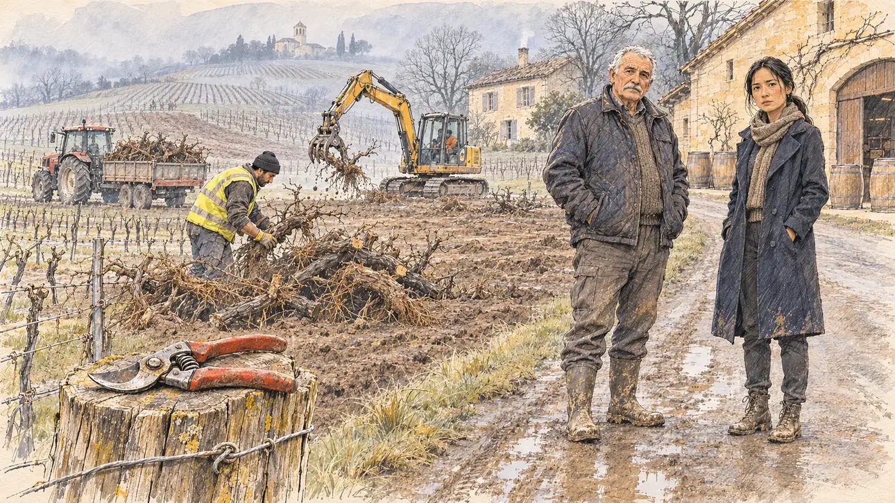

# `vineUprooting` · Les vignes qu'on arrache

**À générer.** Prompt prêt le 04/11/2026, pas encore d'image validée.



| Champ | Valeur |
| --- | --- |
| Carte | `vineUprooting`, catégorie `field` (Rencontre), carte ajoutée par la PR #297 de l'app |
| Style | Reportage dessiné, trait de `primeTime` |
| Ton | Mélancolique, digne |
| Date | À remplir |
| Outil | ChatGPT Images |
| Conversation | À remplir (le lien ne s'ouvre qu'avec le compte qui l'a créée) |
| Format rendu | À remplir |
| Fichier d'origine | À remplir |
| Première édition | À remplir |

## Texte de la carte

> **Les vignes qu'on arrache**
>
> Dans l'Entre-deux-Mers, en Gironde, un viticulteur vous mène devant ses rangs : l'État finance l'arrachage des vignes dont il ne vend plus le vin. Il arrive à la retraite sans repreneur ; sa fille, ingénieure à Bordeaux, est venue elle aussi et vous demande si le métier a un avenir.

## Le moment choisi

Les rangs de vigne d'une propriété de l'Entre-deux-Mers, en Gironde, un matin d'hiver brumeux, vus depuis le bout d'un rang où se tient le candidat (hors champ) : au premier plan, un sécateur posé sur un piquet. Le viticulteur, au bord de la retraite, montre la parcelle déjà arrachée, souches empilées au bord du chemin. Sa fille, ingénieure venue de Bordeaux, se tient près de lui et demande au candidat si le métier a un avenir. Derrière : le tracteur et la pelle qui arrachent les ceps, le chai en pierre blonde, la petite chartreuse aux volets gris, les collines de vignes taillées et le clocher roman au loin.

## Prompt complet

Dans une nouvelle conversation, avec [`primeTime.webp`](../../illustrations/media/primeTime.webp) comme seule image de référence.

```
Use the attached image as the style reference and copy its drawing: a realistic reportage drawing made on the spot for a newspaper, with quick, nervous pencil lines, often drawn twice, ink hatching in the shadows, transparent watercolour washes that spill a little over the lines, and the warm paper showing through. Not the same scene and not the same people: never reuse the face or the hair of the woman in the reference.
Like in the reference, the setting can be full when the story needs it, with the things that say where we are and what is happening, but each one is sketched with a few pencil lines and a light wash, never rendered or finished, and the drawing gets looser and paler towards the edges until it fades into the bare paper.
This must look like a drawing made by hand on paper by a press illustrator, halfway between a quick sketch and a realistic picture: never a photograph, a film poster or a digital painting, and never a cartoon, a comic strip, a caricature or a children's book illustration. Continuous lines, never dotted or dashed outlines; no uniform texture, speckles or hatching filter laid over the picture; no glossy highlights, no smooth gradients, in the sky and on the walls too. Colour can be rich in places, on a piece of clothing, a light or a flag, but it stays transparent and within the palette below. The fade into the paper at the edges stays narrow, without a wide white margin. No blur and no depth-of-field effect: everything, the foreground included, is drawn sharp, like a sketch made on the spot.
People are drawn from life with realistic anatomy and proportions, like in the reference: faces shaped with pencil lines, hatching and light washes, a little more finished than the background but never photographic (no photographic skin, no airbrushed or digital-painting look). Expressions stay natural and restrained, even in laughter or tears: no exaggerated grins, no wide-open mouths full of teeth, no rubbery or cartoonish faces.

Editorial illustration, landscape 16:9 (1536 × 864 px), the scene filling the frame, with only a light fade into the paper at the edges. The rows of a vineyard in the Entre-deux-Mers, in the Gironde, on a misty winter morning in February 2027: the State is paying for vines to be pulled up where the wine no longer sells. The scene is seen from the end of a row where the player's candidate stands, who stays off-camera: in the foreground, only a pair of pruning shears resting on a wooden vine post. In the right third, the winegrower, a stocky man in his sixties close to retirement, with a weathered face, short white hair, a grey moustache, a quilted jacket and muddy boots, his hands in his pockets, shows with a nod of the head the plot already pulled up beside the road, the uprooted vine stocks piled in heaps, and looks at the viewer with quiet, dignified sadness, his face above mid-height. Beside him, his daughter, an engineer from Bordeaux, a woman in her thirties of mixed French and Vietnamese descent, with straight black hair in a low ponytail, a city coat over a jumper and city boots already muddy, looks straight at the viewer and asks whether the trade has a future, earnest and anxious. Behind them, sketched in pencil and light washes: a small tractor and a digger pulling up the old vines in the next plot, a worker of Moroccan origin in a high-visibility vest stacking the stocks; the family's wine store of pale blond stone with a wide wooden door and a few barrels outside; a small low country house of blond stone with grey shutters; gentle hills covered with pruned, bare vines in long rows, patches of brown earth where vines have gone, and a little Romanesque church on a hill in the mist. Only the winegrower and his daughter look at the viewer. Nothing on the barrels, the buildings, the tractor or the vest is readable, and no logo or label of a real wine estate appears.

Style: Reportage drawing made on the spot, like a press illustrator or courtroom sketch artist: pencil and ink with loose watercolour washes, lively unfinished lines, white paper showing through.

Palette: navy #13203F, vellum #F5EFE1, gold #A9802A, brick #B5523B, ochre #D9A441, sage #8FA58A, slate #5E7186, sand #DCC8A4, warm grey #8C8279; use 4 to 6 of them, subtle warm paper grain.

Tone: melancholic and dignified, a soft misty winter morning light, the brown of the bare vines and the blond stone of the wine store as the warmest notes.

Constraints: realistic proportions, natural expressions, never cartoonish or caricatured faces, drawn like the rest of the illustration and never photographic; people of varied ages, genders, origins and body types (heavy, stocky, round, tall, short, wiry, not only slim), each with a distinct face and haircut (no two people alike), drawn with respect and never as a joke; anatomically correct hands with exactly five fingers, few hands visible, the others in pockets, behind objects or out of frame; no readable text anywhere (the barrels, the buildings, the tractor and the vest stay unreadable); no captions or speech bubbles; no logos or political party colours; no recognisable real person, no lookalike of a real politician, and no label of a real wine estate; no explicit violence; no photographic rendering, no blur or bokeh, no dotted outlines, no texture or hatching filter over the picture, no oil-paint texture, no wide white margin or frame (a light fade into the paper at the edges is fine).

Format: if 16:9 is not available, make 1536 × 1024 and keep the top 80 px and the bottom 80 px free of anything important (faces, hands, the main action): they will be cropped.
```

## Décisions prises sur cette image

Aucune pour l'instant.

## Essais écartés

Aucun pour l'instant.

## Retouches

Aucune.

## Relecture

À faire sur l'image validée.
