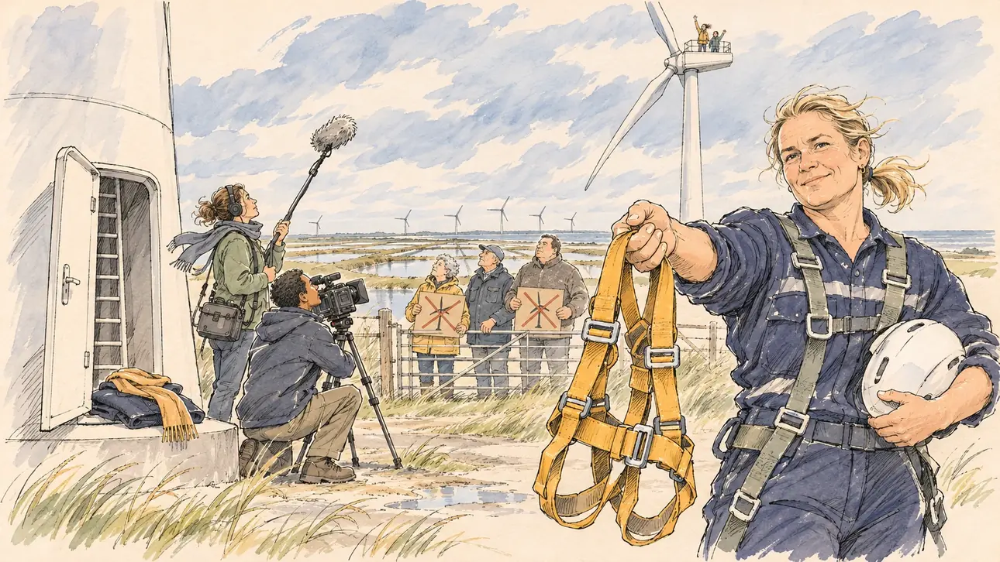

# `windTurbineClimb` · Au sommet de l'éolienne

**Validée par le PO le 10/11/2026**, au premier essai. Elle sert telle quelle en clair et en sombre.



| Champ | Valeur |
| --- | --- |
| Carte | `windTurbineClimb`, catégorie `field` (Rencontre), poids 0,2, toute semaine |
| Style | Reportage dessiné |
| Ton | Vivifiant et venteux, matin de mars |
| Date | 2026-11-10 |
| Outil | ChatGPT Images, à compléter (modèle et effort) |
| Conversation | À compléter |
| Format rendu | 1672 × 941 (16:9) : export en 1290 × 726 px, WebP de qualité 75, 159 Ko, sans recadrage, fait depuis la copie WebP de la conversation (à refaire depuis le PNG d'origine) |
| Fichier d'origine | À compléter (hors du dépôt) |
| Première édition | À compléter |

## Texte de la carte

> **Au sommet de l'éolienne**
>
> Un parc éolien de la façade atlantique vous invite au sommet d'une de ses éoliennes : quatre-vingts mètres d'échelle, casque et baudrier. Les écologistes vous attendent en haut, les caméras en bas, et des riverains opposés au parc au portail.

## Le moment choisi

Le pied d'une éolienne dans les marais de Charente-Maritime, un matin venteux de mars : la tour blanche monte hors du cadre, sa porte ouverte sur l'échelle ; les marais, les claires, l'océan et une rangée d'éoliennes à l'horizon. Le candidat reste hors champ, au pied de la tour : son manteau et son écharpe posés sur la marche de la porte. La technicienne du parc, casque sous le bras, tend un second baudrier vers le spectateur avec un sourire de défi : on monte ? Une équipe de télévision filme en contre-plongée ; au portail, des riverains brandissent des pancartes à l'éolienne barrée ; tout en haut, de minuscules militants font signe. La scène reprend un moment de 2026 en Charente-Maritime : personne n'y ressemble à un responsable politique, et aucun vert militant.

## Prompt complet

Dans une nouvelle conversation, avec [`primeTime.webp`](../../illustrations/media/primeTime.webp) comme seule image de référence :

```
Use the attached image as the style reference and copy its drawing: a realistic reportage drawing made on the spot for a newspaper, with quick, nervous pencil lines, often drawn twice, ink hatching in the shadows, transparent watercolour washes that spill a little over the lines, and the warm paper showing through. Not the same scene and not the same people: never reuse the face or the hair of the woman in the reference.
Like in the reference, the setting can be full when the story needs it, with the things that say where we are and what is happening, but each one is sketched with a few pencil lines and a light wash, never rendered or finished, and the drawing gets looser and paler towards the edges until it fades into the bare paper.
This must look like a drawing made by hand on paper by a press illustrator, halfway between a quick sketch and a realistic picture: never a photograph, a film poster or a digital painting, and never a cartoon, a comic strip, a caricature or a children's book illustration. Continuous lines, never dotted or dashed outlines; no uniform texture, speckles or hatching filter laid over the picture; no glossy highlights, no smooth gradients, in the sky and on the walls too. Colour can be rich in places, on a piece of clothing, a light or a flag, but it stays transparent and within the palette below. The fade into the paper at the edges stays narrow, without a wide white margin. No blur and no depth-of-field effect: everything, the foreground included, is drawn sharp, like a sketch made on the spot.
People are drawn from life with realistic anatomy and proportions, like in the reference: faces shaped with pencil lines, hatching and light washes, a little more finished than the background but never photographic (no photographic skin, no airbrushed or digital-painting look). Expressions stay natural and restrained, even in laughter or tears: no exaggerated grins, no wide-open mouths full of teeth, no rubbery or cartoonish faces.

Editorial illustration, landscape 16:9 (1536 × 864 px), the scene filling the frame, with only a light fade into the paper at the edges. The foot of a wind turbine in a wind farm among the salt marshes of Charente-Maritime, on the Atlantic coast, on a windy morning in March 2027, when the farm invites the player's candidate to climb to the top: the white tower rises out of the frame, its small door open on the ladder inside; very high up, at the top of the frame, tiny figures of environmental activists wave from the nacelle; around, flat marshes, oyster ponds, the grey line of the ocean on the horizon and a row of other turbines; the grass bends and the scarves fly in the wind. The player's candidate stays off-camera, at the foot of the tower: in the foreground, only the candidate's folded coat and scarf left on the step of the tower's door. In the right third, the farm's technician, a stocky white woman in her forties with a short blond ponytail, in work overalls and her own harness, a helmet under one arm, holds out a second harness towards the viewer and looks at the viewer with a sporty, challenging smile, shall we go up?, her face above mid-height. Around her: a television crew films the tower from below, a camera operator in his thirties of Malagasy descent, slim, kneeling, and a sound engineer with a boom; at the farm's gate in the distance, a few residents opposed to the farm, an elderly couple in rain jackets and a heavy-set man in his fifties in a fleece, hold up blank cardboard placards showing only a crossed-out turbine pictogram. Only the technician looks at the viewer. Nothing on the tower, the placards, the camera, the overalls or the gate is readable.

Style: Reportage drawing made on the spot, like a press illustrator or courtroom sketch artist: pencil and ink with loose watercolour washes, lively unfinished lines, white paper showing through.

Palette: navy #13203F, vellum #F5EFE1, gold #A9802A, brick #B5523B, ochre #D9A441, sage #8FA58A, slate #5E7186, sand #DCC8A4, warm grey #8C8279; use 4 to 6 of them, subtle warm paper grain.

Tone: bracing and windy, the big pale sky of the Atlantic marshes, the white tower against the moving clouds, the ochre harness held out as the invitation of the picture.

Constraints: realistic proportions, natural expressions, never cartoonish or caricatured faces, drawn like the rest of the illustration and never photographic; people of varied ages, genders, origins and body types (heavy, stocky, round, tall, short, wiry, not only slim), each with a distinct face and haircut (no two people alike), drawn with respect and never as a joke; each person's age, build and look plausible for their job and the scene (working people of working age), no stereotype tying an origin or a gender to a role, and no person of colour shown alone in a featured service or deferential role; anatomically correct hands with exactly five fingers, few hands visible, the others in pockets, behind objects or out of frame; no readable text anywhere (the tower, the placards, the camera, the overalls and the gate stay unreadable, no slogans, no company name); no captions or speech bubbles; no logos, no energy company logo, no television channel logo, no political party colours, no flags, no green activist banners; no recognisable real person, no lookalike of a real politician; no explicit violence, no one in danger; no photographic rendering, no blur or bokeh, every outline a continuous pencil or ink line with no dotted or dashed outlines, no mottled, crackled or speckled texture over the faces, the clothes, the tower or the sky, no hatching filter over the picture, no oil-paint texture, no glow or halo, no wide white margin or frame (a light fade into the paper at the edges is fine).

Format: if 16:9 is not available, make 1536 × 1024 and keep the top 80 px and the bottom 80 px free of anything important (faces, hands, the main action): they will be cropped.
```

## Décisions prises sur cette image

Validée telle quelle par le PO (10/11/2026). Les militants font signe du haut d'une éolienne du fond, pas de celle dont la porte est ouverte au premier plan : à la taille de la carte, on lit qu'on attend le candidat là-haut, gardé.

## Essais écartés

Aucun.

## Retouches

Aucune.

## Relecture

Faite et validée par le PO le 10/11/2026.

- [x] Aucun texte lisible : les pancartes ne montrent qu'une éolienne barrée ; rien sur la tour, la caméra, la combinaison ni le portail.
- [x] Aucun sosie d'une personne réelle.
- [x] Le candidat du joueur est hors champ : seuls son manteau et son écharpe, sur la marche de la tour.
- [x] Mains et visages sans défaut visible à 343 px de large : la main qui tend le baudrier, celle sous le casque, la perche et la caméra.
- [x] Aucune couleur, aucun logo ni aucun drapeau de parti. Des personnes variées par l'âge, le corps, l'origine et la coiffure.
- [x] En 16:9 : pas de recadrage.
- [ ] Lisible sur la page de l'événement, en clair et en sombre : à vérifier dans l'app, une fois la carte publiée.
