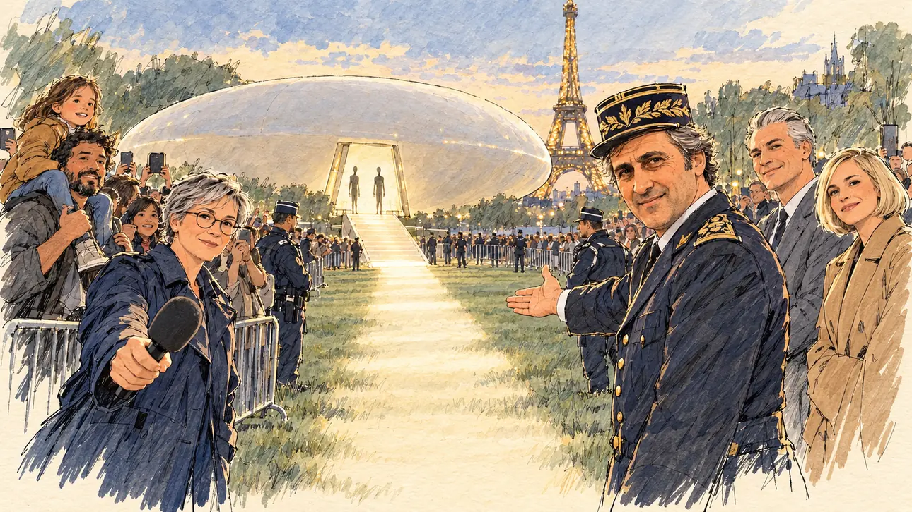

# `firstContact` · Premier contact

**Validée par le PO le 31/10/2026**, à l'essai 3. Elle sert telle quelle en clair et en sombre.



| Champ | Valeur |
| --- | --- |
| Carte | `firstContact`, catégorie `farFetched` (Incroyable) |
| Style | Reportage dessiné, façon carnet de croquis : le dessin s'efface légèrement dans le papier aux bords |
| Ton | Émerveillé, avec une pointe de comique |
| Date | 2026-10-31 |
| Outil | ChatGPT avec le modèle GPT Sol 6.1 en effort « light », et ChatGPT Images 2.5 |
| Conversation | À remplir (le lien ne s'ouvre qu'avec le compte qui l'a créée) |
| Format rendu | 1672 × 941 (16:9) : export en 1290 × 726 px depuis le PNG d'origine, WebP de qualité 75, 190 Ko, sans recadrage |
| Fichier d'origine | PNG de ChatGPT, chez le PO, partagé aussi dans la conversation avec Claude |
| Première édition | À remplir |

## Texte de la carte

> **Premier contact**
>
> Un vaisseau se pose sur le Champ-de-Mars. Ses occupants veulent parler à « la personne la plus sincère de la campagne ». Tous les regards se tournent vers vous.

## Le moment choisi

Le Champ-de-Mars au crépuscule, la tour Eiffel illuminée. Un vaisseau nacré en forme de galet s'est posé sur la pelouse ; en haut de sa rampe, deux occupants attendent, simples silhouettes dans la lumière. Un chemin de lumière mène de la rampe au candidat, hors champ. Tout le monde s'est retourné vers lui : un général lui montre le chemin, deux candidats rivaux s'écartent, soulagés, une reporter lui tend son micro, la foule filme derrière les barrières des gendarmes.

## Prompt complet

Trois messages, dans une seule conversation, avec deux images jointes au premier : [`oldTweet.webp`](oldTweet.webp) pour le style, puis le portrait dessiné de [`pundit`](pundit.md) (étape 1 de la méthode en deux étapes, d'après une photo de famille du PO) pour la ressemblance du général. Le premier prompt a donné l'essai 1 :

```
Use the first attached image as the style reference: the same pencil and ink drawing with loose watercolour washes and warm paper grain. Not the same scene.
Use the second attached image, a drawn portrait, only as the likeness reference for the general: give him this man's features and wavy dark hair going grey at the temples under his kepi, clean-shaven, and draw his face with the same ink lines and washes as the other people in the scene. Keep the likeness through the drawing, never through photographic detail.
This must look like a drawing made by hand on paper, never like a photograph: the people are drawn with ink lines and flat washes, not modelled; large parts of the background are only suggested with a few pencil lines and a wash, leaving the warm paper bare.
Faces are drawn exactly like the clothes and the background: ink outlines, a few hatching strokes and flat watercolour washes for the skin, with the same level of detail as the rest of the drawing. No photographic skin, no realistic wrinkles or pores, no airbrushed or digital-painting look on the faces.

Editorial illustration, landscape 16:9 (1536 × 864 px), filling the whole frame edge to edge. The Champ-de-Mars in Paris at dusk in 2027, with the Eiffel Tower in the background. A spaceship has just landed on the lawn: a huge, smooth, pebble-shaped vessel the colour of pearl, hovering just above the grass, with no lights or markings except a soft glow from an open ramp. At the top of the ramp, two tall, slender occupants stand only as silhouettes in the light, waiting: they have asked to speak to the most sincere person in the campaign. A path of soft light runs from the ramp across the grass straight towards the viewer. The player's candidate stays off-camera, where the path of light ends. In front of the ship, everyone has turned round to look at the viewer. In the right third, a general of the French army, the man from the portrait, in his fifties, in dress uniform and kepi, looks at the viewer with grave insistence and opens one hand towards the ship, inviting the candidate to go first, his face above mid-height. Next to him, two rival candidates step aside, relieved not to have been chosen: a tall man with slicked-back silver hair in a grey suit, and a short woman with a blonde bob in a camel coat, both looking at the viewer with a stiff smile. On the left, a young television reporter, a woman with locs tied back, holds out a microphone towards the viewer; behind her, a father with a child on his shoulders and a few tourists film with their phones, and gendarmes hold back the crowd behind metal barriers. Nothing on the microphone, the barriers or the uniforms is readable.

Style: Reportage drawing made on the spot, like a press illustrator or courtroom sketch artist: pencil and ink with loose watercolour washes, lively unfinished lines, white paper showing through.

Palette: navy #13203F, vellum #F5EFE1, gold #A9802A, brick #B5523B, ochre #D9A441, sage #8FA58A, slate #5E7186, sand #DCC8A4, warm grey #8C8279; use 4 to 6 of them, subtle warm paper grain.

Tone: wonder with a comic undertone, the blue dusk sky, the warm lights of the tower and the pearly glow of the ship.

Constraints: realistic proportions, expressive but not caricatured faces, drawn like the rest of the illustration and never photographic; people of varied ages, genders, origins and body types (heavy, stocky, round, tall, short, wiry, not only slim), each with a distinct face and haircut (no two people alike), drawn with respect and never as a joke; anatomically correct hands with exactly five fingers, few hands visible, the others in pockets, behind objects or out of frame; no readable text anywhere (microphones, barriers, uniforms and signs stay unreadable); no captions or speech bubbles; no logos or political party colours; apart from the general, no recognisable real person and no lookalike of a real politician or general; no spaceship or alien from a famous film or series; no explicit violence, no weapons drawn; no photographic rendering, no hatching filter over a finished digital painting, no oil-paint texture, no white or ragged border.

Format: if 16:9 is not available, make 1536 × 1024 and keep the top 80 px and the bottom 80 px free of anything important (faces, hands, the main action): they will be cropped.
```

### Message de correction

Envoyé après l'essai 1 ; il a donné l'essai 2 :

```
Keep this image, the ship, the general, the two rival candidates, the crowd and the path of light exactly as they are, with two changes:
- the television reporter on the left is a different woman: in her forties, with short, close-cropped natural grey hair, small round glasses and a navy trench coat, no braids and no hoop earrings;
- the drawing fills the whole frame edge to edge: no paper border, no faded or ragged edges in the corners or along the sides.
Everything else stays the same: nothing readable, exactly five fingers on every visible hand, 16:9.
```

### Prompt revu

Envoyé en entier après l'essai 2, dans la même conversation, sans rejoindre d'image ; il a donné l'image retenue, avec une nouvelle composition :

```
Use the first attached image as the style reference: the same pencil and ink drawing with loose watercolour washes and warm paper grain. Not the same scene.
Use the second attached image, a drawn portrait, only as the likeness reference for the general: give him this man's features and wavy dark hair going grey at the temples under his kepi, clean-shaven, and draw his face with the same ink lines and washes as the other people in the scene. Keep the likeness through the drawing, never through photographic detail.
This must look like a drawing made by hand on paper, never like a photograph or a film poster: the people are drawn with ink lines and flat washes, not modelled; the sky, the trees and the far crowd are only suggested with a few pencil lines and light, transparent washes, so that the warm paper shows through them; the drawing may fade lightly into the bare paper at the edges and in the corners, as on a sketchbook page, without a wide white margin. Lighter and less saturated than a painting: no dense colour, no glossy highlights, no hatching filter laid over a finished image.
Faces are drawn exactly like the clothes and the background: ink outlines, a few hatching strokes and flat watercolour washes for the skin, with the same level of detail as the rest of the drawing; the general's face is drawn as simply as the gendarmes' faces. No photographic skin, no realistic wrinkles or pores, no airbrushed or digital-painting look on the faces.

Editorial illustration, landscape 16:9 (1536 × 864 px), the scene filling the frame, with only a light fade into the paper at the edges. The Champ-de-Mars in Paris at dusk in 2027, with the Eiffel Tower in the background. A spaceship has just landed on the lawn: a huge, smooth, pebble-shaped vessel the colour of pearl, hovering just above the grass, with no lights or markings except a soft glow from an open ramp. At the top of the ramp, two tall, slender occupants stand only as silhouettes in the light, waiting: they have asked to speak to the most sincere person in the campaign. A path of soft light runs from the ramp across the grass straight towards the viewer. The player's candidate stays off-camera, where the path of light ends. In front of the ship, everyone has turned round to look at the viewer. In the right third, a general of the French army, the man from the portrait, in his fifties, in dress uniform and kepi, looks at the viewer with grave insistence and opens one hand towards the ship, inviting the candidate to go first, his face above mid-height. Next to him, two rival candidates step aside, relieved not to have been chosen: a tall man with slicked-back silver hair in a grey suit, and a short woman with a blonde bob in a camel coat, both looking at the viewer with a stiff smile. On the left, a television reporter, a woman in her forties with short, close-cropped natural grey hair, small round glasses and a navy trench coat, holds out a microphone towards the viewer; behind her, a father with a child on his shoulders and a few tourists film with their phones, and gendarmes hold back the crowd behind metal barriers. Nothing on the microphone, the barriers or the uniforms is readable.

Style: Reportage drawing made on the spot, like a press illustrator or courtroom sketch artist: pencil and ink with loose watercolour washes, lively unfinished lines, white paper showing through.

Palette: navy #13203F, vellum #F5EFE1, gold #A9802A, brick #B5523B, ochre #D9A441, sage #8FA58A, slate #5E7186, sand #DCC8A4, warm grey #8C8279; use 4 to 6 of them, subtle warm paper grain.

Tone: wonder with a comic undertone, a pale dusk sky in light washes, the warm lights of the tower and the pearly glow of the ship.

Constraints: realistic proportions, expressive but not caricatured faces, drawn like the rest of the illustration and never photographic; people of varied ages, genders, origins and body types (heavy, stocky, round, tall, short, wiry, not only slim), each with a distinct face and haircut (no two people alike), drawn with respect and never as a joke; anatomically correct hands with exactly five fingers, few hands visible, the others in pockets, behind objects or out of frame; no readable text anywhere (microphones, barriers, uniforms and signs stay unreadable); no captions or speech bubbles; no logos or political party colours; apart from the general, no recognisable real person and no lookalike of a real politician or general; no spaceship or alien from a famous film or series; no explicit violence, no weapons drawn; no photographic rendering, no hatching filter over a finished digital painting, no oil-paint texture, no wide white margin or frame (a light fade into the paper at the edges is fine).

Format: if 16:9 is not available, make 1536 × 1024 and keep the top 80 px and the bottom 80 px free of anything important (faces, hands, the main action): they will be cropped.
```

## Décisions prises sur cette image

- **Le général reprend les traits du grand-père du PO,** d'après le portrait dessiné déjà fait pour [`pundit`](pundit.md), avec l'accord de la famille. Ni la photo ni le portrait ne sont dans ce dépôt. La même personne prête aussi ses traits au secrétaire d'État de [`ministerResigns`](ministerResigns.md) et à l'éditorialiste de `pundit` : le PO l'accepte.
- **Le dessin peut s'effacer légèrement dans le papier aux bords** (PO, 31/10/2026) : on n'est plus obligé de dessiner jusqu'au bord, tant que la marge reste légère. Cette règle remplace « remplir tout le cadre, sans bord blanc ».
- **Tout le monde regarde le spectateur :** c'est le sujet de la carte (« tous les regards se tournent vers vous »).
- **Les occupants du vaisseau ne sont que des silhouettes,** pour ne dessiner ni extraterrestre ni emprunt à un film.
- **La reporter n'est plus la rappeuse :** à l'essai 1, elle reprenait les tresses, les créoles et la veste de [`starEndorsement`](starEndorsement.md). Un personnage ne doit pas reprendre les traits d'un personnage d'une autre carte.

## Essais écartés

- **Essai 1** (31/10/2026) : spectaculaire, mais la reporter ressemblait à la rappeuse de `starEndorsement`, et le dessin s'effaçait en coups de pinceau dans les coins. Le vaisseau tenait de la soucoupe, et les silhouettes avaient la grosse tête des « petits gris ».
- **Essai 2** (31/10/2026) : la reporter avait changé et le dessin allait jusqu'aux bords, mais en repeignant l'image, ChatGPT lui avait donné un air d'affiche de film : couleurs denses, hachures en filtre, visage du général plus fini que les autres.

Le tout premier prompt, avec une générale sans ressemblance voulue, a été remplacé avant génération :

```
Use the attached image as the style reference: the same pencil and ink drawing with loose watercolour washes and warm paper grain. Not the same scene.
This must look like a drawing made by hand on paper, never like a photograph: the people are drawn with ink lines and flat washes, not modelled; large parts of the background are only suggested with a few pencil lines and a wash, leaving the warm paper bare.
Faces are drawn exactly like the clothes and the background: ink outlines, a few hatching strokes and flat watercolour washes for the skin, with the same level of detail as the rest of the drawing. No photographic skin, no realistic wrinkles or pores, no airbrushed or digital-painting look on the faces.

Editorial illustration, landscape 16:9 (1536 × 864 px), filling the whole frame edge to edge. The Champ-de-Mars in Paris at dusk in 2027, with the Eiffel Tower in the background. A spaceship has just landed on the lawn: a huge, smooth, pebble-shaped vessel the colour of pearl, hovering just above the grass, with no lights or markings except a soft glow from an open ramp. At the top of the ramp, two tall, slender occupants stand only as silhouettes in the light, waiting: they have asked to speak to the most sincere person in the campaign. A path of soft light runs from the ramp across the grass straight towards the viewer. The player's candidate stays off-camera, where the path of light ends. In front of the ship, everyone has turned round to look at the viewer. In the right third, a general of the French army, a heavy-set woman in her fifties with grey hair in a tight bun, in dress uniform and kepi, looks at the viewer with grave insistence and opens one hand towards the ship, inviting the candidate to go first, her face above mid-height. Next to her, two rival candidates step aside, relieved not to have been chosen: a tall man with slicked-back silver hair in a grey suit, and a short woman with a blonde bob in a camel coat, both looking at the viewer with a stiff smile. On the left, a young television reporter with locs tied back holds out a microphone towards the viewer; behind him, a father with a child on his shoulders and a few tourists film with their phones, and gendarmes hold back the crowd behind metal barriers. Nothing on the microphone, the barriers or the uniforms is readable.

Style: Reportage drawing made on the spot, like a press illustrator or courtroom sketch artist: pencil and ink with loose watercolour washes, lively unfinished lines, white paper showing through.

Palette: navy #13203F, vellum #F5EFE1, gold #A9802A, brick #B5523B, ochre #D9A441, sage #8FA58A, slate #5E7186, sand #DCC8A4, warm grey #8C8279; use 4 to 6 of them, subtle warm paper grain.

Tone: wonder with a comic undertone, the blue dusk sky, the warm lights of the tower and the pearly glow of the ship.

Constraints: realistic proportions, expressive but not caricatured faces, drawn like the rest of the illustration and never photographic; people of varied ages, genders, origins and body types (heavy, stocky, round, tall, short, wiry, not only slim), each with a distinct face and haircut (no two people alike), drawn with respect and never as a joke; anatomically correct hands with exactly five fingers, few hands visible, the others in pockets, behind objects or out of frame; no readable text anywhere (microphones, barriers, uniforms and signs stay unreadable); no captions or speech bubbles; no logos or political party colours; no recognisable real person, no lookalike of a real politician or general; no spaceship or alien from a famous film or series; no explicit violence, no weapons drawn; no photographic rendering, no hatching filter over a finished digital painting, no oil-paint texture, no white or ragged border.

Format: if 16:9 is not available, make 1536 × 1024 and keep the top 80 px and the bottom 80 px free of anything important (faces, hands, the main action): they will be cropped.
```

## Retouches

Aucune.

## Relecture

Faite et validée par le PO le 31/10/2026, sur l'essai 3.

- [x] Aucun texte lisible : ni sur le micro, ni sur les barrières, ni sur les uniformes.
- [x] Aucun sosie d'une personne réelle, hors la ressemblance voulue du général. Ni vaisseau ni extraterrestre tiré d'un film.
- [x] Le candidat du joueur est hors champ, au bout du chemin de lumière.
- [x] Mains, visages et foules sans défaut visible à 343 px de large.
- [x] Aucune couleur de parti. Des personnes variées par l'âge, le corps, l'origine et la coiffure.
- [x] En 3:2 : rien d'important dans les 80 px du haut et du bas. Sans objet ici : l'image est en 16:9.
- [x] Lisible sur la page de l'événement, en clair et en sombre.
