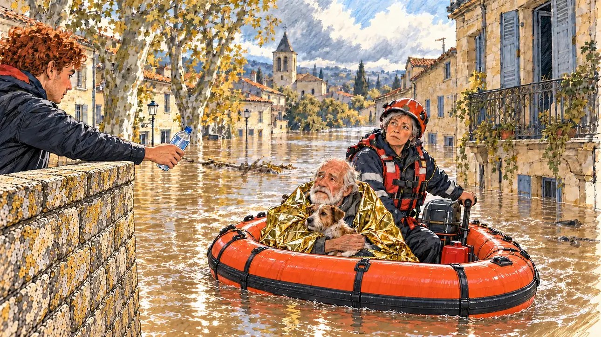

# `floods` · Crues historiques

**Validée par le PO le 31/10/2026**, au premier essai. Elle sert telle quelle en clair et en sombre.



| Champ | Valeur |
| --- | --- |
| Carte | `floods`, catégorie `crisis` (Crise) |
| Style | Reportage dessiné |
| Ton | Tendu et sobre |
| Date | 2026-10-31 |
| Outil | ChatGPT, ChatGPT Images 2.5 ; mode et effort : non précisés |
| Conversation | À remplir (le lien ne s'ouvre qu'avec le compte qui l'a créée) |
| Format rendu | 1673 × 940 (16:9) : export en 1290 × 726 px, WebP de qualité 75, 239 Ko, sans recadrage ; réexportée le 01/11/2026, après une première version en qualité 45 pour tenir 180 Ko |
| Fichier d'origine | PNG de ChatGPT, chez le PO. L'export du dépôt a été fait depuis la copie partagée dans la conversation avec Claude |
| Première édition | À remplir |

## Texte de la carte

> **Crues historiques**
>
> Des crues historiques noient plusieurs villages du Sud-Ouest. Les images tournent en boucle et le climat revient au cœur du débat.

## Le moment choisi

Un village du Sud-Ouest, le matin qui suit la crue, vu depuis le vieux pont où l'eau s'arrête. Un bateau de secours orange arrive : une pompière à la barre, un vieil homme dans une couverture de survie qui serre son chien. Sur le pont, un bénévole tend une bouteille d'eau.

## Prompt complet

Dans une nouvelle conversation, avec [`oldTweet.webp`](oldTweet.webp) comme seule image de référence :

```
Use the attached image as the style reference: the same pencil and ink drawing with loose watercolour washes and warm paper grain. Faces, hands and objects are drawn with visible ink lines, never photographic. Not the same scene.

Editorial illustration, landscape 16:9 (1536 × 864 px), filling the whole frame edge to edge. A village in south-western France, the morning after historic floods in 2027. The main street has become a brown river up to the ground-floor windows of the old stone houses; plane trees and the church tower rise from the water under a heavy, clearing sky. The scene is seen from the old stone bridge where the water stops, the player's candidate staying off-camera: in the foreground, only the wet parapet of the bridge. In the right third, an orange rescue boat comes towards the bridge: at the motor, a sturdy firefighter in her forties with short grey hair under her helmet glances up at the viewer, her face above mid-height; in the boat, a frail old man with a white beard, wrapped in a survival blanket, holds a small dog. On a first-floor balcony, a round, bald man in braces and a woman with a long grey plait wait their turn. On the bridge, a lanky young volunteer with red curly hair hands out bottles of water, and a drone hovers above the street, filming. Nothing on the houses, the boat or the signs is readable.

Style: Reportage drawing made on the spot, like a press illustrator or courtroom sketch artist: pencil and ink with loose watercolour washes, lively unfinished lines, white paper showing through.

Palette: navy #13203F, vellum #F5EFE1, gold #A9802A, brick #B5523B, ochre #D9A441, sage #8FA58A, slate #5E7186, sand #DCC8A4, warm grey #8C8279; use 4 to 6 of them, subtle warm paper grain.

Tone: tense and sober, grey morning light breaking through the clouds, reflections on the muddy water.

Constraints: realistic proportions, expressive but not caricatured faces, people of varied ages, genders, origins and body types (heavy, stocky, round, tall, short, wiry, not only slim), each with a distinct face and haircut (no two people alike), drawn with respect and never as a joke; anatomically correct hands with exactly five fingers, few hands visible, the others in pockets, behind objects or out of frame; no readable text anywhere (houses, signs, labels and screens stay unreadable); no captions or speech bubbles; no logos, flags or political party colours; no recognisable real person, no lookalike of a real politician; no explicit violence, no injured person; no oil-paint texture, no white or ragged border.

Format: if 16:9 is not available, make 1536 × 1024 and keep the top 80 px and the bottom 80 px free of anything important (faces, hands, the main action): they will be cropped.
```

Le générateur n'a dessiné ni le couple au balcon ni le drone. Le PO garde l'image sans eux.

## Essais écartés

Aucun.

## Retouches

Aucune.

## Relecture

Faite et validée par le PO le 31/10/2026.

- [x] Aucun texte lisible : ni sur les maisons, ni sur le bateau.
- [x] Aucun sosie d'une personne réelle.
- [x] Le candidat du joueur est hors champ.
- [x] Mains, visages et foules sans défaut visible à 343 px de large.
- [x] Aucune couleur de parti, aucun symbole officiel. Pas de blessé.
- [x] En 3:2 : rien d'important dans les 80 px du haut et du bas. Sans objet ici : l'image est en 16:9.
- [x] Lisible sur la page de l'événement, en clair et en sombre.
