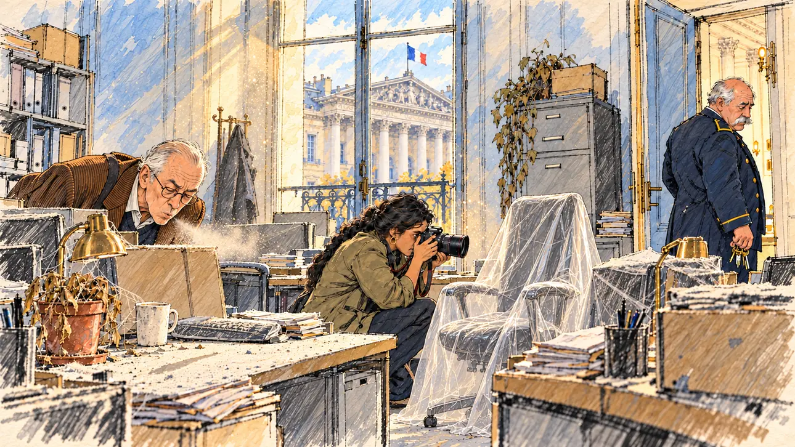

# `ghostAssistants` · Les assistants fantômes

**Validée par le PO le 31/10/2026**, à l'essai 2. Elle sert telle quelle en clair et en sombre.



| Champ | Valeur |
| --- | --- |
| Carte | `ghostAssistants`, catégorie `affair` (Affaire) |
| Style | Reportage dessiné ; visages dessinés comme le reste |
| Ton | Ironique |
| Date | 2026-10-31 |
| Outil | ChatGPT avec le modèle GPT Sol 6.1 en effort « light », et ChatGPT Images 2.5 |
| Conversation | À remplir (le lien ne s'ouvre qu'avec le compte qui l'a créée) |
| Format rendu | 1672 × 941 (16:9) : export en 1290 × 726 px depuis le PNG d'origine, WebP de qualité 75, 214 Ko, sans recadrage |
| Fichier d'origine | PNG de ChatGPT, chez le PO, partagé aussi dans la conversation avec Claude |
| Première édition | À remplir |

## Texte de la carte

> **Les assistants fantômes**
>
> Un journal d'investigation affirme que deux de vos anciens assistants parlementaires n'ont jamais mis les pieds au bureau.

## Le moment choisi

Le bureau des deux assistants, dans une annexe de l'Assemblée nationale, intact depuis des années : chaises encore sous plastique, toiles d'araignée, plante morte, courrier jamais ouvert, poussière épaisse. Un journaliste d'investigation souffle sur la poussière d'un bureau, une photographe mitraille la chaise emballée, l'huissier baisse les yeux, ses clés à la main. Par la fenêtre, la façade du Palais Bourbon et son drapeau. Le candidat n'apparaît pas.

## Prompt complet

Dans une nouvelle conversation, avec [`oldTweet.webp`](oldTweet.webp) comme seule image de référence :

```
Use the attached image as the style reference: the same pencil and ink drawing with loose watercolour washes and warm paper grain. Not the same scene.
Faces are drawn exactly like the clothes and the background: ink outlines, a few hatching strokes and flat watercolour washes for the skin, with the same level of detail as the rest of the drawing. No photographic skin, no realistic shading, no airbrushed or digital-painting look on the faces.

Editorial illustration, landscape 16:9 (1536 × 864 px), filling the whole frame edge to edge. A small office for parliamentary assistants in an annex of the National Assembly in Paris, in the afternoon in 2027. It once belonged to two assistants of the player's candidate, who never set foot in it. The candidate does not appear. Two facing desks, untouched for years: a computer still in its cardboard box, a keyboard in its plastic wrap, an office chair still wrapped in plastic film, a dead potted plant, a mug with a cobweb, a pile of unopened mail and a thick layer of grey dust. A beam of light from the tall window shows the dust floating in the air; through the window, the stone façade of an official building across the courtyard, with a French tricolour flag. In the left third, an investigative journalist, a lanky man in his sixties with thinning white hair combed back, half-moon glasses and a crumpled corduroy jacket, has just run one finger along a desk and looks at the grey dust on his fingertip with quiet, ironic satisfaction, his face above mid-height. In the middle, a photographer, a short, stocky woman in her thirties of South Asian origin with a thick black plait, crouches to photograph the chair still in its plastic. In the doorway on the right, the building's usher, a heavy-set older man with a white moustache and a navy uniform, a bunch of keys in his hand, looks away at the corridor, embarrassed. Nobody looks at the viewer. Nothing on the boxes, the mail, the screens, the walls or the door is readable.

Style: Reportage drawing made on the spot, like a press illustrator or courtroom sketch artist: pencil and ink with loose watercolour washes, lively unfinished lines, white paper showing through.

Palette: navy #13203F, vellum #F5EFE1, gold #A9802A, brick #B5523B, ochre #D9A441, sage #8FA58A, slate #5E7186, sand #DCC8A4, warm grey #8C8279; use 4 to 6 of them, subtle warm paper grain.

Tone: dry irony, still and dusty, a cold afternoon light with a single warm beam through the window.

Constraints: realistic proportions, expressive but not caricatured faces, drawn like the rest of the illustration and never photographic; people of varied ages, genders, origins and body types (heavy, stocky, round, tall, short, wiry, not only slim), each with a distinct face and haircut (no two people alike), drawn with respect and never as a joke; anatomically correct hands with exactly five fingers, few hands visible, the others in pockets, behind objects or out of frame; no readable text anywhere (boxes, mail, labels, screens and doors stay unreadable); no captions or speech bubbles; no logos or political party colours; no recognisable real person, no lookalike of a real politician or journalist; no explicit violence; no oil-paint texture, no white or ragged border.

Format: if 16:9 is not available, make 1536 × 1024 and keep the top 80 px and the bottom 80 px free of anything important (faces, hands, the main action): they will be cropped.
```

### Message de correction

Envoyé après l'essai 1 :

```
Keep this image, the scene, the three people, their poses and the window exactly as they are, with two changes:
- the investigative journalist is clean-shaven, with no moustache, and his thinning white hair is combed straight back, so that he looks nothing like the usher;
- match the rendering of the reference image more closely: pencil and ink lines, loose watercolour washes, more white paper showing through, faces drawn with an ink outline, a few hatching strokes and flat washes; no hatching filter over a finished digital painting.
Everything else stays the same: nothing readable, exactly five fingers on every visible hand, 16:9 filling the whole frame.
```

## Décisions prises sur cette image

- **Le journaliste souffle sur la poussière** au lieu de la regarder sur son doigt, comme le demandait le prompt. Le geste est plus lisible et cache ses mains : il est gardé.
- **La façade du Palais Bourbon** se reconnaît par la fenêtre, avec le drapeau tricolore : les monuments réels et les drapeaux sont permis pour signaler un bâtiment officiel.

## Essais écartés

- **Essai 1** (31/10/2026) : la scène était juste, mais le journaliste portait une moustache. Avec ses cheveux blancs, il ressemblait à l'huissier, et un journaliste d'investigation à moustache et lunettes pouvait évoquer un journaliste réel. Le rendu tenait aussi un peu de la peinture numérique sous un filtre de hachures, avec peu de papier blanc.

## Retouches

Aucune.

## Relecture

Faite et validée par le PO le 31/10/2026, sur l'essai 2.

- [x] Aucun texte lisible : ni sur les cartons, ni sur le courrier, ni sur les classeurs.
- [x] Aucun sosie d'une personne réelle.
- [x] Le candidat du joueur n'apparaît pas.
- [x] Mains, visages et foules sans défaut visible à 343 px de large.
- [x] Aucune couleur de parti. Le drapeau tricolore signale le bâtiment officiel. Des personnes variées par l'âge, le corps, l'origine et la coiffure.
- [x] En 3:2 : rien d'important dans les 80 px du haut et du bas. Sans objet ici : l'image est en 16:9.
- [x] Lisible sur la page de l'événement, en clair et en sombre.
