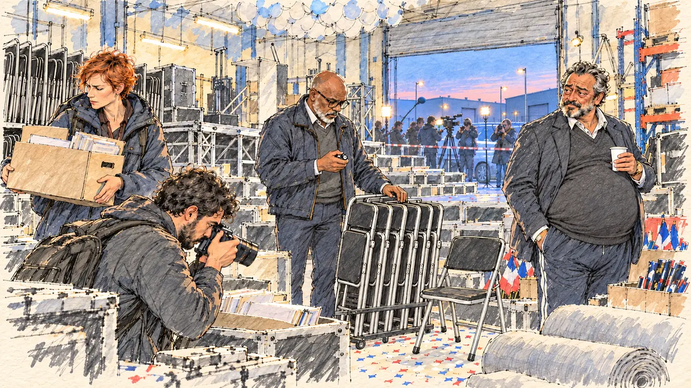

# `inflatedInvoices` · Factures gonflées

**Validée par le PO le 31/10/2026**, à l'essai 3. Elle sert telle quelle en clair et en sombre.



| Champ | Valeur |
| --- | --- |
| Carte | `inflatedInvoices`, catégorie `affair` (Affaire) |
| Style | Reportage dessiné ; visages dessinés comme le reste |
| Ton | Ironique |
| Date | 2026-10-31 |
| Outil | ChatGPT, ChatGPT Images 2.5 ; mode et effort : non précisés |
| Conversation | À remplir (le lien ne s'ouvre qu'avec le compte qui l'a créée) |
| Format rendu | 1670 × 941 (16:9) : export en 1290 × 726 px depuis le PNG d'origine, WebP de qualité 75, 235 Ko, sans recadrage |
| Fichier d'origine | PNG de ChatGPT, chez le PO, partagé aussi dans la conversation avec Claude |
| Première édition | À remplir |

## Texte de la carte

> **Factures gonflées**
>
> Le prestataire de vos meetings est soupçonné d'avoir gonflé ses factures. La presse parle déjà de financement douteux.

## Le moment choisi

À l'aube, des enquêteurs financiers perquisitionnent l'entrepôt du prestataire, au milieu du matériel des meetings : piles de chaises pliantes, pupitre, caisses de petits drapeaux, filets de ballons. Un enquêteur compte les chaises au compteur manuel, une enquêtrice emporte un carton d'archives, un autre photographie les factures. Le patron, tiré du lit, gobelet de café à la main, sourit jaune. Par la porte ouverte, la presse attend derrière une rubalise. Le candidat n'apparaît pas.

## Prompt complet

Trois messages, dans une seule conversation, avec [`oldTweet.webp`](oldTweet.webp) comme seule image de référence. Le premier prompt a donné l'essai 1 :

```
Use the attached image as the style reference: the same pencil and ink drawing with loose watercolour washes and warm paper grain. Not the same scene.
Faces are drawn exactly like the clothes and the background: ink outlines, a few hatching strokes and flat watercolour washes for the skin, with the same level of detail as the rest of the drawing. No photographic skin, no realistic shading, no airbrushed or digital-painting look on the faces.

Editorial illustration, landscape 16:9 (1536 × 864 px), filling the whole frame edge to edge. The warehouse of the events company that stages the player's candidate's rallies, at dawn in 2027, during a search by financial investigators: the company is suspected of inflating its invoices. The candidate does not appear. All around, the gear of a campaign rally: tall stacks of folding chairs, a dismantled stage, a bare lectern, flight cases, rolls of neutral grey carpet, nets full of white balloons, crates of small French tricolour flags and confetti cannons, under cold fluorescent tubes. In the right third, the boss of the company, a round man in his fifties with a tan and a carefully trimmed salt-and-pepper beard, woken up early, in tracksuit trousers under a blazer and a gold watch, holds a paper cup of coffee and watches the investigators with a pale, forced smile, his face above mid-height. In the centre, an older investigator, a bald Black man with grey stubble and reading glasses, counts a stack of folding chairs with a hand tally counter, utterly unimpressed. On the left, a tall investigator in her forties with short cropped red hair and a parka carries out a full archive box; a young, stocky investigator with a short black beard and a backpack photographs an open box of invoices. Through the open rolling door, in the blue dawn light, a television crew and a press photographer wait behind a tape outside, next to an unmarked car. Nobody looks at the viewer. Nothing on the boxes, the invoices, the cases, the armbands, the tape or the car is readable.

Style: Reportage drawing made on the spot, like a press illustrator or courtroom sketch artist: pencil and ink with loose watercolour washes, lively unfinished lines, white paper showing through.

Palette: navy #13203F, vellum #F5EFE1, gold #A9802A, brick #B5523B, ochre #D9A441, sage #8FA58A, slate #5E7186, sand #DCC8A4, warm grey #8C8279; use 4 to 6 of them, subtle warm paper grain.

Tone: dry irony, cold fluorescent light inside and blue dawn outside, a hangover feeling.

Constraints: realistic proportions, expressive but not caricatured faces, drawn like the rest of the illustration and never photographic; people of varied ages, genders, origins and body types (heavy, stocky, round, tall, short, wiry, not only slim), each with a distinct face and haircut (no two people alike), drawn with respect and never as a joke; anatomically correct hands with exactly five fingers, few hands visible, the others in pockets, behind objects or out of frame; no readable text anywhere (boxes, invoices, cases, armbands, tape and vehicles stay unreadable); no captions or speech bubbles; no logos or political party colours; no recognisable real person, no lookalike of a real politician or businessman; no explicit violence, no weapons or handcuffs; no oil-paint texture, no white or ragged border, no hatching filter over a finished digital painting.

Format: if 16:9 is not available, make 1536 × 1024 and keep the top 80 px and the bottom 80 px free of anything important (faces, hands, the main action): they will be cropped.
```

### Message de correction

Envoyé après l'essai 1 ; il a donné l'essai 2 :

```
Keep this image, the scene, the five people, their poses, the warehouse and the open door exactly as they are, but redraw everything in the style of the reference image:
- a quick reportage drawing on warm paper: pencil and ink lines, loose watercolour washes, plenty of white paper showing through, lighter and less saturated overall, with the blue dawn still outside the door; no photographic rendering, no hatching filter over a finished digital painting;
- every face is drawn like the clothes: an ink outline, a few hatching strokes and flat watercolour washes; no photographic skin, no realistic wrinkles or pores, no glossy highlights.
Two small changes: the boss of the company is round, with a big belly under his blazer; outside the door, a plain industrial estate at dawn instead of the old town.
Everything else stays the same: nothing readable, exactly five fingers on every visible hand, 16:9 filling the whole frame.
```

### Prompt revu

Envoyé en entier après l'essai 2, dans la même conversation ; il a donné l'image retenue :

```
Use the attached image as the style reference: the same pencil and ink drawing with loose watercolour washes and warm paper grain. Not the same scene.
This must look like a drawing made by hand on paper, never like a photograph: the people are drawn with ink lines and flat washes, not modelled; large parts of the background are only suggested with a few pencil lines and a wash, leaving the warm paper bare.
Faces are drawn exactly like the clothes and the background: ink outlines, a few hatching strokes and flat watercolour washes for the skin, with the same level of detail as the rest of the drawing. No photographic skin, no realistic wrinkles or pores, no airbrushed or digital-painting look on the faces.

Editorial illustration, landscape 16:9 (1536 × 864 px), filling the whole frame edge to edge. The warehouse of the events company that stages the player's candidate's rallies, at dawn in 2027, during a search by financial investigators: the company is suspected of inflating its invoices. The candidate does not appear. Around them, the gear of a campaign rally, sketched quickly: tall stacks of folding chairs, a bare lectern, flight cases, nets full of white balloons and crates of small French tricolour flags, under fluorescent tubes. In the right third, the boss of the company, a round man in his fifties with a big belly under his blazer, a tan and a carefully trimmed salt-and-pepper beard, woken up early, in tracksuit trousers and a gold watch, holds a paper cup of coffee and watches the investigators with a pale, forced smile, his face above mid-height. In the centre, an older investigator, a bald Black man with grey stubble and reading glasses, counts a stack of folding chairs with a hand tally counter, utterly unimpressed. On the left, a tall investigator in her forties with short cropped red hair and a parka carries out a full archive box; a young, stocky investigator with a short black beard and a backpack photographs an open box of invoices. Through the open rolling door, a plain industrial estate in the blue dawn light, where a television crew and a press photographer wait behind a tape, next to an unmarked car. Nobody looks at the viewer. Nothing on the boxes, the invoices, the cases, the tape or the car is readable.

Style: Reportage drawing made on the spot, like a press illustrator or courtroom sketch artist: pencil and ink with loose watercolour washes, lively unfinished lines, white paper showing through.

Palette: navy #13203F, vellum #F5EFE1, gold #A9802A, brick #B5523B, ochre #D9A441, sage #8FA58A, slate #5E7186, sand #DCC8A4, warm grey #8C8279; use 4 to 6 of them, subtle warm paper grain.

Tone: dry irony, cold light inside and blue dawn outside, a hangover feeling.

Constraints: realistic proportions, expressive but not caricatured faces, drawn like the rest of the illustration and never photographic; people of varied ages, genders, origins and body types (heavy, stocky, round, tall, short, wiry, not only slim), each with a distinct face and haircut (no two people alike), drawn with respect and never as a joke; anatomically correct hands with exactly five fingers, few hands visible, the others in pockets, behind objects or out of frame; no readable text anywhere (boxes, invoices, cases, armbands, tape and vehicles stay unreadable); no captions or speech bubbles; no logos or political party colours; no recognisable real person, no lookalike of a real politician or businessman; no explicit violence, no weapons or handcuffs; no photographic rendering, no hatching filter over a finished digital painting, no oil-paint texture, no white or ragged border.

Format: if 16:9 is not available, make 1536 × 1024 and keep the top 80 px and the bottom 80 px free of anything important (faces, hands, the main action): they will be cropped.
```

## Décisions prises sur cette image

- **Le prompt revu, renvoyé en entier dans la même conversation, a changé le rendu** là où le message de correction n'avait rien changé. Il garde la composition de l'essai 2, y compris les rouleaux de moquette que le prompt revu ne décrit plus. Il ajoute une ligne de style en tête (« a drawing made by hand on paper, never like a photograph », fond seulement esquissé, papier nu) et allège la liste du décor.
- **La qualité reste à 75** (235 Ko), comme décidé pour [`starEndorsement`](starEndorsement.md).

## Essais écartés

- **Essai 1** (31/10/2026) : la scène était juste, mais le rendu était presque photographique, une photo passée sous un filtre de hachures. Le patron était plus costaud que rond, et le paysage derrière la porte ressemblait à une vieille ville à cathédrale.
- **Essai 2** (31/10/2026) : le patron avait son gros ventre et la porte donnait sur une zone d'activités, mais le rendu n'avait pas bougé.

## Retouches

Aucune.

## Relecture

Faite et validée par le PO le 31/10/2026, sur l'essai 3.

- [x] Aucun texte lisible : ni sur les cartons, ni sur les factures, ni sur la rubalise ; pas de « POLICE » en toutes lettres.
- [x] Aucun sosie d'une personne réelle.
- [x] Le candidat du joueur n'apparaît pas.
- [x] Mains, visages et foules sans défaut visible à 343 px de large.
- [x] Aucune couleur de parti. Les petits drapeaux tricolores sont du matériel de meeting. Des personnes variées par l'âge, le corps, l'origine et la coiffure.
- [x] En 3:2 : rien d'important dans les 80 px du haut et du bas. Sans objet ici : l'image est en 16:9.
- [x] Lisible sur la page de l'événement, en clair et en sombre.
