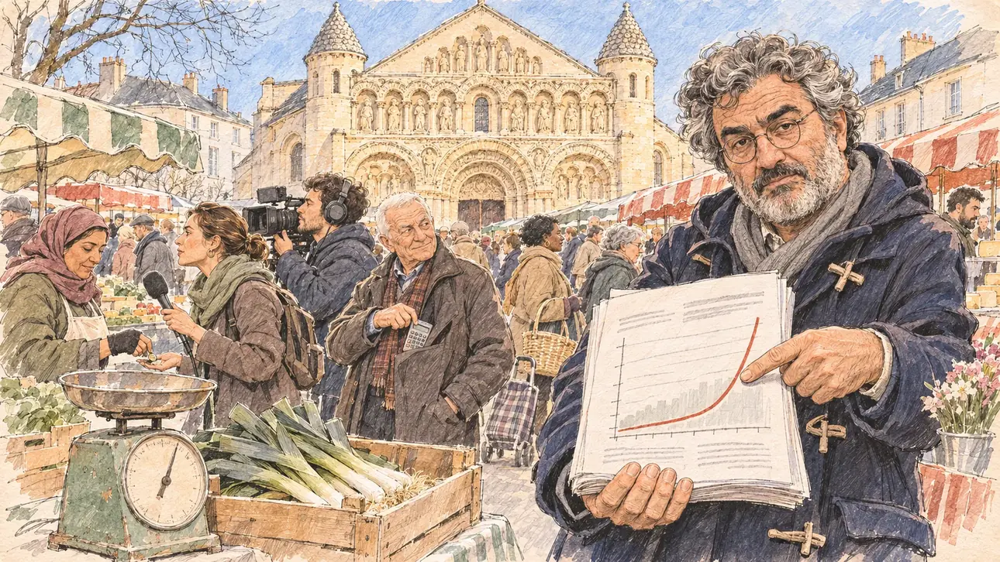

# `auditCourt` · Un rapport de la Cour des comptes

**À générer.** Prompt prêt le 05/11/2026, pas encore d'image validée.



| Champ | Valeur |
| --- | --- |
| Carte | `auditCourt`, catégorie `institutions` (Institutions), carte ajoutée par la PR #297 de l'app |
| Style | Reportage dessiné, trait de `primeTime` |
| Ton | Tendu et ironique |
| Date | À remplir |
| Outil | ChatGPT Images |
| Conversation | À remplir (le lien ne s'ouvre qu'avec le compte qui l'a créée) |
| Format rendu | À remplir |
| Fichier d'origine | À remplir |
| Première édition | À remplir |

## Texte de la carte

> **Un rapport de la Cour des comptes**
>
> La Cour des comptes publie un rapport sévère sur la trajectoire de la dette. Les journalistes vous demandent comment vous financeriez vos propositions.

## Le moment choisi

Le marché du samedi matin devant Notre-Dame-la-Grande, à Poitiers, le jour où paraît le rapport, vu depuis l'allée où le candidat (hors champ) arrive : au premier plan, la balance d'un maraîcher et une cagette de poireaux. Un journaliste économique tend au candidat le rapport imprimé, épais, ouvert sur une courbe de la dette qui grimpe, l'air sceptique. Autour : d'autres journalistes avec micros et caméra, une maraîchère qui écoute en rendant la monnaie, des passants avec leurs cabas, un retraité qui sort une calculette de sa poche. Derrière : la façade romane sculptée de Notre-Dame-la-Grande et ses clochetons en pomme de pin.

## Prompt complet

Dans une nouvelle conversation, avec [`primeTime.webp`](../../illustrations/media/primeTime.webp) comme seule image de référence.

```
Use the attached image as the style reference and copy its drawing: a realistic reportage drawing made on the spot for a newspaper, with quick, nervous pencil lines, often drawn twice, ink hatching in the shadows, transparent watercolour washes that spill a little over the lines, and the warm paper showing through. Not the same scene and not the same people: never reuse the face or the hair of the woman in the reference.
Like in the reference, the setting can be full when the story needs it, with the things that say where we are and what is happening, but each one is sketched with a few pencil lines and a light wash, never rendered or finished, and the drawing gets looser and paler towards the edges until it fades into the bare paper.
This must look like a drawing made by hand on paper by a press illustrator, halfway between a quick sketch and a realistic picture: never a photograph, a film poster or a digital painting, and never a cartoon, a comic strip, a caricature or a children's book illustration. Continuous lines, never dotted or dashed outlines; no uniform texture, speckles or hatching filter laid over the picture; no glossy highlights, no smooth gradients, in the sky and on the walls too. Colour can be rich in places, on a piece of clothing, a light or a flag, but it stays transparent and within the palette below. The fade into the paper at the edges stays narrow, without a wide white margin. No blur and no depth-of-field effect: everything, the foreground included, is drawn sharp, like a sketch made on the spot.
People are drawn from life with realistic anatomy and proportions, like in the reference: faces shaped with pencil lines, hatching and light washes, a little more finished than the background but never photographic (no photographic skin, no airbrushed or digital-painting look). Expressions stay natural and restrained, even in laughter or tears: no exaggerated grins, no wide-open mouths full of teeth, no rubbery or cartoonish faces.

Editorial illustration, landscape 16:9 (1536 × 864 px), the scene filling the frame, with only a light fade into the paper at the edges. The Saturday-morning market in front of the church of Notre-Dame-la-Grande in Poitiers, in the West, in early 2027, on the day the Court of Audit publishes a severe report on the trajectory of the public debt, and journalists ask the player's candidate how the candidate would finance the proposals. The scene is seen from the aisle of the market where the candidate arrives, who stays off-camera: in the foreground, only a market gardener's old weighing scale and a crate of leeks. In the right third, an economics journalist of a regional daily, a man in his fifties of Greek origin, tall and heavy-set, with thick curly grey hair, a grey beard, round glasses and a duffel coat, holds out towards the viewer the thick printed report, open on a big chart where one curve climbs steeply, one finger on the curve, with a sceptical, ironic, insistent look, his face above mid-height. Around him, sketched in pencil and light washes: other journalists, a young radio reporter with a plain foam microphone and a cameraman with a camera on his shoulder; the market gardener, a woman in her forties of Moroccan origin with a headscarf and fingerless gloves, listening while she hands back change; shoppers with wicker baskets and shopping trolleys; a bare-headed retired man with a white crew cut taking a small calculator out of his pocket with an amused look; stalls of vegetables, cheese and flowers under striped awnings. Behind them, the richly carved Romanesque façade of Notre-Dame-la-Grande in warm pale stone, with its rows of sculpted arches and its two corner turrets topped with pine-cone roofs, and the old houses around the square under a clear winter sky. Only the economics journalist looks straight at the viewer. Nothing on the report, the chart, the microphone, the camera, the price tags or the awnings is readable, and no logo of a real newspaper, radio or TV channel appears.

Style: Reportage drawing made on the spot, like a press illustrator or courtroom sketch artist: pencil and ink with loose watercolour washes, lively unfinished lines, white paper showing through.

Palette: navy #13203F, vellum #F5EFE1, gold #A9802A, brick #B5523B, ochre #D9A441, sage #8FA58A, slate #5E7186, sand #DCC8A4, warm grey #8C8279; use 4 to 6 of them, subtle warm paper grain.

Tone: tense and ironic, the clear, cold light of a winter market morning, the warm pale stone of the carved façade, and the red climbing curve on the report as the sharp note.

Constraints: realistic proportions, natural expressions, never cartoonish or caricatured faces, drawn like the rest of the illustration and never photographic; people of varied ages, genders, origins and body types (heavy, stocky, round, tall, short, wiry, not only slim), each with a distinct face and haircut (no two people alike), drawn with respect and never as a joke; anatomically correct hands with exactly five fingers, few hands visible, the others in pockets, behind objects or out of frame; no readable text anywhere (the report, the chart, the microphone, the camera, the price tags and the awnings stay unreadable); no captions or speech bubbles; no logos or political party colours; no recognisable real person, no lookalike of a real politician, and no logo of a real newspaper, radio or TV channel; no explicit violence; no photographic rendering, no blur or bokeh, no dotted outlines, no texture or hatching filter over the picture, no oil-paint texture, no wide white margin or frame (a light fade into the paper at the edges is fine).

Format: if 16:9 is not available, make 1536 × 1024 and keep the top 80 px and the bottom 80 px free of anything important (faces, hands, the main action): they will be cropped.
```

## Décisions prises sur cette image

Aucune pour l'instant.

## Essais écartés

Aucun pour l'instant.

## Retouches

Aucune.

## Relecture

À faire sur l'image validée.
