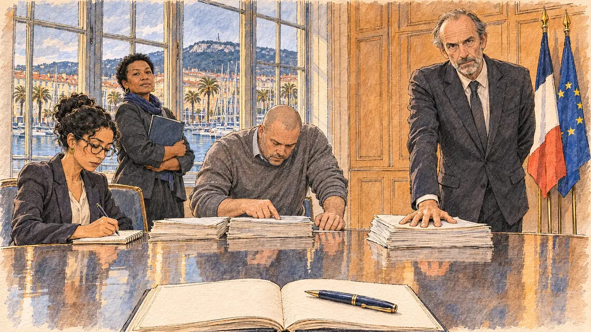

# `blockedRemoval` · Le pays d'origine ne répond pas

**Validée par le PO le 20/11/2026**, au premier essai, avec `primeTime.webp` comme référence. Elle sert telle quelle en clair et en sombre.



| Champ | Valeur |
| --- | --- |
| Carte | `blockedRemoval`, catégorie `institutions` (Institutions), poids 0,2, à partir de l'officialisation, une carte du programme : tirée si le programme tient une mesure d'éloignement (`expelForeignCriminals`, `deportRejectedAsylum`, `schengenLock`, `familyReunificationPause`) (Mitchnsun/moi-president, PO, 17/11/2026) |
| Style | Reportage dessiné, trait de `primeTime` |
| Ton | Tendu et grave, lumière froide de fin d'après-midi |
| Date | 2026-11-20 (prompt écrit le 2026-11-18) |
| Outil | GPT 6.2 Astra |
| Conversation | À remplir (le lien ne s'ouvre qu'avec le compte qui l'a créée) |
| Format rendu | 1672 × 941 (16:9) : export en 1290 × 726 px, WebP de qualité 75, 213 Ko, sans recadrage |
| Fichier d'origine | Image chez le PO. L'export du dépôt a été fait depuis la copie partagée dans la conversation avec Claude |
| Première édition | À compléter |

## Texte de la carte

> **Le pays d'origine ne répond pas**
>
> Un préfet reçoit votre équipe et pose sur la table une liste de personnes sous obligation de quitter le territoire que l'on ne parvient pas à renvoyer : leur pays d'origine ne délivre pas les papiers nécessaires. Il vous demande comment votre programme y arrivera, quand le renvoi dépend de la signature d'un autre État.

## Le moment choisi

Le bureau du préfet, à la préfecture du Var, à Toulon, une fin d'après-midi de mars : boiseries, drapeaux tricolore et européen sur leurs hampes, longue table de réunion, et par les hautes fenêtres les palmiers, les façades ocre, les mâts du port et le mont Faron. Le candidat est assis à la table avec son équipe, hors champ : au premier plan, son carnet ouvert et son stylo. Le préfet a posé sur la table une épaisse liasse de listes illisibles, la main à plat dessus, et le regarde : comment ferez-vous ? Autour : une conseillère de l'équipe qui prend des notes, un juriste de l'équipe qui se penche sur la liasse, la directrice de cabinet debout près de la fenêtre, un dossier contre elle. Aucune des personnes de la liste n'est montrée. La carte rappelle le rapport de la Cour des comptes de janvier 2024 sur les laissez-passer consulaires : personne n'y ressemble à un préfet connu, et aucun portrait n'est au mur.

## Prompt complet

Dans une nouvelle conversation, avec [`primeTime.webp`](../../illustrations/media/primeTime.webp) comme seule image de référence :

```
Use the attached image as the style reference and copy its drawing: a realistic reportage drawing made on the spot for a newspaper, with quick, nervous pencil lines, often drawn twice, ink hatching in the shadows, transparent watercolour washes that spill a little over the lines, and the warm paper showing through. Not the same scene and not the same people: never reuse the face or the hair of the woman in the reference.
Like in the reference, the setting can be full when the story needs it, with the things that say where we are and what is happening, but each one is sketched with a few pencil lines and a light wash, never rendered or finished, and the drawing gets looser and paler towards the edges until it fades into the bare paper.
This must look like a drawing made by hand on paper by a press illustrator, halfway between a quick sketch and a realistic picture: never a photograph, a film poster or a digital painting, and never a cartoon, a comic strip, a caricature or a children's book illustration. Continuous lines, never dotted or dashed outlines; no uniform texture, speckles or hatching filter laid over the picture; no glossy highlights, no smooth gradients, in the sky and on the walls too. Colour can be rich in places, on a piece of clothing, a light or a flag, but it stays transparent and within the palette below. The fade into the paper at the edges stays narrow, without a wide white margin. No blur and no depth-of-field effect: everything, the foreground included, is drawn sharp, like a sketch made on the spot.
People are drawn from life with realistic anatomy and proportions, like in the reference: faces shaped with pencil lines, hatching and light washes, a little more finished than the background but never photographic (no photographic skin, no airbrushed or digital-painting look). Expressions stay natural and restrained, even in laughter or tears: no exaggerated grins, no wide-open mouths full of teeth, no rubbery or cartoonish faces.

Editorial illustration, landscape 16:9 (1536 × 864 px), the scene filling the frame, with only a light fade into the paper at the edges. The office of the prefect in the prefecture of the Var, in Toulon, on the Mediterranean, at the end of an afternoon in March 2027: wood panelling, a tall French tricolour flag and a European flag on their poles in a corner, a long polished meeting table, and through the tall windows palm trees, ochre façades, the masts of the harbour and the limestone ridge of Mont Faron. The bare panelled wall behind the prefect has no portrait. The prefect has received the player's candidate's team and has put on the table a thick sheaf of lists of people under an order to leave France whose country of origin will not issue their papers. The player's candidate sits at the table and stays off-camera: in the foreground, only the candidate's open notebook and a pen. In the right third, the main character, the prefect, a white man in his late fifties, tall and wiry, with a short grey beard and thinning hair combed back, in a dark suit and a plain tie, no uniform, stands behind the table with one hand flat on the sheaf of lists and looks at the viewer with a grave, questioning look, his face above mid-height. Around: at the table, a campaign adviser in her thirties of Tunisian descent, slim, with black curly hair tied back and reading glasses, takes notes, not looking at the viewer; a legal adviser of the team, a stocky white man in his forties with a shaved head and a grey jumper, leans over the lists; by the window, the prefect's chief of staff, a woman in her forties of Malagasy descent, short and round, with short natural hair, holds a folder against her chest and looks at the viewer. Only the prefect and his chief of staff look at the viewer. Nobody in the lists is shown. Nothing on the lists, the folder, the notebook or the papers is readable.

Style: Reportage drawing made on the spot, like a press illustrator or courtroom sketch artist: pencil and ink with loose watercolour washes, lively unfinished lines, white paper showing through.

Palette: navy #13203F, vellum #F5EFE1, gold #A9802A, brick #B5523B, ochre #D9A441, sage #8FA58A, slate #5E7186, sand #DCC8A4, warm grey #8C8279; use 4 to 6 of them, subtle warm paper grain.

Tone: tense and grave, the cold light of the end of the afternoon through the tall windows, the ochre of the town outside against the navy and slate of the office.

Constraints: realistic proportions, natural expressions, never cartoonish or caricatured faces, drawn like the rest of the illustration and never photographic; people of varied ages, genders, origins and body types (heavy, stocky, round, tall, short, wiry, not only slim), each with a distinct face and haircut (no two people alike), drawn with respect and never as a joke; each person's age, build and look plausible for their job and the scene (working people of working age), no stereotype tying an origin or a gender to a role, and no person of colour shown alone in a featured service or deferential role; anatomically correct hands with exactly five fingers, few hands visible, the others in pockets, behind objects or out of frame; no readable text anywhere (the lists, the folder, the notebook and the papers stay unreadable, no names, no nameplates); no captions or speech bubbles; no logos, no emblem of the ministry, no political party colours; no recognisable real person, no lookalike of a real politician or of a known prefect, and no portrait of a president on the wall; no explicit violence, no police and no people being taken away; no photographic rendering, no blur or bokeh, every outline a continuous pencil or ink line with no dotted or dashed outlines, no mottled, crackled or speckled texture over the faces, the clothes, the panelling or the sky, no hatching filter over the picture, no oil-paint texture, no glow or halo, no wide white margin or frame (a light fade into the paper at the edges is fine).

Format: if 16:9 is not available, make 1536 × 1024 and keep the top 80 px and the bottom 80 px free of anything important (faces, hands, the main action): they will be cropped.
```

## Décisions prises sur cette image

Aucune pour le moment.

## Essais écartés

Aucun.

## Retouches

Aucune.

## Relecture

Faite et validée par le PO le 20/11/2026.

- [x] Aucun texte lisible : les listes, le dossier, le carnet et les papiers ; aucun nom ni aucune plaque.
- [x] Aucun sosie d'une personne réelle ; aucun portrait de président au mur.
- [x] Le candidat du joueur est hors champ : son carnet ouvert et son stylo au premier plan.
- [x] Mains, visages et foules sans défaut visible à 343 px de large, la main du préfet posée à plat sur les listes comprise.
- [x] Aucune couleur ni aucun logo de parti. Aucun emblème du ministère, ni police ni personne emmenée. Des personnes variées par l'âge, le corps, l'origine et la coiffure.
- [x] En 3:2 : sans objet, l'image est en 16:9.
- [x] Lisible sur la page de l'événement, en clair et en sombre.

Ce que la relecture a accepté : le carnet du candidat, au premier plan, est un grand registre ouvert ; le mont Faron et sa tour au fond, par la fenêtre.
