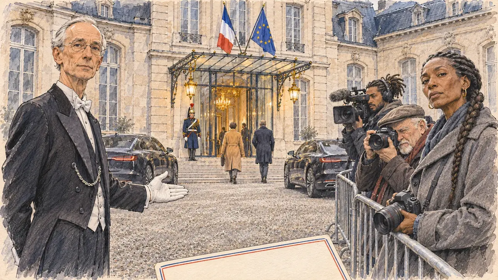

# `candidatesSummoned` · L'Élysée convoque les candidatures

**Validée par le PO le 07/11/2026**, à l'essai 2, après une retouche. Elle sert telle quelle en clair et en sombre.



| Champ | Valeur |
| --- | --- |
| Carte | `candidatesSummoned`, catégorie `institutions` (Institutions) |
| Style | Reportage dessiné |
| Ton | Observateur, un peu solennel |
| Date | 2026-11-07 |
| Outil | ChatGPT Images, à compléter (modèle et effort) |
| Conversation | À compléter |
| Format rendu | 1672 × 941 (16:9) : export en 1290 × 726 px, WebP de qualité 75, 214 Ko, sans recadrage, fait depuis la copie WebP de la conversation retouchée (à refaire depuis le PNG d'origine) |
| Fichier d'origine | À compléter (hors du dépôt) |
| Première édition | À compléter |

## Texte de la carte

> **L'Élysée convoque les candidatures**
>
> Le président de la République convoque toutes les candidatures déclarées : la flambée des prix viendrait des crises internationales, pas des choix du gouvernement. Un ministre résume la ligne : les cortèges ne feront pas baisser le prix de l'énergie.

## Le moment choisi

La cour d'honneur de l'Élysée, un matin gris d'hiver, à l'arrivée des candidats. Le candidat descend de voiture, hors champ : au premier plan, le coin de son carton d'invitation, vierge. Un huissier en habit lui indique le perron d'un geste bref ; derrière une barrière, une photographe a baissé son appareil et le jauge du regard, à côté d'un photographe et d'un cadreur. Deux autres candidats montent les marches, de dos et trop loin pour être reconnus ; un garde républicain se tient près de la porte. Le Président n'apparaît pas.

## Prompt complet

Dans une nouvelle conversation, avec [`primeTime.webp`](../../illustrations/media/primeTime.webp) comme seule image de référence :

```
Use the attached image as the style reference and copy its drawing: a realistic reportage drawing made on the spot for a newspaper, with quick, nervous pencil lines, often drawn twice, ink hatching in the shadows, transparent watercolour washes that spill a little over the lines, and the warm paper showing through. Not the same scene and not the same people: never reuse the face or the hair of the woman in the reference.
Like in the reference, the setting can be full when the story needs it, with the things that say where we are and what is happening, but each one is sketched with a few pencil lines and a light wash, never rendered or finished, and the drawing gets looser and paler towards the edges until it fades into the bare paper.
This must look like a drawing made by hand on paper by a press illustrator, halfway between a quick sketch and a realistic picture: never a photograph, a film poster or a digital painting, and never a cartoon, a comic strip, a caricature or a children's book illustration. Continuous lines, never dotted or dashed outlines; no uniform texture, speckles or hatching filter laid over the picture; no glossy highlights, no smooth gradients, in the sky and on the walls too. Colour can be rich in places, on a piece of clothing, a light or a flag, but it stays transparent and within the palette below. The fade into the paper at the edges stays narrow, without a wide white margin. No blur and no depth-of-field effect: everything, the foreground included, is drawn sharp, like a sketch made on the spot.
People are drawn from life with realistic anatomy and proportions, like in the reference: faces shaped with pencil lines, hatching and light washes, a little more finished than the background but never photographic (no photographic skin, no airbrushed or digital-painting look). Expressions stay natural and restrained, even in laughter or tears: no exaggerated grins, no wide-open mouths full of teeth, no rubbery or cartoonish faces.

Editorial illustration, landscape 16:9 (1536 × 864 px), the scene filling the frame, with only a light fade into the paper at the edges. The main courtyard of the Élysée Palace in Paris, on a grey, cold winter morning in 2027: the President of the Republic has summoned every declared candidate to explain that the surge in prices comes from crises abroad. The player's candidate has just stepped out of a car and stays off-camera: in the foreground, only the corner of a stiff cream invitation card with a thin blue, white and red edge, completely blank, with no writing, no handwriting and no signature. In the left third, a palace usher in his sixties, of European descent, tall and thin, clean-shaven, with a long narrow face, thinning white hair combed back and rimless glasses, in a black tailcoat with a silver chain on his chest and white gloves, indicates the front steps with a short, formal gesture and looks at the viewer with professional neutrality, his face above mid-height. In the right third, behind a low metal barrier on the gravel, a small pack of press: in front, a tall, wiry photographer in her forties of Senegalese descent, with a long braid over a grey coat, has lowered her camera and looks straight at the viewer with an appraising, slightly sceptical look, her face above mid-height; beside her, a short, stocky photographer in his sixties with a white goatee and a flat cap shoots, and a young cameraman with dreadlocks tied back films the viewer. In the background, two other candidates climb the steps towards the open glass doors, seen from behind and too far to recognise, one in a long camel coat, the other in a dark wool coat; a Republican Guard in ceremonial dress stands motionless by the door, looking straight ahead. The pale stone façade of the palace, the glass canopy over the entrance with its lanterns, the French and European flags above it, two black electric official cars on the gravel. No portrait of any real president anywhere; the President does not appear. Nothing on the invitation, the cars, the cameras or the press badges is readable.

Style: Reportage drawing made on the spot, like a press illustrator or courtroom sketch artist: pencil and ink with loose watercolour washes, lively unfinished lines, white paper showing through.

Palette: navy #13203F, vellum #F5EFE1, gold #A9802A, brick #B5523B, ochre #D9A441, sage #8FA58A, slate #5E7186, sand #DCC8A4, warm grey #8C8279; use 4 to 6 of them, subtle warm paper grain.

Tone: observant and a little solemn, flat grey winter light on the pale stone, the only warm touches the gold of the canopy lanterns and the flags.

Constraints: realistic proportions, natural expressions, never cartoonish or caricatured faces, drawn like the rest of the illustration and never photographic; people of varied ages, genders, origins and body types (heavy, stocky, round, tall, short, wiry, not only slim), each with a distinct face and haircut (no two people alike), drawn with respect and never as a joke; nobody is shown in a servile or deferential pose; anatomically correct hands with exactly five fingers, few hands visible, the others in pockets, behind objects or out of frame; no readable text, handwriting or signature anywhere (the invitation, the cars, the cameras and the badges stay blank or unreadable); no captions or speech bubbles; no logos or political party colours; no recognisable real person, no lookalike of a real politician, of the President or of a known palace usher, and the two candidates on the steps stay unrecognisable; no portrait of a real president; no explicit violence; no photographic rendering, no blur or bokeh, no dotted outlines, no texture or hatching filter over the picture, no oil-paint texture, no wide white margin or frame (a light fade into the paper at the edges is fine).

Format: if 16:9 is not available, make 1536 × 1024 and keep the top 80 px and the bottom 80 px free of anything important (faces, hands, the main action): they will be cropped.
```

## Décisions prises sur cette image

- L'huissier est d'origine européenne, et la photographe d'origine sénégalaise tient le second rôle, celui d'un regard qui juge le candidat (PO, 07/11/2026) : voir l'essai écarté. La règle « Le rôle va avec le métier et le contexte, sans cliché » est entrée au [gabarit](../gabarit.md) le même jour.
- Le Président n'apparaît pas et aucun portrait n'est accroché ; les drapeaux tricolore et européen signalent le bâtiment officiel.

## Essais écartés

- **Essai 1, 07/11/2026** : le même prompt, avec un huissier d'origine antillaise, rond, en habit et gants blancs, qui accueillait le candidat d'un geste large et d'un sourire, au premier plan. Le PO l'a écarté : le seul personnage principal noir de l'image, en livrée et dans un rôle de service à la porte du pouvoir, rappelait l'imagerie coloniale du domestique. Un paraphe, illisible, marquait aussi le carton d'invitation : le prompt de l'essai 2 le veut vierge.

## Retouches

- Sur une copie : le nom de marque inventé, presque lisible, sur le boîtier de l'appareil de la photographe, effacé et fondu dans le gris du boîtier.

## Relecture

Faite et validée par le PO le 07/11/2026.

- [x] Aucun texte lisible : le carton d'invitation est vierge, les plaques et les badges illisibles ; le nom de marque de l'appareil de la photographe a été effacé (voir les retouches).
- [x] Aucun sosie d'une personne réelle.
- [x] Le candidat du joueur est hors champ : seul le coin de son carton d'invitation ; les deux candidats sur les marches, de dos, ne se reconnaissent pas.
- [x] Mains, visages et foules sans défaut visible à 343 px de large.
- [x] Aucune couleur ni aucun logo de parti. Drapeaux tricolore et européen pour signaler le bâtiment officiel. Des personnes variées par l'âge, le corps, l'origine et la coiffure, sans rôle assigné par l'origine.
- [x] En 16:9 : pas de recadrage.
- [ ] Lisible sur la page de l'événement, en clair et en sombre : à vérifier dans l'app, une fois la carte publiée.
