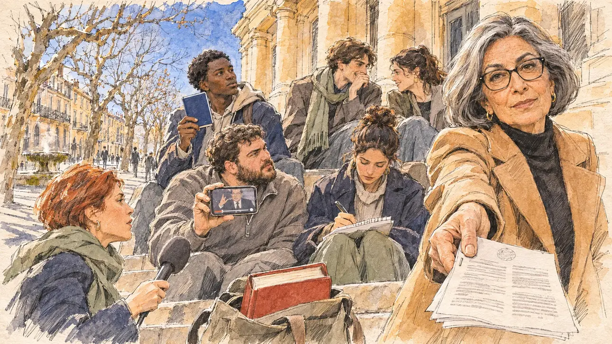

# `constitutionalRuling` · Le Conseil constitutionnel censure une loi

**Validée par le PO le 05/11/2026**, au premier essai, avec `primeTime.webp` comme référence. Elle sert telle quelle en clair et en sombre.



| Champ | Valeur |
| --- | --- |
| Carte | `constitutionalRuling`, catégorie `institutions` (Institutions), carte ajoutée par la PR #297 de l'app |
| Style | Reportage dessiné, trait de `primeTime` |
| Ton | Tendu et pédagogique |
| Date | 2026-11-05 |
| Outil | ChatGPT Images |
| Conversation | À remplir (le lien ne s'ouvre qu'avec le compte qui l'a créée) |
| Format rendu | 1672 × 941 (16:9) : export en 1290 × 726 px, WebP de qualité 75, 242 Ko, sans recadrage |
| Fichier d'origine | Image de ChatGPT, chez le PO. L'export du dépôt a été fait depuis la copie partagée dans la conversation avec Claude |
| Première édition | La prochaine Release qui suit le merge de la PR #297 de l'app |

## Texte de la carte

> **Le Conseil constitutionnel censure une loi**
>
> Le Conseil constitutionnel censure l'article central d'une loi très médiatisée. Des élus dénoncent un « gouvernement des juges » ; on vous demande si vous êtes de leur avis.

## Le moment choisi

Les marches de la faculté de droit d'Aix-en-Provence, un midi d'hiver ensoleillé, le jour de la décision, vues depuis le bas des marches où le candidat (hors champ) arrive pour rencontrer des étudiants : au premier plan, un sac d'étudiant posé sur une marche, un code relié rouge qui en dépasse. Une professeure de droit constitutionnel tend au candidat la décision imprimée, l'air amusé et exigeant, comme pour un oral. Autour : des étudiants avec leurs téléphones, où un élu s'indigne sur une petite vidéo, un étudiant qui brandit un petit livret bleu de la Constitution, une étudiante qui prend des notes, une journaliste au micro. Derrière : les platanes nus, la fontaine moussue du cours Mirabeau et les façades ocre des hôtels particuliers.

## Prompt complet

Dans une nouvelle conversation, avec [`primeTime.webp`](../../illustrations/media/primeTime.webp) comme seule image de référence.

```
Use the attached image as the style reference and copy its drawing: a realistic reportage drawing made on the spot for a newspaper, with quick, nervous pencil lines, often drawn twice, ink hatching in the shadows, transparent watercolour washes that spill a little over the lines, and the warm paper showing through. Not the same scene and not the same people: never reuse the face or the hair of the woman in the reference.
Like in the reference, the setting can be full when the story needs it, with the things that say where we are and what is happening, but each one is sketched with a few pencil lines and a light wash, never rendered or finished, and the drawing gets looser and paler towards the edges until it fades into the bare paper.
This must look like a drawing made by hand on paper by a press illustrator, halfway between a quick sketch and a realistic picture: never a photograph, a film poster or a digital painting, and never a cartoon, a comic strip, a caricature or a children's book illustration. Continuous lines, never dotted or dashed outlines; no uniform texture, speckles or hatching filter laid over the picture; no glossy highlights, no smooth gradients, in the sky and on the walls too. Colour can be rich in places, on a piece of clothing, a light or a flag, but it stays transparent and within the palette below. The fade into the paper at the edges stays narrow, without a wide white margin. No blur and no depth-of-field effect: everything, the foreground included, is drawn sharp, like a sketch made on the spot.
People are drawn from life with realistic anatomy and proportions, like in the reference: faces shaped with pencil lines, hatching and light washes, a little more finished than the background but never photographic (no photographic skin, no airbrushed or digital-painting look). Expressions stay natural and restrained, even in laughter or tears: no exaggerated grins, no wide-open mouths full of teeth, no rubbery or cartoonish faces.

Editorial illustration, landscape 16:9 (1536 × 864 px), the scene filling the frame, with only a light fade into the paper at the edges. The steps of the law faculty in Aix-en-Provence, in Provence, at midday on a sunny winter day in early 2027, the day the Constitutional Council strikes down the central article of a high-profile law: elected officials denounce a government of judges, and the player's candidate is asked whether the candidate agrees with them. The scene is seen from the bottom of the steps where the candidate arrives to meet students, who stays off-camera: in the foreground, only a student's bag on a step, a thick red-bound legal code sticking out of it. In the right third, a professor of constitutional law, a woman in her sixties of Lebanese origin, elegant and slim, with a sleek grey bob, dark-rimmed glasses and a camel coat over a black polo-neck, holds out towards the viewer the printed decision, a thin stapled document with a small round seal and columns of grey lines, with an amused, demanding look, as if setting an oral exam, her face above mid-height. Around her, sketched in pencil and light washes: law students on the steps: a young man of Comorian origin holding up a small blue booklet of the Constitution; a young woman with a high bun taking notes on her knees; a stocky student with a beard and a quarter-zip jumper showing a phone where a tiny elected official gestures angrily in a short video, with no recognisable face; a lanky student in a long scarf, laughing with a friend; a local TV journalist in her thirties with short red hair holding out a plain foam microphone. Behind them, the honey-coloured stone of the faculty with its columns, and further down the cours Mirabeau: the bare plane trees, a round moss-covered fountain steaming in the cold, and the ochre and cream façades of the old mansions with their wrought-iron balconies, under a deep blue sky. Only the professor looks straight at the viewer. Nothing on the decision, the booklet, the code, the phones, the notes, the microphone or the façades is readable, and no logo of a real TV channel, publisher or university appears.

Style: Reportage drawing made on the spot, like a press illustrator or courtroom sketch artist: pencil and ink with loose watercolour washes, lively unfinished lines, white paper showing through.

Palette: navy #13203F, vellum #F5EFE1, gold #A9802A, brick #B5523B, ochre #D9A441, sage #8FA58A, slate #5E7186, sand #DCC8A4, warm grey #8C8279; use 4 to 6 of them, subtle warm paper grain.

Tone: tense and teaching, the bright, low winter sun of Provence on the honey stone, long shadows of the plane trees, the red code and the blue booklet as the bright notes.

Constraints: realistic proportions, natural expressions, never cartoonish or caricatured faces, drawn like the rest of the illustration and never photographic; people of varied ages, genders, origins and body types (heavy, stocky, round, tall, short, wiry, not only slim), each with a distinct face and haircut (no two people alike), drawn with respect and never as a joke; anatomically correct hands with exactly five fingers, few hands visible, the others in pockets, behind objects or out of frame; no readable text anywhere (the decision, the booklet, the code, the phones, the notes, the microphone and the façades stay unreadable); no captions or speech bubbles; no logos or political party colours; no recognisable real person, no lookalike of a real politician, and no logo of a real TV channel, publisher or university; no explicit violence; no photographic rendering, no blur or bokeh, no dotted outlines, no texture or hatching filter over the picture, no oil-paint texture, no wide white margin or frame (a light fade into the paper at the edges is fine).

Format: if 16:9 is not available, make 1536 × 1024 and keep the top 80 px and the bottom 80 px free of anything important (faces, hands, the main action): they will be cropped.
```

## Décisions prises sur cette image

Aucune.

## Essais écartés

Aucun.

## Retouches

Aucune.

## Relecture

Faite et validée par le PO le 05/11/2026.

- [x] Aucun texte lisible : la décision n'a qu'un sceau rond et des lignes grises, le livret et le code n'ont pas de titre ; rien n'est lisible sur les notes, le micro ni les façades.
- [x] Aucun sosie d'une personne réelle.
- [x] Le candidat du joueur est hors champ.
- [x] Mains, visages et foules sans défaut visible à 343 px de large.
- [x] Aucune couleur ni aucun logo de parti. Des personnes variées par l'âge, le corps, l'origine et la coiffure.
- [x] En 3:2 : sans objet, l'image est en 16:9.
- [x] Lisible sur la page de l'événement, en clair et en sombre.

Ce que la relecture a accepté : sur le téléphone, l'élu de la vidéo est un homme générique à lunettes, en costume, plus grand que demandé, sans ressemblance voulue et à peine trente pixels de large à la taille de l'app ; sa main fait un geste aux doigts mal dessinés, invisible à cette taille.
