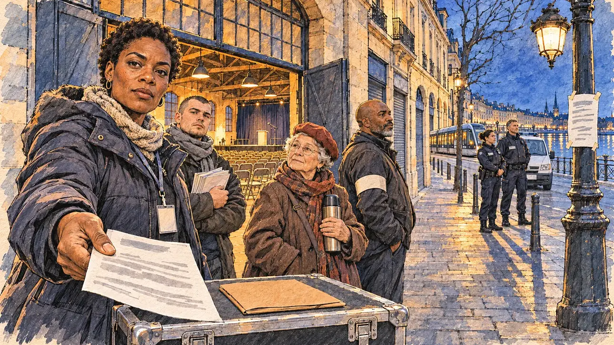

# `curfewCity` · Une ville sous arrêté

**Validée par le PO le 08/11/2026**, au premier essai, telle quelle malgré un rendu qui dérive (voir les décisions). Elle sert telle quelle en clair et en sombre.



| Champ | Valeur |
| --- | --- |
| Carte | `curfewCity`, catégorie `institutions` (Institutions) |
| Style | Reportage dessiné, le rendu tirant vers la peinture numérique (voir les décisions) |
| Ton | Tendu |
| Date | 2026-11-08 |
| Outil | ChatGPT Images, à compléter (modèle et effort) |
| Conversation | À compléter |
| Format rendu | 1672 × 941 (16:9) : export en 1290 × 726 px, WebP de qualité 75, 257 Ko, sans recadrage, fait depuis la copie WebP de la conversation (à refaire depuis le PNG d'origine) |
| Fichier d'origine | À compléter (hors du dépôt) |
| Première édition | À compléter |

## Texte de la carte

> **Une ville sous arrêté**
>
> La préfecture interdit toute manifestation et impose un couvre-feu aux mineurs dans la ville où vous tenez meeting ce soir. Votre base militante attend votre décision.

## Le moment choisi

Bordeaux à la tombée de la nuit, devant la salle du meeting, un ancien hangar des quais de la Garonne : les façades de pierre blonde, un tram, la flèche d'une église au loin, la ville qui se vide. L'arrêté préfectoral est scotché à un réverbère. Le candidat est hors champ : la chemise cartonnée de son discours est posée sur une caisse de matériel. La coordinatrice locale lui tend une copie de l'arrêté et attend sa décision ; un jeune militant, une militante retraitée et un bénévole du service d'ordre attendent avec elle ; de l'autre côté de la rue, deux policiers calmes près d'un fourgon. Une femme tient le rôle principal, un rôle de décision : les quatre autres cartes du mouvement social mettaient un homme au premier plan.

## Prompt complet

Dans une nouvelle conversation, avec [`primeTime.webp`](../../illustrations/media/primeTime.webp) comme seule image de référence :

```
Use the attached image as the style reference and copy its drawing: a realistic reportage drawing made on the spot for a newspaper, with quick, nervous pencil lines, often drawn twice, ink hatching in the shadows, transparent watercolour washes that spill a little over the lines, and the warm paper showing through. Not the same scene and not the same people: never reuse the face or the hair of the woman in the reference.
Like in the reference, the setting can be full when the story needs it, with the things that say where we are and what is happening, but each one is sketched with a few pencil lines and a light wash, never rendered or finished, and the drawing gets looser and paler towards the edges until it fades into the bare paper.
This must look like a drawing made by hand on paper by a press illustrator, halfway between a quick sketch and a realistic picture: never a photograph, a film poster or a digital painting, and never a cartoon, a comic strip, a caricature or a children's book illustration. Continuous lines, never dotted or dashed outlines; no uniform texture, speckles or hatching filter laid over the picture; no glossy highlights, no smooth gradients, in the sky and on the walls too. Colour can be rich in places, on a piece of clothing, a light or a flag, but it stays transparent and within the palette below. The fade into the paper at the edges stays narrow, without a wide white margin. No blur and no depth-of-field effect: everything, the foreground included, is drawn sharp, like a sketch made on the spot.
People are drawn from life with realistic anatomy and proportions, like in the reference: faces shaped with pencil lines, hatching and light washes, a little more finished than the background but never photographic (no photographic skin, no airbrushed or digital-painting look). Expressions stay natural and restrained, even in laughter or tears: no exaggerated grins, no wide-open mouths full of teeth, no rubbery or cartoonish faces.

Editorial illustration, landscape 16:9 (1536 × 864 px), the scene filling the frame, with only a light fade into the paper at the edges. Bordeaux at nightfall, on a cold evening in 2027, in front of the meeting hall, a former warehouse on the quays of the Garonne: the long blond limestone façades along the river, a tram gliding past, shop shutters half pulled down, the street emptying. The prefect has banned every demonstration and set a curfew on minors in the city tonight: a sheet of the prefectural order is taped to a lamp post, unreadable. Through the hall's open doors, rows of folding chairs and a small stage under warm lights. The player's candidate stays off-camera: in the foreground, only the cardboard folder of the candidate's speech lying on a flight case, unreadable. In the left third, the campaign's local coordinator, a woman in her late thirties of Cameroonian descent, tall and solid, with short natural hair and a padded parka with a lanyard, holds out a printed copy of the order towards the viewer and waits for a decision, looking at the viewer with a calm, questioning face, her face above mid-height. Around her, the activists wait too: a stocky young man in his twenties of European descent, with a buzz cut and a scarf, holds a stack of leaflets against his chest and looks at the viewer; a small, round retired activist in her seventies of European descent, with a red beret and a long coat, holds a thermos of coffee and looks at the coordinator; a broad volunteer steward in his forties of Antillean descent, with a shaved head and a short greying beard, wears a plain armband and glances at the street. Across the street, by a police van with its lights off, two calm police officers stand and watch: a woman in her thirties of Algerian descent with her hair tied back, and a tall man in his forties of European descent. The cold blue of the dusk sky against the warm light of the hall and the street lamps. Nothing on the order, the folder, the leaflets, the armband, the tram or the van is readable.

Style: Reportage drawing made on the spot, like a press illustrator or courtroom sketch artist: pencil and ink with loose watercolour washes, lively unfinished lines, white paper showing through.

Palette: navy #13203F, vellum #F5EFE1, gold #A9802A, brick #B5523B, ochre #D9A441, sage #8FA58A, slate #5E7186, sand #DCC8A4, warm grey #8C8279; use 4 to 6 of them, subtle warm paper grain.

Tone: tense, early evening, the cold blue light of dusk against the warm light from the hall's open doors and the street lamps, long hard shadows.

Constraints: realistic proportions, natural expressions, never cartoonish or caricatured faces, drawn like the rest of the illustration and never photographic; people of varied ages, genders, origins and body types (heavy, stocky, round, tall, short, wiry, not only slim), each with a distinct face and haircut (no two people alike), drawn with respect and never as a joke; each person's age, build and look plausible for their role and the scene, no stereotype tying an origin or a gender to a role, and no person of colour shown alone in a featured service or deferential role; no minors in the picture; anatomically correct hands with exactly five fingers, few hands visible, the others in pockets, behind objects or out of frame; no readable text anywhere (the order, the folder, the leaflets, the armband, the tram and the van stay unreadable); no captions or speech bubbles; no logos, no trade-union or political party colours; no recognisable real person, no lookalike of a real politician; no violence, no weapons drawn; no photographic rendering, no blur or bokeh, no dotted outlines, no texture or hatching filter over the picture, no oil-paint texture, no wide white margin or frame (a light fade into the paper at the edges is fine).

Format: if 16:9 is not available, make 1536 × 1024 and keep the top 80 px and the bottom 80 px free of anything important (faces, hands, the main action): they will be cropped.
```

## Décisions prises sur cette image

- **Validée telle quelle, malgré un rendu qui dérive** (PO, 08/11/2026). Une trame uniforme de hachures et de mouchetures couvre toute l'image (parka, pierre, ciel), et le ciel nuit saturé, les ors et le modelé lisse tirent vers la peinture numérique, plus loin de [`primeTime`](../media/primeTime.md) que les quatre autres cartes du mouvement social. Le message de correction du gabarit, complété comme pour [`familyJob`](../affair/familyJob.md) (aucune texture mouchetée, un ciel en lavis léger), a été proposé et n'a pas été envoyé : le PO a gardé l'image.
- Aucun mineur à l'image, aucune violence : les deux policiers attendent, calmes, sans arme sortie.

## Essais écartés

Aucun.

## Retouches

Aucune.

## Relecture

Faite et validée par le PO le 08/11/2026.

- [x] Aucun texte lisible : l'arrêté, en main et sur le réverbère, n'est fait que de traits gris ; le dossier, le badge, les insignes des policiers et la plaque du fourgon sont vierges.
- [x] Aucun sosie d'une personne réelle.
- [x] Le candidat du joueur est hors champ : seule la chemise de son discours, sur la caisse.
- [x] Mains, visages et foules sans défaut visible à 343 px de large.
- [x] Aucune couleur ni aucun logo de parti. Des personnes variées par l'âge, le corps, l'origine et la coiffure, sans rôle assigné par l'origine.
- [x] En 16:9 : pas de recadrage.
- [ ] Lisible sur la page de l'événement, en clair et en sombre : à vérifier dans l'app, une fois la carte publiée ; le rendu plus saturé est à comparer avec les autres cartes.
