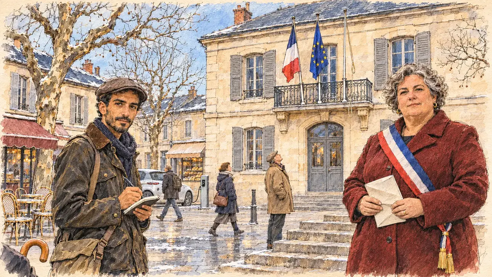

# `flagRemoved` · Le drapeau de la mairie

**Validée par le PO le 27/11/2026**, au premier essai. Elle sert telle quelle en clair et en sombre.



| Champ | Valeur |
| --- | --- |
| Carte | `flagRemoved`, catégorie `institutions` (Institutions), poids 0,15 ; carte ajoutée avec Gaza dans la campagne (Mitchnsun/moi-president#563) |
| Style | Reportage dessiné, trait et texture de `primeTime` |
| Ton | Observateur, fin de matinée |
| Date | 2026-11-27 |
| Outil | ChatGPT Images |
| Format rendu | 1672 × 941 (16:9) : export en 1290 × 726 px, WebP de qualité 75, 255 Ko, sans recadrage |
| Fichier d'origine | Image de ChatGPT, chez le PO. L'export du dépôt a été fait depuis la copie partagée dans la conversation avec Claude |
| Première édition | La prochaine Release qui suit le merge de Mitchnsun/moi-president#563 |

## Texte de la carte

> **Le drapeau de la mairie**
>
> La maire de la ville où vous tenez meeting a hissé le drapeau palestinien au fronton de sa mairie. La préfecture lui demande de le retirer au nom de la neutralité du service public, et la presse vous demande votre avis.

Ses réponses : rappeler la neutralité du service public ; soutenir la maire contre la préfecture ; proposer les deux drapeaux côte à côte, pour la paix ; ne pas commenter une affaire locale.

## Le moment choisi

La place de la mairie d'une petite ville française ordinaire, sans région marquée (PO, 27/11/2026), en fin de matinée d'hiver : une mairie de pierre crème aux volets gris, un café, une boulangerie, des platanes nus, une voiture électrique à sa borne. Au balcon, les drapeaux français et européen, et un mât vide dont la corde pend : le troisième drapeau vient d'être décroché. La maire, écharpe tricolore, tient la lettre de la préfecture et regarde le spectateur ; un correspondant de presse locale prend des notes ; un passant lève les yeux vers le mât vide. Le candidat du joueur est hors champ : le manche de son parapluie au premier plan.

## Prompt complet

Dans une nouvelle conversation, avec [`primeTime.webp`](../../illustrations/media/primeTime.webp) comme seule image de référence :

```
Use the attached image as the style reference and copy its drawing: a realistic reportage drawing made on the spot for a newspaper, with quick, nervous pencil lines, often drawn twice, ink hatching in the shadows, transparent watercolour washes that spill a little over the lines, and the warm paper showing through. Take from the reference its line, its washes and its paper, not the finish of the presenter's face, which is the most finished and almost photographic part of it: every face here stays a drawing. Not the same scene and not the same people: never reuse the face or the hair of the woman in the reference.
Like in the reference, the setting can be full when the story needs it, with the things that say where we are and what is happening, but each one is sketched with a few pencil lines and a light wash, never rendered or finished, and the drawing gets looser and paler towards the edges until it fades into the bare paper.
This must look like a drawing made by hand on paper by a press illustrator, halfway between a quick sketch and a realistic picture: never a photograph, a film poster or a digital painting, and never a cartoon, a comic strip, a caricature or a children's book illustration. Continuous lines, never dotted or dashed outlines; the fine mottled grain of the reference is welcome, as long as the pencil lines and the washes stay clearly visible under it, but never a heavy texture, an oil-paint look or a hatching filter laid over a finished picture; no glossy highlights, no smooth gradients, in the sky and on the walls too. Colour can be rich in places, on a piece of clothing, a light or a flag, but it stays transparent and within the palette below. The fade into the paper at the edges stays narrow, without a wide white margin. No blur and no depth-of-field effect: everything, the foreground included, is drawn sharp, like a sketch made on the spot.
People are drawn from life with realistic anatomy and proportions: each face is drawn with the same visible pencil and ink lines, hatching and transparent washes as the clothes and the room, looser and sketchier than the presenter's face in the reference, with realistic features but never photographic (no photographic skin, no smooth shading, no airbrushed or digital-painting look). Expressions stay natural and restrained, even in laughter or tears: no exaggerated grins, no wide-open mouths full of teeth, no rubbery or cartoonish faces.

Editorial illustration, landscape 16:9 (1536 × 864 px), the scene filling the frame, with only a light fade into the paper at the edges. Late morning in winter 2027 on the square in front of the town hall of an ordinary small French town, with no regional architecture: a plain town hall of cream-coloured stone with grey shutters and a small balcony, a café with a few chairs on the pavement, a bakery, bare plane trees, a parked electric car. On the town hall's balcony hang the French flag and the European flag, and beside them an empty flagpole, its rope loose: a third flag has just been taken down, and nothing hangs there. The player's candidate stays off-camera, the scene seen from where they stand: in the bottom-left foreground, only the curved wooden handle of their closed umbrella. In the right third, on the town hall's steps, the main character, the mayor, a woman in her mid-fifties, white, heavy-set, grey curly hair cut short, a dark red wool coat, a French tricolour sash across her chest, holds a folded official letter with an unreadable letterhead in one hand and looks straight at the viewer, calm and determined, her face above mid-height. On the left, a local press correspondent, a man in his thirties of Moroccan origin, wiry, a neat short beard, a flat cap, a waxed jacket, takes notes in a small notebook and looks at the viewer, waiting for an answer. In the background, two or three townspeople cross the square, one stopping to look up at the empty flagpole. Nothing on the letter, the notebook, the town hall or the shops is readable.

Style: Reportage drawing made on the spot, like a press illustrator or courtroom sketch artist: pencil and ink with loose watercolour washes, lively unfinished lines, white paper showing through.

Palette: navy #13203F, vellum #F5EFE1, gold #A9802A, brick #B5523B, ochre #D9A441, sage #8FA58A, slate #5E7186, sand #DCC8A4, warm grey #8C8279; use 4 to 6 of them, subtle warm paper grain.

Tone: observant and neutral, soft late-morning light, mild shadows.

Constraints: realistic proportions, natural expressions, never cartoonish or caricatured faces, drawn like the rest of the illustration and never photographic; people of varied ages, genders, origins and body types (heavy, stocky, round, tall, short, wiry, not only slim), each with a distinct face and haircut (no two people alike), drawn with respect and never as a joke; each person's age, build and look plausible for their job and the scene (working people of working age), no stereotype tying an origin or a gender to a role, and no person of colour shown alone in a featured service or deferential role; anatomically correct hands with exactly five fingers, few hands visible, the others in pockets, behind objects or out of frame; no readable text anywhere (the letter, the notebook, the town hall and the shop signs stay unreadable); no captions or speech bubbles; no logos or political party colours; no flag other than the French and the European flags on the balcony: no Palestinian flag, no Israeli flag, no other national flag anywhere, folded or hanging; no keffiyeh, no religious symbol; no recognisable real person, no lookalike of a real politician or of a real mayor; no violence; no photographic rendering, no blur or bokeh, no dotted outlines, no heavy texture or hatching filter over a finished picture (the fine grain of the reference is fine), no oil-paint texture, no wide white margin or frame (a light fade into the paper at the edges is fine).

Format: if 16:9 is not available, make 1536 × 1024 and keep the top 80 px and the bottom 80 px free of anything important (faces, hands, the main action): they will be cropped.
```

## Décisions prises sur cette image

- Le drapeau palestinien n'est pas dans l'image (PO, 27/11/2026) : le mât vide dit le retrait. Le lieu est une petite ville sans région marquée, à la demande du PO, au lieu du Pays basque d'abord proposé.

## Essais écartés

Aucun.

## Retouches

Aucune.

## Relecture

Faite par Claude le 27/11/2026 et validée par le PO le même jour.

- [x] Aucun texte lisible : la lettre, le carnet, la mairie, les vitrines.
- [x] Seuls les drapeaux français et européen, et le mât vide ; aucun autre drapeau ni symbole.
- [x] Aucun sosie d'une personne réelle relevé.
- [x] Le candidat du joueur est hors champ ; seul le manche de son parapluie est au premier plan.
- [x] Mains sans défaut visible (la lettre, le stylo et le carnet).
- [x] Aucune couleur ni aucun logo de parti ; l'écharpe tricolore signale l'élue. Des personnes variées par l'âge, le corps, l'origine et la coiffure.
- [x] En 16:9 : pas de recadrage.
- [ ] Lisible sur la page de l'événement, en clair et en sombre : à voir dans l'app.
