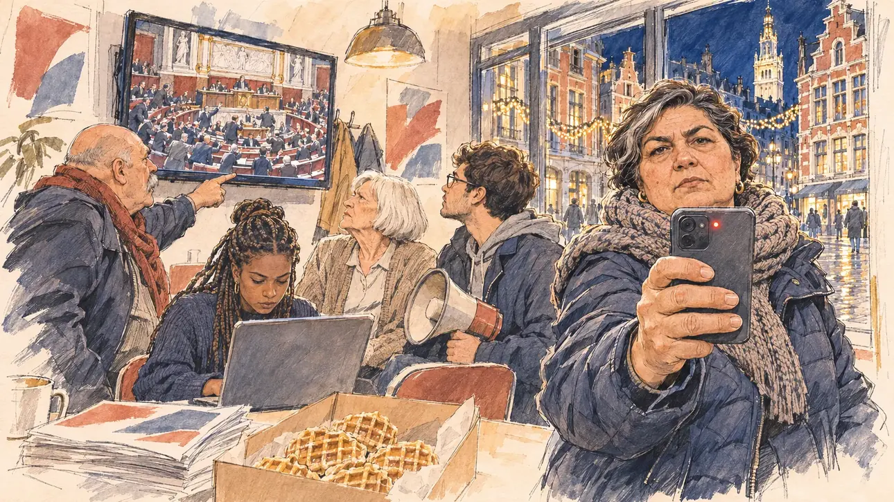

# `forcedBudget` · Le budget et le 49.3

**À générer.** Prompt prêt le 05/11/2026, pas encore d'image validée.



| Champ | Valeur |
| --- | --- |
| Carte | `forcedBudget`, catégorie `institutions` (Institutions), carte ajoutée par la PR #297 de l'app |
| Style | Reportage dessiné, trait de `primeTime` |
| Ton | Tendu et combatif |
| Date | À remplir |
| Outil | ChatGPT Images |
| Conversation | À remplir (le lien ne s'ouvre qu'avec le compte qui l'a créée) |
| Format rendu | À remplir |
| Fichier d'origine | À remplir |
| Première édition | À remplir |

## Texte de la carte

> **Le budget et le 49.3**
>
> À l'Assemblée, le budget de l'an prochain n'a pas de majorité : le gouvernement menace de l'imposer par le 49.3. Vos partisans vous demandent de réagir.

## Le moment choisi

La permanence de campagne du candidat dans le Vieux-Lille, un soir de décembre, vue depuis le seuil où le candidat (hors champ) arrive : au premier plan, une pile de tracts et une boîte de gaufres fourrées entamée. Une militante tend vers le candidat son téléphone, prêt à filmer sa réaction pour les réseaux, la petite lumière rouge allumée. Autour : les militants rassemblés devant la télévision qui montre l'hémicycle de l'Assemblée en pleine agitation, un syndicaliste qui s'indigne, un étudiant qui écrit sur son ordinateur, une retraitée qui secoue la tête. Par la vitrine : les façades de brique et de pierre sculptée du Vieux-Lille, les guirlandes de Noël et le beffroi de l'hôtel de ville illuminé.

## Prompt complet

Dans une nouvelle conversation, avec [`primeTime.webp`](../../illustrations/media/primeTime.webp) comme seule image de référence.

```
Use the attached image as the style reference and copy its drawing: a realistic reportage drawing made on the spot for a newspaper, with quick, nervous pencil lines, often drawn twice, ink hatching in the shadows, transparent watercolour washes that spill a little over the lines, and the warm paper showing through. Not the same scene and not the same people: never reuse the face or the hair of the woman in the reference.
Like in the reference, the setting can be full when the story needs it, with the things that say where we are and what is happening, but each one is sketched with a few pencil lines and a light wash, never rendered or finished, and the drawing gets looser and paler towards the edges until it fades into the bare paper.
This must look like a drawing made by hand on paper by a press illustrator, halfway between a quick sketch and a realistic picture: never a photograph, a film poster or a digital painting, and never a cartoon, a comic strip, a caricature or a children's book illustration. Continuous lines, never dotted or dashed outlines; no uniform texture, speckles or hatching filter laid over the picture; no glossy highlights, no smooth gradients, in the sky and on the walls too. Colour can be rich in places, on a piece of clothing, a light or a flag, but it stays transparent and within the palette below. The fade into the paper at the edges stays narrow, without a wide white margin. No blur and no depth-of-field effect: everything, the foreground included, is drawn sharp, like a sketch made on the spot.
People are drawn from life with realistic anatomy and proportions, like in the reference: faces shaped with pencil lines, hatching and light washes, a little more finished than the background but never photographic (no photographic skin, no airbrushed or digital-painting look). Expressions stay natural and restrained, even in laughter or tears: no exaggerated grins, no wide-open mouths full of teeth, no rubbery or cartoonish faces.

Editorial illustration, landscape 16:9 (1536 × 864 px), the scene filling the frame, with only a light fade into the paper at the edges. The local campaign office of the player's candidate in Vieux-Lille, in the North, on an evening in mid-December 2026: at the National Assembly, next year's budget has no majority, the government threatens to force it through with Article 49.3, and the candidate's supporters ask the candidate to react. The scene is seen from the doorway where the candidate arrives, who stays off-camera: in the foreground, only a pile of leaflets and an open box of filled waffles on a table. In the right third, a local activist, a woman in her fifties of Turkish origin, stocky and energetic, with short dark hair streaked with grey, a thick knitted scarf and a padded jacket, holds out her phone towards the viewer, turned round to film the candidate's reaction for the social networks, so that only the back of the phone, its camera lens and a small red recording light can be seen, with a determined, impatient look, her face above mid-height. Around her, sketched in pencil and light washes: the activists gathered in front of a television on the wall showing the semicircular chamber of the National Assembly in uproar, deputies on their feet and banging their desks, the government bench seen from far away with tiny figures and no recognisable face; a union activist in his sixties, heavy and bald, with a grey moustache, pointing angrily at the screen; a student of Comorian origin with braids, typing fast on her laptop; a retired woman with a white bob and a cardigan shaking her head; a young man with glasses holding a megaphone he has not switched on; posters on the walls with only shapes and colours. Through the shop window, the street of Vieux-Lille at night: tall Flemish façades of red brick and carved pale stone with garlands of Christmas lights, wet cobbles shining, and above the roofs the tall lit belfry of the town hall. Only the activist with the phone looks straight at the viewer. Nothing on the phone, the television, the leaflets, the posters, the laptop or the shop fronts is readable, and no party colour or logo of a real TV channel or company appears.

Style: Reportage drawing made on the spot, like a press illustrator or courtroom sketch artist: pencil and ink with loose watercolour washes, lively unfinished lines, white paper showing through.

Palette: navy #13203F, vellum #F5EFE1, gold #A9802A, brick #B5523B, ochre #D9A441, sage #8FA58A, slate #5E7186, sand #DCC8A4, warm grey #8C8279; use 4 to 6 of them, subtle warm paper grain.

Tone: tense and combative, the warm light of the office against the deep blue December night, the blue-grey glow of the television, the small red recording light of the phone and the Christmas garlands outside.

Constraints: realistic proportions, natural expressions, never cartoonish or caricatured faces, drawn like the rest of the illustration and never photographic; people of varied ages, genders, origins and body types (heavy, stocky, round, tall, short, wiry, not only slim), each with a distinct face and haircut (no two people alike), drawn with respect and never as a joke; anatomically correct hands with exactly five fingers, few hands visible, the others in pockets, behind objects or out of frame; no readable text anywhere (the phone, the television, the leaflets, the posters, the laptop and the shop fronts stay unreadable); no captions or speech bubbles; no logos or political party colours; no recognisable real person, no lookalike of a real politician, and no logo of a real TV channel or company; no explicit violence; no photographic rendering, no blur or bokeh, no dotted outlines, no texture or hatching filter over the picture, no oil-paint texture, no wide white margin or frame (a light fade into the paper at the edges is fine).

Format: if 16:9 is not available, make 1536 × 1024 and keep the top 80 px and the bottom 80 px free of anything important (faces, hands, the main action): they will be cropped.
```

## Décisions prises sur cette image

Aucune pour l'instant.

## Essais écartés

Aucun pour l'instant.

## Retouches

Aucune.

## Relecture

À faire sur l'image validée.
