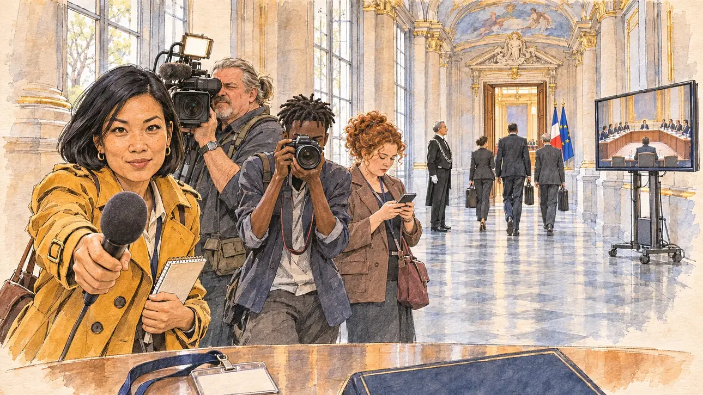

# `foreignHost` · Les données de santé hébergées ailleurs

**Validée par le PO le 18/11/2026**, au premier essai. Elle sert telle quelle en clair et en sombre.



| Champ | Valeur |
| --- | --- |
| Carte | `foreignHost`, catégorie `institutions` (Institutions), poids 0,1, toute semaine, un peu plus souvent pour une position antisystème (`leaning`, système 0,3) (Mitchnsun/moi-president, PO, 17/11/2026) |
| Style | Reportage dessiné |
| Ton | Observateur, une galerie de palais sous une lumière d’après-midi |
| Date | 2026-11-18 |
| Outil | ChatGPT Images |
| Conversation | À remplir (le lien ne s'ouvre qu'avec le compte qui l'a créée) |
| Format rendu | 1672 × 941 (16:9) : export en 1290 × 726 px, WebP de qualité 75, 190 Ko, sans recadrage, fait depuis la copie WebP de la conversation |
| Fichier d'origine | Image de ChatGPT, chez le PO. L'export du dépôt a été fait depuis la copie partagée dans la conversation avec Claude |
| Première édition | `kit-france-2611-0004` |

## Texte de la carte

> **Les données de santé hébergées ailleurs**
>
> Un hébergeur étranger vient de remporter les données d'un fichier public de santé. Devant une commission du Parlement, son responsable juridique a reconnu ne pas pouvoir garantir qu'elles ne seraient jamais transmises à une autorité étrangère. Les journalistes vous demandent si l'État doit changer d'hébergeur.

## Le moment choisi

Au Sénat, au palais du Luxembourg, un après-midi d'avril : la galerie de pierre et de dorures qui mène aux salles de commission, des huissiers en habit à l'arrière, et sur un écran de retransmission la salle de l'audition, une table en U et un témoin vu de loin. Le candidat reste hors champ : seul le bord de son dossier de notes, au premier plan, et son badge visiteur. Une journaliste lui tend son micro et le regarde : l'État doit-il changer d'hébergeur ? Derrière elle, un caméraman, un photographe, un jeune journaliste qui tape sur son téléphone. Au fond, le responsable juridique de l'hébergeur s'éloigne, de dos, avec ses conseils. Le précédent est l'audition du Sénat de juin 2025 : personne n'y ressemble à un témoin ou à un sénateur réel.

## Prompt complet

Dans une nouvelle conversation, avec [`primeTime.webp`](../../illustrations/media/primeTime.webp) comme seule image de référence :

```
Use the attached image as the style reference and copy its drawing: a realistic reportage drawing made on the spot for a newspaper, with quick, nervous pencil lines, often drawn twice, ink hatching in the shadows, transparent watercolour washes that spill a little over the lines, and the warm paper showing through. Not the same scene and not the same people: never reuse the face or the hair of the woman in the reference.
Like in the reference, the setting can be full when the story needs it, with the things that say where we are and what is happening, but each one is sketched with a few pencil lines and a light wash, never rendered or finished, and the drawing gets looser and paler towards the edges until it fades into the bare paper.
This must look like a drawing made by hand on paper by a press illustrator, halfway between a quick sketch and a realistic picture: never a photograph, a film poster or a digital painting, and never a cartoon, a comic strip, a caricature or a children's book illustration. Continuous lines, never dotted or dashed outlines; no uniform texture, speckles or hatching filter laid over the picture; no glossy highlights, no smooth gradients, in the sky and on the walls too. Colour can be rich in places, on a piece of clothing, a light or a flag, but it stays transparent and within the palette below. The fade into the paper at the edges stays narrow, without a wide white margin. No blur and no depth-of-field effect: everything, the foreground included, is drawn sharp, like a sketch made on the spot.
People are drawn from life with realistic anatomy and proportions, like in the reference: faces shaped with pencil lines, hatching and light washes, a little more finished than the background but never photographic (no photographic skin, no airbrushed or digital-painting look). Expressions stay natural and restrained, even in laughter or tears: no exaggerated grins, no wide-open mouths full of teeth, no rubbery or cartoonish faces.

Editorial illustration, landscape 16:9 (1536 × 864 px), the scene filling the frame, with only a light fade into the paper at the edges. A gallery of the French Senate in the Luxembourg Palace in Paris, on an April afternoon in 2027: stone columns, gilded mouldings, a high painted ceiling only sketched, tall windows letting in a pale light, a tricolour flag and a European flag by a carved doorway leading to the committee rooms. On a broadcast screen on a stand, the hearing room is shown from afar: a U-shaped table and a small witness at the end, with no text on the screen. The player's candidate stays off-camera: in the foreground, only the edge of the candidate's folder of notes and a blank visitor's badge on a lanyard. In the left third, a political journalist, a woman in her thirties of Cambodian descent, small and energetic, with a sleek black bob and a mustard trench coat, holds out a microphone towards the viewer and looks straight at the viewer, waiting for an answer, her face above mid-height. Behind her: a burly white cameraman in his fifties with a grey ponytail and a television camera on his shoulder; a lanky photographer in his twenties of Ivorian descent with short twists and a camera raised; a round young journalist with red curly hair typing on her phone. At the far end of the gallery, seen from behind, the foreign host's legal officer, a tall man in a dark suit, walks away with two counsel carrying briefcases; an usher in a black tailcoat and silver chain stands near the door. Only the journalist with the microphone looks at the viewer; the photographer aims at the viewer through his camera; the others look away. Nothing on the screen, the badge, the folder, the microphone or the phones is readable.

Style: Reportage drawing made on the spot, like a press illustrator or courtroom sketch artist: pencil and ink with loose watercolour washes, lively unfinished lines, white paper showing through.

Palette: navy #13203F, vellum #F5EFE1, gold #A9802A, brick #B5523B, ochre #D9A441, sage #8FA58A, slate #5E7186, sand #DCC8A4, warm grey #8C8279; use 4 to 6 of them, subtle warm paper grain.

Tone: observant, a pale afternoon light through the tall windows on the stone and the gilding, the press cluster in warmer colours in the foreground, the small figures walking away in the cool distance.

Constraints: realistic proportions, natural expressions, never cartoonish or caricatured faces, drawn like the rest of the illustration and never photographic; people of varied ages, genders, origins and body types (heavy, stocky, round, tall, short, wiry, not only slim), each with a distinct face and haircut (no two people alike), drawn with respect and never as a joke; each person's age, build and look plausible for their job and the scene (working people of working age), no stereotype tying an origin or a gender to a role, and no person of colour shown alone in a featured service or deferential role; anatomically correct hands with exactly five fingers, few hands visible, the others in pockets, behind objects or out of frame; no readable text anywhere (the screen, the badge, the folder, the microphone and the phones stay unreadable, no channel name, no committee name, no name plates); no captions or speech bubbles; no logos, no tech company logo, no television channel logo on the camera or the microphone, no political party colours, no flags other than the tricolour and European flags by the doorway; no recognisable real person, no lookalike of a real politician, of a real senator, of a real tech executive or of a known journalist; no explicit violence; no photographic rendering, no blur or bokeh, every outline a continuous pencil or ink line with no dotted or dashed outlines, no mottled, crackled or speckled texture over the faces, the clothes, the stone, the gilding or the sky, no hatching filter over the picture, no oil-paint texture, no glow or halo, no wide white margin or frame (a light fade into the paper at the edges is fine).

Format: if 16:9 is not available, make 1536 × 1024 and keep the top 80 px and the bottom 80 px free of anything important (faces, hands, the main action): they will be cropped.
```

## Décisions prises sur cette image

Retenue telle quelle par le PO (18/11/2026). Les visages du premier plan sont plus finis que dans la référence, sans filtre marqué ; la journaliste sourit légèrement plutôt que d'attendre. Le responsable juridique s'éloigne avec trois conseils, dont une femme, et le dossier du candidat est posé sur une table au premier plan.

## Essais écartés

Aucun.

## Retouches

Aucune.

## Relecture

Faite le 18/11/2026, validée par le PO le même jour.

- [x] Aucun texte lisible : l'écran ne montre que la table de l'audition ; badge vierge, carnet, micro, caméra et téléphones sans inscription.
- [x] Aucun sosie d'une personne réelle repéré.
- [x] Le candidat du joueur est hors champ : seuls son dossier et son badge visiteur, au premier plan.
- [x] Mains et visages sans défaut visible à 343 px de large : la main au micro, celles du caméraman, du photographe et de la journaliste au téléphone.
- [x] Aucune couleur, aucun logo ni aucun drapeau de parti ; seuls les drapeaux tricolore et européen du Sénat. Des personnes variées par l'âge, le corps, l'origine et la coiffure.
- [x] En 16:9 : pas de recadrage.
- [ ] Lisible sur la page de l'événement, en clair et en sombre : à vérifier dans l'app, une fois la carte publiée.
