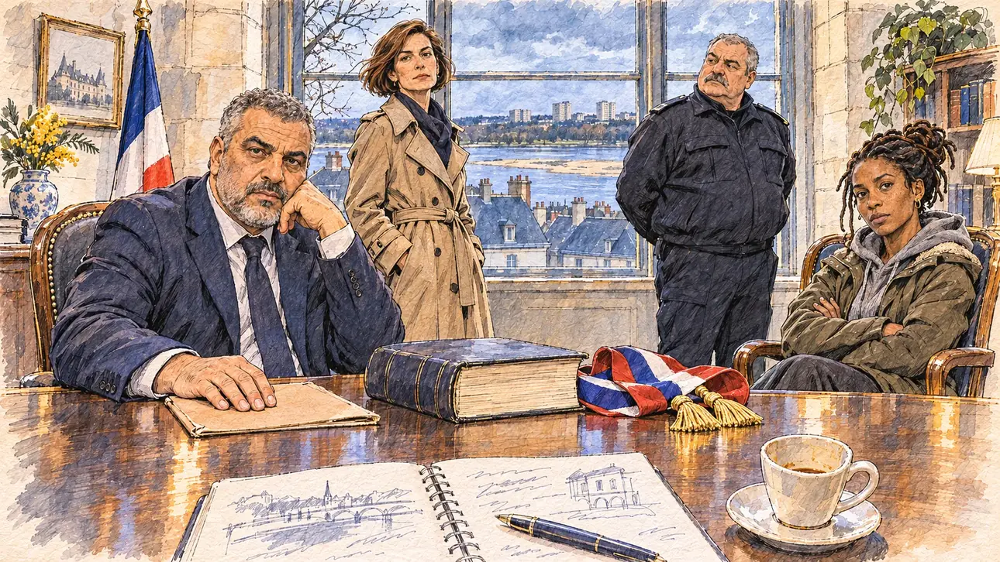

# `narcoDecrees` · Les décrets se font attendre

**Validée par le PO le 20/11/2026**, au premier essai, avec `primeTime.webp` comme référence. Elle sert telle quelle en clair et en sombre.



| Champ | Valeur |
| --- | --- |
| Carte | `narcoDecrees`, catégorie `institutions` (Institutions), poids 0,2, à partir de l'officialisation, une carte du programme : tirée si le programme tient une mesure de sécurité (`narcoEmergency`, `policeJusticeMeans`, `morePoliceOnStreets`, `municipalPolice`) (Mitchnsun/moi-president, PO, 17/11/2026) |
| Style | Reportage dessiné, trait de `primeTime` |
| Ton | Observateur et tendu, lumière claire et froide du matin |
| Date | 2026-11-20 (prompt écrit le 2026-11-18) |
| Outil | GPT 6.2 Astra |
| Conversation | À remplir (le lien ne s'ouvre qu'avec le compte qui l'a créée) |
| Format rendu | 1672 × 941 (16:9) : export en 1290 × 726 px, WebP de qualité 75, 242 Ko, sans recadrage |
| Fichier d'origine | Image chez le PO. L'export du dépôt a été fait depuis la copie partagée dans la conversation avec Claude |
| Première édition | `kit-france-2611-0004` |

## Texte de la carte

> **Les décrets se font attendre**
>
> Le maire d'une ville moyenne touchée par le trafic de drogue vous reçoit : une loi contre le narcotrafic a été votée, mais plusieurs de ses décrets d'application se font attendre, et les crédits de prévention baissent. Il vous demande s'il faut un régime d'exception, ou simplement que l'État applique ce qu'il a voté.

## Le moment choisi

Le bureau du maire d'une ville moyenne de Touraine qu'on ne nomme pas, un matin de mars : murs de tuffeau blanc, drapeau tricolore, et par la fenêtre les toits d'ardoise de la vieille ville, la Loire et, au-delà, les tours d'un quartier. Le candidat est assis face au bureau, hors champ : au premier plan, son carnet et une tasse de café. Le maire a posé côte à côte la loi votée, un épais volume relié, et une chemise presque vide, celle des décrets : il regarde le candidat, entre fatigue et défi. Autour : son adjointe à la sécurité, le chef de la police municipale, et une éducatrice de rue venue dire que les crédits de prévention baissent. La carte rappelle la loi contre le narcotrafic du 13 juin 2025 et ses décrets en retard : la ville est inventée, et personne n'y ressemble à un maire connu.

## Prompt complet

Dans une nouvelle conversation, avec [`primeTime.webp`](../../illustrations/media/primeTime.webp) comme seule image de référence :

```
Use the attached image as the style reference and copy its drawing: a realistic reportage drawing made on the spot for a newspaper, with quick, nervous pencil lines, often drawn twice, ink hatching in the shadows, transparent watercolour washes that spill a little over the lines, and the warm paper showing through. Not the same scene and not the same people: never reuse the face or the hair of the woman in the reference.
Like in the reference, the setting can be full when the story needs it, with the things that say where we are and what is happening, but each one is sketched with a few pencil lines and a light wash, never rendered or finished, and the drawing gets looser and paler towards the edges until it fades into the bare paper.
This must look like a drawing made by hand on paper by a press illustrator, halfway between a quick sketch and a realistic picture: never a photograph, a film poster or a digital painting, and never a cartoon, a comic strip, a caricature or a children's book illustration. Continuous lines, never dotted or dashed outlines; no uniform texture, speckles or hatching filter laid over the picture; no glossy highlights, no smooth gradients, in the sky and on the walls too. Colour can be rich in places, on a piece of clothing, a light or a flag, but it stays transparent and within the palette below. The fade into the paper at the edges stays narrow, without a wide white margin. No blur and no depth-of-field effect: everything, the foreground included, is drawn sharp, like a sketch made on the spot.
People are drawn from life with realistic anatomy and proportions, like in the reference: faces shaped with pencil lines, hatching and light washes, a little more finished than the background but never photographic (no photographic skin, no airbrushed or digital-painting look). Expressions stay natural and restrained, even in laughter or tears: no exaggerated grins, no wide-open mouths full of teeth, no rubbery or cartoonish faces.

Editorial illustration, landscape 16:9 (1536 × 864 px), the scene filling the frame, with only a light fade into the paper at the edges. The mayor's office in the town hall of a mid-sized town in Touraine, in the Loire valley, on a cold, clear morning in March 2027: walls of white tufa stone, a tall window, a French tricolour flag on its pole, a wide wooden desk, and through the window the slate roofs of the old town, the broad Loire with its sandbanks and, beyond the river, the towers of a housing estate. The mayor receives the player's candidate about drug trafficking in his town. The player's candidate sits facing the desk and stays off-camera: in the foreground, only the candidate's notebook and a cup of coffee on the edge of the desk. On the desk, side by side: a thick bound volume, the law that was passed, and a thin, almost empty cardboard folder, the decrees that have not come. In the left third, the main character, the mayor, a man in his early fifties of Algerian descent, broad and stocky, with short grey hair and a trimmed grey beard, in a navy suit with a tricolour sash rolled up on the desk beside him, rests one hand on the thin folder and looks at the viewer with a tired, challenging look, his face above mid-height. Around: his deputy for public safety, a tall white woman in her forties with a sharp chestnut bob and a trench coat, stands by the window, looking at the viewer; the head of the municipal police, a heavy-set white man in his fifties with a grey moustache, in a dark uniform, stands with his hands behind his back, looking at the mayor; on a chair by the wall, a street youth worker, a woman in her thirties of Cameroonian descent, wiry, with locks tied up and a hoodie under a parka, sits with her arms crossed, looking at the viewer. Only the mayor, the deputy and the youth worker look at the viewer. Nothing on the bound volume, the folder, the notebook, the uniform or the papers is readable.

Style: Reportage drawing made on the spot, like a press illustrator or courtroom sketch artist: pencil and ink with loose watercolour washes, lively unfinished lines, white paper showing through.

Palette: navy #13203F, vellum #F5EFE1, gold #A9802A, brick #B5523B, ochre #D9A441, sage #8FA58A, slate #5E7186, sand #DCC8A4, warm grey #8C8279; use 4 to 6 of them, subtle warm paper grain.

Tone: observant and tense, the cold clear light of a March morning on the white stone, the slate-blue of the roofs and the river.

Constraints: realistic proportions, natural expressions, never cartoonish or caricatured faces, drawn like the rest of the illustration and never photographic; people of varied ages, genders, origins and body types (heavy, stocky, round, tall, short, wiry, not only slim), each with a distinct face and haircut (no two people alike), drawn with respect and never as a joke; each person's age, build and look plausible for their job and the scene (working people of working age), no stereotype tying an origin or a gender to a role, and no person of colour shown alone in a featured service or deferential role; anatomically correct hands with exactly five fingers, few hands visible, the others in pockets, behind objects or out of frame; no readable text anywhere (the bound volume, the folder, the notebook, the uniform and the papers stay unreadable, no title on the law, no badges with words); no captions or speech bubbles; no logos, no town coat of arms, no political party colours; no recognisable real person, no lookalike of a real politician or of a known mayor; no explicit violence, no drugs or weapons shown; no photographic rendering, no blur or bokeh, every outline a continuous pencil or ink line with no dotted or dashed outlines, no mottled, crackled or speckled texture over the faces, the clothes, the stone walls or the sky, no hatching filter over the picture, no oil-paint texture, no glow or halo, no wide white margin or frame (a light fade into the paper at the edges is fine).

Format: if 16:9 is not available, make 1536 × 1024 and keep the top 80 px and the bottom 80 px free of anything important (faces, hands, the main action): they will be cropped.
```

## Décisions prises sur cette image

Aucune pour le moment.

## Essais écartés

Aucun.

## Retouches

Aucune.

## Relecture

Faite et validée par le PO le 20/11/2026.

- [x] Aucun texte lisible : le volume de la loi, la chemise, le carnet (croquis et gribouillis), l'uniforme et les papiers ; aucun titre sur la loi.
- [x] Aucun sosie d'une personne réelle.
- [x] Le candidat du joueur est hors champ : son carnet et une tasse de café au bord du bureau.
- [x] Mains, visages et foules sans défaut visible à 343 px de large.
- [x] Aucune couleur ni aucun logo de parti. Aucune armoirie de la ville, ni drogue ni arme. Des personnes variées par l'âge, le corps, l'origine et la coiffure.
- [x] En 3:2 : sans objet, l'image est en 16:9.
- [x] Lisible sur la page de l'événement, en clair et en sombre.

Ce que la relecture a accepté : le carnet du candidat porte des croquis de la Loire et des lignes ondulées, sans lettres ; un tableau de château au mur ; l'écharpe tricolore posée en boule sur le bureau.
