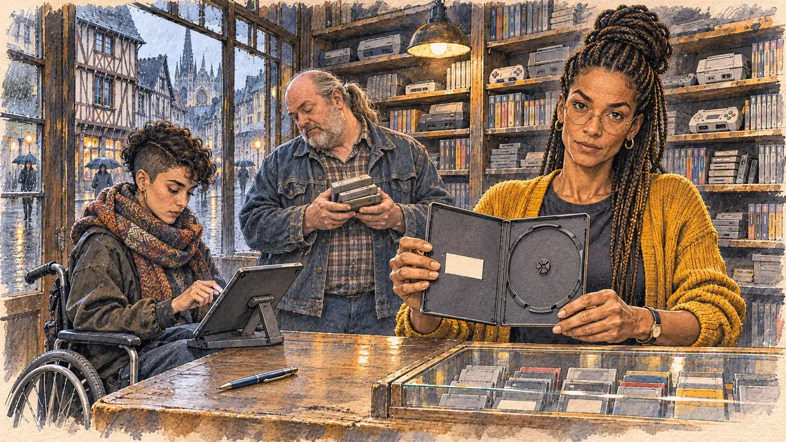

# `physicalGames` · La fin du jeu en boîte

**Retenue par le PO le 21/11/2026**, au premier essai, sans retouche. Elle sert telle quelle en clair et en sombre.



| Champ | Valeur |
| --- | --- |
| Carte | `physicalGames`, catégorie `institutions` (Institutions), poids 0,4 à son pic, sans autre condition, datée du 19/11 au 12/12/2026 et décroissante (`fade` : 1, 0,5, 0,25, 0,1 de la semaine du 15/11 à celle du 6/12) : seules les campagnes longues (#218) l'atteignent (Mitchnsun/moi-president, PO, 20/11/2026) |
| Style | Reportage dessiné |
| Ton | Observateur et légèrement ironique, la lumière grise et pluvieuse de Normandie par la vitrine, la lampe chaude de la boutique sur les visages |
| Date | 2026-11-21 |
| Outil | ChatGPT Images |
| Conversation | À remplir (le lien ne s'ouvre qu'avec le compte qui l'a créée) |
| Format rendu | 1672 × 941 (16:9) : export en 1290 × 726 px, WebP de qualité 75, 254 Ko, sans recadrage, fait depuis la copie WebP reçue (à refaire depuis le PNG d'origine) |
| Fichier d'origine | À compléter (hors du dépôt) |
| Première édition | À compléter |

## Texte de la carte

> **La fin du jeu en boîte**
>
> Le jeu de l'année se vend dans une boîte qui ne contient qu'un code de téléchargement : pas de disque. Des joueurs s'inquiètent de ne plus rien posséder, ni revente ni prêt, et une pétition pour « sauver » le jeu vidéo physique circule.

Réponses : « Laisser l'Union européenne trancher », « Un droit de propriété pour les jeux achetés en ligne », « Une loi française, sans attendre Bruxelles » (plus facile pour un souverainiste), « Rallier les associations de consommateurs contre les plateformes » (le pari risqué).

## Le moment choisi

Une boutique de jeux vidéo d'occasion du Vieux-Rouen, un après-midi de pluie : colombages et cathédrale par la vitrine. La gérante ouvre devant le candidat, hors champ au comptoir, la boîte du jeu de l'année, vide à part une petite carte, avec un regard ironique ; un collectionneur et ses vieilles cartouches ; une cliente signe la pétition sur une tablette. Le jeu est celui sorti le 19/11/2026, vendu sans disque (LCP, 03/07/2026) : la boîte ne reprend rien de lui.

## Prompt complet

Dans une nouvelle conversation, avec [`primeTime.webp`](../../illustrations/media/primeTime.webp) comme seule image de référence :

```
Use the attached image as the style reference and copy its drawing: a realistic reportage drawing made on the spot for a newspaper, with quick, nervous pencil lines, often drawn twice, ink hatching in the shadows, transparent watercolour washes that spill a little over the lines, and the warm paper showing through. Not the same scene and not the same people: never reuse the face or the hair of the woman in the reference.
Like in the reference, the setting can be full when the story needs it, with the things that say where we are and what is happening, but each one is sketched with a few pencil lines and a light wash, never rendered or finished, and the drawing gets looser and paler towards the edges until it fades into the bare paper.
This must look like a drawing made by hand on paper by a press illustrator, halfway between a quick sketch and a realistic picture: never a photograph, a film poster or a digital painting, and never a cartoon, a comic strip, a caricature or a children's book illustration. Continuous lines, never dotted or dashed outlines; no uniform texture, speckles or hatching filter laid over the picture; no glossy highlights, no smooth gradients, in the sky and on the walls too. Colour can be rich in places, on a piece of clothing, a light or a flag, but it stays transparent and within the palette below. The fade into the paper at the edges stays narrow, without a wide white margin. No blur and no depth-of-field effect: everything, the foreground included, is drawn sharp, like a sketch made on the spot.
People are drawn from life with realistic anatomy and proportions, like in the reference: faces shaped with pencil lines, hatching and light washes, a little more finished than the background but never photographic (no photographic skin, no airbrushed or digital-painting look). Expressions stay natural and restrained, even in laughter or tears: no exaggerated grins, no wide-open mouths full of teeth, no rubbery or cartoonish faces.

Editorial illustration, landscape 16:9 (1536 × 864 px), the scene filling the frame, with only a light fade into the paper at the edges. On a rainy afternoon in late November 2027, inside a small second-hand video game shop in the old town of Rouen, in Normandy: wooden shelves packed with used game boxes and old consoles, a glass case of old cartridges, a worn wooden counter, and through the shop window the half-timbered houses of old Rouen leaning over a wet cobbled street. On the counter, a tablet on a stand shows a petition page, nothing on it readable. The player's candidate stays off-camera, standing at the counter: in the foreground, only the candidate's pen lying on the counter at the bottom edge of the frame. In the right third, the main character, the shop's owner, a tall woman in her mid-thirties of Guadeloupean descent with long box braids gathered in a high bun, small round glasses, a strong jaw and a mustard-yellow cardigan over a dark T-shirt, holds open a brand-new game box towards the viewer to show that it is empty but for a small plain card: no disc inside. She looks at the viewer with a dry, ironic raised eyebrow, her face above mid-height. Behind her, a heavy-set white man in his mid-fifties with a long grey ponytail, a bald crown and a denim jacket, a collector, holds a stack of old cartridges and shakes his head at the empty box, eyes on the box. At the left end of the counter, a young woman of about twenty-five of Moroccan descent with a short undercut and a big scarf, in a wheelchair, signs the petition on the tablet with her finger, not looking at the viewer. Only the owner looks at the viewer. The new game box, the old boxes, the cartridges and the posters show no logo, no title and no character from any real game; nothing on the boxes, the card, the tablet, the shelves or the shop window is readable.

Style: Reportage drawing made on the spot, like a press illustrator or courtroom sketch artist: pencil and ink with loose watercolour washes, lively unfinished lines, white paper showing through.

Palette: navy #13203F, vellum #F5EFE1, gold #A9802A, brick #B5523B, ochre #D9A441, sage #8FA58A, slate #5E7186, sand #DCC8A4, warm grey #8C8279; use 4 to 6 of them, subtle warm paper grain.

Tone: observant and gently ironic, the grey rainy light of Normandy through the window and the warm lamplight of the shop on the faces.

Constraints: realistic proportions, natural expressions, never cartoonish or caricatured faces, drawn like the rest of the illustration and never photographic; people of varied ages, genders, origins and body types (heavy, stocky, round, tall, short, wiry, not only slim), each with a distinct face and haircut (no two people alike), drawn with respect and never as a joke; each person's age, build and look plausible for their job and the scene (working people of working age), every person an adult, no stereotype tying an origin or a gender to a role, and no person of colour shown alone in a featured service or deferential role; anatomically correct hands with exactly five fingers, few hands visible, the others in pockets, behind objects or out of frame; no readable text anywhere (the game boxes, the card in the box, the cartridges, the tablet, the posters, the shelves and the shop window stay unreadable); no captions or speech bubbles; no logos, no console brand, no real video game's title, logo, characters or visual identity, no political party colours; no recognisable real person, no lookalike of a real politician; no weapons and no violent imagery, even on the boxes; no explicit violence; no photographic rendering, no blur or bokeh, no dotted outlines, no texture or hatching filter over the picture, no oil-paint texture, no wide white margin or frame (a light fade into the paper at the edges is fine).

Format: if 16:9 is not available, make 1536 × 1024 and keep the top 80 px and the bottom 80 px free of anything important (faces, hands, the main action): they will be cropped.
```

## Décisions prises sur cette image

Retenue par le PO (21/11/2026). Les consoles et les manettes en rayon rappellent par leurs formes des consoles des années 1990, sans logo ni nom : le gabarit permet les ressemblances avec des objets qui existent.

## Essais écartés

Aucun.

## Retouches

Aucune.

## Relecture

Faite le 21/11/2026 sur l'image reçue, zoomée sur le texte possible, les rayons et les mains ; retenue par le PO le même jour.

- [x] Aucun texte lisible : boîte, petite carte, tablette, tranches des boîtes, cartouches et vitrine sans inscription.
- [x] Rien du jeu sorti le 19/11/2026 : un boîtier noir ouvert, le support du disque vide, une carte blanche.
- [x] Le candidat du joueur est hors champ : seul son stylo sur le comptoir au premier plan.
- [x] Écarts au prompt : le collectionneur regarde ses cartouches plutôt que la boîte ; la flèche de la cathédrale de Rouen au bout de la rue.
- [x] Rendu : un grain craquelé couvre l'image, surtout sur le comptoir et les vestes, la dérive que le gabarit signale ; le PO l'a gardée telle quelle.
- [x] Aucun sosie d'une personne réelle repéré ; aucun logo de console ni de jeu.
- [x] Mains sans défaut visible.
- [x] Aucune couleur, aucun logo ni aucun drapeau de parti. Des personnes variées par l'âge, le corps, l'origine, la coiffure et le handicap ; toutes adultes.
- [x] En 16:9 : pas de recadrage.
- [ ] Lisible sur la page de l'événement, en clair et en sombre : à vérifier dans l'app, une fois la carte publiée.
