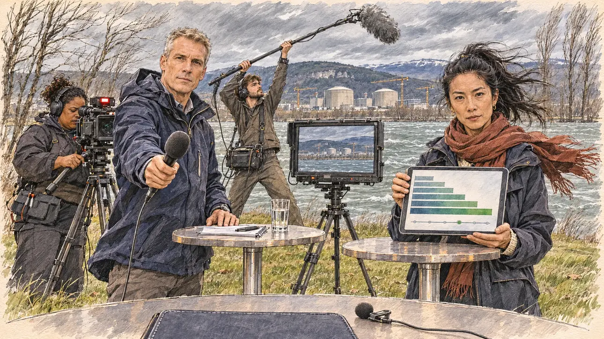

# `reactorBill` · La facture des nouveaux réacteurs

**Validée par le PO le 20/11/2026**, au premier essai, avec `primeTime.webp` comme référence. Elle sert telle quelle en clair et en sombre.



| Champ | Valeur |
| --- | --- |
| Carte | `reactorBill`, catégorie `institutions` (Institutions), poids 0,2, à partir de l'officialisation, une carte du programme : tirée si le programme tient de nouveaux réacteurs (`newReactors`, `nuclearAndRenewables`) ; exclut `energySpike`, une histoire des réacteurs par partie (Mitchnsun/moi-president, PO, 17/11/2026) |
| Style | Reportage dessiné, trait de `primeTime` |
| Ton | Tendu, ciel gris et venteux sur la vallée du Rhône |
| Date | 2026-11-20 (prompt écrit le 2026-11-18) |
| Outil | GPT 6.2 Astra |
| Conversation | À remplir (le lien ne s'ouvre qu'avec le compte qui l'a créée) |
| Format rendu | 1672 × 941 (16:9) : export en 1290 × 726 px, WebP de qualité 75, 233 Ko, sans recadrage |
| Fichier d'origine | Image chez le PO. L'export du dépôt a été fait depuis la copie partagée dans la conversation avec Claude |
| Première édition | `kit-france-2611-0004` |

## Texte de la carte

> **La facture des nouveaux réacteurs**
>
> Sur une chaîne d'information, une économiste de l'énergie compare les devis successifs des nouveaux réacteurs et le calendrier des chantiers. Elle vous demande qui paiera, et si l'on construira à temps.

## Le moment choisi

Un plateau en extérieur d'une chaîne d'information sur une digue herbeuse au bord du Rhône, dans l'Ain, en amont de Lyon, un après-midi gris et venteux de mars : sur l'autre rive, une centrale nucléaire et les grues d'un chantier neuf, les collines boisées du Bugey et, au loin, le Jura. Le candidat est l'invité du duplex, hors champ : au premier plan, le bord de son dossier fermé et son micro-cravate sur son fil. L'économiste de l'énergie tient une tablette où s'allongent des barres et glisse une frise de calendrier, sans aucun chiffre, et regarde le candidat : qui paiera, et construira-t-on à temps ? Le présentateur tend son micro ; une cadreuse et un preneur de son travaillent dans le vent. La carte rappelle le devis des six EPR2 passé de 51,7 à 67,4 milliards d'euros fin 2023 et l'avis de la Cour des comptes : personne n'y ressemble à une économiste connue.

## Prompt complet

Dans une nouvelle conversation, avec [`primeTime.webp`](../../illustrations/media/primeTime.webp) comme seule image de référence :

```
Use the attached image as the style reference and copy its drawing: a realistic reportage drawing made on the spot for a newspaper, with quick, nervous pencil lines, often drawn twice, ink hatching in the shadows, transparent watercolour washes that spill a little over the lines, and the warm paper showing through. Not the same scene and not the same people: never reuse the face or the hair of the woman in the reference.
Like in the reference, the setting can be full when the story needs it, with the things that say where we are and what is happening, but each one is sketched with a few pencil lines and a light wash, never rendered or finished, and the drawing gets looser and paler towards the edges until it fades into the bare paper.
This must look like a drawing made by hand on paper by a press illustrator, halfway between a quick sketch and a realistic picture: never a photograph, a film poster or a digital painting, and never a cartoon, a comic strip, a caricature or a children's book illustration. Continuous lines, never dotted or dashed outlines; no uniform texture, speckles or hatching filter laid over the picture; no glossy highlights, no smooth gradients, in the sky and on the walls too. Colour can be rich in places, on a piece of clothing, a light or a flag, but it stays transparent and within the palette below. The fade into the paper at the edges stays narrow, without a wide white margin. No blur and no depth-of-field effect: everything, the foreground included, is drawn sharp, like a sketch made on the spot.
People are drawn from life with realistic anatomy and proportions, like in the reference: faces shaped with pencil lines, hatching and light washes, a little more finished than the background but never photographic (no photographic skin, no airbrushed or digital-painting look). Expressions stay natural and restrained, even in laughter or tears: no exaggerated grins, no wide-open mouths full of teeth, no rubbery or cartoonish faces.

Editorial illustration, landscape 16:9 (1536 × 864 px), the scene filling the frame, with only a light fade into the paper at the edges. An outdoor live set of a news channel on a grassy embankment on the bank of the Rhône, in the Ain, upstream of Lyon in eastern France, on a grey, windy afternoon in March 2027: a small platform with two standing tables and a monitor on the embankment, and across the wide, fast grey-green river, a nuclear power plant with its reactor buildings and the tall cranes of a new construction site beside it, poplars along the banks, the wooded hills of the Bugey and, far away, the first ridges of the Jura. An energy economist compares the successive estimates and the calendar of the new reactors and asks the player's candidate who will pay. The player's candidate is the guest of the live and stays off-camera: in the foreground, only the edge of the candidate's closed folder and a clip-on microphone on its cable. In the right third, the main character, the energy economist, a woman in her late thirties of Chinese descent, short and wiry, with a long black ponytail whipped by the wind and a brick-red scarf, holds a tablet showing only bars that grow longer and a sliding timeline, with no figures and no words, and looks at the viewer with a precise, insistent look, her face above mid-height. Beside her, the presenter, a tall white man in his forties with a blond-grey crew cut and a navy windproof jacket, holds his microphone towards the viewer. Behind them: a camera operator, a heavy-set woman in her forties of Guadeloupean descent with headphones, films; a sound technician, a thin young man with a beard, holds a boom against the wind. Only the economist and the presenter look at the viewer. Nothing on the tablet, the monitor, the microphones, the folder or the plant is readable.

Style: Reportage drawing made on the spot, like a press illustrator or courtroom sketch artist: pencil and ink with loose watercolour washes, lively unfinished lines, white paper showing through.

Palette: navy #13203F, vellum #F5EFE1, gold #A9802A, brick #B5523B, ochre #D9A441, sage #8FA58A, slate #5E7186, sand #DCC8A4, warm grey #8C8279; use 4 to 6 of them, subtle warm paper grain.

Tone: tense, a grey windy sky over the river valley, the grey-green water of the Rhône and the bare poplars, the brick-red scarf as the warm note.

Constraints: realistic proportions, natural expressions, never cartoonish or caricatured faces, drawn like the rest of the illustration and never photographic; people of varied ages, genders, origins and body types (heavy, stocky, round, tall, short, wiry, not only slim), each with a distinct face and haircut (no two people alike), drawn with respect and never as a joke; each person's age, build and look plausible for their job and the scene (working people of working age), no stereotype tying an origin or a gender to a role, and no person of colour shown alone in a featured service or deferential role; anatomically correct hands with exactly five fingers, few hands visible, the others in pockets, behind objects or out of frame; no readable text anywhere (the tablet, the monitor, the microphones, the folder and the plant stay unreadable, no ticker, no on-screen captions, no numbers); no captions or speech bubbles; no logos, no television channel logo, no energy company logo, no political party colours; no recognisable real person, no lookalike of a real politician or of a known economist or presenter; no explicit violence, no smoke and no steam plume, no accident, no alarm; no photographic rendering, no blur or bokeh, every outline a continuous pencil or ink line with no dotted or dashed outlines, no mottled, crackled or speckled texture over the faces, the clothes, the river or the sky, no hatching filter over the picture, no oil-paint texture, no glow or halo, no wide white margin or frame (a light fade into the paper at the edges is fine).

Format: if 16:9 is not available, make 1536 × 1024 and keep the top 80 px and the bottom 80 px free of anything important (faces, hands, the main action): they will be cropped.
```

## Décisions prises sur cette image

- **Au bord d'un fleuve, pas de la mer** (PO, 20/11/2026) : le premier prompt plaçait la centrale au pied des falaises du pays de Caux, au bord de la Manche ; le PO ne veut pas d'une centrale au bord de l'océan. Le plateau passe au bord du Rhône, dans l'Ain, en face d'une centrale et de son chantier neuf, sans panache de vapeur.

## Essais écartés

Aucun.

## Retouches

Aucune.

## Relecture

Faite et validée par le PO le 20/11/2026.

- [x] Aucun texte lisible : la tablette ne montre que des barres et une frise, sans chiffres ; rien sur l'écran, les micros, le dossier ni la centrale ; aucun bandeau.
- [x] Aucun sosie d'une personne réelle.
- [x] Le candidat du joueur est hors champ : le bord de son dossier fermé et son micro-cravate au premier plan.
- [x] Mains, visages et foules sans défaut visible à 343 px de large.
- [x] Aucune couleur ni aucun logo de parti. Aucun logo de chaîne ni de compagnie d'énergie ; ni fumée, ni panache, ni alarme. Des personnes variées par l'âge, le corps, l'origine et la coiffure.
- [x] En 3:2 : sans objet, l'image est en 16:9.
- [x] Lisible sur la page de l'événement, en clair et en sombre.

Ce que la relecture a accepté : le Rhône agité de vagues par le vent ; le moniteur du plateau montre la centrale ; un carnet et un verre d'eau sur la table du présentateur.
